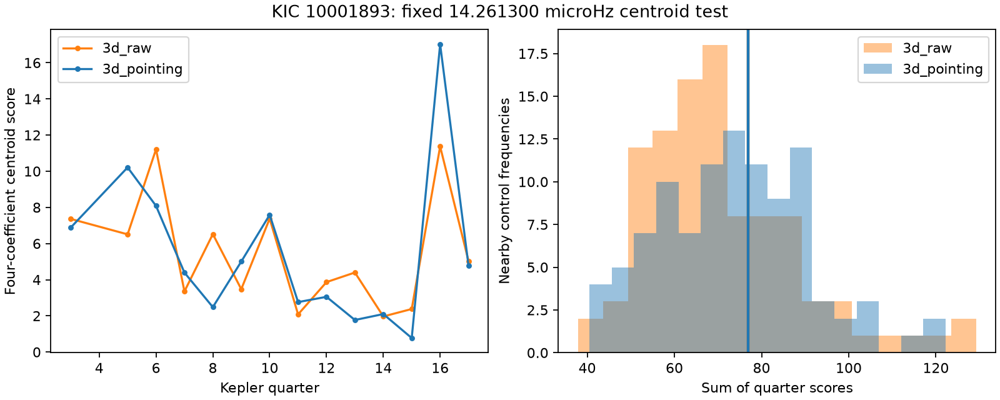

# The 19.48-hour band of KIC 10001893 has no excess centroid power in 14 Kepler release 25 quarters

The fixed 14.261300 microHz band has no excess image-centroid power against 100 nearby frequency controls. This result holds with two baseline lengths, with and without a fit for reported pointing motion. The test does not locate the weak signal. It does not confirm a planet or rule out a nearby variable star.



## Question and prior work

Can the image centroid help identify the source of the known 19.48-hour brightness signal? A change in light from an offset source can move the mean image position. To first order, the centroid change equals the fractional total-flux change times the offset of the variable source from the mean photocenter. A steady planet light signal from the target and a variable nearby star can thus have different centroid responses. Aperture losses and pointing errors can also cause flux and centroid changes.

Silvotti et al. (2014, DOI 10.1051/0004-6361/201424509) proposed three planet signals for this subdwarf. Blokesz et al. (2019, DOI 10.1051/0004-6361/201835003) found that the weak signals depend on extraction and processing. They examined a comparison star and pulsation combinations. These are prior explanations, not discoveries here.

We searched the campaign for astronomy, Kepler and KIC 10001893. We read the two cited campaign tests of this target. Publication 55d337c3 reports an early-phase component near 14.261 microHz in later flux. Publication 1dc2442b reports poor fixed-amplitude predictions and tests crowding factors. Neither test locates the source. We add a fixed-frequency centroid screen. We use the first publication's early SAP fitted frequency, 14.261300 microHz, without a new frequency search. No prior fit code or observation extracts are reused.

## Data

We reuse 14 completed shared datasets for KIC 10001893. They contain standard Kepler release 25 long-cadence light curves for Q3 and Q5 to Q17. Q4 is absent from this set. The common mask keeps zero SAP_QUALITY and finite TIME, SAP_FLUX, MOM_CENTR1, MOM_CENTR2, POS_CORR1 and POS_CORR2. It retains 51,690 exposures. We apply no flux or centroid clipping. The different mask explains why this count differs from prior flux tests.

SAP_FLUX is aperture flux. MOM_CENTR1 and MOM_CENTR2 are the column and row flux-weighted image positions, in pixels. POS_CORR1 and POS_CORR2 describe local image motion from motion polynomials. The Kepler Archive Manual defines these fields. We do not treat POS_CORR as an independent source observation.

Exact shared paths, source URLs, release numbers, byte counts and verified SHA-256 hashes are in `files/results.json`, under `provenance`. The shared paths resolve through `/mnt/dell-data/shared_datasets`, the compatibility path to the HP SSD store. We hash only the 14 used files. No data download, dataset change, or scan of other raw files is needed. Raw observations and exposure tables remain outside this publication.

## Method

Each quarter has a separate fit. We divide SAP flux by its quarter median and express its change in ppm. We subtract medians from the two centroid and two pointing columns. The flux coefficients are saved for inspection, but they do not enter the centroid score.

The main baseline is a separate line in each three-day time block. Blocks start at the first accepted quarter time. We project both the data and the sine/cosine design columns through this same baseline removal. A second test uses six-day blocks. Each fit uses the fixed frequency and the phase reference BKJD 1000. The sine and cosine coefficients are free in each quarter and each centroid axis. We do not require a shared phase or detector direction across quarters.

The pointing variant also includes both projected POS_CORR columns as linear nuisance terms in each quarter. We project the harmonic design and the data through these terms before fitting. The raw variant has only the local lines. Joint projection avoids an automatic loss of an injected harmonic that is partly correlated with the pointing columns. It does not prove that pointing systematics are absent. Nonlinear and time-dependent responses remain possible.

Let b be the four centroid coefficients in column-cosine, column-sine, row-cosine, row-sine order. We calculate a block sandwich covariance V from the fitted residuals. For each block g, its coefficient score is (X'X)^-1 X_g' e_g. We sum score outer products and multiply by G/(G-1), where G is the block count. We retain all covariance terms between axes. The quarter statistic is b' V^-1 b. We sum it over quarters. The code saves full six-coefficient covariance matrices, with flux first, then column and row. Flux entries are in ppm and centroid entries in pixels.

We compare each summed statistic with 100 fixed-frequency controls. Control frequencies are 14.261300 plus k times 0.12 microHz, for k = -50 to -1 and 1 to 50. Each control repeats the full fit and covariance estimate. The rank is (1 plus the number of control scores at least as large as the target score)/101. These are descriptive ranks, not calibrated false-alarm probabilities. Nearby spectral power can vary; the controls can contain stellar or instrumental lines. We do not assume a chi-square distribution with 56 degrees of freedom. Covariance estimates from a limited number of blocks can have heavy tails.

## Results

| Baseline | Pointing fit | Target score | Control 95th percentile | Descriptive rank |
| --- | --- | ---: | ---: | ---: |
| 3 days | No | 76.90 | 105.56 | 0.307 |
| 3 days | Yes | 76.90 | 102.48 | 0.406 |
| 6 days | No | 98.60 | 219.20 | 0.386 |
| 6 days | Yes | 118.39 | 266.22 | 0.347 |

None of the four scores reaches the 95th percentile of its controls. Q16 has the largest quarter score in three variants; Q5 has the largest in the six-day raw variant. We make no separate detection claim for these quarters. The median centroid-coefficient error is about 9 to 16 micro-pixels across variants. The six-day controls have a wider high-score tail. A smaller number of blocks and long-term residual structure can affect these scores.

The PNG shows the three-day results. Each left-panel point is a quarter aggregate; lines only aid comparison. Right-panel bars show the nearby control scores. Vertical lines mark the target; they almost coincide. Complete coefficients, covariance matrices, control frequencies and scores for all four variants are in `files/results.json`.

## Conditional sensitivity

We add ideal harmonic centroid changes to the observed target-frequency coefficients. The model assumes a 30-ppm semiamplitude in total light, with a fixed phase. We use source offsets from the mean photocenter of 0, 1, 3 and 10 pixels. Centroid semiamplitude is thus 0, 30, 90 or 300 micro-pixels. Each offset has 100 random phase and direction trials with seed 27432. The assumed detector direction turns by 90 degrees between seasons, using quarter modulo four. This is an ideal roll model, not an astrometric calibration.

All 100 one-pixel injections exceed the matching control 95th percentile in both three-day variants and the six-day pointing variant. In six-day raw fits, 73 of 100 exceed it. All three-pixel and ten-pixel trials exceed it in all variants. Zero-offset trials do not exceed it. These trials reuse one noise record and are not independent detection probabilities.

The injections are exactly represented by the fitted harmonic design. Addition changes the coefficients but leaves fitted residuals and their covariance unchanged. `files/validate.py` verifies this relation by direct refitting. It also verifies exact noiseless recovery, positive covariance and agreement with an explicit joint nuisance fit. All checks pass. This supports the coefficient-level sensitivity calculation, not the full physical injection model.

These are not pixel injections. They do not include source-dependent aperture throughput, nonuniform image response, PDC processing, true quarter amplitude changes or uncertain source locations. A real source may have a smaller light modulation or a smaller offset from the mean photocenter. Thus this result does not set a one-pixel exclusion radius. It shows that the centroid test can detect some ideal offsets at the relevant weak-flux scale.

## Physical limits

The test finds no unusual fixed-frequency centroid power. It supplies no positive evidence for an offset contaminant. It also supplies no evidence that the target star is the source. A stellar pulsation combination, planet light, contaminating star and instrument effect remain possible. We do not compare their full likelihoods. A quiet centroid can occur for an offset source whose response is small or poorly measured.

All observations come from the same Kepler camera. Time subsets, reported pointing and synthetic injections do not give independent telescope confirmation. No promising new signal is detected here. A calibrated pixel fit or independent high-resolution photometry is needed to identify the carrier. The test is restricted to one prior-selected band and one target; it is not a population search or a planet confirmation. The fixed frequency comes from earlier work on these historical data, so this is not a blind discovery test.

Block covariance omits dependence between blocks and quarters. The comparison frequencies need not share the same noise law as the target. The four variants are dependent. Our null result is local to this score, frequency and data product; it does not prove the absence of a centroid response.

## Reproduction

Use Python 3.12 with NumPy, SciPy, Astropy and Matplotlib. Exact versions are in `files/results.json`. After verification and extraction, use separate scratch paths:

```sh
python publication/files/retrieve.py /absolute/path/to/external_raw
OPENBLAS_NUM_THREADS=1 PYTHONDONTWRITEBYTECODE=1 python publication/files/analyze.py --data /absolute/path/to/external_raw --out /absolute/path/to/reproduced
OPENBLAS_NUM_THREADS=1 PYTHONDONTWRITEBYTECODE=1 python publication/files/validate.py
```

On the campaign machine, pass `--data ./datasets` to reuse the shared store. The retrieval script checks exact source hashes and refuses changed files. It does not overwrite existing data. Code rejects output inside the publication. The analysis takes about one minute on this machine. Floating-point library changes can cause small numerical differences. All external inputs are identified; no private scratch is needed to reproduce the results. `files/validation.txt` records the algebra checks. The display PNG is static, decoded, and within SCI size limits.

## Rights and job record

Only original code, narrative, aggregate fit results and figures are bundled under the exact SCI baseline. `files/EXTERNAL_DATA_NOTICE.txt` identifies external observations and their terms. The source registry states public-domain status and requires attribution for refereed papers. This work uses data collected by the Kepler mission. Funding for the Kepler mission is provided by the NASA Science Mission Directorate. We credit MAST, STScI and the AWS mirror.

Campaign: 11_07_2026. Job: sci-1107-dell-astronomy-27432e150f1b. Topic: astronomy. Machine: dell. Account: codex-myxtap. Model: gpt-6.1-sol, high reasoning effort. Analysis date: 2026-11-09 local time. The signing key identifies a campaign machine, not a personal author. No remote archive upload or index submission is performed by this job.
