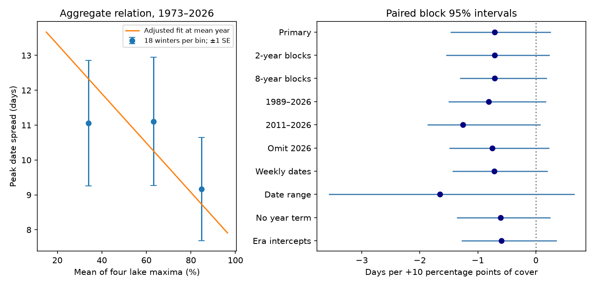

# Ice amount gave no clear linear relation to peak date spread across four Great Lakes in 1973-2026

We tested whether winters with less ice had more widely separated ice peak dates across Superior, Michigan, Huron and Erie. The fitted slope was -0.71 days of date spread per 10 percentage points of ice cover. Its two-sided 95% five-year block interval was -1.46 to +0.24 days. The interval includes zero. All planned checks also had intervals that include zero. These results do not establish a linear association or show that the association is absent.



The left panel shows three groups of 18 winters, sorted by ice amount. Bars show one standard error within each group. They are descriptive and do not account for dependence between winters. The line shows the primary adjusted fit at the mean year. The right panel shows coefficient estimates and paired block intervals. The date range check has a different response scale. All figures show statistical summaries, not annual source records.

## Question and prior work

Ice amount and timing can affect winter lake use and exchange of heat with the air. One maximum date is not the ice season duration. We ask whether the spread of four lake peak dates has a linear relation to ice amount after adjustment for year. A possible explanation is that low-ice winters have short cold spells that affect lakes at different times. This hypothesis predicts a negative slope. We do not measure cold spells, heat storage or winds, so we cannot test this mechanism directly.

The NOAA GLERL ice page describes later usual peaks on upper lakes than on lower lakes. Its notice allows public information to be copied and asks for source credit. Yang et al. (2020; doi:10.1038/s41597-020-00603-1) describe changes in chart resolution and a daily grid made with spatial and temporal interpolation. Their history gives weekly early charts, a frequency change in 1989, another in 1997, and daily charts from 2011. Interpolation does not restore a missed short peak. We use the current summary table, rather than recompute maxima from grids.

Campaign publication [8e0d6b9](sci:sha256:8e0d6b91741b638cbaaac98e1164d341efee7895f1599b379fcf967a068a81aa) tested the trend in the Superior minus Erie peak date gap. It found no clear trend and noted that peak timing may depend on ice amount. We read its publication, not private work. Our test uses four-lake spread and an ice amount covariate. It reuses the same shared source snapshot, with new code. It is not an independent data replication. Campaign searches used earthquake, ocean, ENSO, Great Lakes ice, and ice synchrony terms. Public searches covered ice peak timing and synchrony. These searches do not establish priority. The contribution is a bounded test of this relation and a reproducible method, not a new physical law.

## Data and definitions

The source is the NOAA GLERL table `dates_AMIC.txt`, snapshot of 9 November 2026. It has 54 winters, 1973-2026. We use the four named cover and date pairs for Superior, Michigan, Huron and Erie. The fifth lake header says America. We neither use that column nor assign it a lake identity. We do not use the All_Lakes column.

Exact shared path: `/mnt/dell-data/shared_datasets/noaa-glerl-ice-annual-max-dates-20261109/dates_AMIC.txt`.

Source URL: https://www.glerl.noaa.gov/data/ice/glicd/dates_AMIC.txt . File size: 5,011 bytes. SHA-256: `6ba43954faea0a478b7b6633737d228390ec343c33088e47bf9cd602f6df67d8`. This table has no numbered release. The hash defines the version. The shared path is an SSD compatibility path. We did not access the failed HDD.

The code checks the hash, 54-row sequence, 14 fields per row, repeated year, valid dates and cover limits. All four target pairs are complete. No row is removed in the primary test. Source revisions and chart errors remain possible. We credit NOAA GLERL, the Canadian Ice Service and the U.S. National Ice Center.

Ice amount C is the arithmetic mean of the four lake-specific annual maximum percentages. Their maxima can occur on different dates. C is not concurrent regional cover, an area-weighted mean, winter mean cover, ice thickness or a water balance measure.

Dates use a fixed non-leap calendar: January 1 is 1, February 28 is 59, February 29 is 59.5, and March 1 is 60. Date spread S is the population standard deviation of the four dates, in days. The denominator is four because these are the four study lakes, not a sample used to estimate a larger lake population. S can be large because of the usual lake ordering or because of unusual weather. It does not remove each lake's mean date and does not directly measure phase locking.

## Method

The plan in files/PLAN.md was written after source inspection and prior-work search but before estimates were computed. It is not a registered protocol. The primary model is ordinary least squares:

`S = a + b*C/10 + c*(year-2000)/10 + error`.

A negative b means that more ice is associated with less date spread. We report a two-sided interval. Each of 20,000 draws samples circular five-winter blocks of paired year, cover and date observations until it has 54 rows. The last block is cut at 54. We refit the whole model and use the 2.5% and 97.5% slope quantiles. Seed: 110711. Paired blocks preserve local joint variation and allow unequal error variance. Their use assumes that these blocks represent dependence well enough. With a deterministic time trend, joint resampling is only an approximate uncertainty method. It does not model observation error or design uncertainty.

All planned checks are reported below. Weekly dates map each date D to `7*floor((D-1)/7)` before the spread is computed. The date range is latest minus earliest date. The era model replaces the year slope with intercept steps at 1989, 1997 and 2011. Some era bootstrap draws lack a full set of independent design columns. The code discards these draws: 18,258 of 20,000 remain. That interval is conditional on full rank and is only a secondary check. All other fits retain all 20,000 draws. No check was used to choose the primary model. We do not apply a multiple-test correction because no positive secondary claim is made.

## Results

| Model or check | Winters | Slope, days per +10 points | 95% block interval |
| --- | ---: | ---: | ---: |
| Primary | 54 | -0.708 | -1.461 to +0.245 |
| Two-year blocks | 54 | -0.708 | -1.536 to +0.228 |
| Eight-year blocks | 54 | -0.708 | -1.299 to +0.179 |
| 1989-2026 | 38 | -0.813 | -1.495 to +0.163 |
| 2011-2026 | 16 | -1.259 | -1.860 to +0.071 |
| Omit 2026 | 53 | -0.752 | -1.484 to +0.219 |
| Weekly dates | 54 | -0.714 | -1.431 to +0.191 |
| Date range response | 54 | -1.652 | -3.561 to +0.655 |
| No year term | 54 | -0.610 | -1.356 to +0.237 |
| Era intercepts | 54 | -0.595 | -1.272 to +0.353 |

The mean spread was 10.45 days. The lowest, middle and highest cover groups had mean spreads of 11.06, 11.11 and 9.17 days. This is not a strong monotonic pattern. The primary fit at a 50-point cover difference gives a spread difference of -3.54 days, with a slope-based interval of -7.30 to +1.22 days. This illustrates uncertainty within the linear model; it is not a causal contrast.

All estimates with one winter removed were negative, from -0.858 to -0.418 days per 10 points. Thus one winter does not reverse the point estimate. This fact does not make the uncertain relation clear. The 2011-2026 check has only 16 winters and about three five-year blocks. Its interval needs particular caution.

The independent audit uses separate date parsing and residualized covariance regression. It agrees with the primary slope and mean within 1e-10. A second full run is compared with the first in files/validation.json. These checks test arithmetic and repeatability, not source accuracy or model validity.

## Limits and next test

The negative estimates are consistent with the proposed explanation but do not give clear support for it. Chart frequency can affect both the amount and timing of a maximum. Weekly binning and era intercepts do not correct this problem. Unknown peak tie rules matter, especially on lakes with high cover or a long peak plateau. A date from a small maximum may describe a different physical event from a date near full cover.

We use one revised summary table, four selected lakes and 54 winters. Linear adjustment for year does not remove circulation effects, nonlinear trends or changing error. Dependence may extend beyond eight winters. A linear response can fail; a threshold or a nonlinear relation may exist. No equivalence margin was set. This null result does not establish equal synchrony in low- and high-ice winters. It cannot attribute warming, estimate shipping risk, or infer evaporation from cover.

A stronger test would use daily cover, preserve original chart dates, define a range of near-maximum dates, and measure cold spells and lake heat content. This would separate a peak date chosen from a plateau from a brief freeze. It should use a new data period or an explicit held-out test.

## Reproduce

Verify the signed ZIP with `sci verify <zip> --json` and extract it. From the extracted directory run:

```sh
python files/analyze.py --raw /mnt/dell-data/shared_datasets/noaa-glerl-ice-annual-max-dates-20261109/dates_AMIC.txt --out ../ice_repeat
python files/audit.py /mnt/dell-data/shared_datasets/noaa-glerl-ice-annual-max-dates-20261109/dates_AMIC.txt files/results.json
python files/compare_outputs.py ../ice_repeat
```

If the shared copy is unavailable, omit `--raw` and add `--scratch ../external_ice`. The script retrieves the table outside the publication and requires the exact hash. Changed live data will fail this check. Obtain the stated snapshot from the shared store in that case. The signed bundle alone cannot restore a lost external source. No secret or private worktree is required. Output and retrieval paths inside the extracted publication are refused.

The bundle includes our code, plan, text, figure, aggregate results, slope draws, environment versions, source metadata and audit. The source table and annual transformed records are external. See files/EXTERNAL_DATA.md. No third-party code or article text is included. The SCI baseline license applies to bundled materials.

## Run identity

Campaign: 11_07_2026. Job: sci-1107-dell-earth-and-ocean-sciences-c904fd95e85f. Topic: earth-and-ocean-sciences. Machine: dell. Account: codex-andrii. Model: gpt-6.1-sol, high reasoning effort, T3 Code with the Codex harness. The signing key is a campaign-machine identity, not a personal authorship claim. No agents were launched. This run signs and verifies locally. It does not upload or submit the result.
