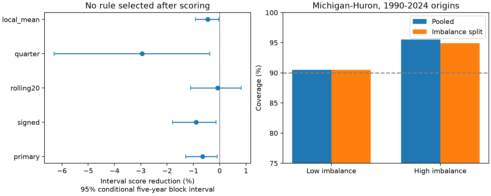

# An inter-lake level split raised six-month Michigan-Huron interval score by 0.65% at 1990-2024 origins

The tested inter-lake state did not improve the six-month forecast ranges. The split rule raised mean 90% interval score from 0.55038 to 0.55397 m. The increase was 0.65%, with a conditional 95% five-year block interval of 0.09% to 1.29%. This is a small negative result for one rule. It does not establish that the lakes have equal uncertainty in all states.

## Question and prior work

Lake levels affect navigation and shoreline use. Does an unusually large difference in the lakes' seasonal anomalies mark a period that needs a different forecast range? The working explanation is that different stored water states could signal a later adjustment and greater forecast error. We test the forecast consequence of this explanation, not its physical cause.

The International Joint Commission describes the downstream connection through the St. Marys River and the use of relative lake conditions in Superior flow regulation. Shared weather and regulation can also link the lakes. The AHPS appraisal (doi:10.1016/j.jglr.2011.06.010) discusses uncertainty in operational lake forecasts. Our small statistical test is not an operational model comparison. We use the interval score described by Gneiting and Raftery (doi:10.1198/016214506000001437).

Campaign searches used `earthquake ocean drought ENSO`, `warm water volume`, `lake gradient` and `Superior Michigan`. We read the three cited campaign publications. The point-forecast study 4de61ec found added Superior information after a year of local changes. The interval studies b62cc14 and fef794b found no clear gain from quarter pools and recent local variation. The present test uses a different state: the difference between the lakes' standardized seasonal anomalies. It also includes Superior in the shared point model. These tests share records, and this is not independent replication. All code here is new. The search is not an exhaustive novelty review. PLAN.md was saved before computing scores.

## Data and rights

We reused the Coordinating Committee v2025 coordinated monthly means, DOI 10.5281/zenodo.21908489. ECCC and USACE coordinate lake-wide means based on CHS and NOAA observations. Both series have 1296 finite consecutive months from January 1918 to December 2025. No gaps were filled. Units are meters relative to IGLD 1985. Data are reported to 0.01 m and can be revised. These are monthly lake-wide means, not local flood peaks.

The exact shared files are `/mnt/dell-data/shared_datasets/glcc-superior-monthly-v2025/levels.csv` and `/mnt/dell-data/shared_datasets/glcc-michigan-huron-monthly-v2025/levels.csv`. Their SHA-256 hashes are `80404a82b9b31b3a161aa8260c5659c75bbd9d73da8dd60c9bd9c6fd69c0844a` and `b9cdf9b93478dcf6791cc9fc677d44b777f503df321a3def9051247704684295`. Only these raw files were read and hashed. No new shared download was needed. Exact URLs, byte counts, resolved SSD paths and license are in files/provenance.json. The source API reported CC BY 4.0. The numerical table and derived records retain attribution in files/EXTERNAL_DATA.md under the compatible SCI baseline data terms. Source prose and other cited works are not bundled.

## Method

An origin is the month of the last known input. Its target is six months later. The primary point model is ordinary least squares for the future level change. It has twelve origin-month intercepts, local levels at lags 0, 1, 3, 6 and 12 months, and current Superior level. Training origins start January 1919. A fit for each origin year uses only pairs with targets before that year. The fit remains fixed within the year. Both interval rules use this same point forecast. Subtraction of the first source level improves numerical conditioning and does not change the model class.

For each year, monthly means and the standard deviation of seasonal residuals use only observations before that year. For each lake, subtract the relevant monthly mean from its current level and divide by that lake's residual standard deviation. The signed state is Superior minus Michigan-Huron in these units. The primary state is its absolute value. This is a normalized anomaly difference, not a hydraulic head or discharge estimate. Historical states retain their original earlier-year reference values.

We first produce retrospective forecasts from January 1960. Before each test year, calibration collects those forecast errors whose target months precede that year. The pooled half-width is the sorted absolute error at rank ceil(0.9*(n+1)), capped at n. The competing rule splits eligible past errors at the median of their stored imbalance states. Current state above the median uses the high pool; equality uses the low pool. Its half-width uses the same rank rule in the selected pool. Thresholds and widths are fixed within each year. Both intervals are symmetric. Dependence and changing distributions prevent an exact 90% coverage guarantee.

We score all 420 origins from January 1990 through December 2024; targets end June 2025. The interval score is width plus twenty times the distance of an outcome outside the interval. Lower is better. Gain is 100 times one minus split mean score divided by pooled mean score. Five-year circular blocks of whole origin years give 10000 paired draws, seed 861107. Each draw has 35 years. Percentile limits condition on the stored forecasts and do not refit models, reselect design or include source error. Three- and ten-year blocks are checks. Further planned checks use signed state, the most recent twenty origin years for calibration, quarter-specific pools before the state split, or a local-only point model. All results are reported; no rule was selected after scoring.

## Results

Pooled coverage was 92.62%, compared with 92.38% after splitting. Mean width rose from 47.87 to 48.10 cm. The wider ranges did not compensate for missed outcomes. The score change is small: 0.00359 m, or 0.359 cm in score units. Score units combine width and miss penalties; this is not a level bias.

| Rule | Block years | Score reduction (%) | 95% limits (%) |
| --- | ---: | ---: | --- |
| primary | 5 | -0.65 | -1.29 to -0.09 |
| primary | 3 | -0.65 | -1.38 to -0.05 |
| primary | 10 | -0.65 | -1.13 to -0.20 |
| signed | 5 | -0.90 | -1.80 to -0.13 |
| rolling20 | 5 | -0.08 | -1.11 to 0.82 |
| quarter | 5 | -2.95 | -6.30 to -0.37 |
| local_mean | 5 | -0.46 | -0.92 to -0.03 |

The twenty-year calibration check has limits across zero. Thus the small adverse difference is not stable across all calibration choices. Secondary intervals have no multiple-test correction. The primary state groups contain 242 low-state and 178 high-state origins. Pooled coverage is 90.50% in the low state and 95.51% in the high state. Split coverage is 90.50% and 94.94%. The high state did not show the lower pooled coverage expected from a simple high-imbalance, high-error explanation. These group rates are descriptive and dependent, not proof of a physical error relation. State summaries and every forecast interval are retained.

## Limits and interpretation

This evidence rejects neither lake coupling nor state-dependent uncertainty in general. A binary split may lose useful continuous information. It also reduces calibration sample size. The point model can already absorb some state information, and errors combine unobserved weather, regulation, measurement error and model error. We did not separate these explanations. The result gives a reproducible negative benchmark for one simple rule.

The test has 35 origin years, overlapping six-month errors and one revised source release. It assumes each origin month's final level is available without delay. It is retrospective, not a sequence of archived real-time forecasts. Mean coverage above 90% does not establish correct coverage at extremes. Conditional block limits exclude parameter uncertainty, design choice after reading prior work, source revisions and observation error. Small near-zero interval endpoints should not be treated as a general law. No operational recommendation, causal mechanism, flood prediction or direct water-supply measure follows.

## Reproduction and checks

Verify and extract the ZIP. Run `python files/analyze.py --out /absolute/local/scratch/run`, then `python files/audit.py /absolute/local/scratch/run`. All numerical inputs are included and no network is needed. Exact raw-source retrieval and table reconstruction are available with files/retrieve.py and files/build_inputs.py. Full instructions are in files/REPRODUCE.md. Package versions are in files/requirements.txt. The package includes every interval, annual averages, aggregate summaries, all gain draws and the static PNG. The numerical audit checks all primary forecasts using an alternative target and QR solver, all primary states and quantiles, all interval arithmetic and all bootstrap draws. The largest reparameterized forecast or state difference was 2.14e-14. A separate offline run produced byte-identical intervals, annual tables, summaries, states, gain draws and figure; files/repeat_check.json records this check. It is an internal code check, not external peer review.

## Identity

Job: sci-1107-dell-earth-and-ocean-sciences-86f2317c3b4c. Topic: earth-and-ocean-sciences. Campaign: 11_07_2026. Machine: dell. Account: codex-andrii. Model: gpt-6.1-sol with high reasoning effort in T3 Code through the Codex harness. Date: 2026-11-09. One worker performed this study with no child agents. The campaign-machine signature is not a personal authorship claim. No remote archive upload or index submission was made by this worker.
