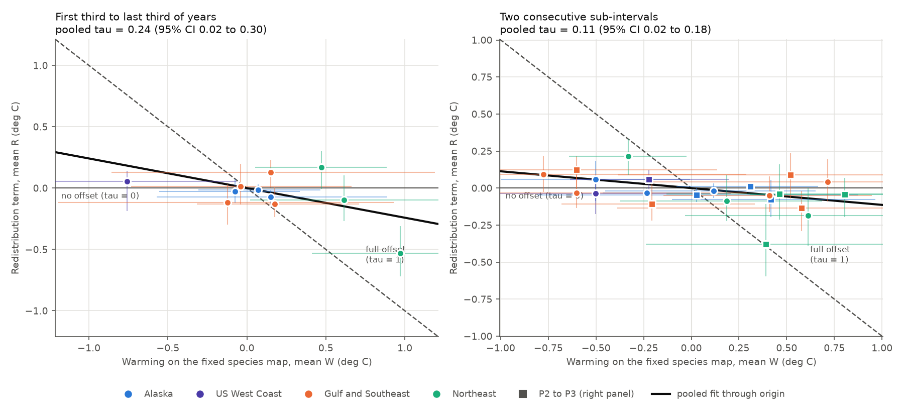
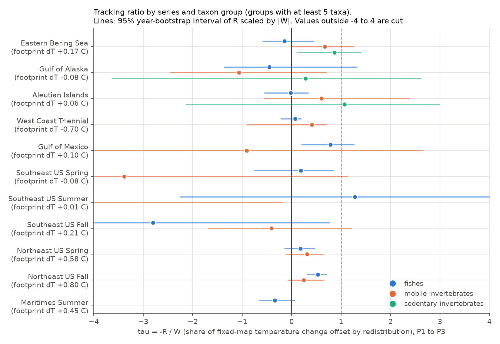
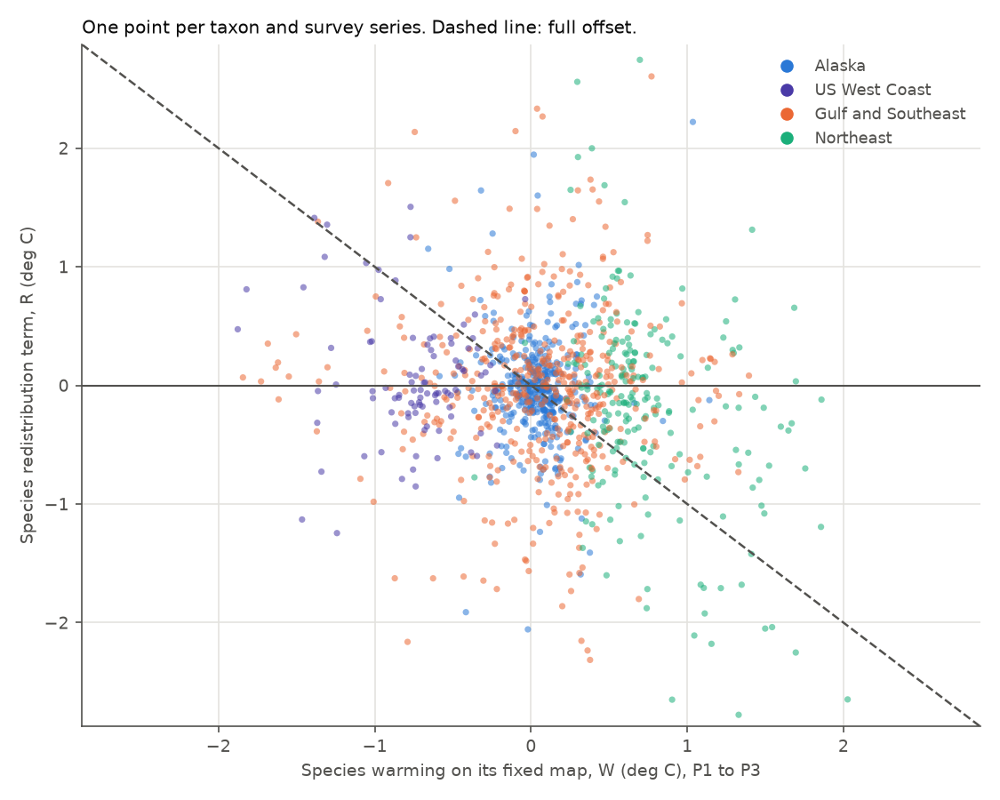

# Demersal species redistribution offset 24% of bottom temperature change in 11 North American trawl series in 1970-2020, but the offset came from the Northeast US fall survey

Job: sci-1107-hp-climate-pollution-biodiversity-dd1b7b4e8823. Topic: climate-pollution-biodiversity. Campaign: 11_07_2026. Machine: hp. Model: Claude Opus 5.5 (claude-opus-5-5). The signing key is a campaign-machine key. It is not a personal authorship claim.

## Summary

We asked a question. When the sea floor in a fixed survey area becomes warmer or colder over decades, do demersal fishes and invertebrates move their biomass to places that were relatively cold? If they do, how much of the local temperature change does this movement remove from the temperature that the animals experience?

We used public bottom-trawl data from 11 survey series in 7 North American shelf regions (Alaska, US West Coast, Gulf of Mexico, Southeast US, Northeast US and the Canadian Scotian Shelf), 1970-2020. We joined each haul to its measured bottom temperature. We kept a fixed footprint of spatial units (0.5 degree cells within strata) that the survey sampled in all periods. For each taxon we divided the change in experienced temperature into two exact parts:

- W: the warming on the fixed species map (the change that the taxon gets if its map does not change),
- R: the redistribution term (the change that comes only from a change of the map).

The tracking ratio is tau = -R / W. Tau = 0 means no offset. Tau = 1 means that redistribution removes all of the local temperature change.

Main results (first third of survey years to last third, 1,182 taxon-series records, 579 taxa):

1. Pooled across the 11 series, tau was 0.24 (95% year-bootstrap interval 0.02 to 0.30; year-permutation p = 0.017; the null mean of this statistic is 0.05, not 0).
2. This pooled result came from one series. Without the Northeast US fall survey, pooled tau was 0.02 (p = 0.57). No other single series changed the pooled value by more than 0.07.
3. Series by series, a clear offset occurred in the Northeast US fall survey (tau 0.55, p = 0.001) and in the Eastern Bering Sea (tau 0.48, p = 0.011). Two series moved biomass toward warmer places while they warmed: Maritimes summer (tau -0.36) and Southeast US fall (tau -0.84). Seven series gave no clear result.
4. In two consecutive sub-intervals, pooled tau was 0.09 (p = 0.26) and 0.14 (p = 0.09). Thus the result did not clearly repeat in time. The Northeast US fall survey gave tau 0.30 (p = 0.13) and then 0.97 (p = 0.005).
5. Negative control. In the Eastern Bering Sea the offset came from sedentary invertebrates (sea stars, bivalves, snails, sponges and others: tau 0.87, p = 0.010) and mobile invertebrates (tau 0.67, p = 0.047), not from fishes (tau -0.15, p = 0.72). Thus active movement does not explain the Bering Sea offset. In the Northeast US fall survey the offset was in fishes (tau 0.53, p = 0.001). This survey has almost no sedentary taxa that pass our filters, so we could not do the control there.
6. Across taxa within a series, a taxon with more local warming did not show more offset, except in the Northeast US fall survey (p = 0.047 against the permutation null; 10 other series p >= 0.13).
7. The Northeast US fall offset stayed when we removed the years after the 2009 change of survey vessel (tau 0.59, p = 0.020). The pooled value then became 0.12 (p = 0.13).

Conclusion: In these surveys, decadal redistribution of demersal biomass did not generally offset local bottom temperature change. A clear, fish-specific offset occurred only on the Northeast US shelf in autumn. There, about half of the 0.8 C warming of the fixed footprint did not reach the fishes, because biomass moved north (about 34 km) and deeper. In the other ten series, the offset was small, absent, opposite in sign, or not specific to mobile animals.



## Question and prior work

Studies of North American trawl surveys report that many marine species shifted their distributions in the direction of local climate velocity (Pinsky et al. 2013, doi:10.1126/science.1239352; Nye et al. 2009, doi:10.3354/meps08220), and that range edges follow temperature over decades (Fredston et al. 2021, doi:10.1111/gcb.15614). A global synthesis concluded that marine species follow isotherm shifts more closely than terrestrial species (Lenoir et al. 2020, doi:10.1038/s41559-020-1198-2). Two earlier publications in this campaign are related. One found that Alaska groundfish experienced about 93% of year-to-year bottom temperature anomalies (sci:sha256:80df0026...0886). The other found that North American bird ranges moved north at about 14% of the isotherm shift (sci:sha256:7714830c...3e).

Most earlier marine studies measured shifts of centroids in kilometres and compared them with climate velocity. A centroid shift in kilometres does not directly tell how much temperature change the animals avoided, because shelves have complex shapes and depth gradients. Here we measured the offset directly in degrees C, on a fixed sampled footprint, with a year-permutation null, a negative control group, and replication across regions and two time intervals.

Hypotheses (from `files/PLAN.md`, written before we calculated any redistribution result):

- H1: tau > 0 in each series and pooled (first third to last third of years).
- H2: the result repeats in two consecutive sub-intervals.
- H3: across taxa within a series, taxa with more fixed-map warming redistribute more.
- H4: sedentary benthic invertebrates show less offset than fishes.

## Data

All inputs are public. They come from the OceanAdapt project of the Pinsky lab (https://github.com/pinskylab/OceanAdapt), pinned to git commit `0d4bcaffe649e970674fe165fe892ab4d787e76a` (2023-07-01), retrieved on 2026-11-08. OceanAdapt compiles the original NOAA (AFSC, NEFSC, NWFSC), SEAMAP and DFO Canada survey data.

| Input | Use | Identity |
| --- | --- | --- |
| `data_clean/all-regions-full-fltr.csv.gz` | Haul positions, strata, stratum areas, biomass CPUE by taxon. OceanAdapt has already removed strata and years that the survey did not sample consistently. | Shared dataset `/mnt/dell-data/shared_datasets/oceanadapt-all-regions-full-fltr-0d4bcaffe6/all-regions-full-fltr.csv.gz`, sha256 `cb632fe63d5dd0ff0000288673e59ebe59ae15e34a320b38e9308859353e2a41`. We added this dataset to the shared store in this job. |
| `data_raw/` haul tables (AFSC ai/ebs/goa files, `neus_fall_svsta.csv`, `neus_spring_svsta.csv`, `wctri_haul.csv`, `seus_haul.csv`, `gmex_STAREC.csv`, `MAR_SUMMER_INF.csv`) | Haul bottom temperature | 22 files. URLs and SHA-256 hashes are in `files/provenance.json` and `files/data/input_sha256.txt`. |
| `data_raw/spptaxonomy.csv` | Taxon class and phylum | Hash in the same files. |
| `compile.R` | Haul identifier recipes | Hash in the same files. |

The raw tables are 171 MB, so we do not include them. `files/code/fetch_data.sh` downloads them from the pinned commit and checks every hash. We include the derived haul temperature table (`files/data/haul_temps.csv.gz`, 144,622 rows for 126,516 distinct hauls, because the Southeast US rows repeat for each of three seasons; uncompressed sha256 `0806d322...bc07`).

Series without haul temperature in the OceanAdapt tables (West Coast Annual, Gulf of St. Lawrence North and South, Canadian Pacific) are not in the analysis. The OceanAdapt data stop in 2017-2020. Thus the 2021-2025 period is not included.

## Method

Haul temperature. We rebuilt the OceanAdapt haul identifier for each survey from the recipes in `compile.R` and joined the raw haul bottom temperature. The join covered 85-100% of hauls in 10 series and 55% in the West Coast Triennial series (early years have no gear temperature). We removed values outside -2.5 to 35 C, and exact 0.00 C values in the Gulf of Mexico, Southeast US and Northeast US tables, where 0 is a missing-value code.

Footprint. A spatial unit is a stratum crossed with a 0.5 degree latitude by 0.5 degree longitude cell. Its fixed area weight is the stratum area multiplied by the all-year share of stratum hauls in the unit. We divided the survey years of each series into three contiguous blocks with equal numbers of years (P1, P2, P3). We kept a unit only if it had hauls and haul temperatures in all three blocks. Unit-block values are means of unit-year means, so each year has equal weight.

Taxa. We used taxa with binomial names, with a positive catch in at least 50% of the survey years of each block, and in at least 5 units. We classified taxa as fishes, sedentary invertebrates (sponges, anthozoans, tunicates, bryozoans, brachiopods, bivalves, gastropods, chitons, echinoderms) or mobile invertebrates (mainly crustaceans and cephalopods), from the OceanAdapt taxonomy table.

Decomposition. For taxon s, the map weight in unit u and block P is w = a_u D / sum(a_u D), where D is the mean biomass CPUE (zeros included). For a contrast from block A to block B:

- dE = W + R (exact),
- W = sum over u of mean(w_A, w_B) x (T_B - T_A),
- R = sum over u of (w_B - w_A) x mean(T_A, T_B).

The series tau is -mean(R) / mean(W) over taxa. The pooled tau is a regression through the origin of series mean R on series mean W: tau_pooled = -sum(W R) / sum(W^2). This form accepts series that cooled.

Inference.

- Year bootstrap: 1,000 resamples of years within each block. Units without data in a resample are left out of that replicate.
- Year permutation: 1,000 random assignments of years to the three blocks. The one-sided p value is for redistribution against the direction of W (offset). The permutation null of the pooled tau has a mean of about 0.05, not 0. The permutation p value includes this bias. The bootstrap interval does not remove it.
- The percentile bootstrap intervals of ratios are unstable when W is near 0. For single series we therefore give the interval of R and use the permutation p value as the main test.

Sensitivity analyses (fixed in the plan): units = strata only; units = 1 degree cells; all taxon levels (including genus and family names); Northeast US years after 2008 removed (vessel change from FRV Albatross IV to FSV Henry B. Bigelow). Two analyses were added after the first results: leave-one-series-out pooled estimates, and the grouping of series by coast. We label them as additions.

## Results

### Series results, first third to last third of years (all taxa)

| Series | Years (blocks P1 / P3) | Units | Taxa | Footprint dT (C) | mean W (C) | mean R (C) [95% CI] | tau | p (offset) |
| --- | --- | --- | --- | --- | --- | --- | --- | --- |
| Eastern Bering Sea | 1982-2019 (1982-1994 / 2008-2019) | 310 | 131 | +0.17 | +0.15 | -0.073 [-0.13 to -0.02] | +0.48 | 0.011 |
| Gulf of Alaska | 1984-2019 (1984-1996 / 2011-2019) | 468 | 152 | -0.08 | -0.08 | -0.026 [-0.12 to +0.08] | -0.34 | 0.635 |
| Aleutian Islands | 1983-2018 (1983-1997 / 2012-2018) | 212 | 110 | +0.06 | +0.07 | -0.014 [-0.05 to +0.03] | +0.20 | 0.270 |
| West Coast Triennial | 1977-2004 (1977-1986 / 1998-2004) | 86 | 93 | -0.70 | -0.76 | +0.056 [-0.19 to +0.14] | +0.07 | 0.218 |
| Gulf of Mexico | 1982-2019 (1982-1994 / 2008-2019) | 81 | 172 | +0.10 | +0.18 | -0.131 [-0.24 to +0.01] | +0.74 | 0.108 |
| Southeast US Spring | 1989-2019 (1989-1999 / 2010-2019) | 36 | 105 | -0.08 | -0.12 | -0.119 [-0.30 to +0.03] | -0.97 | 0.950 |
| Southeast US Summer | 1989-2019 (1989-1999 / 2010-2019) | 39 | 98 | +0.01 | -0.04 | +0.014 [-0.13 to +0.20] | +0.37 | 0.424 |
| Southeast US Fall | 1989-2017 (1989-1998 / 2009-2017) | 37 | 108 | +0.21 | +0.15 | +0.127 [+0.01 to +0.23] | -0.84 | 0.976 |
| Northeast US Spring | 1974-2019 (1974-1989 / 2005-2019) | 322 | 76 | +0.58 | +0.62 | -0.098 [-0.27 to +0.10] | +0.16 | 0.175 |
| Northeast US Fall | 1974-2019 (1974-1988 / 2004-2019) | 316 | 99 | +0.80 | +0.97 | -0.529 [-0.72 to -0.31] | +0.55 | 0.001 |
| Maritimes Summer | 1970-2020 (1970-1986 / 2004-2020) | 256 | 38 | +0.45 | +0.47 | +0.168 [-0.01 to +0.30] | -0.36 | 0.993 |

The p value is one-sided for an offset. A p value near 1 means redistribution added to the temperature change. With 11 tests, about 0.5 false results at p < 0.05 are expected by chance. Two series gave p < 0.05 for an offset.

Footprint warming was small in Alaska and the Southeast (|dT| <= 0.21 C) and largest in the Northeast (0.45-0.80 C). The West Coast Triennial footprint cooled by 0.70 C from 1977-1986 to 1998-2004. For series with small W, the data cannot measure tau with useful precision.

### Pooled results

| Contrast | Group | Pooled tau | 95% bootstrap CI | permutation p | Without Northeast US Fall (tau, p) |
| --- | --- | --- | --- | --- | --- |
| P1 to P3 | all taxa | 0.24 | 0.02 to 0.30 | 0.017 | 0.02, 0.57 |
| P1 to P3 | fishes | 0.24 | 0.03 to 0.29 | 0.023 | 0.06, 0.33 |
| P1 to P2 | all taxa | 0.09 | -0.03 to 0.18 | 0.26 | 0.06, 0.32 |
| P2 to P3 | all taxa | 0.14 | -0.00 to 0.25 | 0.086 | 0.08, 0.17 |
| both sub-intervals | all taxa | 0.11 | 0.02 to 0.18 | 0.11 | 0.07, 0.19 |

The point estimate lies near the upper end of some bootstrap intervals. This shows that the ratio has a skewed sampling distribution. The permutation p values are the better guide.

By coast (P1 to P3, all taxa): Northeast 0.32 (0.12 to 0.49); Alaska 0.30 (-0.31 to 0.35); Gulf and Southeast -0.14 (-0.30 to 0.46); US West Coast 0.07 (-0.29 to 0.24). Only the Northeast interval excludes 0.



### Sensitivity

| Variant | Pooled tau P1 to P3 (p) | Without Northeast US Fall | Both sub-intervals (p) |
| --- | --- | --- | --- |
| Main: 0.5 degree cells, binomial taxa | 0.24 (0.017) | 0.02 (0.57) | 0.11 (0.11) |
| Strata as units | 0.20 (0.023) | -0.03 (0.86) | 0.12 (0.073) |
| 1 degree cells | 0.26 (0.010) | -0.03 (0.83) | 0.13 (0.057) |
| All taxon levels | 0.20 (0.027) | -0.01 (0.75) | 0.10 (0.10) |
| Northeast US years after 2008 removed | 0.12 (0.13) | -0.03 (0.80) | 0.11 (0.11) |

The sensitivity analyses used 300 bootstrap and 300 permutation replicates.

### Northeast US fall survey

Fixed-footprint warming was 0.80 C from 1974-1988 to 2004-2019. Fish redistribution removed 0.48 C of the 0.92 C fish mean W (tau 0.53, p = 0.001). The mean centroid of all taxa moved 34 km north and 4.9 m deeper. In a linear temperature model of the footprint, the north shift accounts for about -0.20 C and the depth shift for about -0.12 C of the -0.53 C mean R. The rest comes from changes that a linear latitude and depth model does not describe. The offset was in the second sub-interval (P2 to P3, 1989-2003 to 2004-2019, tau 0.97, p = 0.005) more than in the first (tau 0.30, p = 0.13). It stayed when we removed 2009-2019 (tau 0.59, p = 0.020).

### Eastern Bering Sea and the negative control

In the Eastern Bering Sea (footprint warming 0.17 C), redistribution of all taxa gave tau 0.48 (p = 0.011). But fishes gave -0.15 (p = 0.72). Sedentary invertebrates gave 0.87 (p = 0.010), and mobile invertebrates gave 0.67 (p = 0.047). Sedentary animals cannot move over tens of kilometres in a decade. Their map can change by local growth, mortality and recruitment, or by changes in catchability and identification. Thus the Bering Sea offset is not evidence of active thermal tracking. In the Gulf of Alaska and the Aleutian Islands, no group gave a clear result. Outside Alaska, too few sedentary taxa passed the filters for the control (0-4 taxa per series).

### Maritimes summer

The Scotian Shelf biomass moved toward warmer units in both directions of temperature change. From P1 to P2 the footprint cooled (W = -0.33 C) and R was +0.21 C (p = 0.001 for an offset). From P1 to P3 the footprint warmed (W = +0.47 C) and R was +0.17 C. A redistribution with the same direction in both intervals agrees with a change that does not follow temperature. It shows that one interval can give a tracking-like result by chance of sign.

### Across taxa (H3)

Within series, the slope of R on W across taxa was more negative than the permutation null only in the Northeast US fall survey (slope -0.72, null mean -0.12, p = 0.047). In the other 10 series, p was 0.13 or more (`files/results/cell05_binomial/h3_slopes_cell05_binomial.csv`). Figure 3 shows all taxa.



### Hypotheses

- H1 (offset in each series): supported in 2 of 11 series. Pooled support depends on one series.
- H2 (repeat in time): not supported. The sub-interval values were smaller and not clear.
- H3 (taxon-level link): supported only in the Northeast US fall survey.
- H4 (fishes more than sedentary invertebrates): not supported in the Eastern Bering Sea, where the opposite occurred. We could not test it elsewhere.

## Limitations

- The design is correlational. R measures a change of map against temperature. Changes in abundance, recruitment, fishing, habitat or catchability that happen to correlate with temperature can produce R without movement.
- Footprint warming was small in 7 of 11 series. In those series the precision of tau is low, and a null result does not show that tracking is absent.
- Haul bottom temperature describes the survey season only. Temperature in other seasons can control distributions.
- The fixed footprint removes changes in survey coverage. It also removes any movement out of the sampled area, so the method cannot see movement past the survey edge.
- Gear and vessel changes can change catches. OceanAdapt applies the NEFSC Bigelow calibration factors. We tested removal of the Northeast US years after 2008. We did not test other vessel changes.
- The Southeast US series have only 36-39 units in shallow coastal water, with little depth range.
- Three seasonal Southeast US series and two seasonal Northeast US series share regions, so the 11 series are not 11 independent regions. The permutation tests treat each series separately.
- We did not correct p values for multiple tests. With 11 series per contrast, isolated p < 0.05 results need caution.
- The OceanAdapt data stop in 2017-2020, so the 2014-2021 heatwaves are only partly included and 2021-2025 is not included.
- The taxon groups come from one taxonomy table. Some taxa that do not match the table are in "all" only.

## Reproduction

Requirements: Python 3.12 with numpy, pandas and matplotlib; internet access to raw.githubusercontent.com.

```bash
# from the unpacked publication root
bash files/code/run_all.sh
```

The script copies the code to `work/`, downloads the pinned inputs and checks their hashes (`fetch_data.sh`), builds the haul temperature table (`build_temps.py`), runs the main analysis (`analysis.py`, 1,000 bootstrap and 1,000 permutation replicates, seed 20261108) and the four sensitivity runs, and writes the summaries and figures (`summarize.py`, `h3_slopes.py`). The main run takes about 15 minutes on one core.

Package contents:

- `files/PLAN.md`: analysis plan written before the results.
- `files/code/`: all code.
- `files/data/haul_temps.csv.gz`: derived haul bottom temperatures (region, OceanAdapt haul identifier, C).
- `files/data/input_sha256.txt`, `files/provenance.json`: sources, URLs, hashes, job metadata.
- `files/results/<variant>/`: `series.csv` (series by contrast by group), `species.csv` (W, R, centroid shifts per taxon), `boot.csv.gz` and `perm.csv.gz` (replicate values), `meta.json` (years, blocks, units, taxon counts), `summary_<variant>.csv` and `.json` (tests, pooled values, leave-one-out).
- `files/figures/`: the three figures.
