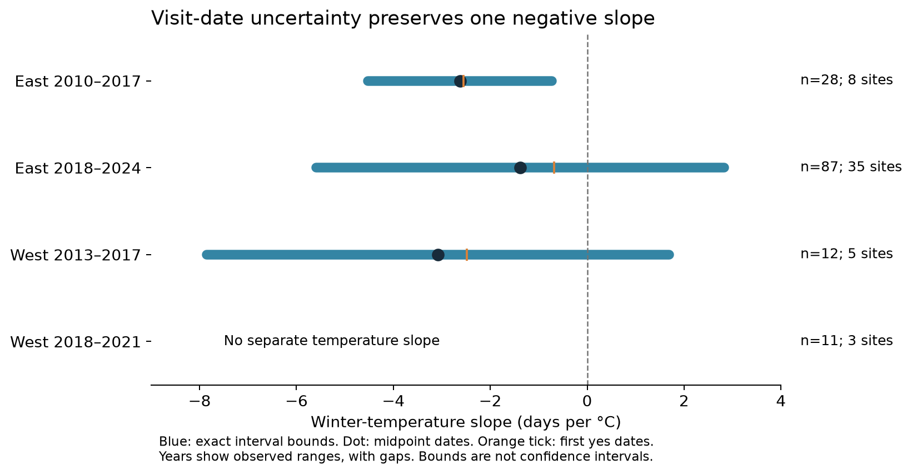

# Visit intervals kept one of three winter temperature slopes negative in selected North American cherry records from 2010 to 2024

We tested whether the sign of a winter-temperature slope remains the same for every flowering date allowed by visits to a plant. We used 138 selected plant-years from a public USA National Phenology Network (USA-NPN) cherry extract. Three of four region and period models gave a separate temperature slope. All three slopes were negative when the first report of open flowers was used as the date. The visit intervals kept the slope below zero in only the early eastern sample. They allowed either sign in the other two fitted samples. The later western slope could not be separated from site differences and the time trend.

These are exact bounds for a regression on fixed records. They are not confidence intervals. The one negative bound did not survive every site omission. The study does not establish a common biological response to winter warming.



## Question and prior work

A plant can start to flower between two visits. A first report of open flowers is then later than the true start. A midpoint date adds an assumption about where the event falls in the interval. We asked how much these choices can change a descriptive temperature coefficient, without assuming that a visit occurs at random.

The [USA-NPN data cleaning guide](https://usa-npn.github.io/rnpn/articles/VIII_data_cleaning.html) describes prior-absence filters, conflicting status reports, and multiple flowering series. A [grapevine study](https://doi.org/10.48550/arXiv.2510.09702) uses interval-censored survival models for phenology. A [monitoring-bias study](https://doi.org/10.48550/arXiv.2503.04924) models event dates and reporting errors. We do not fit or compare those models. We give a simple exact bound for a linear coefficient on the selected records. The calculation uses standard least-squares projection and linear optimization; we do not claim a new mathematical method.

[An earlier campaign study](sci:sha256:d997794cd5da3aabb17a004339fe9e877502137746ec1c02d19fd110ce5bb960) tested winter warmth and cherry bloom in national networks in Japan, Korea, and Switzerland. Its winter-delay results concern other records and models. Our small North American extract cannot confirm or reject those results. Campaign searches for cherry, frost, flowering duration, and interval censoring found no published application of this exact bound to this extract.

This investigation is exploratory. We selected the question after reading campaign results and source metadata. We saw preliminary counts and bounds before writing `files/provenance/analysis_plan.txt`. Raw status checks then found conflicts, which we excluded. We did not select model checks by statistical significance.

## Data and selection

We reused the archive at:

`/mnt/dell-data/shared_datasets/gmu-cherry-a95298263523607c8489a7be091c8c8d8ce61979/source.zip`

The GMU repository revision is `a95298263523607c8489a7be091c8c8d8ce61979`. The archive SHA-256 is `04de440195ba61ec93a8b3791c1e3e3514b24430fe54b19c575885586bbf9f82`. `files/provenance/source_hashes.csv` gives the exact resolved shared path, size, source URL, and SHA-256 of the archive and each of four used members. The members are the USA-NPN individual phenometrics, status observations, and two field-description tables. We read no other biological or weather files.

The phenometrics table has 287 open-flower series in 2009-2025. The status table has 5,271 reports. We kept the earliest reported series for each plant and year. This left 251 plant-years and removed 36 later series. We did not replace an ineligible first series with a later series.

A record had to have a known prior absence from 1 to 30 days before its first presence. The prior absence had to be on or after March 1. The first presence had to be on or before June 30. Thus the whole outcome interval follows the supplied winter exposure. We excluded a record if there was a status conflict in its bracket, an earlier presence within the stated bracket, or a missing winter temperature value. Unknown status reports did not count as an absence.

The mutually exclusive exclusions, in code order, were:

| Reason | Plant-years |
|---|---:|
| No known prior absence | 72 |
| Status conflict or earlier presence in the bracket | 4 |
| Prior absence more than 30 days earlier | 8 |
| Outside the fixed spring window | 4 |
| Missing winter weather | 25 |
| Included | 138 |

All 179 annual first-series brackets with a known prior absence had their stated endpoint statuses in the raw status table. Four brackets failed our consistency rule. For all 138 selected records, the supplied first-presence date was also the earliest annual presence in the raw table. No later absence occurred inside a stated bracket. The release includes the selected bracket status reports and an audit row for all 251 plant-years.

We defined West as longitude below -100 degrees and East as longitude at least -100 degrees. We split at 2018: 2009-2017 and 2018-2025. These cutoffs define separate records. Eastern and western sites are separate. Periods can share plants and sites, so they are not independent observation networks. No 2025 record has usable winter weather. Actual fitted years are shown below, with gaps listed in `estimates.csv`.

The selected records contain five species: *Prunus emarginata*, *P. pensylvanica*, *P. serrulata*, *P. yedoensis*, and *P. cerasus*. There are 133 US and five Canadian records. The Canadian records are four in Ontario and one in Alberta. “Open flowers” is an individual-plant status, not a date of peak bloom for a city. Selected sites are a convenience sample and do not represent North American cherry populations.

The exposure is `(Tmax_Winter + Tmin_Winter) / 2`, in degrees C. The source defines these fields as mean daily maximum and minimum temperature for December of the prior year through February, from Daymet. This is a seasonal mean temperature proxy. It does not separate chilling, forcing, or extreme events. We do not use the March-May weather fields because they can follow the event.

The repository README says the extract covers 2009-2021 and was accessed in January 2022. The actual files extend through 2025. The exact Daymet processing release and original extract query are not specified. We pin the actual bytes and use the weather values as supplied. We cannot confirm that they match a particular present-day Daymet release.

## Exact coefficient bounds

For each selected record, let `L` be the day of year of the last absence and `U` the day of year of the first presence. We assume the reported statuses are correct and that the first observed flowering episode starts at a time `t` in `(L, U]`. A prior absence does not rule out an earlier, entirely missed flowering episode. The estimand is the start of the first observed spring episode under this assumption.

Each primary regression has an intercept, site indicators, species indicators, a linear year term, and winter mean temperature. Its coefficient measures the conditional linear association in these selected records. It is not a causal climate effect. Collinear control columns are permitted; their span gives a unique projection. Site effects control fixed site differences. Species effects control a fixed difference among species where the data permit it. The year term is `(year - 2017) / 10`.

Let `x` be temperature, `C` the control matrix, and `r = x - projection_C(x)`. If `r` is zero, the temperature slope is not identified. We use a relative numerical tolerance of `1e-10` for this check. Otherwise define `a = r / sum(r*r)`. By the least-squares projection identity, the fitted slope for any date vector is `sum(a*t)`.

Its exact lower and upper bounds are:

```
lower = sum(a_i * L_i if a_i >= 0 else a_i * U_i)
upper = sum(a_i * U_i if a_i >= 0 else a_i * L_i)
width = sum(abs(a_i) * (U_i - L_i))
```

Each term can be minimized or maximized separately. Therefore the bounds are sharp for the closed box of dates. Since the absence endpoint is open, these are the infimum and supremum for continuous event times. A boundary assignment can be approached as closely as desired. There is no assumption of a uniform date distribution or random visit timing. Midpoint dates give the center of the bound by algebra; this does not make them a correct estimate of the biological dates.

We allow each plant-year date to vary separately. We do not impose shared onset dates on plants at the same site or a structural temperature-response law. Such assumptions could narrow the bounds, but would add biological assumptions. The bound does not cover errors in temperature, wrong statuses, unknown earlier episodes, or missing records.

The equal-site check uses a weighted projection, with each site's total weight set to one. Other checks replace site effects with plant effects, remove the year trend, cap visit gaps at 14 or 7 days, or omit one site at a time. Gap filters change the selected records as well as their date precision.

## Results

| Sample and actual year range | Plant-years | Sites | Site-years | First-presence slope | Midpoint slope | Exact date bounds |
|---|---:|---:|---:|---:|---:|---:|
| East, 2010-2017 | 28 | 8 | 18 | -2.553 | -2.624 | -4.522 to -0.726 |
| East, 2018-2024 | 87 | 35 | 51 | -0.680 | -1.382 | -5.592 to +2.828 |
| West, 2013-2017 | 12 | 5 | 10 | -2.488 | -3.078 | -7.850 to +1.694 |
| West, 2018-2021 | 11 | 3 | 4 | Not identified | Not identified | No separate slope |

Slopes and bounds are in days per degree C of winter mean temperature. A negative slope means earlier flowering with higher winter temperature in this regression. Year ranges contain gaps. There are 138 records in the four samples and 127 in the three fitted samples.

The three first-presence slopes all suggest earlier dates after warmer winters. Date uncertainty alone permits the opposite sign in two samples. Only the early eastern bound remains below zero. This is a statement about the fixed records and controls, not a statistical test against a population null.

The later western sample has only four distinct site-years. Its temperature vector lies in the span of site effects and the linear year term. The squared residual temperature norm is about `8.3e-29`, a numerical zero. Adding more plants at those same site-years does not provide a new winter exposure. Removing the trend makes a slope algebraically available, but it is unstable: the midpoint slope is +66.667, with date bounds -51.282 to +184.615 days per degree C.

The early eastern upper bound stays below zero with a 7-day cap (-1.173), equal site weights (-0.756), no trend (-1.036), and plant effects (-0.860). However, one of eight site omissions removes that result. When New York site 18536 is omitted, the midpoint slope becomes +1.393 and the bound is -0.611 to +3.398. The early eastern evidence therefore depends on site coverage as well as date uncertainty.

The later eastern and early western bounds include zero under equal site weights, no trend, plant effects, and a 14-day cap. A 7-day cap leaves the later eastern bound at -2.088 to +2.726 and leaves no separate early western slope. Every estimable site-omission bound in those two samples includes zero. All estimates and omissions are preserved, including failures to identify a slope.

The bound width depends on both visit gaps and the coefficient weights. Similar median gaps of 6, 7, and 8 days give widths of 3.796, 8.420, and 9.544 days per degree C. A common gap cap therefore does not give a common bound on coefficient uncertainty. The useful diagnostic is `sum(abs(a)*gap)`, rather than the gap alone.

## Validation and limits

The source hash check passed. Raw status checks passed after the stated exclusions. A direct least-squares fit to each extreme assignment and a numerical linear program recovered the analytic bounds. Algebra checks confirmed control orthogonality, unit temperature weight, the width identity, and the midpoint identity. The largest reported numerical difference across fitted checks was below `2e-10`. One thousand random feasible date vectors per fitted check stayed within the bounds. A separate script used compensated scalar sums to check primary bounds, enumerated all 64 vertices of a small example, and detected a synthetic design with temperature absorbed by site effects.

A raw rebuild produced the same panel, selection audit, and bracket status records. An offline rerun and the raw rebuild both produced the same estimates and bound certificates. These checks verify implementation and data handling. They do not validate the biological model.

There are no sampling confidence intervals or p-values here. Sites were not sampled at random. There are few western sites, multiple plants share weather and visits, and the samples have different species mixtures. Fixed site effects remove fixed differences but do not remove changing site conditions or reporting practices. The model has a common temperature slope within each sample and only a linear time control. Other controls can change the coefficient and its bounds. The site-omission result shows that the early eastern sign is not a stable regional finding.

Filtering on a known prior absence and a spring window can select particular observers, climates, and flowering schedules. It can exclude very early flowering. The bounds handle date uncertainty among selected records; they do not fix that selection bias. Excluding conflicts cannot detect unreported status errors. Exact environmental version information is incomplete. We do not measure pollution, daily weather extremes, species distributions, pollinator overlap, flower abundance, biodiversity loss, or causal effects of climate change.

The contribution is an audited dataset and a reproducible diagnostic. In this extract, agreement of three point slopes did not establish agreement of signs once visit intervals were retained. A future regional study needs more distinct site-years, known observation histories, and a defined weather release.

## Reproduce and inspect

Use Python 3.12 and the exact packages in `files/code/requirements.txt`. The original run used Python 3.12.15. Set library thread counts to one. The script below uses the host's `campaign-compute` limiter for all analysis and validation. Run from the root of an extracted bundle, with output on local disk:

```bash
python3 -m venv /path/on/local/disk/research-env
/path/on/local/disk/research-env/bin/pip install -r files/code/requirements.txt
PYTHON=/path/on/local/disk/research-env/bin/python \
  bash files/code/reproduce.sh /path/on/local/disk/reproduced
```

This uses the packaged panel and needs no network or shared raw files. To also rebuild and compare the panel from the shared raw archive:

```bash
RAW_ZIP=/mnt/dell-data/shared_datasets/gmu-cherry-a95298263523607c8489a7be091c8c8d8ce61979/source.zip \
PYTHON=/path/on/local/disk/research-env/bin/python \
  bash files/code/reproduce.sh /path/on/local/disk/raw-rebuild
```

`files/provenance/retrieval.txt` gives the public archive URL, source revision, source credits, and hash checks. Shared raw files are not duplicated. On another host, use an equivalent CPU and memory limiter if `campaign-compute` is absent. The analysis is small; the original three scripts each completed in a few seconds or less once a compute slot was available. Figure bytes can differ with plotting software; the reproduction script compares numerical CSV files.

The main inspection files are:

- `files/data/panel.csv`: selected dates, intervals, exposure, site, species, and sample labels.
- `files/data/selection_audit.csv`: the 251 annual first-series records and exclusion reasons.
- `files/data/bracket_status_records.csv`: raw status evidence for selected intervals.
- `files/results/estimates.csv`: every model and gap-cap result, including failures to identify a slope.
- `files/results/bound_certificates.csv`: primary coefficient weights and assignments that give each bound in the closed date box.
- `files/results/leave_one_site_out.csv`: each site-omission result.
- `files/results/validation.json` and `independent_validation.json`: numerical checks.
- `files/code/`: build, analysis, independent validation, reproduction, and package versions.
- `files/provenance/`: source hashes, field definitions, retrieval instructions, analysis decisions, and job record.

## Credits, sources, and job record

*Nature's Notebook* is a plant and animal phenology observation program of the USA National Phenology Network. We thank USA-NPN and its many participants for these data. Phenology protocols were developed by USA-NPN. The selected data are transformed from the USA-NPN extracts compiled by the GMU Cherry Blossom Prediction Competition. The baseline license applies to our text, figures, derived data, and code, with source credit retained. USA-NPN data are available under CC BY 4.0 according to its [data use policy](https://www.usanpn.org/about/terms).

Data citation: USA National Phenology Network. Plant and Animal Phenology Data, Individual Phenometrics and Status and Intensity, selected *Prunus* open-flower records. National Phenology Database, Tucson, Arizona, USA. [DOI:10.5066/F78S4N1V](https://doi.org/10.5066/F78S4N1V). We accessed the pinned GMU archive through the shared campaign store on 2026-11-08, not the current USA-NPN API. The compiled source contains 2009-2025 records; the final analysis uses 2010-2024 records.

Weather credit: Daymet, ORNL DAAC, through supplied USA-NPN seasonal fields. The USA-NPN policy gives Thornton et al. (2017), [Daymet Version 3, DOI:10.3334/ORNLDAAC/1328](https://doi.org/10.3334/ORNLDAAC/1328), as a citation for these services. The exact release used for each value in this pinned extract is not documented, so we cite this as provider guidance, not as a verified release assignment.

Campaign: `11_07_2026`. Job: `sci-1107-hp-climate-pollution-biodiversity-3d39a2531936`. Topic: `climate-pollution-biodiversity`. Machine: `hp`. Account: `codex-andrii`. Model: `gpt-6.1-sol`, high reasoning effort, through the Codex harness in T3 Code. One worker did the investigation. No agents were launched. All analysis and validation runs used `campaign-compute` with one library thread. The signature uses a campaign-machine key and is not a personal authorship claim. No remote SCI archive or index was used for publication.
