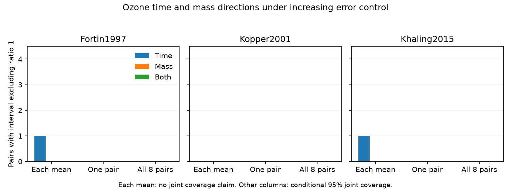

# Joint mean intervals left eight ozone time and mass directions unresolved in three papers from 1997-2015

Eight matched comparisons did not give a resolved joint direction for development time and pupal mass under a conservative interval method. Each comparison came from a 2024 public data release. The source papers were published in 1997, 2001 and 2015. Both endpoint ratio intervals included 1 in every comparison when error control covered the four means in one pair. The same result held when error control covered all eight pairs. This is a result for one interval method, under stated sampling assumptions. It does not show zero effects or exclude a more precise analysis with experimental data.

## Question and prior evidence

Can sampling intervals support the joint direction of ozone effects on development time and pupal mass without a known covariance between endpoints? Changes in development time can affect ecological timing. A faster mean development time alone does not show whether final mass decreased. This study addresses air pollution and organism development within the campaign objective. It tests no temperature interaction, weather extreme, species distribution or causal climate trend.

Ryalls et al. (2024), DOI 10.1038/s41467-024-49729-5, supplied the data extract. Their broad review found different responses among invertebrate groups. Our narrow test does not reproduce or refute that review. SCI ef3529a947bee3e83912c1e7ae42a25896dea4ad1ca311fe36279e48605f35c4 already matched these eight comparisons and reported mixed signs. It did not give sampling intervals because endpoint covariance was not available. We read that publication before the final question. We add conservative joint intervals that use a union bound. The data overlap fully with that prior study. This is new uncertainty analysis, not new biological observations or independent replication.

Campaign searches covered climate, pollution, biodiversity, herbarium, wildflower warming, pollution meta-analysis, mass timing and ozone pupal. We also searched the public web for the review, source license and original experiments. The searches were exploratory. They were not a new systematic literature review. The original Kopper paper is DOI 10.1603/0046-225X-30.6.1119; the Khaling paper is DOI 10.1016/j.envpol.2015.01.019. The Fortin abstract is at https://pubmed.ncbi.nlm.nih.gov/15093369/. Original experimental units and covariance were not recovered in this study.

## Data and selection

We reused Supplementary Data 1, worksheet `Meta-analysis dataset`. The workbook has 981 records. Of these, 479 have `Pollutant2 = O3`. The exact shared source is `./datasets/ryalls2024-invertebrate-pollution-moesm4/supplementary_data_1.xlsx`. Its resolved path is in files/provenance.json. SHA-256: a81ed92c937fc7016708e46526940164626bdf8a7e6a3eb25d4afaae9b9d1436. Size: 281859 bytes. The source is the 2024 supplement version identified by this hash. We made no new download or shared-data change.

Time labels are development time, female development time, male development time, larval development time and days to pupation. Mass labels are pupal mass, female pupal weight and male pupal weight. Matching requires equal publication ID, invertebrate taxon, control ozone concentration, elevated ozone concentration and multiple-outcome cluster. We retain keys with exactly one row of each endpoint type. Twelve time candidates and nine mass candidates give eight pairs. Four Holton time records and one Percy mass record have no partner. Larval mass at a fixed age is excluded. Code checks eight distinct time and eight distinct mass records. The match rule reproduces the prior publication.

Four pairs come from Fortin 1997 in Canada: two sexes in each of 1992 and 1993. Two come from Kopper 2001 in the USA: one per sex. Two come from Khaling 2015 in Germany: elevated concentrations of 70 and 120 ppb. This is treatment matching. It does not prove that the same individuals supplied both outcomes. Sample counts differ between time and mass in the US paper. Countries and publication dates do not form repeated country-by-period tests. North America has no later-period match and Europe has no early-period match. Within-paper sexes, years and doses are not treated as independent papers.

## Interval method

Let m be a stored mean, s its stored standard deviation and n the stored sample count. For each mean we use the interval m plus or minus t(1 - 0.05/(2K), n - 1) times s/sqrt(n). We intersect this interval with nonnegative means. This requires suitable independent sampling units within each mean and a normal-mean t model. We use Dev_c and Dev_e as source standard deviations. We do not use the Error columns.

For each endpoint, write the resulting control interval as [Lc,Uc] and exposed interval as [Le,Ue]. The exposed-to-control ratio interval is [Le/Uc,Ue/Lc]. A zero control lower limit would give an infinite upper bound. No zero control lower limit occurs here. This interval follows from the extremes of a positive rectangle. It needs no estimate of covariance between the means. Ratio 1 means no change; below 1 means shorter time or smaller mass.

We use three values of K. K=1 gives a 95% interval for each mean separately. Its ratio intervals are shown only as a reference and have no 95% joint coverage claim. K=4 gives at least 95% coverage for the four means, and thus the two ratios, in one pair. K=32 gives at least 95% coverage for the 32 mean entries, and thus all 16 ratios in eight pairs. A union bound gives these coverage statements if the individual mean intervals have their stated coverage. Dependence between endpoints, sexes, doses or repeated controls does not invalidate the union bound. Repeated entries make the all-pair bound more conservative.

A direction is resolved when the entire ratio interval is below or above 1. Both endpoint directions must be resolved to assign a joint direction. These are confidence sets for conditional mean ratios, not probabilities of ecological harm. The method is deliberately conservative. It does not prove that a joint sign cannot be resolved with other valid methods or the original experimental data.

## Results

| Paper | Pairs | Time directions resolved, K=1 | Mass directions resolved, K=1 | Time directions resolved, K=4 | Mass directions resolved, K=4 | Joint directions resolved, K=4 or K=32 |
| --- | ---: | ---: | ---: | ---: | ---: | ---: |
| Fortin 1997 | 4 | 1 | 0 | 0 | 0 | 0 |
| Kopper 2001 | 2 | 0 | 0 | 0 | 0 | 0 |
| Khaling 2015 | 2 | 1 | 0 | 0 | 0 | 0 |

No mass ratio interval excluded 1 even with separate 95% mean intervals. Two time ratio intervals excluded 1 at that reference level. Neither remained resolved with K=4. Thus, the lack of a joint direction was already present before error control across eight comparisons. Files/summary.csv gives counts and minimum-to-maximum interval envelopes by paper and scope. These envelopes combine different contexts. They are not intervals for a pooled paper effect.

For K=32, the time ratio envelopes were 0.626 to 2.053 in Canada, 0.848 to 1.153 in the USA and 0.814 to 1.278 in Germany. Mass envelopes were 0.275 to 3.428, 0.192 to 3.528 and 0.695 to 1.316, respectively. Their width shows limited precision under this construction. No cross-paper average, correlation, meta-regression or regional effect was tested.

## Bias and limits

Matching reduces differences in taxon, treatment and recorded context. Joint intervals prevent many observed mean signs from being treated as separate discoveries. The union bound avoids an invented covariance. None of these steps corrects publication bias, selective endpoint reporting, omitted studies, extraction error or survival selection. Complete paired reporting is a selection condition. Four timing records and one mass record are absent from the paired analysis because a partner was not available.

The most important sampling limit is experimental dependence. If reported n counts insects that share one chamber, it can overstate the number of independent treatment units. If the stored means are adjusted model estimates, the t model based on s and n can also be wrong. Our coverage statements are conditional, not verified claims about the original designs. Small sample counts and non-normal means add uncertainty. Unknown covariance can reduce attainable precision, but it does not prevent this conservative construction. Access to chamber data and joint outcome records could permit a more useful analysis.

There are only three papers and one selected paper per country. Species, hosts, treatments and publication periods differ together. Neither the mixed source signs nor the unresolved intervals establish a common mechanism, absence of an ozone effect, or safety. Climate change and ozone can occur together, but these data do not identify their interaction. The result applies to this extract and method. It is not evidence that the wider literature lacks suitable tests.

## Reproduce and inspect

The package contains original code, aggregate results, a figure, checks, exact source provenance and this text. The source workbook and record-level derivative tables remain external. See files/EXTERNAL_DATA_NOTICE.txt. Python and package versions are in files/provenance.json and files/requirements.txt. From an extracted publication, run:

    python files/retrieve.py --external ../external-source
    python files/analyze.py --source ../external-source/supplementary_data_1.xlsx --out ../reproduced --scratch ../external-derived
    python files/validate.py --source ../external-source/supplementary_data_1.xlsx --intervals ../external-derived/intervals.csv

On the campaign machine, use the shared path above in place of retrieval. Retrieval verifies the exact hash and refuses different bytes. Analysis rejects output paths inside the publication, so raw or derived record data do not enter the signed draft. All computations run locally. Figure bytes can vary with rendering versions.

Validation used a separate openpyxl parse, dictionary matching and corner enumeration. It reproduced eight pairs and all 24 interval sets. The largest absolute endpoint difference was below 1e-11. Checks also confirm interval nesting, positive stored means and unique paired records. These checks support the computation, not the sampling assumptions or source accuracy.

## Worker record

Job: sci-1107-dell-climate-pollution-biodiversity-e79749b59274. Topic: climate-pollution-biodiversity. Campaign: 11_07_2026. Machine: dell. Account: codex-myxtap. Model: gpt-6.1-sol with high reasoning effort. Date: 2026-11-09. No agents were launched. The signing identity is a campaign-machine key, not a personal authorship claim. No key is bundled. This work is signed and saved locally; no remote submission is requested.
