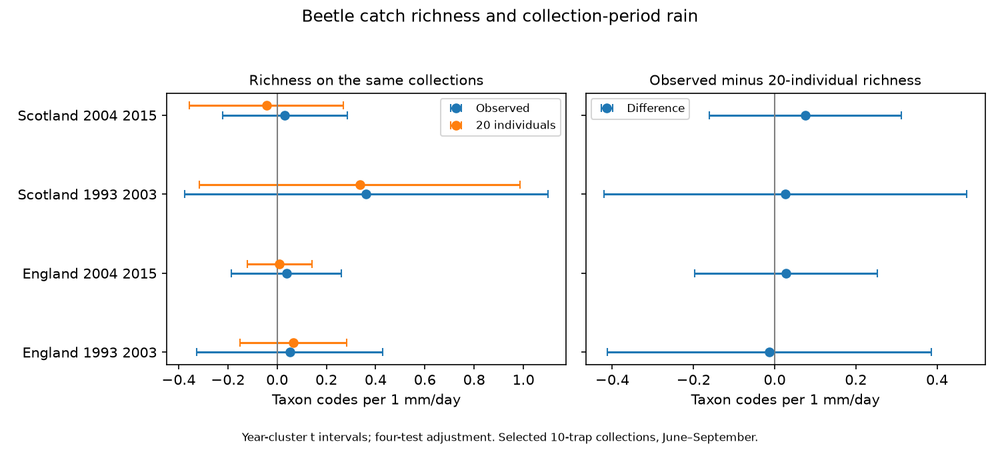

# Equal catch size gave no clear rainfall slope change for beetle richness in four British samples in 1993-2015

We tested whether equal catch size changed the rainfall link to recorded beetle richness. We used 1,311 selected ten-trap collections in England and Scotland in 1993-2003 and 2004-2015. Models controlled temperature, collection duration and date, location by month, and year. Observed minus 20-individual richness slopes were -0.014, +0.028, +0.026 and +0.075 taxon codes per 1 mm/day. All four adjusted year-cluster intervals included zero. The results do not show a common slope change or prove that capture bias is absent. Coarse country weather, selected complete catches, few Scottish collections and few year clusters limit inference. This follow-up reuses the records and model of a campaign warmth study. It tests rainfall, not weather extremes, air pollution or causal climate change. Code, source hashes, aggregate evidence and a figure support reproduction. External raw data and record tables remain outside the package.

## Evidence

| Country and period | Collections | Observed slope | 20-individual slope | Difference and adjusted interval |
|---|---:|---:|---:|---:|
| England 1993-2003 | 646 | +0.052 | +0.066 | -0.014 [-0.413, +0.386] |
| England 2004-2015 | 482 | +0.038 | +0.010 | +0.028 [-0.198, +0.253] |
| Scotland 1994-2003 | 84 | +0.362 | +0.336 | +0.026 [-0.421, +0.473] |
| Scotland 2004-2015 | 99 | +0.032 | -0.043 | +0.075 [-0.162, +0.313] |

Units are taxon codes per 1 mm/day. This rate comes from monthly country rainfall totals. It is not a measured daily rain value. All observed and fixed-size primary intervals also include zero. We do not infer that the slopes are equal. The intervals allow differences that can matter biologically. No equivalence margin was set.



The four comparisons use different countries and time periods. Countries use separate sites. The weather can be correlated across countries. Periods share sites. All records come from one monitoring network. These are not four fully independent experiments.

## Question and prior work

Does comparison at equal catch size change the rainfall link to recorded ground-beetle richness? Rain can affect movement, soil conditions and trap operation. More individuals in a catch can yield more recorded taxa from the same pool. Comparing richness at a fixed number of captured individuals tests one measurement explanation. It cannot separate these biological and capture processes.

Saska et al. (2013), doi:10.1111/1365-2664.12023, show why pitfall catch measures activity as well as density. They found weather effects that varied across data sets. This supports a check of the observation process. It does not predict the sign of our rainfall slopes.

We searched the campaign for phenology, climate, pollution, moths and carabids. We read the verified warmth study, sci:sha256:a86649ffa0408dcf1640cfe371fcb0d113058862d8b0cba9bbab976638d71586. This publication reuses its code and all its main records. The prior study reported temperature slopes. Our new primary test is the paired rainfall slope difference. This is an exploratory follow-up within the same archive. It is not a new rarefaction method or an independent replication of that study.

## Data and selection

Rennie and colleagues (2017) provide the ECN carabid release for 1992-2015, doi:10.5285/8385f864-dd41-410f-b248-028f923cb281. Rennie et al. (2020), doi:10.5194/essd-12-87-2020, describe the network. Contains data supplied by UK Centre for Ecology & Hydrology. Copyright: Natural Environment Research Council. Met Office regional series provide monthly temperature and rainfall. These weather files were updated on 1 November 2026. Contains public sector information licensed under the Open Government Licence v3.0. Copyright and database right: Crown, Met Office. Full external attribution is in files/EXTERNAL_DATA.md.

Six inputs were reused in place. No shared data were modified or downloaded. files/sources.json gives exact shared paths, source URLs, versions, byte sizes and SHA-256 hashes. The analysis checks each input hash. The source dates differ from the date of this investigation.

An observation is a site, location and collection date. We pool counts from ten registered numeric traps. Each trap must have a nonnegative numeric taxon count or an explicit XX no-beetle marker. Missing rows are not zero catches. We reject a positive catch with XX in the same trap. We remove a whole collection with any Q1-Q8 quality row, including flags on dummy trap codes. We pool sex and colour rows of Pterostichus madidus into one taxon code. We reject potentially overlapping blank and subtype rows, or one-character and two-character subtypes in the same trap. Unidentified UU entries do not count. Richness counts positive numeric taxon codes, which can include broad ranks. It is not a fully harmonised species count.

Collection duration must be 7-28 days. The midpoint must fall in June-September in 1993-2015. A missing set date is excluded. Main catches must contain at least 20 identified individuals. England has seven sites in the early period and six in the later period. Scotland has three in each period. Early Scotland starts in 1994. Country mapping is fixed in code.

Of 8,355 registered collections in the two countries, 4,882 meet the interval and season rules. There are 4,787 with ten traps, 3,138 after the flag filter, 3,054 after all trap and code checks, and 2,776 with positive identified catch. Only 1,311 meet the main count threshold. Selection can depend on weather, abundance and trap failure. These filters reduce obvious recording problems but do not correct all observation bias.

## Measures and inference

For taxon counts n_j and total N, expected richness at m individuals is the sum of 1 - choose(N-n_j,m)/choose(N,m). The second term is zero when N-n_j is less than m. Main m is 20. This gives an exact expectation for sampling without replacement from the captured assemblage. No random subsample is needed. It does not estimate unseen taxa.

Weather is averaged over the days after the set date through the collection date. Every day receives its country's monthly mean temperature and monthly rainfall total divided by days in that month. The daily labels serve only to weight months that a collection spans. The midpoint determines year and calendar month. Each collection has equal model weight.

For each country and period, ordinary least squares fits observed richness, expected richness, their direct difference and log identified catch. Predictors are temperature, rain rate, log duration, midpoint day of month, location-by-month fixed effects and year fixed effects. The rain coefficient of the direct difference equals the paired difference of rain coefficients. Temperature control addresses one measured weather correlate. Unit-month and year effects remove stable season patterns and shared annual change. Local habitat change and local weather remain unmeasured.

Standard errors cluster by midpoint year. There are 11, 12, 10 and 12 year clusters in table order. The finite-sample multiplier is G/(G-1) times (n-1)/(n-rank(X)). Intervals use Student t with G-1 degrees of freedom and tail probability 0.05/8. This is Bonferroni correction for four primary difference tests. Other intervals use the same rule as a descriptive aid. There is no joint guarantee across all outcomes and sensitivity checks. Year clustering allows dependence within years, but not arbitrary dependence between years. Few clusters and serial dependence can make coverage poor.

## Checks and limits

Sensitivity checks use 10 or 30 individuals, durations of 10-18 days, no year effects, and omission of each site. A further check uses 10 and 20 individuals on the common N>=30 sample. That check separates changes in fixed sample size from changes in eligible catches. It was added after the first fits. files/plan.txt records this amendment. All 24 additional difference intervals for size, common-sample, duration and year-control checks include zero. Site omission gives difference ranges of -0.112 to +0.002, -0.010 to +0.060, -0.011 to +0.146 and -0.086 to +0.061 in table order. Thus each group can change sign under site omission. All primary and sensitivity estimates are retained, including negative estimates.

The independent CSV reader checks count totals and positive taxon counts for all 2,776 panel collections. Exact integer combinations check all eligible rarefaction values. Complete enumeration of a small catch checks the formula. An independent Statsmodels fit checks all 16 primary rainfall coefficients and standard errors. Residual projection checks the rainfall coefficient in every fit. The code requires nonzero residual rain variation. Some site-omission models have redundant nuisance columns; the pseudoinverse and model rank handle those columns. The largest rarefaction discrepancy is 1.6e-11 taxa. The largest Statsmodels coefficient or standard-error discrepancy is 2.5e-12. All four primary designs have full column rank. These checks test arithmetic, not ecological assumptions.

Country rain is a coarse exposure. These data cannot resolve a short flood or drought. Rarefaction changes the target: it measures diversity of captured individuals at a fixed count. Abundance itself can be a real response. Conditioning on catch size can remove part of that response or induce selection bias. Species-specific capture rates can change after rarefaction. Unflagged trap problems, changing identifications, few Scottish catches and common source errors remain. A null slope difference does not show that rain has no effect. This analysis tests no air pollutant, range shift, extreme event, or causal effect of long-term climate change.

## Reproduction and rights

Python versions are in files/environment.json. After extraction, repeat all aggregate summaries and the figure offline:

```sh
python files/analyze.py --evidence files/evidence.json --out /tmp/beetle-rain-summary
```

Rebuild from the shared inputs on this machine, then run the independent checks:

```sh
python files/analyze.py --datasets /mnt/dell-data/shared_datasets --out /tmp/beetle-rain-full
python files/validate.py --datasets /mnt/dell-data/shared_datasets --analysis /tmp/beetle-rain-full
```

Elsewhere, first run `python files/retrieve.py /tmp/beetle-rain-inputs`, then use that directory as `--datasets`. Retrieval stops on a hash mismatch. Authentication or later source revisions can block retrieval. Do not bypass a mismatch and call it the same source version. Record-level tables and raw inputs must stay outside the signed package. Source hashes, aggregate influence sums, coefficients and ranks support review even if exact source bytes become unavailable. The analysis writes its outputs to a separate directory.

The package includes code adapted from the cited SCI publication under its MIT baseline terms. Our text, figures and aggregate findings use the exact SCI baseline license. External input rights remain with their providers. The external-data notice identifies those inputs; it does not impose conflicting terms on the bundled work. No raw source table or derivative record database is bundled.

## Assignment

Job: sci-1107-dell-climate-pollution-biodiversity-98eacaea1696. Topic: climate-pollution-biodiversity. Campaign: 11_07_2026. Machine: dell. Account: codex-myxtap. Model: gpt-6.1-sol with high reasoning effort, in T3 Code through the Codex harness. No other agent was used. The campaign-machine signing key is not a personal authorship claim. The bundle is saved locally without remote upload or index submission.
