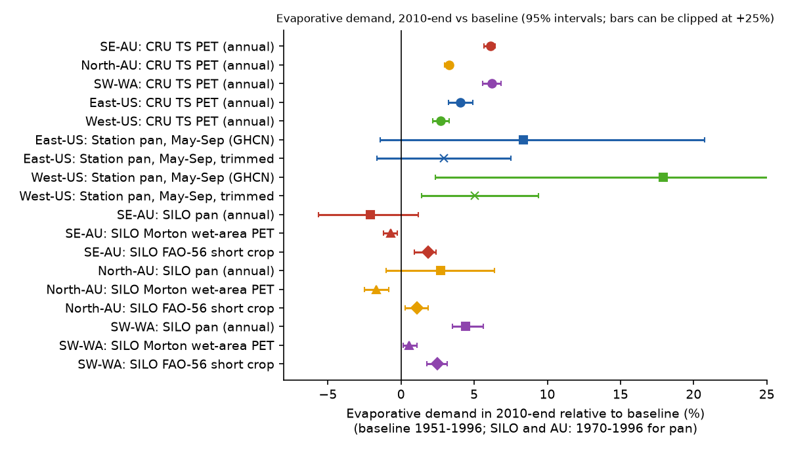
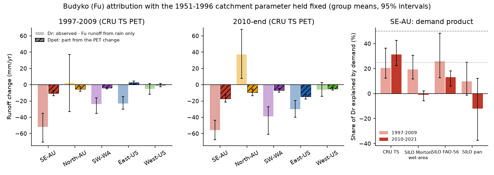
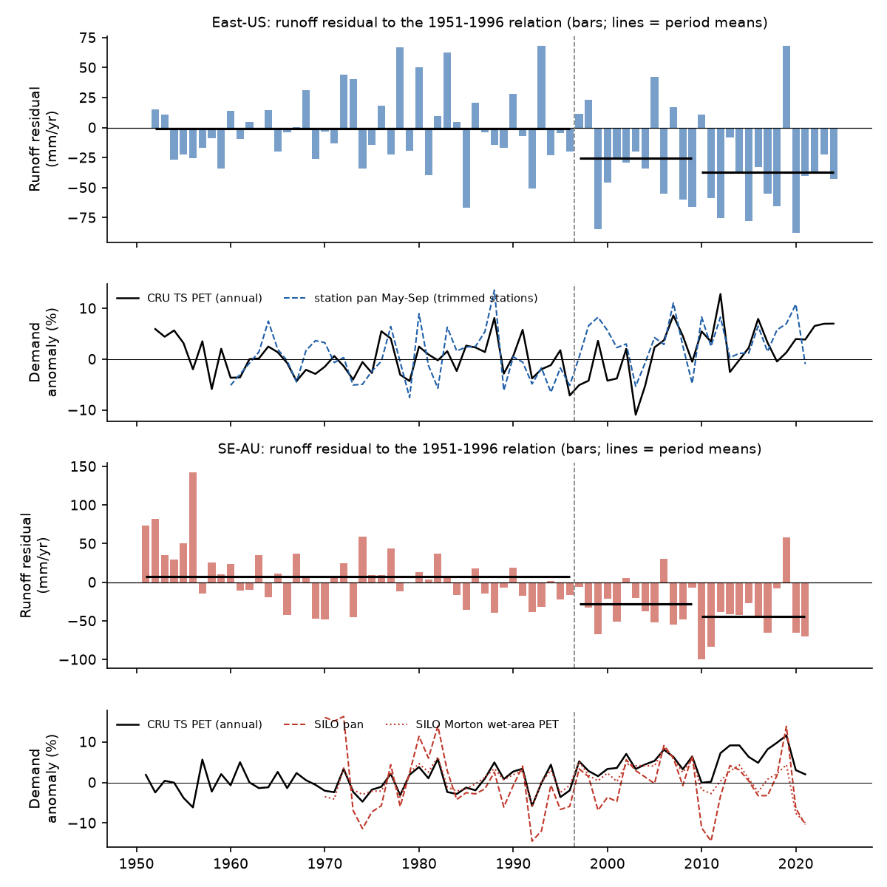

# Evaporative demand did not cause the post-1997 runoff loss in 175 south-east Australian catchments or start the offset in 260 eastern US catchments; after 2009 it explains about half of the US offset

Job `sci-1107-dell-earth-and-ocean-sciences-52acde2f0882`, campaign 11_07_2026, topic
earth-and-ocean-sciences, machine dell, account claude-olen. Model: Claude Opus 5.5
(`claude-opus-5-5`) in Claude Code (T3 Code). The signing key is a campaign-machine key. It is
not a personal authorship claim.

## Summary

**Question.** Earlier campaign bundles found that runoff in south-east Australia (SE-AU, 175
CAMELS-AUS catchments) and in the eastern US (East-US, 260 CAMELS catchments, HUC-02 regions
01-08) fell below each catchment's 1951-1996 rainfall-runoff relation after 1997 and stayed low
(bundles 7dedc5bb, df943002, 20955da2). Fixed rain-gauge networks confirmed both shifts, about
40 mm/yr after 2009 (20955da2). The SE-AU change is a 20-25% loss of the runoff response to
rain. The East-US change is a constant offset (871b2192). Those models used rain, previous-year
rain and air temperature. They did not test the physical cause. We tested one candidate cause
that the temperature term does not fully capture: **an increase of atmospheric evaporative
demand** (more radiation, for example the surface "brightening" after the US sulphur dioxide
cuts, drier air or more wind). In humid, energy-limited catchments such as the East-US, more
demand gives an almost constant runoff loss. Thus, this hypothesis agrees with the form of the
East-US offset.

**Method.** We wrote the plan (`files/ANALYSIS_PLAN.md`) before we calculated any demand
result. We used the valid catchment-years, the runoff residuals and the region groups of bundle
871b2192 without change. We used three kinds of demand data:

1. CRU TS 4.09 monthly PET (FAO Penman-Monteith from CRU temperature, vapour pressure and cloud;
   0.5-degree cell at the catchment), all regions.
2. CAMELS-AUS v2.03 SILO catchment series for Australia: Class-A pan evaporation, Morton
   wet-environment areal PET, FAO-56 short-crop PET, solar radiation and vapour-pressure deficit.
3. GHCN-Daily station pan evaporation (May-September totals) at US stations with records from
   1975 or before to 2018 or later (16 East-US and 59 West-US stations passed the completeness
   rules).

For each catchment we fitted the Fu (1981) Budyko curve parameter w to the 1951-1996 means of
rain, PET and runoff. With w fixed, we predicted the period-mean runoff for 1997-2009 (P1) and
2010-end (P2) from the period rain only (Qr) and from the period rain and PET (Qc). Dr = observed
- Qr is the runoff change that rain does not explain. Dpet = Qc - Qr is the part that the
demand change predicts. Intervals are 95% cluster-bootstrap intervals over 2 x 2 degree cells.

**Results.**

1. **SE-AU: demand does not explain the loss (planned rule: rejected with three of four demand
   products).** The rain-only Budyko deficit was -52 mm/yr in 1997-2009 and -56 mm/yr in
   2010-2021. With CRU PET (+6.1% in 2010-2021), demand explains 31% of the 2010-2021 deficit
   (95% CI 23-43%). But the station-based SILO series do not show this increase: Morton PET
   changed by -0.2%, pan evaporation by -1.7% and FAO-56 PET by +2.1%. With these series, demand
   explains -1%, -12% and 13% of the 2010-2021 deficit. Radiation was 3.0% *lower* in 2010-2021
   than in 1970-1996, and only the vapour-pressure deficit stayed high (+7.8%). In 1997-2009,
   demand explains 10-26% with all four products. Year to year after 1997, the SE-AU runoff
   residual was *less* negative in high-demand years (Pearson r = +0.68 with the CRU PET anomaly,
   25 years). This agrees with a loss of runoff response that is largest in wet, low-demand years
   (bundle 871b2192), and not with a demand effect. A non-demand deficit of -38 mm/yr (CI -51 to
   -26) remains in 2010-2021 even with CRU PET.
2. **East-US: demand did not start the offset (planned rule: rejected for 1997-2009).** In
   1997-2009 the rain-only Budyko deficit was -23 mm/yr (CI -30 to -15), but CRU PET was 0.7%
   *lower* than in 1951-1996 (CI -1.2 to -0.2%). Thus, CRU PET predicts slightly *more* runoff
   (+2.7 mm/yr), and the non-demand deficit was -26 mm/yr (CI -34 to -17). Station pans in the
   East-US rose by +2.5% (CI -0.7 to +5.6%, 16 stations) in 1997-2009. If this increase applied
   to the catchment PET, it would explain about 39% of the 1997-2009 deficit (post hoc; interval
   from -12% to 88%).
3. **East-US after 2009: demand can explain about half (planned rule: inconclusive).** CRU PET
   was +4.1% (CI 3.2-4.9%) higher in 2010-2025. Budyko predicts -14.8 mm/yr from this change,
   49% of the -30 mm/yr deficit (CI 35-82%). Station pans rose by +8.3% (CI -1.4 to +20.7%;
   median +5.6%; +2.9% without one station with a ratio above 1.6). A full explanation needs a
   PET increase of about 79 mm/yr (8%); CRU PET rose by 39 mm/yr. A non-demand offset of -15 mm/yr
   (CI -26 to -4) remains.
4. **Cross-sections do not support demand as the driver of the East-US offset.** Within the
   East-US, catchments with a larger CRU PET increase did not have larger deficits (Spearman
   +0.09, p = 0.14; the hypothesis predicts a negative value). With the nearest station pan within
   150 km (70 catchments, 17 stations), Spearman was +0.09 (p = 0.47). In SE-AU the 2010-2021
   correlation had the expected sign but was weak (-0.19, p = 0.012); in 1997-2009 it had the
   opposite sign (+0.18, p = 0.02).
5. **Controls.** In the West-US, CRU PET also rose (+2.7%) and station pans rose (+5.0% with
   trimming), but runoff did not fall relative to the regression (+12 mm/yr). Budyko gives this
   region a small demand elasticity, so this is consistent, but it shows that the demand increase
   after 2009 was not specific to the deficit regions. In a post hoc placebo (w fitted to
   1951-1980 and tested on 1981-1988 and 1989-1996), the East-US rain-only deficit was -8 and
   -9 mm/yr. Thus the Budyko frame has a bias of this size. The post-1997 East-US values (-23 and
   -30) are larger. The SE-AU placebo deficit was already about -30 mm/yr before 1997, which
   agrees with the earlier finding of a SE-AU drift in 1981-1996.

**Conclusion.** An increase of evaporative demand is not the cause of the SE-AU runoff loss.
Three of four demand products show little or no increase after 2009, the deficit is largest in
low-demand years, and at least 38 mm/yr of the 2010-2021 deficit has no demand explanation. For
the East-US, CRU PET decreased in 1997-2009 while the offset started. Thus demand did not start
the shift, unless the station pans (+2.5%, uncertain) are a better measure than CRU PET. After
2009, demand rose by about 4% and can explain about half of the East-US offset. A non-demand
offset of about 15-26 mm/yr remains in both periods. The planned cross-section test did not
support demand. The physical cause of most of both shifts is still open. Our results move the
search toward non-atmospheric causes: catchment storage, vegetation water use per unit of
demand, and land or water use.

## Figures

**Figure 1.** Change of evaporative demand in 2010 to the end of the record relative to the
baseline. Baseline: 1951-1996 for CRU TS PET and GHCN pans; 1970-1996 for the SILO series.
Squares and crosses: station pans with and without stations that have a ratio outside 0.6-1.6.
The untrimmed West-US pan interval extends beyond the axis (+17.9%, CI 2.4-48.0%). In SE-AU only
CRU PET shows a large increase.

**Figure 2.** Left and centre: Dr (light bars, observed runoff minus the Fu runoff from the
period rain with the baseline PET) and Dpet (hatched bars, the runoff change that the PET change
predicts). Right: share of the SE-AU deficit Dr that the demand change explains, for four demand
products. Dashed and dotted lines: the 50% and 25% decision thresholds of the plan.

**Figure 3.** Group-mean annual runoff residual relative to the 1951-1996 relation of bundle
871b2192 (bars; black lines are period means), and group-mean demand anomalies. In the East-US
the residual became negative in 1997, when CRU PET was below its baseline. Station pans (16
stations, after the trimming rule, years with 8 or more stations) rose in 1997-2001. In SE-AU the
SILO pan and Morton series do not rise after 2009, while the CRU series does.

**Figure 4.** Catchment runoff residual in 2010 to the end of the record (bundle 871b2192
model) against the catchment CRU PET change. The demand hypothesis predicts a negative relation.

## Tables

**Table 1. Budyko (Fu) attribution with CRU TS PET.** dPET: group-mean PET change. Dr: observed
minus rain-only Fu runoff (mm/yr). Dpet: part from the PET change. X = mean Dpet / mean Dr.
Brackets: 95% cluster-bootstrap intervals. Number of catchments with a valid w in parentheses.

| Group | Period | dPET (%) | Dr (mm/yr) | Dpet (mm/yr) | X |
| --- | --- | --- | --- | --- | --- |
| SE-AU (169) | 1997-2009 | +4.6 [3.8, 5.2] | -51.6 [-70.5, -35.4] | -10.6 [-13.4, -7.3] | 0.20 [0.12, 0.36] |
| SE-AU (169) | 2010-2021 | +6.1 [5.7, 6.4] | -55.6 [-67.5, -43.6] | -17.4 [-21.4, -12.4] | 0.31 [0.23, 0.43] |
| SW-WA (25) | 2010-2021 | +6.2 [5.6, 6.8] | -38.9 [-60.9, -27.3] | -6.8 [-9.3, -4.7] | 0.18 [0.13, 0.23] |
| North-AU (64) | 2010-2021 | +3.3 [3.0, 3.5] | +37.1 [7.7, 67.9] | -9.7 [-13.5, -5.7] | - |
| East-US (260) | 1997-2009 | -0.7 [-1.2, -0.2] | -23.2 [-30.3, -14.8] | +2.7 [0.9, 4.4] | -0.12 [-0.20, -0.05] |
| East-US (260) | 2010-2025 | +4.1 [3.2, 4.9] | -30.2 [-39.9, -19.4] | -14.8 [-17.5, -12.1] | 0.49 [0.35, 0.82] |
| West-US (262) | 2010-2025 | +2.7 [2.2, 3.3] | -6.2 [-14.2, 2.7] | -5.1 [-6.6, -3.8] | 0.82 [0.34, 7.3] |

**Table 2. SE-AU with the CAMELS-AUS SILO demand series** (same method; X with 95% interval).

| Demand series | dPET 2010-2021 (%) | X 1997-2009 | X 2010-2021 |
| --- | --- | --- | --- |
| CRU TS PET | +6.1 | 0.20 [0.12, 0.36] | 0.31 [0.23, 0.43] |
| SILO Morton wet-environment PET | -0.2 | 0.19 [0.12, 0.31] | -0.01 [-0.06, 0.02] |
| SILO FAO-56 short-crop PET | +2.1 | 0.26 [0.13, 0.48] | 0.13 [0.06, 0.18] |
| SILO Class-A pan (baseline 1970-1996) | -1.7 | 0.10 [-0.01, 0.25] | -0.12 [-0.37, 0.12] |

**Table 3. Station pan evaporation, May-September (GHCN-Daily).** Mean of station ratios minus 1.

| Group | Stations | 1997-2009 | 2010-end | 2010-end, trimmed |
| --- | ---: | --- | --- | --- |
| East-US | 16 | +2.5% [-0.7, +5.6] | +8.3% [-1.4, +20.7] | +2.9% [-1.6, +7.5] (15) |
| West-US | 59 | +0.8% [-1.2, +2.6] | +17.9% [+2.4, +48.0] | +5.0% [+1.4, +9.4] (58) |

All values are in `files/results/`: `budyko_groups_<product>.csv` (E2, E3),
`budyko_groups_PET_placebo.csv` (post hoc placebo), `demand_change.csv` (E1),
`pan_stations.csv`, `pan_crosssection.csv`, `pan_monthly_profile.csv` (post hoc),
`pan_annual_group.csv`, `annual_group_PET.csv` and `au_demand_annual_group.csv` (E4 and Figure 3).

## Decisions against the plan

| Region and period | E1 (demand increase) | E2 (share explained) | Plan decision |
| --- | --- | --- | --- |
| SE-AU 1997-2009 | yes for CRU, Morton, FAO; pan CI includes 0 | 0.10-0.26 | rejected (CRU, Morton, pan); inconclusive (FAO, 0.26) |
| SE-AU 2010-2021 | CRU and FAO yes; Morton and pan no | -0.12 to 0.31 | rejected (Morton, FAO, pan); inconclusive (CRU) |
| East-US 1997-2009 | CRU no (decrease); pan CI includes 0 | -0.12 (CRU) | rejected |
| East-US 2010-2025 | CRU yes; pan CI includes 0 | 0.49 (CRU) | inconclusive (just below 0.5) |

E3 did not support the hypothesis in East-US (planned CRU and pan tests). E4: the post-1997
annual correlation of the residual with the PET anomaly was -0.21 in East-US (p = 0.29) and +0.68
in SE-AU (p < 0.001).

## Post hoc analyses (not in the plan)

- Placebo split (w from 1951-1980; tests 1981-1988 and 1989-1996), `budyko_groups_PET_placebo.csv`.
- Pan-scaled demand part in the East-US: mean catchment PET elasticity (-0.38) x mean baseline
  PET (978 mm/yr) x station pan change. This gives -9 mm/yr (39%) for 1997-2009 and -11 to
  -31 mm/yr (36-104%, by trimmed or untrimmed mean) for 2010-end, with wide intervals.
- Monthly pan profile (median over trimmed stations, `pan_monthly_profile.csv`): the East-US
  increase after 2009 was largest in August-September (+10 to +11 mm per month).
- The annual pan series in Figure 3 and `pan_annual_group.csv` use trimmed stations only.

## Limitations

- **Demand products disagree.** CRU TS PET uses CRU cloud cover, which after the 1990s depends
  more on interpolation and on diurnal temperature range in many areas. SILO and GHCN pans are
  point measurements with possible changes of pan, site and exposure that the metadata do not
  record. The Australian result depends on the product; the East-US pan network is small (16
  stations) and one station (Knoxville, ratio 1.9) has a probable data problem.
- **Budyko frame.** The Fu curve with a fixed parameter uses period means. It assumes no change
  in storage and the same elasticity in all years. The placebo shows biases of about -8 to -19
  mm/yr in US groups. The CRU cell is at the gauge (US) or the outlet (AU), not a basin average.
- **Demand is not ET.** A demand increase can change actual ET less or more than the Budyko
  elasticity predicts. Vegetation that changes its water use per unit of demand is not part of
  this test. Thus, "non-demand deficit" can include vegetation, storage, land use and
  measurement effects.
- **Data.** Australian flow ends in 2021. One GHCN station file (USC00254455, Kingsley Dam NE,
  a West-US station) was truncated during the download and was not used. GHCN-Daily files change
  daily; a new retrieval can differ slightly from ours (hashes in `files/provenance/`).
- We did not measure radiation directly. Station radiation records with a long pre-1997 baseline
  were not available without registration.

## Reproduction

`files/code/reproduce.sh` reproduces all results. It reads the derived inputs from the signed
campaign bundles 871b2192 and 664b208c with `sci read`, reads the CAMELS-AUS hydrometeorology
ZIP in place, downloads the CRU TS PET files and the GHCN-Daily station files into a separate
scratch folder, and then runs:

1. `build_au_demand.py`: annual SILO demand sums per catchment (CAMELS-AUS).
2. `cru_pet_points.py`: annual CRU PET at the catchment points.
3. `pan_ghcn.py`: monthly and May-September pan totals per GHCN station.
4. `budyko.py <in> <out> PET|mwet|fao|pan` (E2, E3, E4); `PLACEBO=1` for the placebo.
5. `pan_analysis.py` (E1, E3 with pans); `figures.py`.

Run time on an unloaded machine is a few minutes after the downloads. Hashes of all inputs are
in `files/provenance/`. Software versions are in `files/environment.txt`. External data terms
are in `files/DATA_NOTICE.md`. The bundle contains no raw third-party data and no per-catchment
CRU or SILO values.

## Citations

Campaign bundles: 871b2192 (data, groups and runoff residuals), 664b208c (US basin climate),
20955da2, 5b8df990, 7dedc5bb, df943002, 36d145c1, 996e7776, 03b9bf62, d124c3f7, 363ebf38
(earlier findings). External: Fu (1981); Zhang et al. (2004, WRR 40, W02502) for the Fu form;
Fowler et al. (2025) CAMELS-AUS v2.03; Addor et al. (2017) CAMELS-US; Harris et al. (2020) CRU
TS; Menne et al. (2012) GHCN-Daily; Oliveira et al. (2011, Global Change Biology 17:3453) for
modelled brightening effects on runoff; Peterson et al. (2021, Science 372:745).
