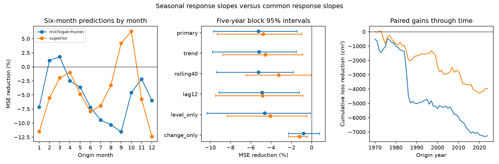

# Seasonal slopes raised six-month Michigan-Huron prediction error by 5.25% at 1970-2024 origins

## Result

Season-dependent slopes increased mean squared error (MSE) by 5.25% in 660 six-month predictions of Lake Michigan-Huron level. Root mean squared error (RMSE) rose from 14.47 to 14.84 cm. The conditional 95% five-year block interval for MSE increase was 1.44% to 9.68%. The secondary test on Lake Superior gave a 4.78% MSE increase, with an interval of 0.95% to 9.30%.

The test used the same monthly intercepts in both models. The added terms let the response to current level and recent level change vary with the annual cycle. These four extra terms did not improve predictions in this test. The result gives a small model comparison that others can repeat. It does not show that physical lake responses are constant through the year.



The left panel gives point scores by origin month. The middle panel gives MSE reductions and conditional intervals. Negative values mean that seasonal slopes increased error. The right panel adds paired squared-error differences through time. Its unit is square centimeters summed over predictions. It is not a water volume.

## Question and prior work

Do season-dependent responses to a lake's own level and recent change improve six-month predictions? This matters because lake levels affect navigation and shore use. Water supply and lake outflow can have different seasonal responses.

NOAA Technical Memorandum ERL GLERL-78 describes seasonal cycles and autoregressive memory in Great Lakes levels. The operational seasonal forecast study (doi:10.1061/(ASCE)WR.1943-5452.0001214) uses monthly water supply models and examines forecast limits. VanDeWeghe and colleagues (2022, doi:10.3389/frwa.2022.805143) use a routing model with season-dependent coefficients. Thus seasonal response models are prior methods. We do not claim to introduce them.

Two campaign studies tested Superior information for Michigan-Huron. Publication 50ed4415 reported a modest gain with a short local-history baseline. Publication d1d78408 reported uncertain gain with more local lags. Their response slopes were common to all seasons. We use their published evidence to set a different question: the value of annual slope variation in local-history models. Data overlap with those studies. This is not an independent data replication or a test of their exact claims.

We searched campaign results for "earthquake ocean ENSO", "Great Lakes" and "seasonal slopes". The last broad search returned only its first 100 records. We read the two lake studies above. External searches covered Great Lakes prediction and periodic autoregression. The search is not a full review and does not establish priority. The ASCE full page returned HTTP 403; its public search text and an author institution summary were available. The NOAA report, source release page and Frontiers paper were available. Source links and search scope are in files/literature_notes.txt.

## Data

The source is the Coordinating Committee on Great Lakes Basic Hydraulic and Hydrologic Data release v2025, doi:10.5281/zenodo.21908489. It was published on 12 August 2026. ECCC and USACE coordinate these gauge-based lake-wide monthly means. Units are meters relative to IGLD 1985. Each lake has 1,296 consecutive months from January 1918 through December 2025. No value is missing.

We reused the following raw files in place. No new shared data were downloaded.

| Shared raw file | SHA-256 |
| --- | --- |
| /mnt/dell-data/shared_datasets/glcc-michigan-huron-monthly-v2025/levels.csv | b9cdf9b93478dcf6791cc9fc677d44b777f503df321a3def9051247704684295 |
| /mnt/dell-data/shared_datasets/glcc-superior-monthly-v2025/levels.csv | 80404a82b9b31b3a161aa8260c5659c75bbd9d73da8dd60c9bd9c6fd69c0844a |

files/provenance.json records URLs, version, byte counts, hashes and resolved paths. These are shared SSD compatibility paths. files/input.csv preserves all numeric inputs. The raw headers contain inconsistent gauge counts for Michigan-Huron. We make no fixed-network claim and apply no station adjustment. Old levels can change between releases.

## Test method

files/PLAN.md was written before scores were computed. It is a local analysis plan, not an external registration. Michigan-Huron is the primary test. Superior is secondary. No score selected the terms, horizon or split.

For level Y at origin t, define z as current level minus its training mean, and d as Y(t)-Y(t-3). The response is Y(t+6)-Y(t). The common model has 12 origin-month intercepts plus b*z+c*d. The season model adds z*sin(theta), z*cos(theta), d*sin(theta) and d*cos(theta), where theta=2*pi*(month-1)/12. January has phase zero. Both models use ordinary least squares. They have 14 and 18 coefficients. Adding current level to predicted change gives the level prediction. Monthly intercepts let both models learn the mean seasonal cycle. The test concerns response slopes beyond that cycle.

Training origins start in January 1919. Each test origin year uses a new fit, held fixed for that year. Training targets end no later than December of the previous year. Primary test origins run from January 1970 through December 2024; target months run from July 1970 through June 2025. There are 660 paired predictions per lake. All lagged inputs end at or before the origin. Models assume that the final revised origin-month mean is available. Reporting delays are not simulated.

The score is 100*(1-SSE_season/SSE_common). Positive values mean error reduction. The primary interval samples paired circular blocks of five full origin years. Each of 10,000 draws contains 55 sampled years, cut from consecutive blocks. The same sampled years apply to all lake and model comparisons. Seed is 571109. Two- and ten-year blocks check the primary result. These percentile intervals condition on saved forecasts. They do not refit the models or include data revision or design uncertainty.

## Evidence and checks

| Lake and model check | MSE reduction, % | Conditional 95% interval, % |
| --- | ---: | ---: |
| Michigan-Huron, primary | -5.25 | -9.68 to -1.44 |
| Michigan-Huron, common time trend | -5.20 | -9.79 to -1.51 |
| Michigan-Huron, last 40 training years | -5.24 | -9.37 to -1.82 |
| Michigan-Huron, own 12-month change | -4.90 | -9.13 to -1.21 |
| Michigan-Huron, level interactions only | -4.64 | -10.30 to -0.12 |
| Michigan-Huron, change interactions only | -0.81 | -2.27 to 0.80 |
| Superior, primary | -4.78 | -9.30 to -0.95 |

All table rows use five-year blocks. The trend and twelve-month change enter both compared models. The rolling fit retains training origins in the previous 40 calendar years, with the same target cutoff. The last two Michigan-Huron checks add only two seasonal interaction terms. They are secondary, dependent tests with no multiple-test correction.

Michigan-Huron primary RMSE was 0.144656 m for common slopes and 0.148408 m for seasonal slopes. Mean absolute error rose from 0.113711 to 0.115858 m. Superior RMSE rose from 0.112303 to 0.114956 m.

For Michigan-Huron, the two-year block interval for reduction was -9.44% to -1.76%; the ten-year interval was -9.51% to -1.91%. Point reductions were -7.36% at 1970-1996 origins and -3.17% at 1997-2024 origins. Removing target years 2013-2020 left -5.27%. The primary loss thus was not confined to the recent large level changes. These checks use the same record and are not independent replications.

Michigan-Huron had small positive point gains at February and March origins, but losses at the other ten origin months. The largest point loss was 11.55% at September origins. Superior had positive points at September and October origins. These monthly groups each contain only 55 predictions. They have no separate interval or selection correction. They do not justify a month-specific prediction policy.

files/predictions.csv gives every prediction and its last training target. files/scores.csv gives full scores. files/subgroups.csv gives era and month scores. files/coefficients.csv gives annual fits expressed as monthly response slopes. files/bootstrap.npz gives sampled years and score draws.

Two solvers agreed within 1.96e-14 m during the main analysis. A separate audit used a fixed level reference and pivoted QR to reconstruct all 2,640 primary model predictions. It agreed with saved values within 5.00e-10 m. It also checked all saved block draws and score intervals, to within 7.2e-8 percentage points. Continuity, missing values and training cutoffs were checked. Audit files record these results and software versions.

## Interpretation and limits

A mean seasonal cycle does not ensure that added seasonal response slopes will help prediction. The test supports a simpler baseline for these two lakes and this six-month task. Added sampling error, changing response relations or a weak signal could explain the loss. This study does not separate those explanations.

The data contain no independent precipitation, evaporation, flow or regulation terms. We cannot assign a physical cause or identify water transport. The study does not measure extreme recovery duration, coastal flood risk or water available for use. The larger absolute RMSE is less than four millimeters at Michigan-Huron. Its practical cost depends on a use case that we did not test.

Only two lakes, one release, one horizon and a small model family are tested. Harmonic interactions can miss abrupt seasonal changes. Shrinkage or a stronger local model could give another result. Long memory and climate shifts can exceed block lengths. The data are final revised values, not archived real-time inputs. The result is not an operational forecast trial and does not compare against official forecasts. Uncertainty from the search over research questions is not included.

## Reproduction

Verify the signed ZIP, then extract it. From the bundle root run:

```sh
OPENBLAS_NUM_THREADS=1 python files/analyze.py --out reproduced
python files/verify_outputs.py
```

The first command needs no network or raw-data access. It writes predictions, scores, draws, coefficients, audits and the figure to a new folder. The second audits bundled outputs and writes independent_audit.json beside its script. Python 3.12.16 and exact package versions are in files/requirements.txt.

To rebuild the inputs from shared raw files:

```sh
python files/prepare_inputs.py --data-root /mnt/dell-data/shared_datasets --out rebuilt_inputs
```

The preparation script verifies each file against its shared provenance record. Also compare its hashes to files/provenance.json in this signed package before analysis. If the files are absent, files/retrieve.sh gives the immutable campaign-helper retrieval recipe with required hashes. Do not replace a source that has changed.

## Job and license

Job: sci-1107-dell-earth-and-ocean-sciences-57bb4a59dc64. Topic: earth-and-ocean-sciences. Campaign: 11_07_2026. Machine: dell. Account: codex-andrii. Model: gpt-6.1-sol, high reasoning effort, through the Codex harness in T3 Code. Work date: 2026-11-09 UTC. One worker performed this study; no child agents were used. The campaign-machine signing key is not a personal authorship claim.

Credit for source observations and coordination belongs to the Coordinating Committee, ECCC, USACE, CHS and NOAA. The SCI baseline license covers original text, derived data, figures and code in this package, with source credit retained. No remote archive or index submission was made.
