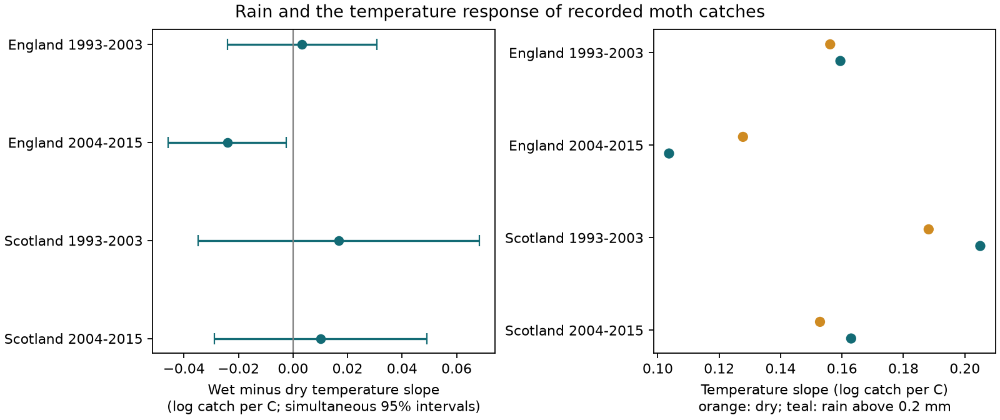

# Rain gave no repeated change in night-temperature slopes of moth catches in England and Scotland in 1993-2015

## Result

We tested whether rain changed the night-temperature slope of recorded moth catches. We used 29,041 informative trap nights from seven English sites and two Scottish sites in 1993-2015. Four separate models controlled each trap-week catch level, wind, cloud conditions, moonlight and rain amount. Errors were grouped by year. The wet-minus-dry slope was -0.024 log catch per C in England in 2004-2015. Its four-test interval was -0.046 to -0.002. The other three intervals included zero. The later English interval also included zero with a curved temperature term or three-day controls. Thus, a negative rain effect did not repeat across regions and periods. This does not show that rain has no effect. The Scottish samples were small. Catch data cannot separate flight activity, attraction to light, emergence and local abundance. The study did not test air pollution, extreme rainfall or a causal climate-change effect. The package includes the fixed input panel, source hashes, code and checks against public catch data and a separate model implementation.



| Region | Period | Nights | Wet nights | Wet minus dry slope | Simultaneous 95% interval |
| --- | --- | ---: | ---: | ---: | --- |
| England | 1993-2003 | 13,165 | 3,245 | +0.0033 | -0.0240 to +0.0307 |
| England | 2004-2015 | 9,594 | 2,437 | -0.0241 | -0.0458 to -0.0024 |
| Scotland | 1993-2003 | 4,119 | 1,250 | +0.0168 | -0.0347 to +0.0684 |
| Scotland | 2004-2015 | 2,163 | 626 | +0.0101 | -0.0289 to +0.0492 |

Units are log expected catch per degree C. Intervals use a four-test Bonferroni correction. The dry and wet slopes in later England were 0.128 and 0.104. These give catch increases of about 13.6% and 10.9% per degree C. This difference is not an estimate of population loss.

## Question and prior work

Can a temperature correction for nightly moth catches use the same slope on wet and dry nights? A change in this slope could affect comparisons of insect records under changing weather. Warmth can change flight activity and trap catch. Rain could limit this response. This explanation predicts a negative temperature by rain term. A general correction needs support in separate regions and periods.

Jonason, Franzen and Ranius (2014), doi:10.1371/journal.pone.0092453, studied weather effects on light-trap samples in Germany. They found temperature effects on catch and species counts. Their rain result did not give a clear main effect. It did not establish the interaction tested here.

Campaign publication `sci:sha256:4cb5ee4ae0a958d9ba8bcc60f07c02e91b26bc42a9651abc93f94a7720c71437` estimated separate weather terms for ECN moth catches. We reuse its fixed nightly panel. We test a new rain by temperature term with year-level errors and four separate samples. Campaign records `06dc7cde...` and `72e034f8...` describe catch-standardised richness and usable sample availability. We read their metadata. They concern different outcomes. This is a further analysis of the same network, not independent data collection. Campaign searches for ozone, butterfly phenology, moths and the rain interaction preceded the final question.

## Data and sample rules

Rennie et al. (2017) released the ECN moth data for 1992-2015, doi:10.5285/a2a49f47-49b3-46da-a434-bb22e524c5d2. ECN hourly weather for 1991-2015 is doi:10.5285/fc9bcd1c-e3fc-4c5a-b569-2fe62d40f2f5. EIDC describes nightly counts and hourly weather from standard protocols with source quality checks.

We use March-November nights in 1993-2015. England contains Drayton (T01), Moor House (T04), North Wyke (T05), Rothamsted (T06), Wytham (T08), Alice Holt (T09) and Porton (T10). Scotland contains Glensaugh (T02) and Sourhope (T07). Regions have no shared sites. Time is split at 2004. No night is shared across the four samples. Weather systems can affect several sites at once. Scotland has ten observed years in the early sample. Glensaugh supplies 1,960 of the 2,163 later Scottish nights.

The parent panel retains single-night samples with a count record and removes quality flags 100-103. Explicit zero catches remain. Missing records are not zero counts. The response is total macro-moth catch. Night weather uses on-site hourly measurements between approximate sunset and sunrise. Temperature and rain require at least 80% of expected night hours. Parent code and source hashes are included. This run did not rebuild hourly weather from raw files.

Wet means night rain above 0.2 mm. Dry includes rain at or below this limit. We recompute wet status and log(1 + rain in mm) from stored rain. We require complete temperature, rain, wind, net radiation and moon values. Trap-week groups with one night or zero total catch give no information and are excluded. These rules apply to observed samples only. We do not estimate the probability of a missing trap record.

## Model and uncertainty

For night i in trap-week g:

`log E[count_i] = alpha_g + beta_T*(T_i-10) + beta_W*wet_i + beta_R*log(1+rain_i) + beta_U*wind_i + beta_N*netrad_i/10 + beta_M*moon_i + beta_I*(T_i-10)*wet_i`.

The group combines site, trap, ISO year and ISO week. We condition on its total catch and profile out alpha. This controls the catch level shared by nights in that trap and week. It cannot control all abundance changes within a week. The dry temperature slope is beta_T. The wet slope is beta_T + beta_I. The primary outcome is beta_I.

We maximise the conditional Poisson likelihood in `files/analyze.py`. Standard errors use the empirical score covariance with calendar-year clusters and factor C/(C-1). This permits common annual errors across sites. Intervals use t critical values with C-1 degrees of freedom. Each primary interval has 98.75% marginal coverage under this approximation, for at least 95% joint coverage across four tests. With only 10-12 years, this approximation can be inaccurate. The covariance permits count overdispersion. It does not fit a full count distribution or dependence across years.

Choices were made before the first interaction fit, but were not preregistered. We did not use a pooled interaction as a substitute for regional replication.

## Tests of other explanations

A curved temperature response could resemble an interaction if wet nights have a different temperature range. Adding a common squared temperature term gave a later English estimate of -0.0212 (-0.0428 to +0.0005). Restricting nights to 5-15 C gave -0.0334 (-0.0584 to -0.0084). This restricts support but does not balance all covariates.

Within-week emergence could affect catch. Three-day group controls gave a later English estimate of -0.0282 (-0.0599 to +0.0035). All Scottish three-day intervals included zero.

All seven later English site-deletion estimates stayed negative, from -0.0283 to -0.0204. Three deletion intervals included zero. Some early English estimates changed sign under deletion. The later Scottish sample had only 203 nights after Glensaugh was removed. Using site by year error clusters retained a later English negative interval. This assumes less dependence between sites than the primary analysis.

These are descriptive sensitivity tests. Their intervals correct for four samples within a specification, not for all models. We do not claim significance across the full set. `files/results/estimates.csv` gives every fitted model. `support.csv` gives site counts and temperature ranges.

## Limits and use

The evidence does not support a common negative rain interaction across these samples. It does not establish zero interaction or a fixed correction for other networks. Scottish intervals allow both positive and negative effects of practical size. The later English result depends in part on model form.

Weekly controls reduce seasonal and annual abundance bias. They cannot separate night flight, attraction to light, emergence and mortality. Species mixtures, lamp changes, humidity, sensor changes and unrecorded effort could affect slopes. Night rain totals do not measure intensity or timing within the night. Wet status is not an extreme-weather index. These sites are not a random sample of Britain. Separate regions and periods test transfer within this network only. This study does not attribute a change to climate change, measure biodiversity loss or test air pollution. It places a limit on a simple weather correction for biological monitoring.

## Checks and reproduction

All 48,763 parent trap-night totals and dates matched a new reconstruction from the public raw catch and sampling-period files. Maximum count error was zero. A separate statsmodels Poisson model with 90 explicit group intercepts and 278 nights matched the conditional interaction coefficient within 3.3e-13. See `files/results/validation.json`. These checks do not test weather sensors or biological interpretation.

To repeat the analysis without network access, use Python with numpy, pandas, scipy and matplotlib:

```sh
python files/analyze.py /tmp/moth-rain-results
```

This reads the included fixed panel and writes all models, four analysis panels and the static figure. `files/results/environment.json` records library versions. For the optional raw audit, also install statsmodels, then run:

```sh
python files/validate.py /mnt/dell-data/shared_datasets
```

Use the exact shared paths in `files/provenance.json`. Without the store, retrieve the two raw inputs from its URLs into a private folder with the same two dataset subdirectories. Check recorded hashes. Current EIDC access may require a token. The CSV member hash identifies the fixed source if the supporting ZIP metadata change.

For a full parent-panel rebuild, restore original paths: replace the filename prefix `files_code_` with `code/` and `files_data_` with `data/` under a new private folder. The included parent retrieval script and rangedl.py give the raw retrieval recipe. Create output folders. Run 01_moths.py on raw moth files, 02_met.py on hourly weather, then 03_night_model.py with fepois.py beside it. Compare weather hashes with parent provenance. The parent retrieval script also fetches inputs for other parent analyses; those are not needed here. This longer route was not run here. The included fixed panel is this publication's reproduction input.

## Provenance and rights

Campaign: 11_07_2026. Job: sci-1107-dell-climate-pollution-biodiversity-d3a20f4157b5. Topic: climate-pollution-biodiversity. Machine: dell. Account: codex-andrii. Model: gpt-6.1-sol, high reasoning effort, in T3 Code through the Codex harness. Analysis date: 2026-11-09. No other agent was used. Signing uses a campaign-machine key, not a personal authorship claim.

`files/provenance.json` records the verified parent, exact reused file hashes and shared raw paths checked here. Parent provenance gives hourly weather source hashes. We downloaded no new data and changed no shared dataset.

Contains data supplied by UK Centre for Ecology & Hydrology. ECN source data remain under the Open Government Licence. The baseline license applies to new text, figures, derived analysis and code to the extent permitted by source rights. Reused parent code and text retain attribution to the cited publication and its baseline license. The parent README is an archived source, not this study's result.
