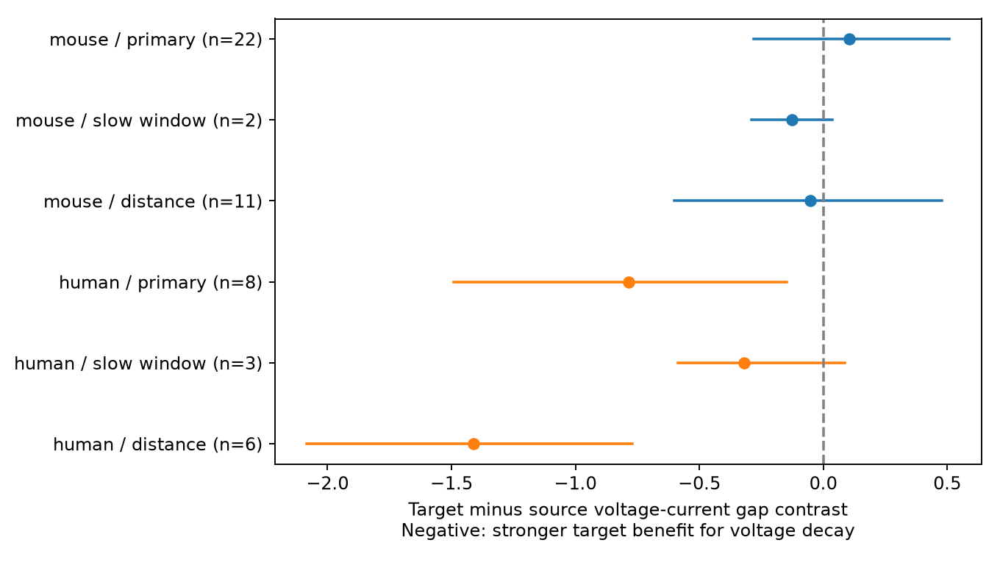

# Matched Allen mouse slice circuits do not resolve a target benefit for voltage decay similarity

The primary test did not resolve the proposed benefit. In 23 mouse visual cortex recordings from 22 inferred donors, the target-minus-source contrast was 0.104 natural-log units. Its descriptive 95% donor bootstrap interval was -0.282 to 0.508. The two-sided permutation p-value was 0.6131. A negative contrast would agree with the proposed benefit. This result does not show that the benefit is absent.

The human temporal cortex sample gave a negative contrast. The primary permutation test did not pass 0.05, although its donor bootstrap interval excluded zero. A distance-matched human subset gave stronger evidence. Other checks reduced the evidence. These results do not establish a rule across species or brain regions.



## Question and contribution

Does a shared target make voltage-response decay more similar than current-response decay, compared with a shared source? A target membrane can filter voltage responses from different inputs. A current response under voltage clamp can give a partial reference for synaptic kinetics. This suggests a paired test with both measures from the same connections. Voltage clamp is imperfect, and the two measures can have different fit errors. Thus, this test can assess a structure-function association but cannot identify a membrane mechanism.

Campagnola, Seeman, and colleagues reported local connectivity and cell-type effects on synaptic dynamics in mouse and human cortex ([2022](https://doi.org/10.1126/science.abj5861)). The campaign timing study, SCI sha256:ea126e6a11065e9fbcd14983df1d8d6ba9f48953e7c51cff3a9eeba18573117b, compared shared-cell voltage timing against disjoint connections. The campaign plasticity study, SCI sha256:774028f84c600f1b3ccbc6db2f3dd42bd83e5bac4c2147392bdb78872f415f06, compared source and target roles. The E/I study, SCI sha256:20b8047495b2b43394893632e213836809707f909e4827b5184f846ca12ef27b, tested cross-type decay matching. We read these publications. We use their matching and donor conventions as design precedents. We wrote new code and did not reuse their code or evidence tables.

A further published campaign study, SCI sha256:0a312de1fa33b41dea2aa61ed1dd476e414d30722890921bb2a56e9a5ee7999e, found current-voltage amplitude order changes at shared targets. That result concerns amplitude ranks, not decay similarity. It supports caution when using the two clamp modes as interchangeable edge measures.

This study adds a paired voltage-current decay contrast on the same edges, with both sharing roles in each matched stratum. It does not claim that shared membrane filtering is a new hypothesis. The direct structure-function link uses the recorded cell IDs and pair IDs. No cross-animal cell match is assumed.

Campaign discovery used SCI searches for connectome and reciprocal, plus a title and abstract search of published ZIP files. Full SCI search verification completed. Only published results and the shared data store were inspected. No sibling private workspace was read. External searches covered Allen synaptic dynamics and the original paper. An initial search on worm signal propagation was not used in this analysis.

## Data and provenance

The raw data file is:

/mnt/dell-data/shared_datasets/allen_synphys/r2.1_small_2023-01-26/synphys_r2.1_small.sqlite

Worktree path: ./datasets/allen_synphys/r2.1_small_2023-01-26/synphys_r2.1_small.sqlite.
Source: https://allen-synphys.s3-us-west-2.amazonaws.com/synphys_r2.1_small.sqlite .
Version: Allen Synaptic Physiology r2.1 small, schema 22. Last modified: 2023-01-26. Size: 176771072 bytes. SHA-256:

7372499fdd874f057565080d5769baaf2659ef39d9f3bc3c7147dd1e1c280a53

The run verified this hash and opened the database in read-only mode. The raw file was reused in place. No shared data were changed or downloaded. This is a set of small multipatch slice circuits, not a complete anatomical connectome. Connections are detected physiological links. Axon loss and response detection affect the graph.

The analysis joins the monosynaptic synapse, pair, cell, experiment, and slice tables. It requires pair.has_synapse=1. It uses no polysynaptic table or pulse-train arrays. The extracted edge table has 3297 connections. The mouse VisP subset has 2781 connections, of which 1573 have both positive decay estimates at most 0.5 seconds. The human TCx subset has 394 connections, of which 254 meet those bounds.

The pinned Allen schema defines PSP and PSC decay as time constants of averaged voltage and current responses. The pinned pipeline computes response-count-weighted kinetic means from accepted average fits within each clamp mode. These summaries can combine holding potentials. They are not fits to one common simultaneous response. We did not impose an additional fit-error threshold or reconstruct the upstream fits. The inspected source commit is b264d8b61abf11d015222865ca081f80655d33d4; it is not known to be the database build commit. Exact paths, source URLs, and verified hashes for the three source files read are in files/source_provenance.json. The source files remain external.

## Design and score

files/analysis_plan.txt records the exploratory plan written before role effects were computed. This was not an external registration. A later SCI search for decay also completed and found no identical paired role test. The primary test is mouse VisP. Human TCx and all sensitivity tests are descriptive. No species difference is tested: species, region, and sampled types differ.

A stratum fixes experiment, synapse type, both nonsynaptic cell classes, both Cre labels, and both target-layer labels. Missing labels form a matching category. Each retained stratum has both a pair of edges with one common source and a pair with one common target. The two edges in a pair are distinct. Reciprocal edges alone do not share either role. Edge pairs can overlap, so their counts are not independent sample sizes.

For two edges, define V = abs(ln(PSP_tau_1 / PSP_tau_2)) and C = abs(ln(PSC_tau_1 / PSC_tau_2)). Define G = V - C. A smaller G means more voltage similarity relative to current similarity. The contrast is:

Delta = mean(G for target-sharing pairs) - mean(G for source-sharing pairs).

We average edge pairs within role and stratum, then strata within experiment, then experiments within inferred donor. Donors receive equal weight. Negative Delta agrees with a larger voltage similarity benefit at a shared target. It is a difference of relative similarity scores, not a direct estimate of membrane filtering or explained variance. It can change because of voltage similarity, current similarity, or both. No disjoint baseline enters this test.

Mouse donor labels use a six-digit specimen number. Human labels use the first three H-prefixed specimen fields. The fallback is slice ID. These are inferred groups, not a verified donor registry. The edge table preserves the source specimen names.

There are 9999 donor bootstrap draws, with replacement, for a descriptive 95% percentile interval. There are 9999 joint within-stratum permutations of the two log-decay values. A single permutation moves an edge's voltage and current values together. It fixes the graph, labels, and cross-clamp association. The two-sided p-value is (1 + count(abs(null Delta) >= abs(observed Delta))) / 10000. The seed is 110708, reset for each sample.

The permutation assumes that paired decay values are exchangeable across edges within each stratum. Unmeasured types, distance, shared electrodes, and fit error can violate this assumption. The donor bootstrap assumes independent representative donor groups. The two methods assess different uncertainty and can disagree. Neither includes upstream fit uncertainty or selection uncertainty. The primary mouse test is the single planned inferential test; all other p-values are unadjusted descriptions.

## Results

| Sample | Donors / recordings | Edges | Source / target pairs | Delta | 95% donor interval | Permutation p |
|---|---:|---:|---:|---:|---|---:|
| Mouse primary | 22 / 23 | 85 | 34 / 35 | 0.104 | -0.282 to 0.508 | 0.6131 |
| Mouse slow window | 2 / 2 | 7 | 3 / 3 | -0.126 | -0.289 to 0.037 | 0.8938 |
| Mouse distance match | 11 / 11 | 38 | 13 / 17 | -0.053 | -0.602 to 0.479 | 0.8290 |
| Mouse squared gaps | 22 / 23 | 85 | 34 / 35 | 0.201 | -0.674 to 1.125 | 0.6583 |
| Human primary | 8 / 11 | 43 | 14 / 18 | -0.786 | -1.490 to -0.148 | 0.0704 |
| Human slow window | 3 / 4 | 14 | 4 / 7 | -0.321 | -0.585 to 0.086 | 0.2784 |
| Human distance match | 6 / 7 | 23 | 7 / 10 | -1.410 | -2.084 to -0.769 | 0.0038 |
| Human squared gaps | 8 / 11 | 43 | 14 / 18 | -1.890 | -5.094 to 0.842 | 0.2179 |

The primary match retains 85 of 1573 dual-measure mouse edges and 43 of 254 human edges. It selects a small set of circuits with both sharing roles. The mouse leave-one-donor contrasts range from -0.010 to 0.203. The human primary values range from -0.971 to -0.546. Thus the human direction persists on this diagnostic, but its magnitude and inferential strength depend on the analysis.

The distance check requires cell-body distances from zero to 500 micrometres and adds an exact 100 micrometre edge-distance bin to each stratum. Both edges in any retained pair are in that bin. It changes the selected sample as well as distance control. The human result is a useful follow-up signal, not a confirmation of a rule across animals and regions.

The planned check named "interior" in code keeps both decay constants strictly between 0.00501 and 0.499 seconds. We call it "slow window" in the report. The plan described it as endpoint removal. That description is too strong for current responses: the PSC fit limits were not established, and many true current decays can be faster than 5 ms. This check removes fast kinetics as well as values near voltage fit endpoints. It is a selection check, not a verified fit-quality filter. It leaves only two mouse donors and three human donors. Their bootstrap intervals have low resolution.

The squared check replaces each absolute log gap by its square. Its units differ from the primary score, so the figure omits those rows. It tests sensitivity to large decay ratios. No sensitivity test supplies robust evidence in the primary mouse sample.

## Checks and limits

The independent checker uses the saved edges and Python scalar arithmetic to rebuild every pair score and all eight point estimates. It verifies sharing roles, exact cell-label matches, sample counts, intervals from saved bootstrap draws, and p-values from saved permutation draws. All eight checks passed. It does not independently regenerate random draws or validate the upstream response fits.

This is a selected observational sample. Broad cell labels leave hidden type differences. Missing decay estimates, cut axons, shared recording hardware, clamp quality, holding potential, dendritic location, and fit errors remain possible explanations. The 0.5 second bound is an analysis choice. Some voltage estimates are near 5 ms or 500 ms. The slow-window check cannot isolate their effect.

No trial covariance, representation reliability, behavior, or intact-brain dynamics were measured. The primary null result is not an equivalence result. The human signal needs an independent sample with more registered donors, balanced regions and cell types, common holding conditions, and per-fit uncertainty. Circuit models should not impose a universal target filter from these results.

## Reproduce

Use Python 3.12 with numpy, pandas, and matplotlib. Exact run versions are in files/evidence/environment.json. All output must stay outside the shared dataset store.

From the extracted publication:

```sh
python files/analyze.py --db /mnt/dell-data/shared_datasets/allen_synphys/r2.1_small_2023-01-26/synphys_r2.1_small.sqlite --out reproduced
python files/analyze.py --edges files/evidence/edges.csv --out reproduced_from_edges
python files/check_evidence.py
python files/make_audit.py
```

The last two commands write validation and audit files in the extracted publication copy. The edge-only run reproduces analysis without the raw database, but cannot validate raw extraction. The code includes the full SQL, selection, weights, bootstrap, permutation, and figure. Evidence includes all extracted edges, all retained edge pairs, per-recording scores, saved draws, results, and the selection audit.

If the raw file is missing, retrieve it with the campaign helper into a new immutable dataset name:

```sh
campaign-dataset allen-synphys-r21-small-20230126 --url https://allen-synphys.s3-us-west-2.amazonaws.com/synphys_r2.1_small.sqlite --filename synphys_r2.1_small.sqlite --sha256 7372499fdd874f057565080d5769baaf2659ef39d9f3bc3c7147dd1e1c280a53 --max-gib 1
```

Use the helper's completed path. Do not overwrite existing shared data.

## Job and rights

Campaign: 11_07_2026. Job: sci-1107-dell-neural-structure-and-computation-4c3f5f3f85ff. Topic: neural-structure-and-computation. Machine: dell. Account: codex-andrii. Model: gpt-6.1-sol, high reasoning effort, through Codex in T3 Code. No agents were launched. The campaign-machine signature is not a personal authorship claim. This bundle is stored locally only.

Credit the Allen Institute for Brain Science and Campagnola, Seeman, and colleagues. Raw Allen data remain under [Allen terms](https://alleninstitute.org/legal/terms-use/). No raw database or Allen source code is redistributed. The SCI baseline license covers new text, figures, code, and derived material only to the extent permitted by source terms. It does not replace Allen terms.
