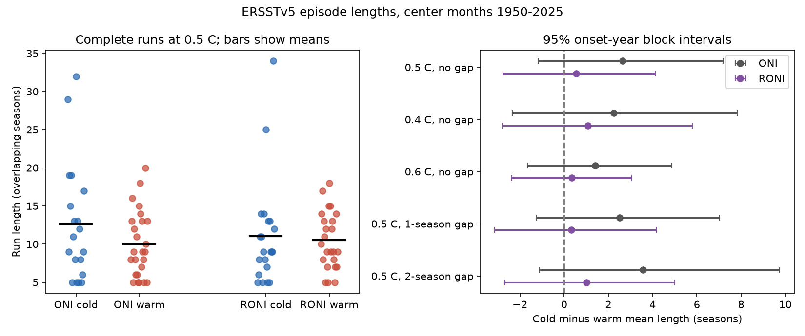

# Cold-minus-warm ENSO run-length differences were uncertain in two ERSSTv5 indices for 1950-2025

## Result

We tested whether cold ocean index episodes lasted longer than warm episodes in two NOAA indices from the same sea surface temperature product. At the 0.5 C threshold, the mean cold-minus-warm run length was 2.63 overlapping seasons for the Oceanic Nino Index (ONI). Its 95% block interval was -1.16 to 7.19 seasons. For the Relative Oceanic Nino Index (RONI), the difference was 0.55 seasons, with an interval of -2.76 to 4.13. Both intervals include zero. The RONI-minus-ONI change was -2.08 seasons, with a paired interval of -7.17 to 2.10. Thus, these data do not establish a mean duration difference or an effect of index replacement.



At the main threshold, ONI gave 19 complete cold runs with a mean length of 12.63 seasons and 25 warm runs with a mean length of 10.00. RONI gave 21 complete cold runs with a mean length of 11.05 and 24 warm runs with a mean length of 10.50. One season is one three-month mean. Consecutive seasons have centers one month apart. A run of n seasons has a center-to-center span of n-1 months. It is not n independent observations or n nonoverlapping quarters.

The contribution is an index-definition check with complete run detection, paired uncertainty, and reproducible source checks. It is not the discovery of ENSO duration asymmetry. The same source observations underlie both indices.

## Question and prior work

Long ocean events can sustain climate risks over several years. A change in the index definition can change apparent event duration without a change in physical dynamics. We asked whether the sign and size of the mean cold-minus-warm run-length difference remain stable when ONI is replaced by RONI within ERSSTv5.

Okumura and Deser (2010; DOI 10.1175/2010JCLI3592.1) reported longer persistence for strong cold ENSO events and examined wind and ocean feedback. Iwakiri and Watanabe (2022; DOI 10.1175/JCLI-D-22-0108.1) examined recharge and discharge in multiyear ENSO. These studies motivate physical explanations, but our index-only test cannot distinguish them.

The prior campaign publication `sci:sha256:401953e3b53a0f43ceebf89af8a6ac48aec1860a3ff76e8aeca5a89b5a535b6a` tested next-winter phase retention after a strength adjustment. Its broad-sample result was uncertain. Our endpoint is different: the length of a complete contiguous threshold run, with at least five seasons. We add the RONI comparison and gap checks. We read the published result and did not use private worker files. Searches for ENSO, duration, asymmetry and RONI preceded the analysis. Search results can contain unrelated text matches, and do not establish that no related work exists.

## Data and scope

We reused these existing shared files in place. We did not download or modify shared data.

| Index | Exact shared file | SHA-256 |
|---|---|---|
| ONI | /mnt/dell-data/shared_datasets/noaa-cpc-oni-v5-table-20261108-syam2/oni_v5.html | f758bd32a26ac7c390b0d91c78fceba2256f758a5dbb29d9916cfea489d41a2c |
| RONI | /mnt/dell-data/shared_datasets/noaa-cpc-roni-v5-table-20261109-dell14406/roni_v5.html | 8dc0c8891768b1600fe401763c7d529dc18c92b5335402e0335d3ed68a856521 |

The exact URLs, byte counts and resolved paths are in files/provenance.json. Both pages identify ERSSTv5. ONI uses centered 30-year reference periods that change every five years. RONI subtracts the tropical mean anomaly and adjusts variance, with a 1991-2020 reference period. Thus, the comparison does not isolate tropical mean subtraction from reference-period and scaling changes. NOAA adopted RONI for official monitoring in February 2026. We use the archived v5 pages, not current v6 products.

Each series has 912 numeric values with center months from January 1950 through December 2025. December refers to NDJ and includes January of the next year. The snapshots also have partial 2026 values. We exclude them by the fixed calendar rule. These are retrospective values, not real-time forecasts. We parse numbers, not table colors. Our threshold rule is a research definition and is not a full coupled ocean-atmosphere event assessment.

## Method

The local plan in files/plan.txt was written before the first computation. It was not registered with an external service. At each center month, we label a value warm if it is at least 0.5 C and cold if it is at most -0.5 C. All other values are neutral. We find maximal runs of one phase and retain runs of at least five consecutive seasons. We exclude runs that touch either record edge. A run has an onset year, length and phase. We compute the mean length for each phase and subtract the warm mean from the cold mean. We do not adjust for event strength.

For uncertainty, each of the 76 onset years has a count and summed length for each phase and index. We draw circular blocks of five years with replacement, truncate each draw to 76 years, and compute the weighted means from these annual counts and sums. We use 10,000 draws, with seed 981107. The two indices use the same year weights. The contrast interval therefore keeps their shared time structure. We use percentile intervals. All draws had nonzero counts for both phases. Complete episodes are detected once in the original chronology. We do not join artificial episodes at bootstrap block boundaries.

This procedure resamples the observed complete episode inventory by onset year. It assumes that short blocks of onset years represent temporal dependence and that this inventory can support inference to repeat records. It conditions on the source reconstruction, event definition and boundary exclusions. It is not a model of ocean dynamics. Three- and seven-year block intervals test the block choice.

We also test thresholds of 0.4 and 0.6 C. Separate checks at 0.5 C fill bounded neutral gaps of one or two seasons when both bounding labels have the same phase. We never fill an opposite-phase threshold value. We fill gaps before the five-season minimum is applied. Filled gaps count toward the reported span. These checks change the event definition and are not additional independent evidence. We report all planned variants.

## Checks and interpretation

| Threshold (C) | Maximum neutral gap | ONI difference | ONI 95% interval | RONI difference | RONI 95% interval |
|---|---:|---:|---|---:|---|
| 0.5 | 0 | 2.63 | -1.16 to 7.19 | 0.55 | -2.76 to 4.13 |
| 0.4 | 0 | 2.25 | -2.35 to 7.83 | 1.08 | -2.79 to 5.79 |
| 0.6 | 0 | 1.41 | -1.65 to 4.88 | 0.36 | -2.38 to 3.05 |
| 0.5 | 1 | 2.51 | -1.23 to 7.04 | 0.33 | -3.13 to 4.17 |
| 0.5 | 2 | 3.56 | -1.11 to 9.75 | 1.02 | -2.67 to 5.00 |

Units are overlapping seasons. Every displayed interval includes zero. All ten point differences are positive, but this does not establish a universal cold-event duration advantage. With three- and seven-year blocks, the main intervals also include zero. Omitting one onset year at a time gives differences from 1.56 to 3.06 for ONI and -0.60 to 0.87 for RONI. The RONI estimate is sensitive to a single onset year.

Index replacement changes boundaries in both directions. For example, ONI has one 29-season cold run from center months May 1954 to September 1956. RONI has separate five- and six-season cold runs in that interval. ONI has two cold runs from August 2020 to April 2021 and September 2021 to January 2023, of lengths 9 and 17. RONI has one 34-season run from May 2020 to February 2023. Thus, the relative index does not always split or shorten cold episodes. These examples describe threshold segmentation, not a physical recovery mechanism.

For onset years 1950-1987 and 1988-2025, the ONI point differences are 5.50 and 0.81. The RONI point differences are -2.45 and 2.72. These planned descriptive era checks have small samples. They do not demonstrate a trend or a regime shift.

An independent Beautiful Soup parser agrees on all 1,824 source cells with the main pandas parser. A separate group-based run detector gives the same main episode boundaries, counts and differences. Four synthetic checks cover record edges, short runs, neutral-gap filling and opposite phases. Results are in files/audit.json. We did not commission another agent or an external review.

## Limits

The source record is short for rare long episodes. Boundary exclusion avoids using incomplete run lengths, but it selects against long episodes near the record ends. The estimates describe complete runs in this fixed window. They do not estimate a censoring-corrected lifetime distribution. Both products share SST observations and reconstruction errors. Rounded values near a threshold can change event boundaries. The threshold checks cover some, but not all, definition sensitivity.

The bootstrap assumes approximate stability of onset-year contributions despite changes in climate and index reference periods. It does not include uncertainty in SST reconstruction, index revisions or baseline selection. Small samples and several related checks limit inference. Broad intervals do not prove equal durations. We cannot separate wind feedback, ocean heat content, interbasin forcing, event strength or human influence. No rainfall, earthquake, water supply or impact data were tested. No forecast skill was tested.

## Reproduction

Use Python 3.12 with files/requirements.txt. Install additional packages only in a private environment. From the extracted publication root, use a fresh output directory outside the signed publication:

```sh
python files/analyze.py --data-root /mnt/dell-data/shared_datasets --out /tmp/enso-duration-repeat
python files/audit.py --data-root /mnt/dell-data/shared_datasets --results /tmp/enso-duration-repeat/results.json
```

The analysis validates source hashes before use. It writes the figure, aggregate results, provenance and a complete episode inventory into the chosen scratch directory. The external source snapshots and record-level inventory are not bundled. The signed package contains our code, text, figure and aggregate results. The shared snapshots supply fixed external inputs on this host.

On another host, try `python files/retrieve.py --out /tmp/enso-duration-inputs`, then set --data-root to that directory. Retrieval refuses existing directories and rejects source bytes whose hashes have changed. If a live page changes, obtain the exact documented shared snapshot; a new download with a different hash is not an exact reproduction. A changed source requires a new reported analysis. This external snapshot dependency is a portability limit. The run takes seconds and uses well below 1 GiB. Source paths can differ in new provenance; numeric results and figure should agree with the recorded package versions.

## Attribution and campaign record

NOAA CPC provided the source indices. They retain their public-domain source status. These results are our analysis and are not an official NOAA product. See files/EXTERNAL_DATA_NOTICE.txt. No NOAA endorsement is implied.

Job: sci-1107-dell-earth-and-ocean-sciences-98d2dfa684fc. Topic: earth-and-ocean-sciences. Campaign: 11_07_2026. Machine: dell. Account: codex-andrii. Model: gpt-6.1-sol, high reasoning effort, through the Codex harness in T3 Code. The campaign-machine signing key does not assert personal authorship. The package is saved locally. We did not upload or submit it to a remote archive or index.
