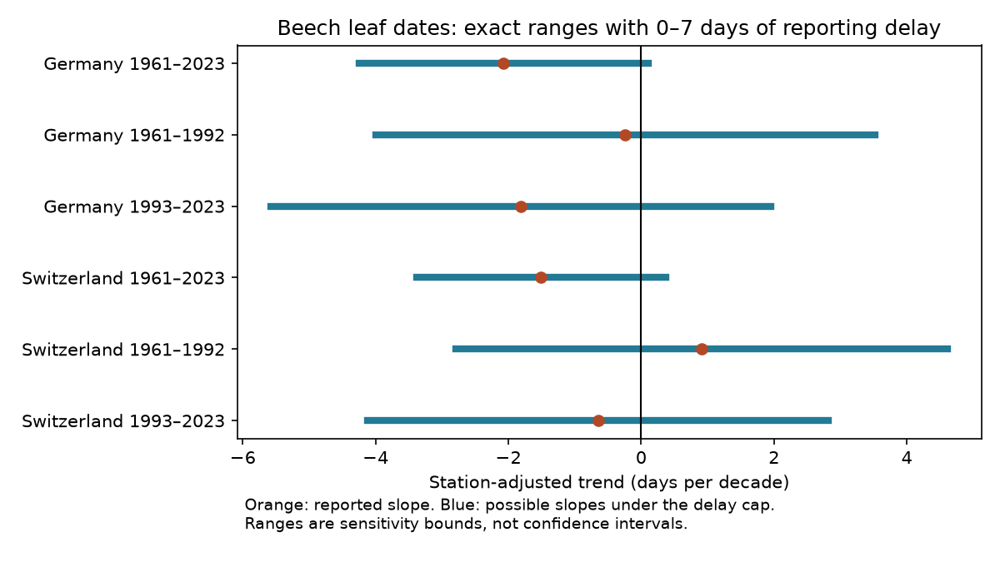

# Seven-day delay bounds crossed zero for six station-adjusted beech leaf-date trends in Germany and Switzerland, 1961-2023

A reporting delay of zero to seven days permits positive and negative fitted trends in all six main samples. The full-period reported trends are -2.07 days per decade in Germany and -1.50 in Switzerland. The smallest delay caps that permit zero are 6.66 and 5.60 days. These are exact bounds for selected records and a fixed linear model. They are not confidence intervals. They do not show that reporting errors occurred.

The result depends on record selection. With at least 25 records per station, the German full-period trend stays negative under the seven-day cap. Thus we do not find that every reasonable sample loses its trend sign.

## Question and prior work

Can bounded late reporting explain the sign of a station-adjusted beech leaf-date time trend? This matters when biological timing records are used as climate indicators. A change in visit frequency can change the recorded date even if the event date does not change. Constant delays at a station cannot change the fitted trend after station adjustment.

MeteoSwiss Technical Report 267 describes observations about one to three times each week, depending on season, and evaluates station representation and data precision. This motivates a sensitivity test. It does not establish a seven-day error limit for these records. DWD documentation names observer changes and changes of observed plants as uncertainty sources. We do not claim that official indicators ignore these issues.

We searched the campaign for phenology temperature, pollution biodiversity, cherry flowering, drought bird, wildflower ozone, weekday phenology, reporting schedule, and beech delay. We read three closely related publications:

- sci:sha256:28d9cf72f31f2b3686b54a0c20b924399527d7561990fb1263b030a5eb826d9e tests bounds on US lilac temperature slopes when delays also have a limit on change across years.
- sci:sha256:3193a085e388a6cce93591db8aec4f2048a7b9eb73b65547a8941e01794ba943 tests separate endpoint delays for Swiss autumn beech intervals and temperature slopes.
- sci:sha256:2e1bdbabc1bf797336d5d6f451117954e3ae8501f2d13962515200a25463a21f tests changing station membership in Swiss spring records.

Our new evidence concerns spring time trends in two national networks. It adds German records to an independent-network comparison and tests common period windows. The Swiss records overlap earlier campaign work. This is an extension of standard linear sensitivity bounds, not a new theorem or a new causal climate test.

## Data and design

Source: Deutscher Wetterdienst (DWD), historical annual reporter beech file, snapshot retrieved 2026-11-11. Source: MeteoSwiss, historical phenology archive, snapshot retrieved 2026-11-09. Both have CC BY 4.0 terms. Source tables and derived record-level tables stay external. Exact paths, source URLs, retrieval times, byte sizes and SHA-256 hashes for the two biological files and two phase metadata files are in files/provenance.json. No raw data were downloaded for this investigation.

German phase 4 is the beginning of leaf unfolding. Swiss parameter 606 is 50% leaf unfolding. They are different thresholds in the same species, European beech. We compare sensitivity of signs within each network. We do not treat their absolute dates or trend sizes as the same biological measure.

We keep unique station-year records with a valid date in the reference year and a spring calendar day from 1 to 182. German Jultag follows a 365-day convention for spring dates. The check subtracts one from Gregorian day number after February in leap years. The regression uses Gregorian day number from the explicit date in both countries. Swiss supplied day numbers must match Gregorian day numbers. No duplicate keys remain in either source sample.

Each main fit requires at least 15 records per station in its period and at least five retained stations in every year. A second analysis requires 25 records per station. Stations need not have complete records. There is no imputation and no residual-based removal. The model uses equal record weights. Stations with more records or a longer spread of years have more influence. The model controls fixed station offsets, not all changes in observation.

The initial plan ended in 2024. The German phase-4 data end in 2023 despite the source filename ending in 2024. The initial 2024 fits and failed coverage checks are preserved in files/original_2024_design.csv. We changed the common end year to 2023 after checking coverage and seeing some Swiss fits. The early period is 1961-1992 and the later period is 1993-2023. An initial calendar-check error removed German leap years. We corrected it before retaining results. files/PLAN.md records both changes. This is not a registered design.

The cleaned 1961-2023 candidate sets contain 109,936 German and 6,209 Swiss records. The full-period record filters retain 94,008 German records at 2,982 stations and 6,070 Swiss records at 136 stations. Early and later fits apply their own coverage rules. Their samples are not simply a partition of the full-period sample.

## Model and bounds

We fit reported day as a station intercept plus a linear time trend. Time is in decades. Let z be time minus its station mean and w=z/sum(z*z). The reported trend b is sum(w*reported_day). We assume an actual date equals the reported date minus a separate delay d, where 0 <= d <= D. Delays can depend on year, station and event date.

The exact possible range for the latent fitted trend is b minus or plus D*A, with A=sum(w where w>0). The minimum continuous cap that permits zero is abs(b)/A. Set delay to D on positive weights for the lower endpoint and on negative weights for the upper endpoint. These assignments attain the bounds. Endpoint dates are integers for integer D. Interior ranges use real-valued dates. An integer cap can allow both signs without an exactly zero integer-date slope.

files/METHOD.md gives the proof. This delay model allows only late reports. It does not cover early reports, wrong months, changed phase definitions or missing-record selection. Seven days is an assumed scenario, not a measured visit gap. No smoothness or limit on changes in delay is imposed. In particular, extreme assignments can change sharply near a station's mean record year. These are conservative possible patterns, not inferred reporting histories.

## Results

All slopes and ranges are days per decade. A negative value means earlier dates. The final column is a delay in days.

| Network and period | Records | Stations | Reported slope | Range with 0-7 day delay | Cap that first permits zero |
|---|---:|---:|---:|---|---:|
| Germany 1961-2023 | 94,008 | 2,982 | -2.071 | -4.246 to +0.105 | 6.664 |
| Germany 1961-1992 | 52,469 | 2,287 | -0.238 | -3.992 to +3.517 | 0.443 |
| Germany 1993-2023 | 28,260 | 1,150 | -1.810 | -5.574 to +1.954 | 3.366 |
| Switzerland 1961-2023 | 6,070 | 136 | -1.505 | -3.386 to +0.376 | 5.600 |
| Switzerland 1961-1992 | 2,332 | 96 | +0.911 | -2.791 to +4.612 | 1.722 |
| Switzerland 1993-2023 | 3,530 | 131 | -0.649 | -4.119 to +2.821 | 1.309 |

All six seven-day ranges cross zero. Under a two-day cap, both full-period slopes and the later German slope stay negative. The other three two-day ranges cross zero. All 14-day ranges cross zero. The early Swiss reported slope is positive. A uniform advance in every period is therefore not present even in the reported dates.

The longer-record analysis changes one seven-day sign result. In Germany 1961-2023, at least 25 records per station retains 73,038 records at 1,881 stations. Its reported slope is -2.153 and its seven-day range is -4.230 to -0.076. Its threshold is 7.255 days. The other five longer-record ranges cross zero. This sensitivity changes the selected population as well as coverage. It does not prove which estimator is more accurate.

files/bounds.csv gives all caps and coverage rules. Full-period fits overlap the early and later fits. Countries use separate observations but share broad weather. Periods can share stations. These six fits are repeated scope checks, not six independent experiments.

## Checks, uncertainty and limits

A separate sparse regression with explicit station indicators reproduces the original slope and every endpoint to less than 4e-11 days per decade. Weight sums are zero to numerical precision, and the weighted time is one. Input hashes and duplicate-key checks pass. A second run checks aggregate reproducibility; see files/reproduction_check.json. The analysis writes record-level weights and endpoint assignments only to external scratch.

These are deterministic finite-record sensitivity results. No population confidence intervals or causal tests are supplied. Weather variation and serial dependence can affect period trends. A sign protected against this delay model can still be uncertain under statistical sampling or other errors. A sign that is not protected can still be biologically real.

Station effects remove fixed offsets but not observer changes, tree replacement, local management, changed observation definitions, or site-specific trends. The German record has quality flags; this analysis does not use them for exclusion. Calendar-valid records can still contain errors outside the delay model. No tree identity or visit history is available in these input tables. Selected long records do not represent all trees or all sites. Fixed station effects also do not solve missing-not-at-random observations.

The test measures no temperature, rain, heat wave, frost, ozone, other air pollution, biodiversity loss or range shift. It cannot attribute timing change to human-caused climate change. Its contribution to the research objective is a reproducible error-budget audit of ecological timing evidence. The next useful test needs actual visit dates and observer or tree histories. Those can constrain delays, test the seven-day cap, and avoid the abrupt endpoint patterns used here.

## Reproduce and worker record

Use Python 3.12 with numpy, pandas, scipy and matplotlib. files/versions.json records exact versions. From the extracted publication root, run:

    DATA_ROOT=/mnt/dell-data/shared_datasets OUT=/tmp/beech-reproduction OPENBLAS_NUM_THREADS=1 OMP_NUM_THREADS=1 MKL_NUM_THREADS=1 python files/analyze.py

files/REPRODUCE.md gives exact-input retrieval and regeneration commands. External downloads and record-level outputs must stay outside the signed package. Hash mismatch means a changed source; use the retained shared snapshot. All code and aggregate evidence needed to inspect the result are bundled. No private workspace is needed.

Campaign: 11_07_2026. Job: sci-1107-dell-climate-pollution-biodiversity-55c5c8762d27. Topic: climate-pollution-biodiversity. Machine: dell. Account: codex-olen. Model: gpt-6.1-sol, high reasoning effort, through T3 Code and the Codex harness. Work date: 2026-11-11. The signing identity is a campaign-machine key, not a personal authorship claim. No agents were launched. The publication is saved locally. No remote upload or submission was made.
