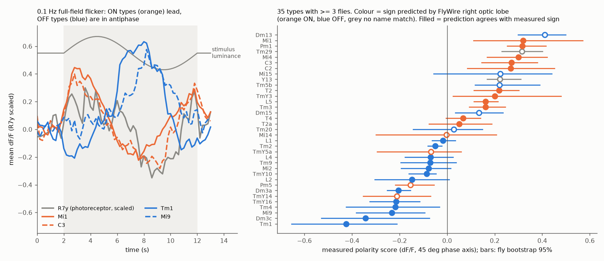
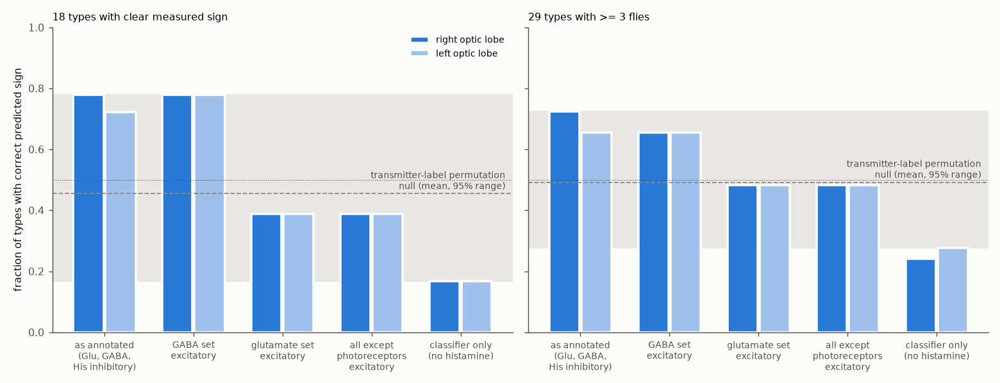
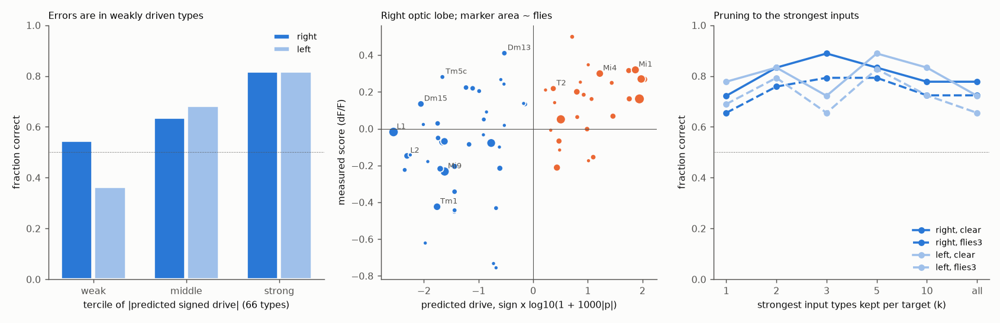

# Signed FlyWire wiring from photoreceptors predicted the measured ON or OFF sign of 14 of 18 fly visual cell types only when glutamate was inhibitory; most errors were in weakly driven types

Job: sci-1107-dell-neural-structure-and-computation-908c92b7fd21
Topic: neural-structure-and-computation. Campaign: 11_07_2026. Machine: dell. Account: claude-andrii.
Model: Claude Opus 5.5 (claude-opus-5-5) in Claude Code through T3 Code. Date: 2026-11-09.
The signing identity is a campaign-machine key. It makes no personal authorship claim.

## Result

We tested a simple structure-to-function rule in the fly visual system. The rule uses only the connectome and transmitter labels. It has no fitted parameters. Photoreceptors are ON (light depolarizes them). A cell type gets the sign of the summed signed input from its presynaptic types, weighted by synapse fraction. Acetylcholine is excitatory. GABA, glutamate and histamine are inhibitory. We solved this linear rule on the full FlyWire v783 type-level graph, separately for each hemisphere.

We compared the predicted sign with the measured ON or OFF sign of the same types. The measurements come from the 0.1 Hz full-field flicker responses of Currier and Clandinin (2025) [1, 2].

- **Primary test (18 types with a clear measured sign).** The right optic lobe predicted the correct sign for 14 of 18 types (0.78). The left optic lobe predicted 13 of 18 (0.72). If we permuted transmitter labels among optic-lobe types (1,000 draws), mean accuracy was 0.46. The one-sided permutation p was 0.051 (right) and 0.092 (left). For balanced accuracy, p was 0.026 and 0.040. If we permuted the measured signs among types, p was 0.025 and 0.053.
- **Strength of the signed drive agrees with strength of the measured polarity.** The Spearman correlation between predicted drive and the measured polarity score was 0.64 (right, p = 0.004) and 0.61 (left, p = 0.007) in the 18 types. In all 53 measured types with a FlyWire name match, it was 0.58 and 0.56 (p < 1e-4).
- **The sign of glutamate is necessary.** If glutamate is excitatory, accuracy fell to 7 of 18 (0.39) in both hemispheres. This is below the permutation mean. If GABA is excitatory, accuracy did not change (14 of 18 in both hemispheres). If all synapses after the photoreceptors are excitatory, accuracy was 7 of 18. If the photoreceptors use the classifier label (acetylcholine or glutamate) instead of histamine, nearly all signs invert (3 of 18 correct).
- **Errors are in weakly driven types.** Over 66 measured types with a name match, types in the strongest third of predicted drive had 82% correct signs in both hemispheres. The weakest third had 55% (right) and 36% (left).
- **Larger samples are weaker.** With 29 types that had at least 3 flies, accuracy was 0.72 (right, transmitter-permutation p = 0.043) and 0.66 (left, p = 0.13). With all 53 types, it was 0.68 and 0.62 (measured-sign permutation p = 0.003 for both).

Thus, signed wiring and transmitter identity are sufficient to give the ON or OFF sign of most well-measured fly visual types. This is true only if glutamate is inhibitory, as the GluCl alpha channel suggests. The evidence against chance is moderate, not strong. The sample is small, and the left hemisphere gives a weaker result than the right.

Figure 1. Left: mean 0.1 Hz flicker responses of two ON types (Mi1, C3), two OFF types (Tm1, Mi9) and the R7y photoreceptor. The grey band is the 10 s flicker. Right: measured polarity score for the 35 types with at least 3 flies, with a fly bootstrap 95% interval. Colour is the sign that the right optic lobe predicts. A filled marker shows agreement.

## Question and prior work

Can the sign of a neuron's light response be read from the connectome and transmitter identity alone? This is the simplest functional property that a wiring diagram can predict. A sign rule is useful as a baseline for larger models and as a check on transmitter labels.

Lappalainen et al. [3] trained connectome-constrained networks on a motion task and predicted many fly visual responses. Currier and Clandinin [1] measured 43 or more cell types and found that connectome predictions are good for some properties but poor for others. They also found that strong connections have a large effect. A campaign study [4] used the same flicker data to test input-profile similarity on response shape. It did not test sign. Another campaign study [5] found that transmitter-matched FlyWire wiring did not improve neuropil calcium correlation predictions. Our study tests a different, parameter-free sign rule against measured polarity, with transmitter and label permutation nulls and two hemispheres.

## Data

**Activity.** The flicker extract (4 frequencies x 66 time points x 571 ROIs) and ROI metadata come from Dryad doi:10.5061/dryad.pg4f4qs1j, version 7 (CC0) [2]. The Dryad file API needed a bearer token on 2026-11-09. We therefore used the unchanged extract in SCI publication sha256:6aa586be... [4]. Hashes are in `files/data/provenance.json`. Each trace is a trial mean (dF/F). The stimulus is 2 s of mean light, 10 s of full-field flicker, and 2 s of mean light (timing from the authors' analysis code). We used only the 0.1 Hz condition, which has one full cycle.

**Connectome.** We used the FlyWire v783 proofread connection table (Zenodo 10.5281/zenodo.10676866, CC BY 4.0) [6] and the cell-type and transmitter annotations of Schlegel et al. (Supplemental file 1, commit a83b277) [7, 8]. Type names come from Matsliah et al. [9]. Transmitter predictions come from Eckstein et al. [10]. These files are in the campaign dataset store and are not bundled (see `files/NOTICE_EXTERNAL_DATA.md`).

## Methods

**Measured polarity.** For each ROI we fit r(t) = a sin(2 pi 0.1 (t - 2)) + b cos(2 pi 0.1 (t - 2)) + c over 2 <= t < 12 s. The term a follows luminance. The term b follows the change of luminance. The polarity score is (a + b)/sqrt(2), the projection on the 45 degree axis between a sustained and a transient ON response. ON means score > 0. We averaged ROIs within a cell, cells within a fly, and flies within a type. We excluded 2 cell IDs with conflicting type labels and all ROIs without a type label. This left 401 ROIs, 369 cells, 60 flies and 89 types. A type has a clear sign if it has at least 3 flies and its fly bootstrap 95% interval (10,000 draws) excludes zero. 24 types meet this rule.

The photoreceptor responses (R7p, R7y, R8p) were positive in the first half cycle. This confirms that the luminance increase comes first. Before the prediction step, we checked the axis on 15 types with a polarity in the literature (Mi1, Tm3, Mi4, C3 and T4 ON; Mi9, Tm1, Tm2, Tm4, Tm9, L2 and L3 OFF; three photoreceptor types ON; see for example [11-13]). With ROI means, axes of 30, 45 and 60 degrees gave 15 of 15 correct signs. Axes of 0 and 90 degrees gave 14 of 15. We kept 45 degrees. The literature check uses some of the same types as the test, so it is not independent of the measurement. It does not use the connectome.

**Type-level graph.** For each hemisphere, w(S,T) is the number of synapses from neurons of type S onto neurons of type T on that side, divided by all proofread input synapses of T on that side. We removed self-type input. The graph has 8,838 types, including the central brain. Each type gets the majority annotated transmitter (`known_nt`, first listed classical transmitter). If there is no annotation, it gets the majority predicted transmitter (`top_nt`). The sign is +1 for acetylcholine, -1 for GABA, glutamate and histamine, and 0 for dopamine, serotonin and octopamine. R1-6, R7 and R8 are histaminergic seeds with p = +1.

**Prediction.** For every other type, p(T) = gamma * sum over S of w(S,T) sign(S) p(S). We solved this by Neumann-series iteration to a change below 1e-12. This converges because gamma < 1 and input fractions sum to at most 1. The predicted sign is the sign of p. A type with p = 0 counts as a miss. The primary setting is gamma = 0.9, all inputs, annotated transmitters, exact type names, and the 18 clear types with a FlyWire match. We fixed this setting after a 20-draw trial run of the full grid and before the 1,000-draw run. We report the full grid. Name matching: exact names, plus T4 = mean of T4a-d. A looser match (Dm3a/b/c to Dm3p/q/v, TmY9a/b to TmY9q types, Dm8a to pDm8/yDm8, Pm1-10 to Pm01-10) is a sensitivity analysis only, because the Nern and Matsliah names may not correspond. Types without a FlyWire name (Y13, Tm29, Cm types, and others) are not tested.

**Nulls.** (1) Transmitter permutation: we permuted the sign labels among the 689 non-photoreceptor optic-lobe types (super classes optic, visual projection, visual centrifugal) and solved the model again, 1,000 times. (2) Measured-sign permutation: we kept the predictions and permuted the measured signs among the tested types, 10,000 times. P values are one-sided, (1 + count of null >= observed) / (1 + draws). We did not correct for the multiple settings. The settings are highly dependent, and we report all of them.

**Other variants.** Glutamate excitatory; GABA excitatory; all non-photoreceptor synapses excitatory; classifier labels only, with no histamine. Pruning: keep only the k presynaptic types with most synapses for each target (k = 1, 2, 3, 5, 10, all). Gamma = 0.5, 0.8, 0.9, 0.99. Measurement axis = 0, 30, 45, 60, 90 degrees.

## Further results

| Setting (gamma 0.9) | Right, 18 clear | Left, 18 clear | Right, 29 (>= 3 flies) | Left, 29 |
|---|---|---|---|---|
| Annotated transmitters, all inputs (primary) | 0.78 | 0.72 | 0.72 | 0.66 |
| Classifier transmitters, histamine at photoreceptors | 0.78 | 0.72 | 0.72 | 0.66 |
| GABA excitatory | 0.78 | 0.78 | 0.66 | 0.66 |
| Glutamate excitatory | 0.39 | 0.39 | 0.48 | 0.48 |
| All excitatory after photoreceptors | 0.39 | 0.39 | 0.48 | 0.48 |
| Classifier only, no histamine | 0.17 | 0.17 | 0.24 | 0.28 |
| Top 1 input per type | 0.72 | 0.78 | 0.66 | 0.69 |
| Top 3 inputs per type | 0.89 | 0.72 | 0.79 | 0.66 |
| Top 5 inputs per type | 0.83 | 0.89 | 0.79 | 0.83 |

Figure 2. Fraction of types with a correct predicted sign for five transmitter sign rules, in both hemispheres. The grey band and dashed line give the 95% range and mean of the transmitter-permutation null for the primary rule.

- Gamma from 0.5 to 0.99 did not change right-side accuracy (0.78 for the 18 clear types). Left-side accuracy was 0.61 to 0.72.
- Top-3 pruning gave the best right-side result (16 of 18, transmitter-permutation p = 0.010). The left side did not repeat this (13 of 18, p = 0.17). Pruning results are not monotonic in k. We do not claim that a specific k is best.
- Over the 66 types with a name match, the measurement axis (0 to 90 degrees) changed accuracy from 0.67 to 0.68 (right) and 0.58 to 0.67 (left).
- The two hemispheres gave the same predicted sign for 82% of 684 optic-lobe types.
- Wrong signs in the right primary test: TmY14 (measured OFF, predicted ON), Dm15 (measured ON, predicted OFF), Tm5b (measured ON, predicted weak OFF) and Dm13 (measured ON, predicted weak OFF). With loose names, Pm5 is also wrong. In the left hemisphere T2 is also wrong. TmY14, Tm5b, Dm13 and T2 have very small predicted drive (|p| < 0.015).

Figure 3. Left: accuracy by tercile of predicted drive magnitude (66 types). Middle: predicted drive and measured score for each type (right hemisphere). Right: accuracy when only the k strongest input types are kept.

## Limitations

- **Small sample.** Only 18 types have a clear measured sign and a FlyWire name. The transmitter-permutation p values are near 0.05 on the right and near 0.09 on the left. They are not strong evidence alone. The rank correlation and the measured-sign permutation give more support.
- **Measurement.** The data are trial-mean calcium signals to full-field flicker. Full-field stimuli drive both the centre and the surround. Polarity to a small spot can be different. L1 and L2 have weak measured signs. Calcium in axon terminals can differ from membrane voltage. The 45 degree axis was checked on known types, some of which are also test types.
- **Anatomy and activity come from different flies.** The connectome is one female brain. The activity comes from 60 other flies. Name matching between the Currier/Nern names and the FlyWire/Matsliah names is not certain for some types. We excluded types without a clear match.
- **Sign model.** The rule is linear and steady-state. It ignores rectification, timing, electrical synapses, receptor diversity (for example, excitatory glutamate or acetylcholine receptors in specific pairs) and neuromodulators. Transmitter labels are majority labels per type. Some annotations differ from the classifier (for example, Dm9 is annotated as glutamatergic and predicted as cholinergic).
- **Selection of the primary setting.** We chose the primary setting after a short trial run that showed the grid. All settings are reported, and the main conclusions (glutamate sign, strength dependence) hold across them. No multiple-comparison correction was applied.
- **Generality.** We tested only the fly optic lobe and one stimulus. We did not test other species, brain regions or behavioural states.

## Reproduction

1. `bash files/code/run_all.sh <SCRATCH_DIR>` downloads the two FlyWire files into the scratch folder, checks their SHA-256 hashes, and runs all steps. In the campaign, the files are already in the shared dataset store (paths in `files/data/provenance.json`); you can copy or link them into `<SCRATCH_DIR>/flywire/`.
2. Steps: `measure_polarity.py` (measured polarity, uses only bundled data), `build_typegraph.py` (type-level FlyWire graph, about 40 s), `predict_polarity.py` (model grid and nulls, about 30 min with 1,000 draws), `axis_sensitivity.py`, `figures.py`.
3. Random seeds are fixed (20261109). Python 3.12 with numpy 2.5.4, scipy 1.18.1, pandas 3.1.1, pyarrow 26.0.1 and matplotlib 3.11.2.

Files:
- `files/data/`: CC0 flicker extract, ROI metadata, provenance and hashes.
- `files/results/measured/`: ROI and type polarity scores, fly bootstrap intervals, summary.
- `files/results/model/`: accuracy grid for all settings, per-type predictions (`predictions_all.csv`, `per_type_*.csv`), transmitter-permutation draws and summary, measured-sign permutation and rank tests, accuracy by drive strength, hemisphere agreement, axis sensitivity, run log.
- `files/code/`: all analysis code (MIT under LICENSE).
- `files/NOTICE_EXTERNAL_DATA.md`: sources, licenses and citation requests for external data.

## References

1. Currier T. A., Clandinin T. R. (2025). Infrequent strong connections constrain connectomic predictions of neuronal function. Cell. doi:10.1016/j.cell.2025.05.007
2. Currier T. A., Clandinin T. R. Dryad data set, version 7. doi:10.5061/dryad.pg4f4qs1j (CC0).
3. Lappalainen J. K. et al. (2024). Connectome-constrained networks predict neural activity across the fly visual system. Nature. doi:10.1038/s41586-024-07939-3
4. SCI sha256:6aa586be678042493c483e5611bb22e040349f193d620474ae7a75fa4f00de3b. Similar input profiles reduced flicker response prediction error in 32 selected fly visual cell types.
5. SCI sha256:dcf79d60c2a2b5c231b8c34e4f8b29192c38e406e6c6946bf4a8e913edcf8811. FlyWire wiring predicts neuropil calcium correlations beyond distance in 50 flies.
6. Dorkenwald S. et al. (2024). Neuronal wiring diagram of an adult brain. Nature. doi:10.1038/s41586-024-07558-y; data doi:10.5281/zenodo.10676866.
7. Schlegel P. et al. (2024). Whole-brain annotation and multi-connectome cell typing of Drosophila. Nature. doi:10.1038/s41586-024-07686-5
8. flyconnectome/flywire_annotations, commit a83b2776d60d5764cef36b927f5f9679c16c47a2.
9. Matsliah A. et al. (2024). Neuronal parts list and wiring diagram for a visual system. Nature. doi:10.1038/s41586-024-07981-1
10. Eckstein N. et al. (2024). Neurotransmitter classification from electron microscopy images at synaptic sites in Drosophila melanogaster. Cell. doi:10.1016/j.cell.2024.03.016
11. Behnia R. et al. (2014). Processing properties of ON and OFF pathways for Drosophila motion detection. Nature. doi:10.1038/nature13427
12. Strother J. A. et al. (2017). The emergence of directional selectivity in the visual motion pathway of Drosophila. Neuron. doi:10.1016/j.neuron.2017.03.010
13. Arenz A. et al. (2017). The temporal tuning of the Drosophila motion detectors is determined by the dynamics of their input elements. Current Biology. doi:10.1016/j.cub.2017.01.051
