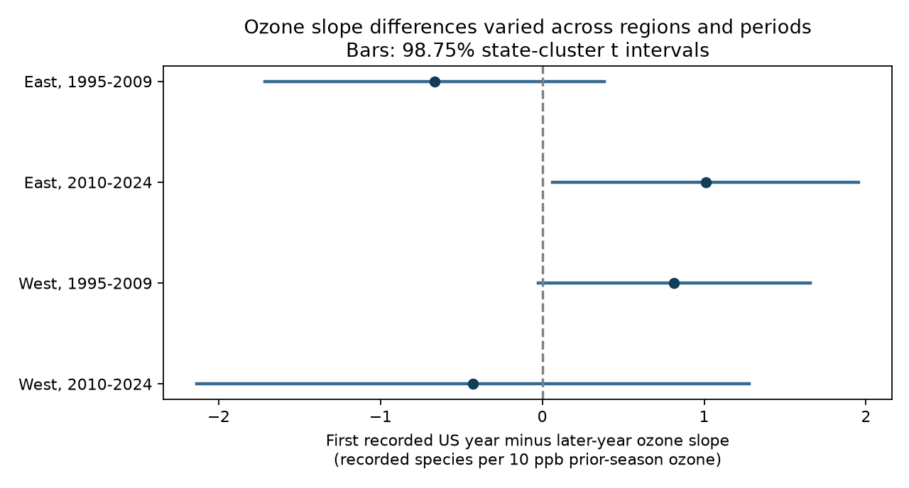

# First-year status gave no repeated ozone slope difference in four US bird samples in 1995-2024

## Result

The ozone slope difference between first-year and later-year observers did not repeat across the four samples. The difference means the first-year slope minus the later-year slope. A positive number means a more positive ozone association in the first recorded US survey year. It does not mean that ozone increased true species richness.

| Sample | Surveys | Routes | States | First-year surveys | Difference | Adjusted interval |
|---|---:|---:|---:|---:|---:|---|
| East, 1995-2009 | 12,908 | 1,349 | 35 | 622 | -0.667 | -1.715 to +0.382 |
| East, 2010-2024 | 12,845 | 1,340 | 36 | 573 | +1.010 | +0.065 to +1.956 |
| West, 1995-2009 | 2,078 | 291 | 13 | 93 | +0.815 | -0.025 to +1.654 |
| West, 2010-2024 | 3,277 | 417 | 14 | 173 | -0.430 | -2.136 to +1.277 |


Units are recorded species per 10 ppb of previous May-September ozone. Bars and table bounds are 98.75% marginal state-cluster t intervals. The Bonferroni rule gives approximate 95% coverage for the four primary comparisons. The later eastern result was positive under this model. The earlier eastern result was negative and uncertain. Three primary adjusted intervals included zero. This is a failure to find a repeated difference, not proof of no difference.



## Question and prior work

Can a first-year observer indicator have a different pollution slope even after persistent observer and route differences and weather are removed? This is a check of one observation-bias concern in biodiversity and air-pollution studies. It does not estimate a climate-change effect or an extreme-weather effect.

[Liang et al. (2020)](https://pubmed.ncbi.nlm.nih.gov/33234568/) reported an ozone association with bird abundance in eBird. This study uses recorded species richness in fixed-route surveys. [Kendall et al.](https://pubs.usgs.gov/publication/5223223) studied first-time observer effects in North American surveys. Their route-entry construct differs from the flag available here. The source-code audit was thus necessary to define our test.

We searched the shared campaign before choosing this test. The exact search results are included. We read the verified panel publication, SCI sha256:2603c41c0fe979d3cf70d08c3bdfb1b052386c2cee04f2e9e054d5c5fa10d6a2, and the later count-ratio publication, SCI sha256:175f5aed43f9afb760c09d0040f9849c6dadcfd6c0f1cba9a6b5ab7301967058. They tested different outcomes or pollution modifiers. This study extends the same archive. It is not an independent data replication. Our separate periods can share routes and observers. East and West can share state clusters near the longitude boundary.

The plan was written before these outcome fits. During fitting, we found that its initial description of the first-year flag was wrong. The flag uses the minimum year for each observer ID anywhere in the US weather archive, before the standard-protocol filter. It does not use the first year on a route. We kept the model and corrected the interpretation. The original plan and the correction are preserved in files/PLAN.md. The plan was not registered.

## Data and provenance

The exact input is files/data/panel.csv.gz from the cited panel bundle. Complete SCI bundle verification passed before extraction. We include that compressed panel unchanged. files/provenance.json gives the full shared bundle path and SHA-256 hashes of the ZIP and input member. This bundle is the shared source actually read. We made no new raw downloads and changed no shared datasets.

The source panel joins the USGS 2025 release for 1966-2024, EPA AQS ozone for 1994-2024, NOAA county monthly weather version 20261006 and Census 2020 county points. files/upstream_provenance.json preserves exact raw URLs, versions and hashes. Historical raw shared paths in that file are upstream records, not claims that those raw files were available or read here. files/upstream_code/ preserves the source processing and retrieval recipe. We did not rebuild the raw panel.

Ozone is the inverse-distance-weighted mean of monitors within 50 km of a route start. Each monitor window needs at least 75% valid days. The tested exposure is May-September of year t-1. A current April 1-June 15 exposure is a control. The current window can extend beyond a survey date. The [EPA documentation](https://aqs.epa.gov/aqsweb/airdata/FileFormats.html) defines the daily summary data. Temperature is the county mean of May-June maximum temperature. Rain is the May-June total. The county has the nearest Census internal point, which need not be the containing county. Thus weather and ozone have different windows and spatial support.

The outcome counts distinct recorded AOU species codes under the upstream name filter. It excludes names marked as unidentified, hybrid or selected non-species forms. It is an observation measure, not a complete census. Source code is preserved so that this definition can be inspected.

We keep RunType 1 standard accepted surveys in 1995-2024. RPID 101 was imposed upstream. There are no 2020 surveys. We remove records with missing model fields, then remove singleton route-observer or state-year groups until none remain. The full complete-case panel has 32,588 records before this removal. Split models retain different groups. First-year records from observers with no later record in that sample are often removed. The result applies to this selected support, not all new observers.

## Model

Let F be first-year status, O be (prior ozone minus 50 ppb)/10 and C be (current ozone minus 50 ppb)/10. We fit richness on O, F, O times F, C and C times F. The tested coefficient is O times F. Controls include current and previous temperature and their squares, current and previous rainfall, day of year, start time, wind and sky classes. First-year products with both linear temperature terms allow a different weather association at entry. Temperature is centered at 70 F and divided by 9 F, which equals 5 C. Wind classes above 5 and sky classes above 9 are pooled. The model has route-observer and state-year intercepts.

These intercepts remove stable route-observer differences and common state-year conditions. They do not remove changing observer skill, habitat, noise, route assignment or conditions that affect different observers in different ways. May-June weather is a seasonal control. It is not a direct heat-wave or drought measure. Climate-pollution synergy is not the tested term.

We use OLS after sparse LSMR removal of fixed effects. The covariance is the state-cluster sandwich. Its finite-sample factor is G/(G-1) times (n-1)/(n-K), with t reference on G-1 degrees of freedom. K counts all fixed-effect columns and the residual model rank. It overcounts dependent effects and makes the factor somewhat conservative. It does not solve few-cluster or spatial-dependence problems. The code checks residual rank, solver stops and projection scores. Full coefficient uncertainty and sample support are in files/results/estimates.csv.

## Sensitivity and numerical check

| Sample | Primary | Route trends | Long spells | No first-year weather products |
|---|---:|---:|---:|---:|
| East, 1995-2009 | -0.667 | -0.245 | -0.780 | -0.502 |
| East, 2010-2024 | +1.010 | +0.837 | +1.530 | +0.653 |
| West, 1995-2009 | +0.815 | -0.333 | +0.766 | +0.450 |
| West, 2010-2024 | -0.430 | -0.278 | -0.324 | -0.306 |


The long-spell check keeps route-observer groups with at least three complete surveys in the full period before each regional split. It changes the sample. It is not a test restricted to the same first-year records. The route-trend check adds a separate linear trend for each route. The no-weather-product check removes both first-year temperature products but keeps common weather terms. The log-count check changes the outcome to log(1 + total recorded birds); its scale differs from species richness. All sensitivity intervals are in the result table. Their adjusted bounds are descriptive; the planned four-test family contains only the primary fits.

The later eastern positive result became uncertain with route trends. No sensitivity gives evidence of a common difference across all four samples. The data allow both observer-related bias and ecological causes for the isolated estimate. In the log-count check, the later western difference was -0.102 log units per 10 ppb, with a descriptive adjusted interval of -0.184 to -0.020. That isolated negative count result did not repeat across the four samples and is not the primary richness outcome.

An independent dense design with explicit fixed-effect columns on 1460 records matched the sparse coefficient vector to 7.9e-14. The uncorrected covariance matrices matched to 2.2e-11. The check validates the projection and sandwich implementation on that subset. It does not validate the ecological assumptions.

## Limits

New observers can enter routes under different ecological conditions. Persistent route-observer effects do not remove exposure-dependent selection or time-varying habitat. The first US year can be misclassified if old records or observer IDs are incomplete. It measures neither age nor route familiarity. One annual visit cannot separate detection from true richness. Entry status is not randomly assigned. A common ozone effect across experience classes can remain biased even if the slope difference is zero.

The western tests have few state clusters. Cluster t intervals are approximate. Unmeasured regional shocks can cross state lines. Ozone exposure is coarse and monitor coverage selects routes. Temporal samples share routes. Ozone and weather window mismatch can weaken or distort associations. The linear slope difference is not an episode threshold test. First-year sample selection limits transfer to one-time observers. These results do not establish pollution causality, climate causality, absence of bias or biological independence.

## Reproduction

From the extracted bundle root, use Python 3.12 with the versions in files/requirements.txt and run:

```sh
OPENBLAS_NUM_THREADS=2 python files/analyze.py /tmp/sci-observer-results
```

This writes all 20 estimates, a PNG figure, software versions and the dense-model check. Compare numerical results with files/results/. Minor floating-point and image-byte differences can occur across platforms. No network or raw shared data is needed. The source panel is included with its exact hash. For a raw rebuild, use files/upstream_code/fetch_data.sh and stages 01-03, and compare with files/upstream_provenance.json. The NOAA historical files can move. Use the dataset helper from the campaign README for any new reusable raw download; do not run the preserved fetch script against existing shared data. Upstream later model scripts require additional software and are not needed for this analysis.

## Work record

Job: sci-1107-dell-climate-pollution-biodiversity-6613b186f057. Topic: climate-pollution-biodiversity. Campaign: 11_07_2026. Machine: dell. Account: codex-andrii. Model: gpt-6.1-sol with high reasoning effort through the Codex harness in T3 Code. Date: 2026-11-09. No child agents were used. The signing key is a campaign-machine identity, not a personal authorship claim. Storage is local to the campaign.
