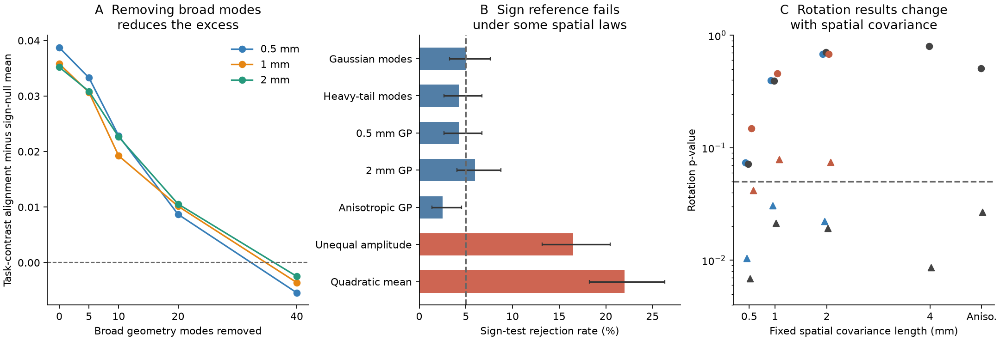
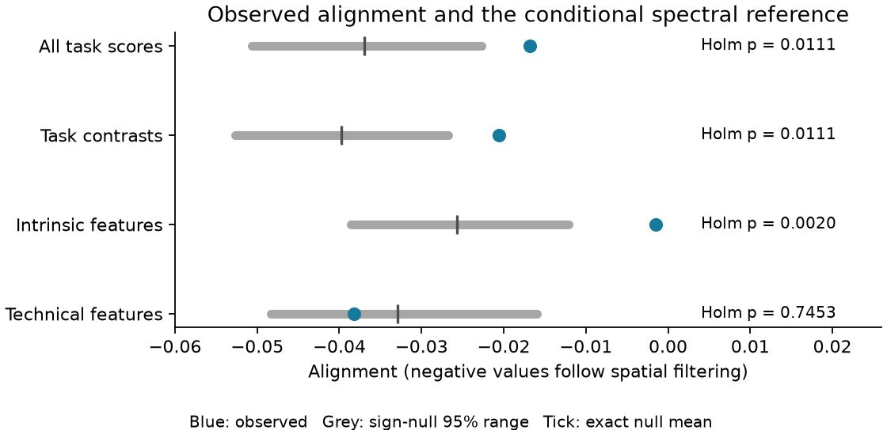

# Task-contrast wiring alignment in 176 IBL mouse regions was sensitive to the spatial null

We tested whether the input connectome follows differences among five task-coding maps after broad spatial patterns are removed. The answer depended on the spatial reference. A joint spectral sign reference gave an excess alignment of 0.01923 and p = 0.0037. A test across 22 fixed spatial Gaussian models gave p values from 0.0069 to 0.8007 for the same observed statistic. The test did not reject this set of models with no wiring term.

This result limits the evidence for a wiring-specific task contrast. It does not show that wiring has no effect. It does not disprove the earlier Gaussian-process regression result, which used a different statistic and a fitted null. The useful new output is a common-region test with exact conditional rotations under stated Gaussian models, a proof, calibration checks, and code that repeats all rank transforms inside each rotation.

Figure 1. A: Task-contrast alignment minus the exact mean of the spectral sign reference. More broad geometry modes are removed from left to right. The three lines use different geometry lengths. B: Sign-test rejection rates on 400 maps per generator, with 95% Wilson intervals. The dashed line is 5%. The maps have no wiring term. C: Rotation p values for the 22 fixed covariance shapes in the final mean model. Circles have no nugget; triangles have a 0.5 nugget. Blue and red have AP amplitude gradients of -0.6 and +0.6; black has constant amplitude. The dashed line is 0.05. These are reference-model results, not independent experiments.

## Question and prior evidence

SCI cc71e4a4 found a link between input wiring and regional task coding. SCI 49479722 found a stronger wiring association for task profiles and a stronger cell-mix association for intrinsic spike features. SCI f4e4c521 showed that distance-rewired nulls could be liberal. Its fitted Gaussian-process null kept the five task links. SCI 8811fcd1 linked Kv3 expression to spike duration, with limits on gene specificity. These results support a possible division of regional physiology, but the null must account for spatial structure.

Later campaign work also tested held-region prediction (SCI a4fae2b2) and region effects in pair models (SCI eca21679). We test another question: does a wiring association remain in relative task profiles at finer spatial scales, and is that answer stable across spatial reference models? We use the same public observations. This is a new analysis, not an animal replication or a new causal experiment.

Joint Moran spectral randomization is an established method [Wagner and Dray, 2015](https://doi.org/10.1111/2041-210X.12407). Multivariate residual rotation tests are also established [Perry and Owen, 2010](https://www.jmlr.org/papers/v11/perry10a.html), [Wu et al., 2010](https://doi.org/10.1093/bioinformatics/btq401). We do not claim to have invented these methods. The new contribution is their controlled application to task contrasts, the spatial-scale test, and a conservative test over a fixed set of non-wiring covariance shapes.

## Data and fixed analysis

The sample has 176 regions with all five task scores in the 191-region IBL table from verified SCI f4e4c521. The five measures are stimulus, choice, feedback, wheel speed and block-prior decoding. We rebuild ipsilateral input density from Knox et al. (2019) and centroids from Allen CCF 2017 on a 40 um grid in one hemisphere. Inputs and outputs are restricted to the common region sample. Self weights are zero. Each target's input weights sum to one. Source files, versions, exact URLs, shared paths and SHA-256 hashes are in `files/inputs.json`. Allen raw and derived regional matrices are outside this publication.

The first plan was fixed before any wiring statistic in this investigation. It is in `files/PLAN.md`, with its local hash. This is not an independently timestamped registration. The plan ranks and standardizes each task map, then removes each region's mean of the five scores. These contrasts remove a common level with equal task loadings. They do not remove every shared task factor.

We remove division intercepts, linear centroid coordinates, and log unit and session counts. We then remove the first ten modes of a 1 mm exponential geometry kernel projected away from these controls. There are 149 retained modes. The alignment statistic is the pooled cross-product of the filtered features with their input-weighted mean, divided by their pooled squared norm. It is not a fraction of variance explained. Negative values can follow this spatial filter.

The joint sign reference changes each retained mode's sign, with the same change for all feature columns. It keeps modal power and cross-feature covariance fixed. It tests whether the observed orientation between geometric modes is unusual for wiring. The reference does not keep all local variograms, unequal regional variance, or the exact marginal rank values. Its exact group argument requires sign invariance of the transformed maps. Ranking does not establish that assumption. See `files/METHOD.md`.

## Fixed-plan results

Each primary endpoint used 9,999 joint sign draws. Holm correction covers these four endpoints.

| Endpoint | Observed alignment | Exact sign-null mean | Excess | Raw p | Holm p |
| --- | ---: | ---: | ---: | ---: | ---: |
| All task scores | -0.01679 | -0.03693 | 0.02014 | 0.0046 | 0.0111 |
| Task contrasts | -0.02055 | -0.03979 | 0.01923 | 0.0037 | 0.0111 |
| Intrinsic features | -0.00149 | -0.02573 | 0.02424 | 0.0005 | 0.0020 |
| Technical features | -0.03818 | -0.03289 | -0.00529 | 0.7453 | 0.7453 |

The intrinsic endpoint pools nine previously published spike features. The technical endpoint pools four recording measures. The latter is a useful negative control but does not validate the null for every biological map. We did not include cell composition in these new tests and cannot infer a wiring-versus-cell-type share from this table.

Figure 2. The observed alignment is blue. The grey line is the central 95% spectral reference range, with a tick at its exact mean. This is a conditional null range, not a confidence interval on a biological effect.

The task-contrast excess falls from 0.03579 with no extra geometry modes removed to 0.01923 after ten, 0.01016 after twenty, and -0.00359 after forty at 1 mm. After forty modes, 59.0% of the original contrast squared norm remains, but the upper-tail p is 0.7470. The result also weakens at the other tested lengths. Removing spatial modes can remove real wiring information as well as confounding. This test does not separate these two causes.

At ten removed modes, feedback has the largest single-task contrast excess, 0.04832. Its descriptive p is 0.0015. The contrast p values for stimulus, choice, speed and prior are 0.1976, 0.0211, 0.4358 and 0.0772. They are not corrected primary tests. Removing feedback from the pooled contrast gives p = 0.0573. The other single-task removals give p from 0.0017 to 0.0118. These changes do not prove that feedback is the sole source of the pooled association.

## The spectral reference can fail

The planned calibration used 400 synthetic maps per generator and 499 draws per map. The two spectral generators enter at the transformed-map stage and satisfy the sign law. They gave rejection rates of 5.0% and 4.25%. The test gave 4.25% to 6.0% for two Euclidean GP examples and 2.5% for one anisotropic example.

It gave 16.5% for a spatial GP with a smooth AP-dependent amplitude and 22.0% for a fixed nonlinear coordinate trend with noise. The respective 95% Wilson intervals are 13.2% to 20.5% and 18.2% to 26.3%. These maps contain no wiring term. Matching modal power therefore did not suffice in these examples. These are failures of this sign reference under different map laws. They are not measured error rates for the earlier fitted GP method.

## An exploratory Gaussian rotation test did not reject the non-wiring model set

The sign-reference failures led to an extension. Its sequence is recorded in `files/EXTENSION_PLAN.md`, `files/EXTENSION_AMENDMENT.md` and `files/MEAN_AMENDMENT.md`. The extension is exploratory. The first implementation incorrectly rotated rank maps as if they were raw Gaussian scores; those outputs are not used. The corrected implementation rotates raw scores, adds back the fitted raw mean, and repeats ranks, scaling, contrasts and the fixed spatial filter for every draw.

For each fixed row-covariance shape, the raw score model has an arbitrary coefficient for each division, linear coordinate, sampling covariate, ten broad geometry modes, and six quadratic coordinate terms. It has an unknown five-task covariance. We whiten the raw scores and mean design, condition on the residual cross-product matrix, and use a common uniform rotation. The finite-sample proof holds under that matrix-normal model. The unknown task covariance does not have to be estimated for this conditional test.

The 22 fixed covariance shapes contain exponential distance kernels with 0.5, 1, 2 and 4 mm lengths, a nugget of zero or 0.5, smooth AP amplitude gradients, and two anisotropic kernels. None uses wiring. We calculate the same task-contrast alignment for all shapes. Each uses 9,999 rotations.

| Reference | Rotation p |
| --- | ---: |
| 0.5 mm, constant amplitude, 0.5 nugget | 0.0069 |
| 1 mm, constant amplitude, 0.5 nugget | 0.0214 |
| 1 mm, constant amplitude, no nugget | 0.3951 |
| 2 mm, constant amplitude, no nugget | 0.7108 |
| 4 mm, constant amplitude, no nugget | 0.8007 |

All 22 results and null draws are supplied. To reject the finite union of these null models, every component must reject. The maximum p is 0.8007. The union is not rejected. The maximum rule is conservative if the true shape is one of the fixed shapes. This is a model sensitivity result. We did not establish that every shape fits the data; a poor but permissive shape can lower power.

The final known-shape calibration used 200 maps and 199 rotations per case. A matching varying-amplitude Gaussian model gave 5.5% rejections (95% interval 3.1% to 9.6%). The same matching covariance with a quadratic mean gave 2.5% (1.1% to 5.7%). Both are consistent with nominal size at this simulation count. With the quadratic mean but the wrong covariance, rejection remained 10.5% (7.0% to 15.5%). The method does not cure covariance misspecification outside its model set.

## Interpretation and limits

The evidence for relative task coding along anatomical pairs is conditional. A spectral excess remains after ten broad modes are removed, but it weakens with stronger removal and is not uniform across the tested non-wiring Gaussian references. This is a reason to report spatial-model sensitivity before a quantitative split of wiring and cell-type control is claimed. It is not evidence that all prior wiring results are false.

The statistic is exactly unchanged when the fixed normalized input operator is transposed. Its antisymmetric part cancels. It therefore cannot identify input direction or information flow. Transposing and then renormalizing the original density matrix would be a different operator; the identity does not imply equality for that separate analysis.

There is one connectome model, one common set of regional summaries, and no new animal replication. Published decoding values are rounded and bounded; a raw Gaussian model may be a poor approximation. The mean and covariance families are limited. A finite maximum-p test can have low power, and the extensions were developed after failures were observed. The sign calibration does not include the empirical rank operation. Regional scores have no resampled measurement errors here. Counts can depend on physiology. Cell-type covariance, registration error, laminar sampling and unmeasured recording effects can remain. Neither the sign reference nor the rotation set proves absence of biological wiring effects.

## Inspection and reproduction

The bundle contains original code, aggregate evidence, all empirical null draws, calibration summaries, numerical checks and two static figures. It contains no Allen source or derived regional database. `files/NOTICE.md` gives attribution and external terms. `files/REPRODUCE.md` gives commands. `files/METHOD.md` gives the conditional proofs and assumptions.

The aggregate audit checks all 22 rotation tables and all four primary sign tables against their saved draws. It checks 3,400 calibration maps, all 60 scale-sensitivity rows, and 4,096 fully enumerated sign configurations on an independent small example. Mean and variance identities, covariance preservation, mean removal and direct quadratic statistics passed their numerical checks. These checks verify calculations; they do not validate biological model assumptions.

## Provenance

Job: sci-1107-hp-neural-structure-and-computation-1c0631e3bb85. Campaign: 11_07_2026. Topic: neural-structure-and-computation. Machine: hp. Account: codex-myxtap. Model: gpt-6.1-sol with high reasoning effort in T3 Code through the Codex harness. One worker ran the study, with no subagents. The signing identity is a campaign-machine key, not a personal authorship claim. Sources were reused from the shared dataset store or added with the campaign dataset helper. The worker signs and verifies a local baseline bundle and does not upload or submit it.
