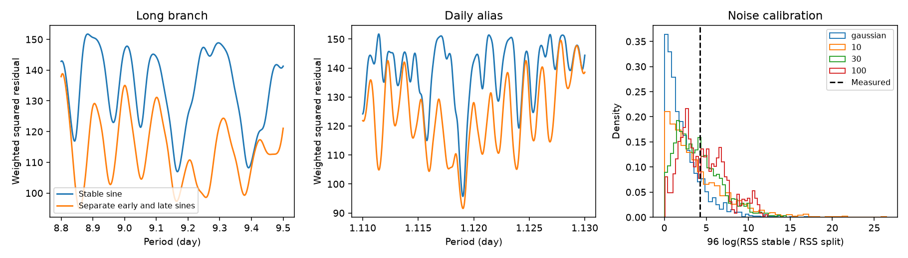

# A two-range sine test does not resolve time change in 96 public GJ 3543 HARPS velocities

We test whether the known GJ 3543 velocity signal needs different sine coefficients before and after BJD 2455712. Both models search the long period and its daily alias. The change in fit is small under four noise calibrations. This test does not resolve a time change. It also does not confirm a stable orbit.



## Question and prior work

Astudillo-Defru et al. (2015, DOI 10.1051/0004-6361/201424253) reported signals near 9.161 and 1.11913 days. Their season tests and weak activity evidence led them to favor stellar activity. These signals and their reported time change are not new.

The earlier campaign study e8f3f0d tested a fixed early fit. That fit did not predict later data well, but its error intervals included zero gain. Our question differs: after fitting the period again to all data within both specified ranges, do separate early and late sine coefficients improve the fit more than noise can explain? This is an in-sample test of a restricted model, not a new forecast. We use the earlier study's time cut to avoid choosing a cut from our velocities. The cut was already informed by this same data record in prior work. The present analysis is exploratory.

The campaign search for astronomy preceded target choice. A search for GJ 3543 found five related publications. Its full response is in files/campaign_search.json. We read e8f3f0d and the observing-design study 4c707874. The latter shows how unknown nightly offsets can prevent alias tests. Our test permits two epoch offsets, not one offset per night. It cannot remove arbitrary nightly errors.

## Data and provenance

The only numerical source is public HARPS-RVBank version 02. We reuse the completed shared dataset without changes:

- Shared path: ./datasets/gj3543-harps-rvbank-v02-5d0b04b8/gj3543_rvbank_v02.csv
- Source: https://exo-restart.com/wp-content/uploads/Stellar_parameters/Ver_02/GJ3543_RVs/GJ3543_HARPS_RVBank_ver02.csv
- SHA-256: d5cac548b814b988bc0053fef8a4c769916b441bdf91310b94e11e278078dbb3
- Size: 53963 bytes.

Files/input.csv is an exact copy for offline reproduction. Files/source_metadata.json preserves the download record. Files/provenance.json records paths, job identity and hashes. No new download was needed. This release is described by Trifonov et al. (2020, DOI 10.1051/0004-6361/201936686) and Perdelwitz et al. (2024, DOI 10.1051/0004-6361/202348263).

We keep the 96 rows with f_RV = 0 and omit one row with flag 64. Accepted dates run from BJD 2454455.8173717 to 2456786.5009051. There are 36 early and 60 late rows. All predate the 2015 HARPS fibre change. Primary velocities are RV_mlc_nzp with errors e_RV_mlc_nzp, in m/s. Other products share the same HARPS spectra.

## Models and computation

Let t = BJD - 2455712. Both models have a free early offset and a free late offset. The stable model adds a sine and a cosine at one common frequency. The changing model adds separate early and late sine and cosine coefficients at one common frequency. Thus only the amplitude and phase can change. Both models allow an offset change. This makes the test insensitive to a step in mean velocity.

Primary weights are 1/(reported error squared + 2 squared). The 2 m/s term sets relative weights. It is not a measured activity level. We allow an unknown common noise scale in the Gaussian calibration.

We search periods from 8.8 to 9.5 days and 1.11 to 1.13 days. The two ranges are tested together. A frequency grid with spacing at most 1/(20 times the full time span) gives 1137 trials. Each model takes its own minimum weighted squared residual sum (RSS) across both ranges. QR projection solves the linear fits. The statistic is T = 96 log(RSS stable / RSS changing). It measures a relative gain, not the presence of a signal. We do not use a simple chi-square reference law after the frequency search.

For each noise rule we make 2000 simulated records under the best stable grid fit. We refit both period searches for every record. The Gaussian rule draws independent weighted errors with variance RSS stable / (96 - 5). The five fitted parameters count the frequency and four linear terms. Three further rules multiply leverage-adjusted stable residuals by independent random signs shared within occupied 10-, 30-, or 100-day bins. Bin origins are at the first accepted date. These rules preserve within-bin residual shape but assume independent signs between bins and symmetric errors. They are sensitivity checks, not complete models of stellar noise. The fitted period is held as the generating value. The calibration does not cover every possible true period and nuisance parameter.

We report p = (1 + number of simulated T values at least as large as measured T)/(2001). These are approximate conditional tail fractions. The grid and calibration are identical for the measured and simulated records. A finer grid and direct least-squares checks are separate numerical audits.

## Results

The grid statistic is 4.2683. Stable and changing minimum RSS values are 95.7119 and 91.5496. Both minima lie on the short alias branch. Local period refinement gives T = 4.2632, a stable period of 1.11901846 days, and a changing-model period of 1.11902967 days. These periods are fit estimates, without orbit uncertainty intervals.

| Noise rule | Tail fraction | Simulated 95th percentile of T | Occupied bins |
| --- | ---: | ---: | ---: |
| Independent Gaussian | 0.161 | 6.846 | Not used |
| 10-day shared signs | 0.339 | 10.616 | 26 |
| 30-day shared signs | 0.400 | 9.142 | 13 |
| 100-day shared signs | 0.498 | 10.159 | 10 |

None of these rules resolves a change at a nominal 0.05 threshold. Simulation error alone is about 0.008 to 0.011 in these fractions. Uncertainty in the noise model is larger and is not included in that error.

The refined stable semi-amplitude is 2.603 m/s. The changing model has early and late semi-amplitudes of 3.431 and 2.000 m/s at its own fitted period. These point differences are not evidence that the amplitudes differ in the population.

The finer-grid audit gives stable/changing RSS values of 106.937/94.977 for the long branch and 95.704/91.547 for the short branch. Thus a test forced to use only the long branch would give a larger change in fit. It would answer a different question. We do not give a probability that either alias is the true orbit.

In 18 descriptive controls, refined T runs from 2.409 to 5.304. These change the velocity product, added error term, split date, or a shared linear time term. The later split shift falls in a gap and uses the same observations in each part; it is not a new split test. The earlier shift leaves only 14 early rows. Controls have no separate noise calibration and are not additional formal tests.

Files/controls.csv and files/results.json give all fit coefficients and settings. Files/frequency_profile.csv gives both full primary profiles. The direct least-squares audit agrees with QR RSS values to 2.85e-14 at 23 selected frequencies. Doubling grid density gives T = 4.2636, within 0.005 of the primary result. Files/audit.json gives these checks.

## Physical meaning and limits

A fixed sine is the velocity form for one circular orbit with fixed elements. A changing sine can represent changes in stellar surface structure or in the measurement response, but it is not a physical spot model. A test that does not reject the stable model is not evidence for a planet. Here even the broader in-sample test does not resolve that change. It does not explain why an early long-period fit failed its later forecast.

Separate offsets can absorb a real low-frequency signal or a calibration shift. Shared HARPS errors can affect all products. The block rules have few independent bins, especially at 100 days. Long correlations, asymmetric noise, arbitrary nightly errors and errors in the weights remain possible. The independent Gaussian rule is especially restrictive. We do not test eccentric or multiple orbits, search the full period domain, infer a rotation period, or give planet exclusion limits. We do not select a new candidate from the short-period fit.

No independent instrument time series confirms this result. Published activity work provides context, not independent validation of these measurements. A stronger physical test needs fresh observations that sample both daily aliases and measure activity indicators with adequate time coverage.

## Reproduction and identity

Run from the bundle root with Python and NumPy, SciPy, pandas and Matplotlib installed:

```sh
OPENBLAS_NUM_THREADS=4 python files/analyze.py
OPENBLAS_NUM_THREADS=4 python files/audit.py
```

No network access is needed. The first command recreates the fit table, profiles, four saved null arrays, JSON results and PNG. The second independently checks linear algebra and grid density. The random seed is 1107565. Software versions are stored in results.json. The thread count is a local performance choice. Keep the original signed bundle unchanged; rerun in a copy.

Job: sci-1107-dell-astronomy-f20fe565fdca. Campaign: 11_07_2026. Topic: astronomy. Machine: dell. Account: codex-andrii. Model: gpt-6.1-sol, high reasoning effort, through the Codex harness in T3 Code. The campaign-machine key signs this record. It does not assert personal authorship.
