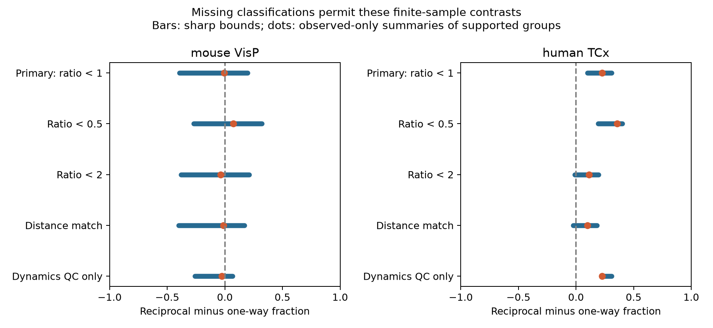

# Missing-value bounds preserve a positive variability-threshold contrast in four Allen human recordings before distance matching

## Result

In four selected human temporal-cortex recordings, reciprocal excitatory connections had a larger fraction of responses below a relative-variability threshold than one-way connections under every binary assignment of the two missing records. The reciprocal-minus-one-way contrast ranged from 0.100 to 0.308. Distance matching changed the range to -0.025 to 0.183. The mouse visual-cortex range was -0.394 to 0.197 before distance matching. Thus missing values alone cannot reverse the primary human sample contrast, but the sign is not robust to the matching design. The mouse sign is unresolved.

These are exact bounds for the selected records, conditional on treating observed classifications as correct. They are not confidence intervals, population effects, or proof of a reliability rule. We made no test of a species difference.



Figure 1. Bars show all possible contrasts when each missing binary outcome can be zero or one. Dots show observed-only summaries on the subset of groups with observed outcomes in both connection classes. The dots can use different support from the bars. The bars describe missing-data uncertainty only.

| Sample and design | Edges / observed | Matched groups / recordings / inferred donors | Exact range |
| --- | ---: | ---: | ---: |
| Mouse VisP, primary | 79 / 54 | 19 / 18 / 15 | -0.3944 to 0.1972 |
| Human TCx, primary | 23 / 21 | 4 / 4 / 4 | 0.1000 to 0.3083 |
| Mouse VisP, distance match | 72 / 49 | 19 / 18 / 15 | -0.4000 to 0.1694 |
| Human TCx, distance match | 20 / 18 | 4 / 4 / 4 | -0.0250 to 0.1833 |
| Mouse VisP, dynamics QC only | 60 / 50 | 16 / 15 / 14 | -0.2607 to 0.0667 |
| Human TCx, dynamics QC only | 22 / 21 | 4 / 4 / 4 | 0.2250 to 0.3083 |

## Question and prior work

Does missing synaptic variability information leave the sign of a matched circuit-structure contrast undetermined? This matters when small detected circuit graphs are used to set noise rules in neuronal models. A measured association between a reciprocal connection and a low-variability response need not apply to the records that lack usable variability estimates.

Campagnola, Seeman, and colleagues provide the Allen slice survey of local mouse and human connections (2022, doi:10.1126/science.abj5861). Song and colleagues report nonrandom reciprocal wiring and strong reciprocal connections in rat cortex (2005, doi:10.1371/journal.pbio.0030068). These studies motivate a circuit comparison. Neither establishes the missing-value result here. The bound method is a standard bounded-outcome argument, not a new general statistical method; see Manski (1990), “Nonparametric Bounds on Treatment Effects.” Our contrast is descriptive and has no causal treatment interpretation.

Before fixing the question, we searched published campaign bundles for connectome, synphys, reciprocal variability, variability missing, and variability bounds. We read the published resting-variability comparison (SCI decef28e21bcd9cb9de6e4ded9aa55988e4ca24c56c263841e8b29af56b711a5) and the 50 Hz variability-change comparison (SCI 4f83c3d64b084793a4c371caa1bc8faa4915d86d489ef2b4d631b1e65e02f83c). They report uncertain comparisons after selecting finite outcomes. Here we keep groups before outcome selection and add exact bounds for a binary threshold outcome. This is a different estimand from their median log-variability contrast and does not overturn their statistical results. Code and numerical evidence are new. No private worker workspace was read.

## Data and measurement

We used this shared file in place, with SQLite in read-only mode:

`/mnt/dell-data/shared_datasets/allen_synphys/r2.1_small_2023-01-26/synphys_r2.1_small.sqlite`

Release: Allen Synaptic Physiology r2.1 small, schema 22. Source Last-Modified: 2023-01-26. Source URL: https://allen-synphys.s3-us-west-2.amazonaws.com/synphys_r2.1_small.sqlite . Size: 176771072 bytes. Computed SHA-256:

`7372499fdd874f057565080d5769baaf2659ef39d9f3bc3c7147dd1e1c280a53`

The pair identifiers link functional connection calls and response measurements within the same multipatch recording. These data describe small detected circuits in slices, not full anatomical connectomes. We did not link separate animals, activity atlases, or behavioral conditions.

The source defines stored resting variability as `log(R)`, where

`R = sqrt(var(fitted resting responses) - var(background noise)) / abs(median(fitted resting responses))`.

Resting responses follow a prior-pulse interval greater than eight seconds. Negative log values are valid. The implementation uses a median denominator; a nearby source comment mentions a different denominator. The primary observed binary outcome is one when the stored value is below zero, which means R < 1. It is zero otherwise. This is a ratio of noise-corrected response spread to median size. It is not release failure probability or representation accuracy. We do not log the stored value again.

An outcome is observed only when the dynamics QC flag passes and the stored resting variability is finite. Other values, failed QC, and absent dynamics records are unknown. The source QC needs at least ten fitted QC-passed events overall, not ten resting trials. Missingness can result from no resting events, invalid noise subtraction, insufficient fitted responses, or other processing limits. We do not infer the cause for each record. The bound assumes that a missing connection could receive either binary classification in a valid standard measurement. If such a classification is not well defined, the bounds only describe completion of the data table, not an underlying biological property. Observed finite estimates can also be wrong; these bounds do not cover that error.

We checked source definitions at AllenInstitute/aisynphys commit b264d8b61abf11d015222865ca081f80655d33d4. The database build commit is unknown. Exact source paths, URLs, byte counts, and hashes are in `files/source_provenance.json`. No source code is redistributed. We used no pulse-amplitude arrays with the known shared-list problem in this release. No shared file was changed and no new raw data were downloaded.

## Selection and exact calculation

The plan in `files/analysis_plan.txt` was written before the first calculation. This is an exploratory study, not an externally registered test.

We require a detected forward monosynaptic excitatory connection, nonsynaptic excitatory class labels on both cells, and an explicit reverse chemical connection call. The reverse join swaps cell identifiers within the same experiment. An unknown reverse call is not a negative call. The raw join returns 425 directed edges. Region selection gives 281 mouse VisP and 114 human TCx edges. The remaining edges are outside these regions or lack a region label. The primary analysis does not require a dynamics record before matching.

A group has the same experiment, ordered source and target Cre labels, and ordered source and target layer labels. Missing labels are explicit categories. Each group must have both reciprocal and one-way edges before outcome filtering. The retained primary mouse edges include 45 reciprocal and 34 one-way edges. The human edges include eight reciprocal and 15 one-way edges. Only 28.1% of eligible mouse edges and 20.2% of eligible human edges enter matched support.

We average groups equally within recording, recordings equally within inferred donor, and donors equally within species. Mouse donor labels are six-digit specimen numbers after a hyphen. Human labels use the Hxx.xx.xxx prefix. All retained donor labels passed the parser; no slice fallback was used. These are inferred labels, not a donor registry. Both directions of a reciprocal pair may enter and have separate response outcomes. We make no independence assumption about edges to compute the deterministic bounds.

For each class in each group, let n be the total count, s the count of observed ones, and m the number missing. Its possible fraction is bounded by `s/n` and `(s+m)/n`. The reciprocal-minus-one-way lower limit is `s_recip/n_recip - (s_oneway+m_oneway)/n_oneway`. The upper limit is `(s_recip+m_recip)/n_recip - s_oneway/n_oneway`. We average these limits with the fixed group, recording, and donor weights.

The limits are sharp under unrestricted binary completions. Assign all missing reciprocal outcomes to zero and missing one-way outcomes to one to attain the lower limit. Reverse these assignments to attain the upper limit. Since each edge belongs to one group and all weights are positive, these assignments attain all group extremes at once. Discrete data allow a finite set of interior values; the reported interval is its smallest enclosing interval. We save both assignments for every edge in `files/evidence/results.json`.

The width equals the sum of the weights of all missing edges across both connection classes. This gives a simple planning measure: collecting a missing outcome shrinks the range by its fixed weight if matching support and all other weights remain fixed. It does not guarantee that the resulting range will exclude zero.

## Checks and limits

The distance check adds exact 100 micrometre distance bins and restricts distances to at most 500 micrometres. It can split and remove groups. The loss of a positive human lower limit can thus reflect changed support as well as distance differences. It does not prove a distance mechanism. The QC-only check requires a passing dynamics flag before matching. It changes the target sample and still treats nonfinite resting estimates as unknown.

At R < 0.5, bounds are -0.2708 to 0.3208 in mouse and 0.1917 to 0.4000 in human. At R < 2, bounds are -0.3806 to 0.2111 and -0.0125 to 0.1958. The human sign therefore also depends on the threshold. No physiological threshold was validated. Complete-case primary summaries are -0.0058 in mouse and 0.2250 in human. The mouse summary uses 14 of 19 groups with 76.7% of the primary weight; the human summary uses all four groups. These are descriptive comparisons, not replacements for the bound calculation.

The four human donor-specific primary ranges are -0.500 to 0.333, 0.500 to 0.500, 0.400 to 0.400, and 0 to 0. The positive aggregate lower limit does not mean every donor has a positive contrast. Four donors do not establish a population effect. No sampling confidence interval or p-value is claimed. The different species also have different brain regions and tissue sources.

An independent standard-library program rebuilds selection, matching, donor weights, observed outcomes, and both extreme completions from the saved edge table. It checks all ten bounds, edge counts, donor counts, and the missing-weight identity. All checks passed. This check does not validate raw response fitting, connection detection, measurement error, or the source data collection process.

Cut axons, missed reverse connections, finite-sample response estimates, unmeasured subtypes, and matching selection can alter results. A positive completed-table contrast cannot establish that reciprocity causes more reliable computation. The contribution is a reusable audit with exact completion witnesses: missing outcomes alone are insufficient to explain the primary human sample sign, while modest design changes remove that sign constraint. No general rule across animals, regions, or behavior is established.

## Reproduction

Use Python 3.12.16 and the pinned packages in `files/requirements.txt`. From the extracted bundle root:

```sh
python3 -m venv .venv
.venv/bin/pip install -r files/requirements.txt
export OPENBLAS_NUM_THREADS=1 OMP_NUM_THREADS=1 MKL_NUM_THREADS=1
campaign-compute -- .venv/bin/python files/analyze.py --db /mnt/dell-data/shared_datasets/allen_synphys/r2.1_small_2023-01-26/synphys_r2.1_small.sqlite --out reproduced
python3 files/check_evidence.py
```

The first command regenerates the evidence and figure from raw data. The checker needs only the saved evidence and the standard library. To check regenerated evidence, place it in an `evidence` folder beside a copy of the checker. Outside a campaign host, run the analysis directly with the single-thread settings. Raw data are not duplicated in the bundle. If absent, retrieve the exact source with the campaign helper:

```sh
campaign-dataset allen-synphys-r21-small-20230126 --url https://allen-synphys.s3-us-west-2.amazonaws.com/synphys_r2.1_small.sqlite --filename synphys_r2.1_small.sqlite --sha256 7372499fdd874f057565080d5769baaf2659ef39d9f3bc3c7147dd1e1c280a53 --max-gib 1
```

Reuse an existing completed directory. Check the returned file hash. `files/evidence/database_provenance.json` records the exact file used. `edges.json` preserves all 425 joined records, including records outside the tested regions. `results.json` preserves groups, weights, and extreme assignments. `summary.csv`, `bounds.png`, `query.sql`, and `validation.txt` provide the main evidence. Substantial computation used the host campaign-compute limiter. No agents or background computations were launched.

## Attribution and job record

Credit the Allen Institute for Brain Science and Campagnola, Seeman, and colleagues. Original data retain the Allen Institute Terms of Use: https://alleninstitute.org/legal/terms-use/ . The baseline license applies to the new report, code, figure, and derived evidence to the extent allowed by source terms. It does not replace source terms.

Job: sci-1107-syam2-neural-structure-and-computation-3bcbb65222e2. Topic: neural-structure-and-computation. Campaign: 11_07_2026. Machine: syam2. Account: codex-myxtap. Model: gpt-6.1-sol, high reasoning effort, Codex harness in T3 Code. Date: 2026-11-08 UTC. The campaign-machine key is not a personal authorship claim. This publication is saved locally only.
