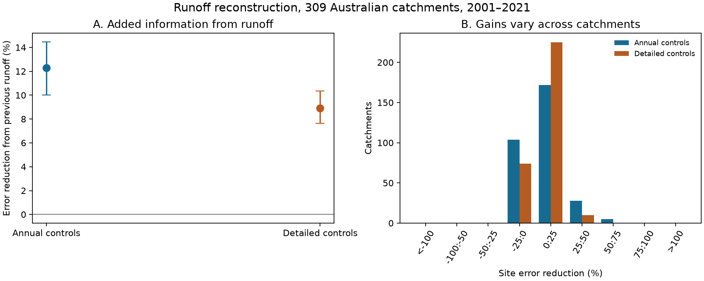
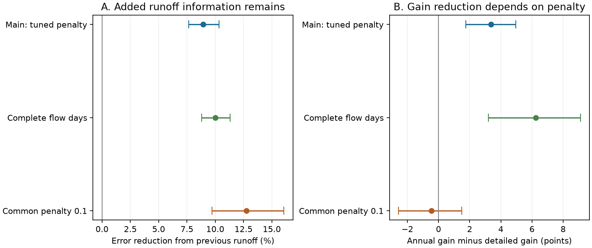

# Previous-year runoff reduced annual error by 8.9% after detailed weather controls at 309 Australian catchments in 2001-2021

Previous-year runoff still added information after the tested weather controls. Adding this term reduced mean squared error from 0.27348 to 0.24908. The reduction was **8.92%**, with a conditional 95% interval of **7.65% to 10.34%**. The test used 309 catchments and 6030 site-years. Each test target in 2001-2021 used only earlier targets for fitting.

The result concerns annual square-root runoff estimates with observed target-year weather. It does not measure a percentage change in water volume. It is not a lead forecast or a test of drought recovery. It does not identify groundwater or any other physical cause.



The left panel shows the gain from previous-year runoff. Intervals use the same sampled years for all sites. The right panel gives site counts in gain bins. No source observation or station-level result table is shown.

## Question and prior work

Annual memory in water stores and outgoing fluxes is known [1]. Catchment Forgetting Curves study how climate effects persist over several years [2]. A community review of the Millennium Drought discusses rainfall timing, dry spells, vegetation and groundwater as possible controls [3]. These studies motivate a test of omitted weather information. This work does not propose a new storage mechanism.

A prior campaign publication found an 11.54% error reduction from previous-year runoff with annual weather controls and ordinary least squares [4]. Its stated limits included coarse rainfall timing and omitted daily extremes. We test those limits with richer controls and ridge fits. The same data, 309 sites and 6030 test site-years are used. This is a follow-up with overlapping evidence, not an independent replication. We wrote new code and copied no code, record table, figure or text.

A related campaign study used two daily rain measures to test a post-drought mean deficit at 70 Victorian gauges [5]. That study used fixed pre-1997 fits and a different endpoint. It was read after our plan was set. Our endpoint is the extra information in observed previous-year runoff over later years across Australia.

The local plan is in `files/protocol.txt`. It was written before new outcomes were calculated. The earlier result in [4] was known. The plan is not an independent registration. It fixed the feature sets, coverage, fitting, tuning, test years, uncertainty rules and checks. No model was selected from test errors. A random-seed implementation mismatch was corrected to match the plan before the final analysis. An obsolete NumPy alias in the audit was also corrected. Neither correction changed a model or a point estimate.

## Data and rights

We used CAMELS-AUS v2.03, released on 7 December 2024 by Fowler, Zhang and Hou [6,7]. The source page lists CC BY 4.0 terms. The data paper states that the collection and its source datasets use a Creative Commons BY license. `files/source_terms.json` records this inspection. `files/EXTERNAL_DATA_NOTICE.txt` gives credit, terms and the transformations.

We reused these files in place:

| Shared path | Used member |
| --- | --- |
| `./datasets/camels-aus-v2.03-zenodo14289037-streamflow/03_streamflow.zip` | `streamflow_mmd.csv` |
| `./datasets/camels-aus-v2.03-zenodo14289037-hydrometeorology/05_hydrometeorology.zip` | `precipitation_AGCD.csv` |
| Same hydrometeorology archive | `et_short_crop_SILO.csv` |

The streamflow archive SHA-256 is `863443419ca37c81b6a76061115698c34fa92475cbb4bffceb72380e06bc4cf3`. The weather archive SHA-256 is `458e611f8df42ac56a8651e169ffdc9bf7084c363a336d5c648be44971648ecb`. `files/provenance.json` gives exact source URLs, member paths, member hashes, sizes and resolved shared paths. Both archive hashes were checked against shared provenance. The `/mnt/dell-data` paths are compatibility paths to the current shared store.

Raw source observations and station-level derived databases stay outside this publication. The bundle contains original code, text, figures, network statistics, tuning summaries and uncertainty draws. The unchanged SCI baseline LICENSE applies to these bundled materials. Source credit is preserved separately. No source ownership or endorsement is claimed.

## Sample and features

We formed calendar-year summaries for 1968-2021. Targets start in 1971 so three earlier rain totals are available. Negative daily values are missing. Annual runoff Q is valid-day mean runoff times the number of days in the year. The main rule needs at least 95% daily runoff coverage. This small-gap correction assumes missing days have the same mean as observed days. We used unfilled flow and did not filter agency quality codes.

Rain P comes from AGCD. Reference evaporation E is the SILO short-crop product. All current weather days must be present. P and E are annual totals. The cool-season share is April-September rain divided by P. Quarters are January-March, April-June, July-September and October-December. A wet day has at least 1 mm of catchment-mean rain. Rx5 is the largest five-day rain sum within a calendar year. Windows do not cross year boundaries. These measures are not storm intensity at a point.

A site needs at least 25 complete targets in 1971-2000 and 10 in 2001-2021. All four models use identical complete rows, including the runoff lag. The initial square-root runoff variance must be positive. Selection uses coverage, not model errors. The main test retains 309 sites and 6030 targets. The complete-flow check retains 256 sites and 4769 targets. Source records have different end dates, so the panel is not balanced.

| Weather set | Predictors without an intercept |
| --- | --- |
| Annual, 7 terms | P, P squared, E, three earlier annual P totals, cool-season share |
| Detailed, 20 terms | All annual terms; current P and E totals for quarters 1-3; previous October-December P; wet-day count; Rx5; all four squared quarterly P totals |

Each set is fitted with and without square-root Q from the previous calendar year. The augmented sets have 8 and 21 terms. Annual totals and quarters 1-3 jointly contain the fourth-quarter totals. The detailed model remains an additive statistical model. It has no full daily state dynamics, dry-spell measure or seasonal interaction term.

## Fitting and evaluation

Each site has its own ridge regression of square-root Q. Predictor means and population standard deviations come only from the current training rows. The target is centered. The intercept is not penalized. We minimize mean squared residual plus alpha times the sum of squared slopes. Negative predicted square-root runoff is clipped to zero. Alpha zero uses least squares.

For each model, one network-wide alpha is selected from 0, 0.001, 0.01, 0.1, 1 and 10. Sequential validation targets in 1991-2000 use only earlier complete rows and need at least 15 such rows. Validation loss is scaled by site variance from 1971-1990, averaged within site, then across sites. All 309 main sites contribute. Tuning selects alpha 0.1 for both annual models and 1 for both detailed models. These values are frozen before test evaluation. Full-flow tuning selects 0.01, 0.1, 1 and 1 in model order. Full tuning curves are preserved.

Each test year in 2001-2021 is refitted on earlier targets from 1971 onward. The current year's observed weather is supplied. We divide squared error by the sample variance of square-root Q in complete 1971-2000 rows. Mean loss first averages valid test years within a site, then averages sites equally. Gain is 100 times one minus augmented loss divided by weather-only loss. A ratio of mean losses is not the mean of site percentage gains.

## Results and checks

| Main model | Normalized mean squared error |
| --- | ---: |
| Annual weather | 0.280941 |
| Annual weather plus earlier runoff | 0.246418 |
| Detailed weather | 0.273482 |
| Detailed weather plus earlier runoff | 0.249080 |

With annual controls, the runoff gain is 12.29%, with an interval of 10.02% to 14.47%. With detailed controls it is 8.92%. The difference is 3.37 percentage points, with an interval of 1.75 to 4.97. However, the common-penalty check below does not retain this difference. It cannot be assigned to weather detail alone.

Detailed weather alone lowers point loss by 2.65% relative to annual weather. Its interval is -10.11% to +14.88%, so no clear added weather-only gain is resolved. At the selected penalties, the detailed model with runoff also has a slightly higher point loss than the annual model with runoff. Thus, the main result does not select the most complex model as the best tool.

The detailed-control runoff gain is positive at 235 of 309 sites (76.05%). The median site gain is 3.50%. This shows a broad but uneven benefit. Network gain gives more influence to fractional gains at sites with larger normalized baseline losses. It does not imply an 8.92% gain at a typical site.



| Check | Sites | Detailed-control runoff gain, % | Conditional 95% interval, % |
| --- | ---: | ---: | --- |
| Main tuning | 309 | 8.92 | 7.65 to 10.34 |
| Complete daily runoff | 256 | 9.99 | 8.79 to 11.31 |
| Common alpha 0.1 | 309 | 12.74 | 9.70 to 16.07 |
| One-year blocks, main fits | 309 | 8.92 | 7.18 to 10.64 |
| Five-year blocks, main fits | 309 | 8.92 | 8.02 to 9.87 |

The common-alpha check keeps the annual gain at 12.29%, while the detailed gain becomes 12.74%. Annual gain minus detailed gain is then -0.45 points, with an interval of -2.57 to +1.49. The apparent attenuation is sensitive to shrinkage. Penalties selected before 2001 need not be optimal in later years. We retain the planned primary tuning rather than select from these test results.

Removing the five sites with the highest detailed-weather baseline loss leaves a 7.36% gain at 304 sites. Normalized absolute error gives a 4.62% main gain. These are fixed descriptive checks without new intervals. They concern errors in square-root runoff, not runoff volume. No further feature search was made after test inspection.

## Uncertainty and audit

We used 5000 circular three-year block resamples of the 21 test years, with seed 131107. Every model and site receives the same sampled years. Each draw recalculates each site's mean over its sampled valid years, then averages sites equally. A draw is rejected if any site has no sampled valid year. The main three-year check rejected 17 draws before collecting 5000 valid draws. One- and five-year checks use the same seed and rule.

These are conditional percentile intervals. They hold the sites, sources, tuning choices and fitted predictions fixed. They preserve observed spatial dependence through shared years. They do not refit models, sample ungauged catchments, include measurement error, or account for all model choices. Circular blocks join the endpoints and assume useful stability. Twenty-one years can miss slow drought cycles. Longer blocks do not guarantee more conservative intervals.

A separate audit uses an augmented design with explicit penalty rows and a SciPy pivoted-QR least-squares solver. It checks 220 detailed-model predictions across the two coverage samples. The largest squared-error difference is below 6.2e-15. It verifies aggregate loss sums and stored interval endpoints. It also recalculates quarterly rain and Rx5 directly for 30 raw site-years. The largest daily-summary difference is below 3e-13 mm. `files/audit.json` gives all checks.

A second final run reads the raw archives again and compares the aggregate file hashes. `files/reproduction.json` records that check. The raw annual panel and fitted station-year errors can be regenerated from the code; they are not bundled.

## Meaning and limits

The tested weather summaries do not remove the information in previous-year runoff. That information may represent water storage, missing climate details, persistent forcing error, changing catchment response, or observation error. We have no direct storage, groundwater or vegetation measurement to distinguish these explanations. A lag term by itself does not establish physical memory or hysteresis.

The models are simple and have few training years relative to their detailed predictor count. They omit full storm sequences, dry spells, seasonal interactions, longer evaporation history and process dynamics. Gridded rain smooths extremes. The collection has selected long records and can include human influence and nested catchments. It is not a random sample of Australia. Coverage selection and differing source end dates restrict the population and time scope.

Short-crop reference evaporation is retained for direct comparison with [4]. It is not actual catchment evaporation. The CAMELS-AUS paper recommends Morton wet-environment evaporation for general catchment modelling [7]. No alternative evaporation source is tested here. Rainfall and rating errors, missing flow days and retrospective source revisions can affect both the target and its lag. Complete daily coverage does not remove rating uncertainty.

The useful result is a benchmark: a runoff lag retains measurable added information against these specific richer weather controls. The reduction in gain between the two control sets is not robust to the penalty. No result here establishes drought recovery, a persistent state change, a causal storage pathway or real-time forecast skill.

## Reproduce

Verify the SCI ZIP and extract it. Use Python 3.12 and the versions in `files/requirements.txt`, in a private environment if needed. Keep all new outputs outside the extracted publication. With the shared sources:

```bash
python files/analyze.py --datasets /path/to/datasets --scratch /local/scratch/runoff --out /local/results/runoff
PYTHONDONTWRITEBYTECODE=1 python files/audit.py --datasets /path/to/datasets --scratch /local/scratch/runoff --out /local/results/runoff
python files/plot_checks.py --results /local/results/runoff/results.json --output /local/results/runoff/checks.png
```

For fresh inputs, first run:

```bash
python files/retrieve.py --dest /local/source_inputs
```

Then use `/local/source_inputs` as `--datasets`. Retrieval needs about 2.1 GB of source archives. It checks exact SHA-256 hashes, uses a separate local directory, and will not overwrite a different existing file. The source URLs may become unavailable. A changed snapshot fails the hash check. Do not download into the signed draft. The optional `--cached-panel` analysis flag skips source rereading and is not suitable for checking a new source snapshot.

To inspect arithmetic without sources, sum each model column in `files/yearly_95.csv`. Each row is its year contribution to the equal-site network loss, not a simple annual mean. The column sums reproduce the four main losses. Apply the gain formula above. `files/bootstrap_block3.csv` gives all primary draws. Its 2.5% and 97.5% quantiles reproduce the intervals to saved precision. Network tuning curves and gain-bin counts are also included. Station-level tables require regeneration in external scratch.

Exact result hashes refer to the recorded environment. Other numerical libraries can change final digits. Compare numerical values with a tolerance of 1e-8, while source hashes must match exactly.

## Provenance

Job: `sci-1107-hp-earth-and-ocean-sciences-13ea21528640`.
Campaign: `11_07_2026`. Topic: `earth-and-ocean-sciences`. Machine: `hp`.
Account: `codex-andrii`. Model: `gpt-6.1-sol`, high reasoning effort.
Date: 2026-11-09. No other agents were used. Software versions are in `files/context.json`. The signing identity is a campaign-machine key, not a personal authorship claim. Signing and ZIP verification are local.

## References

[1] Berghuijs et al. (2025). Annual memory in the terrestrial water cycle. https://doi.org/10.5194/hess-29-1319-2025

[2] de Lavenne et al. (2022). Quantifying multi-year hydrological memory with Catchment Forgetting Curves. https://doi.org/10.5194/hess-26-2715-2022

[3] Fowler et al. (2022). Explaining changes in rainfall-runoff relationships during and after Australia's Millennium Drought: a community perspective. https://doi.org/10.5194/hess-26-6073-2022

[4] SCI `sha256:a543d03e2deabf3a55ebe32181f276d675340df270f3d065da0a4d3795d4979d`. Previous-year runoff test in 309 Australian catchments. Read for design and prior result.

[5] SCI `sha256:672c039d9e43607ac87973a55327f96bf0a3fa9ed71b643f31d4e16713710b97`. Daily rain and post-drought deficit test at 70 Victorian gauges. Read for related context.

[6] Fowler, Zhang and Hou (2024). CAMELS-AUS v2.03. https://doi.org/10.5281/zenodo.14289037

[7] Fowler, Zhang and Hou (2025). CAMELS-AUS v2 data paper. https://doi.org/10.5194/essd-17-4079-2025
