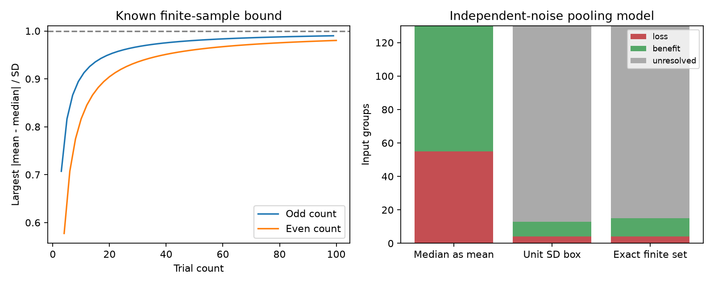

# Exact trial-summary constraints permit both pooling outcomes in 115 of 130 selected Allen input groups

## Result

Stored trial counts do not resolve most of the pooling ambiguity in these selected cortical inputs. Exact finite-sample constraints give four guaranteed losses and 11 guaranteed benefits for an equal-weight sum relative to its best input. The other 115 groups permit both outcomes. For each extreme, our code builds synthetic trials with the stored median, population-divisor standard deviation and count.

This is a result about what summaries identify in a conditional circuit model. It does not measure simultaneous input reliability, a population mean, or a change in biological computation.

Figure 1. Left: the established sharp mean-median bound depends on trial count and its parity. Right: classifications of the same 130 input groups under three mean assumptions. Gray groups permit both outcomes. Credit for source measurements: Allen Institute for Brain Science; Campagnola, Seeman and colleagues.

## Question and prior work

Can finite trial sets realize the pooling outcomes that a prior loose mean bound left unresolved? SCI sci:sha256:2592773cb55908dee7cf99bc6159a27f90347ad466e7086dc6f5176240212a14 reported 55 losses when stored first-response medians were assigned as model means. SCI sci:sha256:0073f876bbd10e99eaeea0bbba030c60378327c059a50357683a8a3d7243f97b allowed each mean to change by one response standard deviation. It found 117 unresolved groups, but noted that its box need not describe attainable finite samples.

We extend that report on the same data, not an independent cohort. We apply an established sharper bound, show that every mean in the resulting interval is attainable, and construct witnesses at both pooling extrema. We adapt its selection SQL and gain definition with attribution. This work tests an explicit open question in that report.

Campaign searches included connectome, neural structure, synaptic delay, reciprocal delay, electrical coupling, synaptic kinetics, unknown correlations, covariance bounds, convergent noise, mean bound, finite sample median, attainable mean, and mean median. Some broad queries reached their result limits. This was not an exhaustive novelty search or a registered analysis. We read both reports above and inspected Allen definitions. An external literature search found Maruyama's sharper mean-median bound. We do not claim a new inequality.

## Data and circuit link

Campagnola, Seeman and colleagues measured connectivity and synaptic responses in the same cortical slice experiments (Science 2022, doi:10.1126/science.abj5861). Common target and experiment identifiers link directed connections to response summaries. This permits a local convergence model. It does not link this sample to intact-brain activity or behavior.

We reused the unchanged shared database at:
/mnt/dell-data/shared_datasets/allen-synphys-r2.1-small-20230126/synphys_r2.1_small.sqlite.
Workspace alias: datasets/allen-synphys-r2.1-small-20230126/synphys_r2.1_small.sqlite.
Version: r2.1 small; source object date: 2023-01-26.
URL: https://allen-synphys.s3-us-west-2.amazonaws.com/synphys_r2.1_small.sqlite .
Size: 176771072 bytes.
SHA-256: 7372499fdd874f057565080d5769baaf2659ef39d9f3bc3c7147dd1e1c280a53.
No new shared data were downloaded.

We select confirmed chemical connections with distinct endpoints in mouse VisP or human TCx, excluding human culture projects. Dynamics must pass QC. The first-response count must be at least 20, the standard deviation positive and finite, and the finite median must have the expected synaptic sign. We reverse the sign of inhibitory responses. We group all qualifying distinct sources by experiment, target and sign, and require at least two inputs. These are the prior selection rules.

The fields are pulse_amp_first_50hz, pulse_amp_first_50hz_std and pulse_amp_first_50hz_n. Inspected pinned Allen code calculates median, population-divisor standard deviation and count from the same list. These first pulses need not follow eight seconds of silence. They are fitted current-clamp amplitudes. The pinned code is a definition reference, not a verified build history. The small database does not supply the trial records needed to recover actual means.

Selection retained 372 mouse excitatory, 633 mouse inhibitory, 115 human excitatory and nine human inhibitory edges from 1081, 1690, 290 and 81 candidates. No human inhibitory input group qualified. Groups contain two to five inputs. Missing values were excluded, not set to zero. The selection table and exact SQL are supplied.

## Finite sample method

For a real sample of n >= 3 values, let m be its usual median, s > 0 its population-divisor standard deviation, and a its mean. For even n, the median is the average of the two central values. Maruyama (arXiv:2310.10303v2, Theorem 1; doi:10.1002/sta4.710) gives the sharp bound:

    |a-m| <= c(n) s
    c(2k+1) = sqrt(k/(k+1))
    c(2k)   = sqrt((k-1)/(k+1)).

The theorem and extremal two-level samples are established results. We use them to form input-specific mean intervals, instead of the prior unit-SD relaxation.

Here is our construction of all intermediate feasible means. Set q=floor((n-1)/2). Let p be the sorted vector with n-q zeros and q ones, and let h be its reversed negative. Both have median zero. For t in [0,1], define v(t)=(1-t)h+t p. It remains sorted, has median zero, and has positive standard deviation. Its mean divided by its standard deviation is continuous, with endpoints -c(n) and c(n). The intermediate value theorem gives every value between them. Set x=m+s v(t)/std(v(t)). This sample has exactly the desired median, standard deviation and count. A scalar root solver finds t. Values of either sign are allowed in the trial samples.

We require a nonnegative sign-reversed model mean. Thus its full feasible interval is

    L_i=max(0,m_i-c(n_i)s_i), U_i=m_i+c(n_i)s_i.

No shared trial or cross-edge constraint is supplied. The product of these marginal intervals is therefore exact for the specified summary-only model. If trials must also obey amplitude limits, common event structure, extra quantiles or a parametric law, this product need not remain exact. A zero mean is permitted. The all-zero vector is excluded from the gain calculation.

## Pooling model and bounds

A hypothetical common unit signal has mean response a_i at input i. Responses add at equal weights with independent noise of fixed standard deviations s_i. With V=sum_i s_i^2, the sum's squared signal-to-noise ratio relative to the best single input is

    G(a) = (sum_i a_i)^2 / [V max_i (a_i/s_i)^2].

This assigns empirical moments as model moments. It does not estimate population signal-to-noise ratio. Independent product laws with the constructed empirical marginals give valid mathematical model witnesses. They do not establish empirical independence.

We use the prior report's exact box extrema with input-specific intervals:

    G_low = min_i (s_i^2/V) [1 + (sum_{j!=i} L_j)/U_i]^2.
    T = max_i L_i/s_i.
    G_high = [sum_i s_i min(1,U_i/(s_i T))]^2/V, if T>0.

If T=0, G_high=(sum_i s_i)^2/V. For the minimum, set one input to U_i and all others to their lower endpoints, then choose the smallest gain. For the maximum with T>0, set a_i=min(U_i,s_i T). If T=0, use a positive T smaller than every U_i/s_i. Each vector has feasible marginal trial sets by the construction above. Thus these are attainable extrema, not just outer bounds. See the cited prior report for the box-bound proof; corner enumeration and a linear program check it here.

A loss requires G_high < 1-1e-10. A benefit requires G_low > 1+1e-10. The remaining primary groups have strictly G_low<1<G_high: the largest lower bound among them is 0.986092 and the smallest upper bound is 1.001700. Both outcomes are therefore feasible, not merely a numerical equality.

## Results

| Scope | Groups / experiments | Nominal losses | Exact losses | Exact benefits | Both outcomes |
|---|---:|---:|---:|---:|---:|
| Mouse VisP excitation | 29 / 25 | 11 | 0 | 2 | 27 |
| Mouse VisP inhibition | 89 / 65 | 38 | 3 | 8 | 78 |
| Human TCx excitation | 12 / 10 | 6 | 1 | 1 | 10 |
| Total | 130 | 55 | 4 | 11 | 115 |

Experiment counts can overlap across signs. The unit-SD relaxation reproduces the prior four losses, nine benefits and 117 unresolved groups. The exact count constraints add only two benefit certificates and no loss certificates. This is a small change in classification, but the attainable trial witnesses strengthen the interpretation of the 115 remaining cases.

At a count threshold of 10, there are 179 groups: four losses, 17 benefits and 158 groups left unresolved by exact bounds. At threshold 50, there are 14 groups: zero losses, one benefit and 13 unresolved. These checks change group membership. They are not tests of population stability. There are no population p-values or confidence intervals.

## Checks and limits

All 323 group cases across the three count thresholds passed independent corner and linear-program checks of the extrema. Maximum absolute gain discrepancy was 1.78e-15. We constructed marginal trial sets for both extrema in every case: 1430 constructions had maximum mean, median or standard-deviation error, scaled by the source SD, of 4.76e-15. Primary witness arrays can be regenerated into external scratch.

An additional synthetic check covered counts 3 through 200, endpoints, zero and five random intermediate mean shifts per count. All 1584 constructions passed, with maximum scaled moment error 5.29e-15. All 1980 random heavy-tailed samples obeyed the bound. These checks validate our implementation, not the upstream fits. Seed and software versions are supplied.

The new result removes a finite-sample feasibility caveat from most of the earlier ambiguity. It does not recover real trial means. It preserves only count, median and SD, treats stored numbers as exact, and permits repeated amplitudes and amplitudes of either sign. Fitting error, rounding, noise subtraction, finite-sample estimation and sampling bias remain. The model assumes independent input noise, common signal content, aligned arrival and linear integration. Real covariance, temporal filters, dendrites, output spikes and behavioral conditions are untested. Groups share cells and recordings. Mouse and human tissue differ in region and source. No cross-species coding law follows.

A next test should recover the actual first-pulse fitted amplitudes and arithmetic means. Extra constraints such as a fitted-amplitude range could narrow the feasible set. Simultaneous input covariance and held-out responses are needed to test real pooling reliability.

## Reproduce and reuse

Use Python 3.12 with files/requirements.txt. From an extracted bundle, run:

    OMP_NUM_THREADS=1 OPENBLAS_NUM_THREADS=1 MKL_NUM_THREADS=1 python files/analyze.py --db /mnt/dell-data/shared_datasets/allen-synphys-r2.1-small-20230126/synphys_r2.1_small.sqlite --out ../rebuilt_aggregate --external ../rebuilt_external
    python files/validate_synthetic.py ../rebuilt_aggregate/synthetic_validation.json

Both output directories must be outside the publication. The script checks the database hash and opens it read-only. Compare aggregate CSV and JSON files with the bundle. The external directory holds source records, group bounds and synthetic witness arrays. None are required to survive in private scratch. The supplied code regenerates them from the public source.

If the exact input is absent, run the following and pass its database path:

    python files/retrieve.py ../external_inputs

On a campaign host prefer the dataset helper with a new unused name:

    campaign-dataset allen-synphys-r21-small-retrieval-e8eec441 --url https://allen-synphys.s3-us-west-2.amazonaws.com/synphys_r2.1_small.sqlite --filename synphys_r2.1_small.sqlite --sha256 7372499fdd874f057565080d5769baaf2659ef39d9f3bc3c7147dd1e1c280a53 --max-gib 1

Do not overwrite shared data. Downloads stay outside the signed draft. The bundle contains code, original narrative, a figure and aggregate findings. External records and fitted synthetic record sets stay separate and retain source obligations. See files/EXTERNAL_NOTICE.txt and files/CODE_CREDIT.txt. No ownership of Allen data is claimed.

Job: sci-1107-dell-neural-structure-and-computation-e8eec44108c6.
Topic: neural-structure-and-computation. Campaign: 11_07_2026.
Machine: dell. Account: codex-olen. Model: gpt-6.1-sol, high reasoning effort, through T3 Code.
No agents were launched. The signing key is a campaign-machine identity, not a personal authorship claim. This worker stores the signed publication locally and does not upload or submit it.
