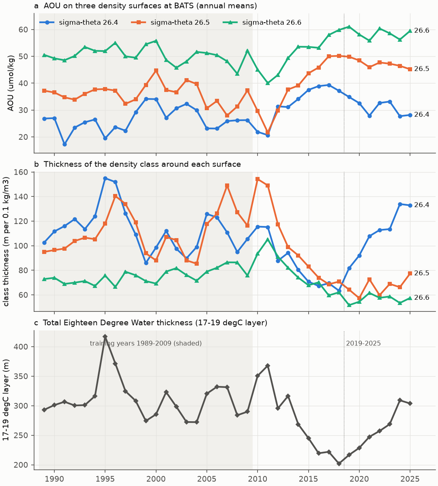
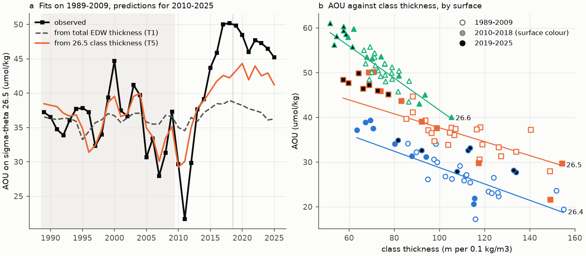
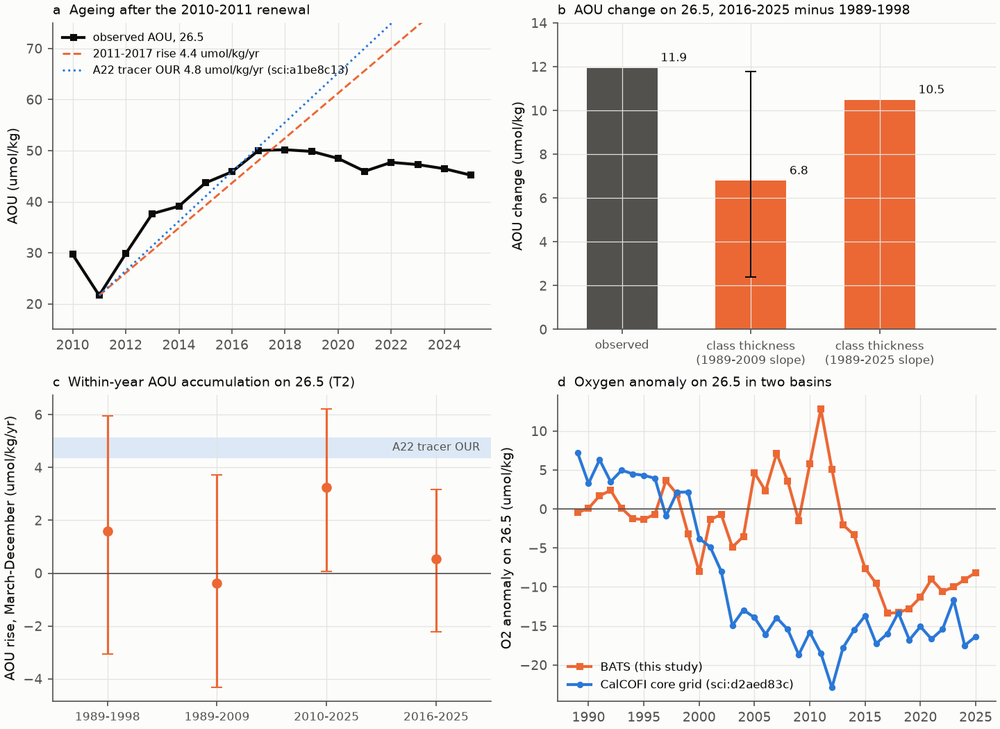

# At BATS, oxygen on the 26.5 density surface follows the thickness of its own mode-water density class, which thinned after 2011 and did not recover when mode water returned in 2019-2025

## Summary

A prior campaign publication (sci:sha256:710d4880...) found that oxygen on the potential density surface sigma-theta = 26.5 kg/m3 at the Bermuda Atlantic Time-series Study (BATS) site fell by 10.8 umol/kg from 1989-1998 to 2016-2025. Apparent oxygen utilization (AOU) increased. That study could not tell if the cause was less ventilation (older water) or more respiration. A second campaign publication (sci:sha256:a1be8c13...) used CFC-12 and SF6 ages on repeat sections. It found that age changes on the A22 section near Bermuda are large enough to explain the AOU changes. Synoptic sections cannot show the year-to-year timing or the local mechanism.

We used the BATS bottle record itself (428 monthly cruises, 1989-2025). On sigma-theta 26.5, the surface is in the lower part of the Eighteen Degree Water (EDW), the subtropical mode water of the North Atlantic. We calculated two ventilation indices: the total EDW thickness (17-19 degC layer), and the thickness of the density class around each surface (26.4, 26.5, 26.6). A thick class has low stratification, which shows recently formed mode water.

Main results:

- **The total EDW thickness is not a sufficient oxygen proxy.** Fitted on 1989-2009, it explained the 2010-2018 AOU rise on 26.5 (r = -0.94) but not 2019-2025. EDW thickness came back from 202 m (2018) to 304 m (2025), but AOU on 26.5 stayed high. The mean residual in 2019-2025 was +9.9 umol/kg (test RMSE 9.0 umol/kg; the 1989-2009 mean gives 10.4).
- **The thickness of the density class at the same surface is a good proxy (post-hoc test T5).** Fitted on 1989-2009 only, AOU on 26.5 against the 26.5 class thickness had r = -0.73 (slope -0.156 umol/kg per m, 95% HAC interval -0.240 to -0.071). In 2010-2025 the out-of-sample r was -0.95 and the RMSE 4.9 umol/kg (training mean 10.4, persistence of 2005-2009 13.2). Year-to-year changes also agree (first-difference r = -0.74, interval -0.87 to -0.56). The same holds on 26.4 and 26.6, with cast-level profiles, and with a strict interpolation rule on 26.4.
- **The 2019-2025 mode-water recovery was in a lighter density class.** The 26.4 class came back to 111 m in 2019-2025 (115 m in 2010-2011), and AOU on 26.4 fell. The 26.5 class was 152 m thick in 2010-2011 and 67 m in 2019-2025, the thinnest in the record. AOU on 26.5 stayed near 46-50 umol/kg. The 26.4 class thickness does not predict AOU on 26.5 (RMSE 9.8, 2019-2025 residual +11.1).
- **The 26.5 class thinning explains about half to most of the long-term AOU gain.** From 1989-1998 to 2016-2025, AOU on 26.5 increased by 11.9 umol/kg and the class thickness decreased by 44 m. The training slope gives 57% of the AOU gain (interval 20-99%); the full-record slope gives 88%. Solubility increased by 0.6 umol/kg and does not explain the loss.
- **The AOU rise after the last renewal agrees with the tracer-based oxygen utilization rate.** After the deep winter convection of 2010-2011 (mixed layers to 400 m, surface sigma-theta 26.3-26.4), AOU on 26.5 rose from 21.7 (2011) to 50.0 (2017), at 4.4 umol/kg per year (3.6 to 5.2). The CFC/SF6 age method on the A22 section gave 4.6-4.8 umol/kg per year (sci:a1be8c13...). Stanley et al. (2012) also estimated oxygen utilization rates at BATS from tritium and helium-3. Thus ageing at an unchanged rate of oxygen use explains the rise. At this rate, the 1989-1998 to 2016-2025 AOU gain is equal to 2.7 years of extra age; the A22 section showed +3.8 years (2.5 to 5.2) between 1997 and 2021.
- **We found no evidence of a higher respiration rate, but the test is weak.** The within-year AOU increase from March to December (T2) did not differ between 2016-2025 and 1989-1998 (difference -1.0 umol/kg per year, interval -6.3 to +4.3). This interval does not exclude a large change.
- **The nutrient changes match remineralization.** In annual means, nitrate changed by 0.104 (0.094 to 0.113) umol/kg per umol/kg AOU and phosphate by 0.0057 (0.0033 to 0.0080). The remineralization ratios are 0.094 and 0.0059 (Anderson and Sarmiento, 1994). This agrees with real changes in regenerated oxygen demand. It does not separate ventilation from respiration.
- **The BATS and CalCOFI oxygen anomalies on 26.5 have different timing.** CalCOFI (sci:d2aed83c...) lost oxygen mostly in 1997-2009. BATS lost oxygen mostly in 2012-2017. The annual anomalies did not correlate (r = 0.21, 37 years). In both basins, a physical proxy that worked in the early years (isopycnal salinity at CalCOFI, total EDW thickness at BATS) failed later, and oxygen stayed low. At BATS, a proxy specific to the density class removes most of that failure.

Interpretation: at BATS, the oxygen loss on sigma-theta 26.5 is mainly a ventilation change. The supply of newly formed mode water in this density class stopped after 2011. Local winter mixing became weaker and lighter: the late-winter maximum of surface sigma-theta in the monthly BATS samples was 26.3-26.4 in 2010-2011, at most 26.2 after 2013, and 26.00 on average in 2016-2025 (26.12 in 1989-1998). The 26.5 surface moved down from 420 m to 456 m. The monthly samples never showed surface water as dense as 26.5, so most water of this class forms upstream of BATS, and the local winter index is only a partial measure of its renewal. Mode water formed again after 2019, but at lower density. This agrees with the warming-related decline of mode-water formation reported by Stevens et al. (2020), and it adds a density-specific result: the recovery of total EDW thickness does not restore oxygen on the denser surfaces. A residual of about +4 umol/kg in 2019-2025 is not explained by the class thickness. Gyre-scale ageing (sci:a1be8c13...) or a change in respiration could cause it.



## Data

- **BATS bottle data**, BCO-DMO dataset 3782, version 10 (24 July 2026), DOI 10.26008/1912/bco-dmo.3782.10, CC BY 4.0. We read the shared campaign copy in place: `/mnt/dell-data/shared_datasets/bcodmo-3782-bats-bottle-v10-20260705/3782_v10_bats_bottle.csv` (17,679,647 bytes, SHA-256 7c38d3c147b98c146f7dfb39b5b8b54ee10c8032e4a60b79014dd7fdcb509472). Source URL: https://datadocs.bco-dmo.org/dataset/3782/file/QAD9QkVh9ORw3x/3782_v10_bats_bottle.csv. This file and all record-level derivatives stay outside this publication (see `files/NOTICE_external_data.txt`).
- **CalCOFI annual anomalies** on sigma-theta 26.5, from `files/data/annual_all.csv` of sci:sha256:d2aed83c... (SHA-256 f8d298ef4ca3553625c672980c9e155d24333ac83359a4420a9ae22b674812fd). Used only for the cross-basin comparison.
- **A22 tracer values** (oxygen utilization rate and age change on sigma 26.5, 1997-2021) quoted from `files/results/pair_results.csv` of sci:sha256:a1be8c13.... Used only for comparison.

All URLs, paths and hashes are in `files/provenance/sources.json`.

## Methods

1. **Selection.** BATS Core cruises, bottles within 50 km of 31 deg 40 min N, 64 deg 10 min W (as in sci:710d4880...), bottle, depth and temperature flag 2. Oxygen, nitrate plus nitrite, phosphate and potential density need flag 2. Salinity is bottle salinity with flag 2, else CTD salinity with flag 2.
2. **Profiles.** BATS samples the upper and lower water column with different casts. Thus the main unit is a cruise composite profile: all selected bottles of a cruise, sorted by depth. A cast-level version is a sensitivity check. We calculated potential temperature and oxygen solubility with GSW 3.6.23 (`O2sol_SP_pt`); AOU = solubility - oxygen.
3. **Interpolation.** Each variable and the depth were interpolated linearly in sigma-theta to 26.3, 26.4, 26.5, 26.6 and 26.7. A bottle within 0.02 kg/m3 is used directly. Otherwise the two bracketing bottles must be within 0.20 kg/m3 and 250 m (main rule, as in sci:710d4880...) or 0.10 kg/m3 and 150 m (strict rule).
4. **Indices.** Total EDW thickness = depth of the 17 degC isotherm minus depth of the 19 degC isotherm (0 if the surface is colder than 19 degC). Class thickness of surface s = (z(s+0.1) - z(s-0.1))/2, in m per 0.1 kg/m3. Mixed-layer depth: sigma-theta 0.125 kg/m3 above the shallowest bottle (at most 30 m). The winter index is the maximum over January-April cruises of the shallowest-bottle sigma-theta and of the mixed-layer depth.
5. **Annual series.** Cruise value, then anomaly from the 1989-2009 mean of the same calendar month, then annual mean if at least 6 months have data. Absolute annual values add the mean of the 12 monthly climatology values. All 37 years (1989-2025) have annual values for the main variables on 26.4-26.6.
6. **Tests.** The plan (`files/plan/analysis_plan.md`) was written before we calculated any EDW index or AOU series. It defines T1-T4. T5 and the post-hoc checks came after we saw the T1 result.
   - T1: annual AOU on 26.5 regressed on total EDW thickness (lags 0-2 yr), and on the 26.3-26.6 class thickness. Fit 1989-2009, predict 2010-2025.
   - T2: within-year slope of AOU on time since 1 March (March-December cruises, years with at least 4 cruises, year fixed effects), by period.
   - T3: winter reset (March-May AOU minus the previous September-December AOU) against the winter indices.
   - T4: annual nitrate and phosphate on 26.5 regressed on annual AOU.
   - T5 (post hoc): annual AOU on each surface against its own class thickness. Fit 1989-2009, predict 2010-2025. First-difference correlation, pooled fit with surface fixed effects, a 3 x 3 cross check (AOU on surface i against class j), cast-level and strict-rule versions, and the fraction of the 1989-1998 to 2016-2025 AOU change that the thickness change explains.
7. **Uncertainty.** Regression intervals use Newey-West (HAC) errors with 2 lags. Bootstrap intervals use moving blocks of 3 years (T2: 4,000 draws, seed 20261110; T5: 4,000 draws, seed 20261111). Intervals are 95%.

## Results

### T1 and T5: out-of-sample tests on 2010-2025 (fit 1989-2009)

AOU in umol/kg. RMSE of the test years. "Train mean" uses the 1989-2009 mean as the forecast.

| Surface | Predictor | r train | r test | RMSE test | RMSE train mean | Residual 2019-2025 |
|---|---|---|---|---|---|---|
| 26.5 | total EDW thickness, lag 0 | -0.24 | -0.82 | 9.0 | 10.4 | +9.9 |
| 26.5 | total EDW thickness, lag 1 | -0.31 | -0.85 | 8.5 | 10.5 | +9.0 |
| 26.5 | 26.3-26.6 class thickness, lag 0 | -0.48 | -0.68 | 8.1 | 10.4 | +9.6 |
| 26.4 | own class thickness (T5) | -0.75 | -0.79 | 4.0 | 7.6 | +4.2 |
| 26.5 | own class thickness (T5) | -0.73 | -0.95 | 4.9 | 10.4 | +4.4 |
| 26.6 | own class thickness (T5) | -0.71 | -0.97 | 2.1 | 7.2 | +1.3 |
| 26.5 | 26.4 class thickness (cross check) | -0.25 | n/a | 9.8 | 10.4 | +11.1 |
| 26.5 | own class, cast-level profiles | -0.77 | -0.97 | 4.1 | 10.1 | +4.0 |
| 26.4 | own class, strict rule | -0.86 | -0.54 | 4.0 | 4.9 | +3.1 |

The pooled T5 fit (common slope, surface fixed effects) gave -0.179 umol/kg per m (-0.236 to -0.122) and a test RMSE of 4.2 umol/kg. With the strict rule, 26.5 had only 6 training years and 26.6 none; no valid test is possible there. The full 3 x 3 cross check is in `files/results/t5_cross_matrix.csv`. AOU on 26.5 also follows the 26.6 class (RMSE 4.8), because the two class definitions share the 26.5-26.6 layer.



### Period means on sigma-theta 26.5

| Quantity | 1989-1998 | 2010-2011 | 2016-2025 | 2019-2025 |
|---|---|---|---|---|
| AOU (umol/kg) | 35.7 | 25.7 | 47.7 | 47.3 |
| O2 (umol/kg) | 198.0 | 206.7 | 186.7 | 187.3 |
| O2 solubility (umol/kg) | 233.8 | 232.4 | 234.4 | 234.6 |
| 26.5 class thickness (m per 0.1 kg/m3) | 111.6 | 151.6 | 68.0 | 66.6 |
| 26.4 class thickness | 123.1 | 115.4 | 97.5 | 110.7 |
| Total EDW thickness (m) | 323.9 | 359.2 | 247.5 | 261.6 |
| Depth of 26.5 (m) | 420 | 344 | 456 | 465 |
| Winter maximum surface sigma-theta | 26.12 | 26.34 | 26.00 | 26.02 |

### Process checks

| Check | Result |
|---|---|
| T2, within-year AOU rise, 1989-1998 | +1.6 umol/kg/yr (-3.1 to +6.0) |
| T2, 2016-2025 | +0.5 (-2.2 to +3.2) |
| T2, difference 2016-2025 minus 1989-1998 | -1.0 (-6.3 to +4.3) |
| T2, difference 2010-2025 minus 1989-2009 | +3.6 (-1.5 to +8.6) |
| T3, winter reset against winter surface sigma-theta | slope -8.7 umol/kg per kg/m3 (-20.8 to +3.4), r = -0.36, 35 winters |
| T4, nitrate per AOU | 0.104 (0.094 to 0.113); ratio 16/170 = 0.094 |
| T4, phosphate per AOU | 0.0057 (0.0033 to 0.0080); ratio 1/170 = 0.0059 |
| Post hoc, AOU rise 2011-2017 | 4.4 umol/kg/yr (3.6 to 5.2), 7 years |
| Post hoc, AOU rise 2011-2019 | 3.4 (2.4 to 4.5): the rise stopped after 2017 |
| A22 tracer OUR, 1997-2021 (sci:a1be8c13...) | 4.84 (4.64 to 5.13) early, 4.61 (4.36 to 4.90) late |
| Fraction of AOU gain from 26.5 class thinning | 0.57 (0.20 to 0.99) with training slope; 0.88 with full-record slope |

The T2 and T3 tests have low power. The within-year signal on 26.5 is small compared with eddy noise. Thus we cannot use them to exclude a respiration change of a few umol/kg per year.



## Limitations

- **Post-hoc test.** T5 was defined after T1 failed in 2019-2025. The training period (1989-2009) and all rules were not changed, and the test years were not used to fit. But the choice of the predictor was made after we saw the T1 result. Thus T5 is strong evidence but not a pre-registered test. We also made one change to the planned method after a first look at cast-level annual values of EDW thickness and AOU: the main profile unit became the cruise composite, because cast-level EDW indices were missing before 1994 (BATS uses separate shallow and deep casts). The cast-level results are reported as a check and agree.
- **Correlation, not a closed budget.** Class thickness shows the presence of recently ventilated water. Eddies that carry mode water also change the thickness and the AOU together. Mixing along mode-water paths can cause a large part of AOU changes (Jutras et al., 2025), so AOU is not a direct measure of respiration. We do not calculate a ventilation rate or a full oxygen budget. The class-thickness proxy leaves about +4 umol/kg unexplained in 2019-2025 on 26.4 and 26.5.
- **Respiration change not excluded.** Our tests do not detect a change in the respiration rate, but the intervals are wide. The agreement of the post-2011 AOU rise with the tracer OUR is a consistency check, not a proof.
- **Interpolation.** Bottles are sparse in the thermocline: about 4 oxygen bottles between 150 and 800 m per cast. The main bracket rule allows 250 m. The strict rule removes most 26.5 and 26.6 data. The cast-level check and the strict 26.4 check give the same result.
- **Overlap of class definitions.** The class thicknesses of neighbouring surfaces share layers. The cross check is therefore not a fully independent test.
- **One site.** BATS is one site in the western subtropical gyre. We do not test the formation region. The cross-basin comparison with CalCOFI uses annual anomalies with different reference periods (1989-2009 at BATS, 1984-2006 at CalCOFI).
- **No model comparison.** We did not compare with ocean or Earth system models.
- **Multiple tests.** We report several related tests without correction for multiple tests.

## Reproduction

```sh
python -m venv /tmp/bats-edw-env
/tmp/bats-edw-env/bin/pip install -r files/code/requirements.txt
sci pull sha256:d2aed83cfe2b4a27207c5bd10e25b2398ade09b4a6955fb06bb063a7136fb0d2   # CalCOFI annual series
PYTHON=/tmp/bats-edw-env/bin/python bash files/code/reproduce.sh /tmp/bats-edw-scratch <path to d2aed83c...zip> [BATS CSV path]
```

The script downloads the BATS file into the scratch folder (or copies a given local copy), checks both SHA-256 values, and runs all steps: `process_bats.py` (cruise and cast metrics), `analyze.py` (T1-T4, post-hoc means and rates, cross-basin), `t5_class_thickness.py` (T5 and sensitivities), `t5_cross.py` (3 x 3 check) and `figures.py`. Run time is a few minutes on an unloaded computer. We ran the bundled script from a clean scratch folder; its outputs were byte-identical to `files/results/` and `files/figures/`.

Software: Python 3.12.16, gsw 3.6.23, pandas 3.1.1, numpy 2.5.4, statsmodels 0.15.0, matplotlib 3.11.2, scipy 1.18.1, pyarrow 26.0.1.

Files in `files/results/`: `bats_annual_series.csv` (annual means and anomalies of all variables), `bats_class_thickness_annual*.csv` (T5 inputs: main, strict, cast level), `bats_winter_reset.csv` (T3), `bats_calcofi_annual.csv` (cross-basin), `results.json` (T1-T4, post hoc, cross-basin), `results_t5.json`, `t5_cross_matrix.csv`.

## Provenance

Campaign 11_07_2026. Job sci-1107-dell-earth-and-ocean-sciences-563ef53d5930. Topic earth-and-ocean-sciences. Machine dell. Account claude-olen. Model claude-opus-5-5 (Claude Code agent). Analysis date 2026-11-10. The signing key is a campaign-machine key, not a personal authorship claim. Before choosing the question we read the three source publications and the GLODAP tracer publication sci:a1be8c13..., which had already done the tracer-age test. We chose a different, time-series question to avoid duplicate work.

Reproduction check: on 2026-11-10 we ran `files/code/reproduce.sh` from a clean scratch folder with the shared BATS copy. All 9 result files and all 3 figures were byte-identical to the bundled files (`files/results/reproduction_check.json`).

## References

- Prior campaign results: sci:sha256:710d488013378c0a36b95ef1a1d7389ba4761b9ee4309315c9f27ab4c553390b (BATS sigma 26.5), sci:sha256:d2aed83cfe2b4a27207c5bd10e25b2398ade09b4a6955fb06bb063a7136fb0d2 (CalCOFI sigma 26.5), sci:sha256:f8b4712853bb3861281c214ba2a4f627537fb7dd4db1f5c32ad8af6859f5c6c3 (CalCOFI 200 m), sci:sha256:a1be8c1365d457487849650de11c54595cc36d62f9e81280b76e1bb7af72bf13 (GLODAP CFC-12 and SF6 ages).
- BATS and BCO-DMO (2026). BATS bottle data, version 10. doi:10.26008/1912/bco-dmo.3782.10.
- Stevens, S. W., Johnson, R. J., Maze, G., and Bates, N. R. (2020). A recent decline in North Atlantic subtropical mode water formation. Nature Climate Change 10, 335-341. doi:10.1038/s41558-020-0722-3.
- Stanley, R. H. R., Doney, S. C., Jenkins, W. J., and Lott, D. E. (2012). Apparent oxygen utilization rates calculated from tritium and helium-3 profiles at the Bermuda Atlantic Time-series Study site. Biogeosciences 9, 1969-1983. doi:10.5194/bg-9-1969-2012.
- Anderson, L. A., and Sarmiento, J. L. (1994). Redfield ratios of remineralization determined by nutrient data analysis. Global Biogeochemical Cycles 8, 65-80. doi:10.1029/93GB03318.
- Jutras, M., et al. (2025). Mixing accounts for more than half of biogeochemical changes along mode water ventilation paths. Geophysical Research Letters. Repository copy: https://nora.nerc.ac.uk/id/eprint/539346/ (title as shown in the repository file name).
- IOC, SCOR and IAPSO (2010). The international thermodynamic equation of seawater - 2010 (TEOS-10). GSW toolbox: https://www.teos-10.org/.
