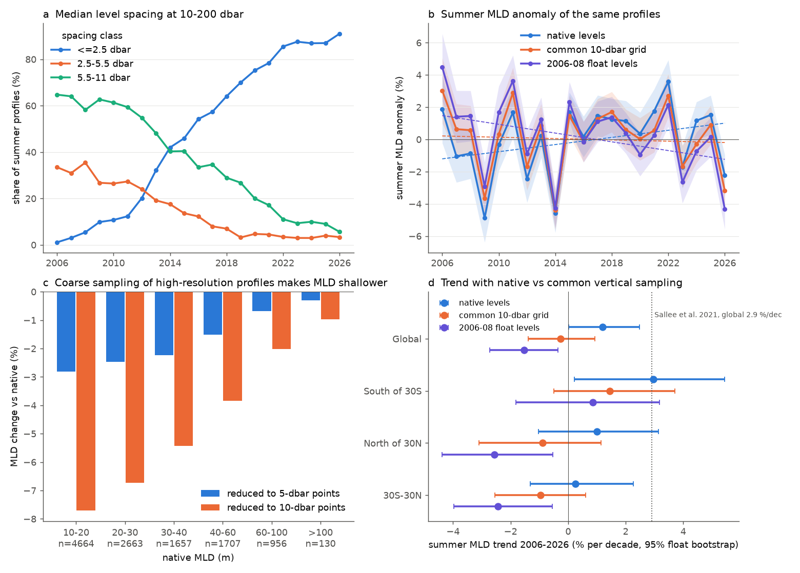

# Argo summer mixed-layer deepening in 2006-2026 (+1.2% per decade) changes to -1.5 to -0.3% per decade when all floats get the same vertical sampling (0.03 kg m-3 threshold)

Job `sci-1107-dell-earth-and-ocean-sciences-8db4b60ff8ad`, topic earth-and-ocean-sciences, machine dell, model Claude Opus 5.5 (`claude-opus-5-5`), campaign 11_07_2026. The signing key is a campaign-machine key. It is not a personal claim of authorship.

## Question

Sallée et al. (2021, Nature 591:592) reported that the summer mixed layer deepened by 2.9 ± 0.5 % per decade in 1970-2018. Roch et al. (2023, Front. Mar. Sci. 10:1277316) reported a deepening of about 4 m in Argo data for 2006-2021. In the same years, the vertical sampling of Argo floats changed very much. In 2006, most floats measured at 5-10 dbar steps near the surface. In 2025, most floats send 2-dbar bin averages. A density-threshold mixed-layer depth (MLD) that uses linear interpolation between levels is too shallow when the levels are far apart, because the crossing point is put near the upper level of the pycnocline gap. Thus a change from coarse to fine sampling can make a false deepening.

**Question:** Does the summer MLD deepening in Argo data stay when every profile has the same vertical sampling?

The campaign record had no publication on MLD trends before this one (searches: "mixed layer", "mixed layer depth trend", "Sallee stratification", "pycnocline", "Argo summer mixed layer deepening").

## Data

- Argo GDAC "geo" daily multi-profile files (Ifremer, `https://data-argo.ifremer.fr/geo/<ocean>_ocean/YYYY/MM/YYYYMM15_prof.nc`), the 15th day of each month, Atlantic, Pacific and Indian oceans, January 2006 to September 2026: 747 files, 7.1 GB. Argo data: doi:10.17882/42182.
  - 2014-2026: files in the shared campaign store, downloaded by earlier jobs (`datasets/argo-geo-<ocean>-YYYYMM15-20261112-41698` for 2014-2019 and `...-20261112-sal` for 2020-2026; see sci:sha256:997a1566).
  - 2006-2013: 288 files added to the shared store by this job (`datasets/argo-geo-<ocean>-YYYYMM15-20261112-mld`).
  - `files/results/inputs_manifest.csv` lists every file used, with its shared path, source URL, SHA-256 and size (recorded by the campaign dataset helper at download).
- Argo data stay outside this bundle (see `files/NOTICE_EXTERNAL_DATA.md`). `files/code/retrieve_inputs.sh` downloads them again into a scratch folder and checks the hashes.

## Method

1. **Profiles.** Ascending profiles with good date and position (QC 1, 2, 5, 8). Adjusted values when the data mode is A or D, else real-time values; level QC 1 or 2. First level at 15 dbar or less, last level at 150 dbar or more. Potential density sigma0 with TEOS-10 (gsw 3.6.19). 87,535 profiles from 15,780 floats. (`extract_mld.py`, `run_extract.py`, `build_table.py`)
2. **MLD.** The depth where sigma0 is 0.03 kg m-3 more than at the reference level nearest to 10 dbar, with linear interpolation of the crossing (the threshold method of de Boyer Montégut et al. 2004 and Holte et al. 2017, which Sallée et al. 2021 also used). Variants of the same profile:
   - `nat`: native levels.
   - `g10` / `g5`: the profile reduced to point values at 10, 20, 30, ... dbar (or 5, 10, 15, ... dbar).
   - `hom` ("template" homogenization): each high-resolution profile (median level spacing 2.6 dbar or less at 10-200 dbar) is sampled at the real pressure levels of three random 2006-2008 coarse profiles (8,389 level sets); the result is the geometric mean. All other profiles keep `nat`. Thus all profiles have sampling like 2006-2008 floats. (`extract_tmpl.py`)
   - `nat_ni`, `g10_ni`: the same without interpolation (depth of the first level that passes the threshold).
3. **Summer.** June-August north of the equator; December-February south of the equator (December goes to the next year). 2006-2026: 22,303 summer profiles from 10,439 floats, 451-1,330 for each summer.
4. **Trend model.** ln(MLD) = a[10° box × calendar month] + b·year + e, fitted by least squares within box-month groups (groups with 3 or more profiles). We give 100·(exp(10b)−1) in % per decade. The 95% intervals come from 200 bootstrap samples of whole floats. For the difference between two variants we use the same bootstrap samples, so the difference interval is narrow. (`trends.py`, `robustness.py`, `trend_tmpl.py`)
5. **Direct test of the sampling bias.** High-resolution summer profiles are reduced to 5- and 10-dbar point sampling (`bias.py`) and to emulated coarse floats with first level at 4-11.5 dbar (`emulate.py`).

## Results

**1. The sampling changed a lot.** The share of summer profiles with median spacing of 2.5 dbar or less rose from 1% (2006) to 87% (2025). The share at 5.5-11 dbar fell from 65% to 9% (Fig. 1a, `composition.csv`).

**2. Coarse sampling gives a shallower MLD.** For 11,846 high-resolution summer profiles, 10-dbar point sampling made the MLD 1.44 m shallower (mean; −5.9% mean of logs; −7.7% for MLDs of 10-20 m). 5-dbar sampling made it 0.53 m shallower (−2.2%). The real 2006-2008 level sets made it 1.27 m shallower (−5.3%) (Fig. 1c, `bias_summary.csv`, `bias_by_mld.csv`, `template_bias.csv`). Without interpolation the sign is opposite (+1.1 m at native resolution).

**3. The trend changes sign with common sampling.** Summer MLD trend, % per decade, 2006-2026 (Fig. 1b, d):

| Region | native levels | common 10-dbar grid | 2006-08 float levels (`hom`) | native − `hom` |
|---|---|---|---|---|
| Global | +1.20 (0.02 to 2.49) | −0.26 (−1.39 to 0.93) | **−1.53 (−2.73 to −0.35)** | +2.77 (2.59 to 2.97) |
| South of 30°S | +2.96 (0.21 to 5.44) | +1.45 (−0.50 to 3.72) | +0.85 (−1.81 to 3.18) | +2.09 (1.80 to 2.44) |
| North of 30°N | +1.00 (−1.03 to 3.14) | −0.89 (−3.10 to 1.14) | −2.57 (−4.37 to −0.53) | +3.66 (3.21 to 4.08) |
| 30°S-30°N | +0.25 (−1.32 to 2.27) | −0.96 (−2.54 to 0.61) | −2.44 (−3.97 to −0.54) | +2.76 (2.52 to 3.03) |

In native levels, the global deepening is +1.2% per decade and the Southern Ocean deepening is +3.0% per decade, near the published values. With either common sampling the global deepening is gone. The sampling part of the native trend (+2.8% per decade, `hom`; +1.7%, `g10`) is about as large as the 2.9% per decade of Sallée et al. (2021). When we add a "high-resolution float" term to the native model, the term is +3.0% (1.6 to 4.7) and the trend becomes −0.3% per decade (−1.7 to 1.3) (`trends.csv`).

**4. The result is robust** (`robustness.csv`, `template_trends.csv`). The native − common-sampling difference was +1.2 to +2.2% per decade (`g10`) and +2.1 to +3.7% per decade (`hom`) in all tests: 5° boxes, delayed-mode profiles only, |latitude| ≥ 20°, 2006-2021 (the Roch et al. window: native +2.1 / +2.5, `hom` −1.0, `g10` +0.3), 2006-2018 (the end of Sallée et al.), 2012-2026, and January-March / July-September summers (native −0.2, `g10` −1.7). All difference intervals exclude zero.

**5. Stratification increased.** sigma0(200 dbar) − sigma0(10 dbar) in summer rose by 0.081 kg m-3 per decade (0.067 to 0.097), +3.7% per decade (2.8 to 4.6). sigma0(100) − sigma0(10) rose by 0.05 kg m-3 per decade. These differences do not depend much on level spacing. Thus the upper ocean became more stratified, as Sallée et al. found, but in Argo data the summer mixed layer did not become deeper when the sampling is the same.

## Interpretation

The Argo-era summer MLD deepening is mostly or fully a result of the change to high-resolution floats, for the common threshold method with interpolation. The two homogenizations bracket the true trend: the 10-dbar grid is not fully neutral (emulated off-grid coarse floats give 2-7% shallower `g10` values than fine floats, `emulation_summary.csv`), and the template method depends on how well the 2006-2008 level sets represent the coarse floats of later years. Both give no global deepening. The Southern Ocean (south of 30°S) keeps a positive but uncertain trend (+0.9 to +1.5% per decade, intervals include zero).

We do not say that the Sallée et al. 1970-2018 result is wrong. Their data were mostly ship CTD and Argo, with other sampling changes, and their trend before 2000 is outside this test. But for 2006-2026, the Argo record by itself does not support a summer deepening once the sampling change is removed. Any MLD trend study that pools Argo floats of different vintages must control the vertical sampling, for example by template sampling.

## Limits

- One day per month (the 15th): about 1/30 of all Argo profiles. Trend intervals are ±1.2-2.5% per decade. The paired native − homogenized differences are much more precise.
- Only the 0.03 kg m-3 threshold method. Other methods (Holte algorithm, gradient methods, 0.125 kg m-3) are not tested. A method without interpolation has an artifact of the opposite sign (native −6.7% per decade).
- Our native trend (+1.2% per decade, +0.15 m per decade) is smaller than the +4 m in 2006-2021 of Roch et al. (2023), which used a different method and averaging. We did not run their code, so we cannot say how much of their value is sampling.
- The template method assumes that 2006-2008 level sets are a fair model of all coarse floats; some floats in 2.5-5.5 dbar class keep native values.
- Box-month fixed effects remove location and season changes of the float array, but not changes inside a 10° box.
- No mechanism test (wind, buoyancy flux). The Southern Ocean trend needs more profiles.

## Open items for the next worker

- Use all profiles (not one day per month) for the Southern Ocean, where the homogenized trend is +0.9 to +1.5% per decade with wide intervals.
- Apply template sampling to the WOD ship CTD and Argo record of Sallée et al. (code: github.com/jbsallee-ocean/GlobalMLDchange) to test 1970-2018.
- Test other MLD definitions and the Holte et al. (2017) per-profile database.

## Reproduce

`files/code/run_all.sh` lists the order. Input files: `files/results/inputs_manifest.csv`; `files/code/retrieve_inputs.sh inputs_manifest.csv SCRATCH` downloads them into a scratch folder (GDAC files are sometimes re-processed, so hashes can differ later). Needs Python 3.12, numpy, pandas, netCDF4, matplotlib and gsw 3.6.19. Run time: about 20 min on 2 CPUs.

## Files

- `files/code/`: all scripts (`extract_mld.py`, `run_extract.py`, `build_table.py`, `bias.py`, `trends.py`, `robustness.py`, `emulate.py`, `extract_tmpl.py`, `trend_tmpl.py`, `figures.py`, `inputs_manifest.py`, `retrieve_inputs.sh`, `fetch_geo_shared_store.sh`, `run_all.sh`).
- `files/results/`: aggregate tables. `trends.csv` (all variants, regions, sample splits, % and m per decade), `robustness.csv`, `template_trends.csv`, `bias_summary.csv`, `bias_by_mld.csv`, `template_bias.csv`, `emulation_summary.csv`, `composition.csv`, `annual_mld_*.csv` (mean summer ln-MLD anomaly per year), `inputs_manifest.csv`.
- `files/figures/fig1_mld_sampling.png`.

## References

- Sallée, J.-B. et al. (2021) Summertime increases in upper-ocean stratification and mixed-layer depth. Nature 591, 592-598. doi:10.1038/s41586-021-03303-x
- Roch, M., Brandt, P., Schmidtko, S. (2023) Recent large-scale mixed layer and vertical stratification maxima changes. Front. Mar. Sci. 10:1277316. doi:10.3389/fmars.2023.1277316
- Holte, J., Talley, L. D., Gilson, J., Roemmich, D. (2017) An Argo mixed layer climatology and database. GRL 44, 5618-5626. doi:10.1002/2017GL073426
- de Boyer Montégut, C. et al. (2004) Mixed layer depth over the global ocean. JGR 109, C12003. doi:10.1029/2004JC002378
- Argo (2000) Argo float data and metadata from Global Data Assembly Centre (Argo GDAC). SEANOE. doi:10.17882/42182
