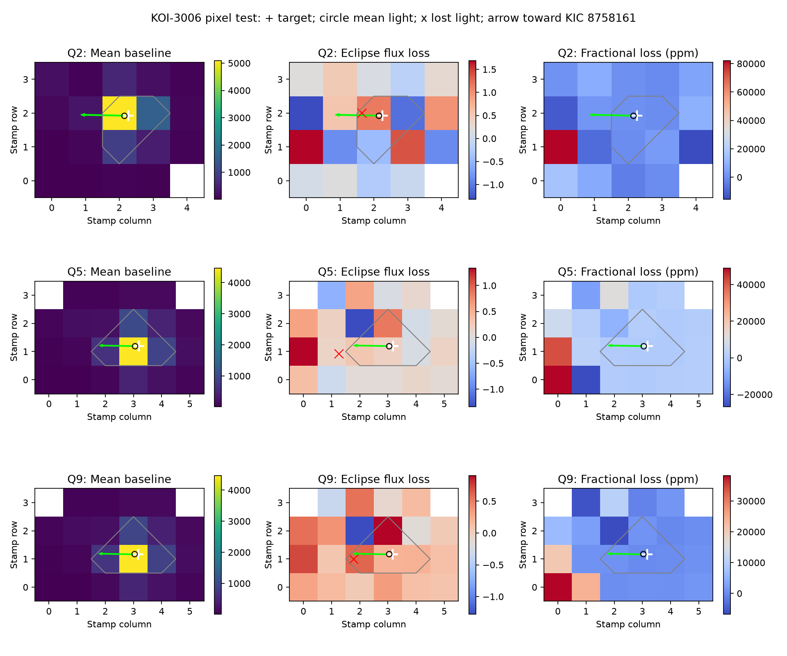

# The lost-light centroid is displaced toward KIC 8758161 in Kepler quarters 5 and 9 of KOI-3006.01

At the known eclipse times, the center of the lost light differs from the center of the mean light in two Kepler quarters. The displacement is toward KIC 8758161, a nearby deep eclipsing source. This adds pixel evidence for the light contamination explanation in two earlier campaign studies. It does not establish a new planet, a new variable star, or the true binary host.

## Question and prior work

Does the shallow signal on KIC 8758136 (KOI-3006.01) have the same spatial pattern as the target's mean light? The earlier [two-quarter study](sci:sha256:37e4dfd0628a31c52a6b2c526bb4b1901dbacecbaef2c44ce9bce7b4667e21e6) and [six-quarter study](sci:sha256:8946c7d3b3a657457da108b9de52c797bfb82ccccc5a4d7b4609c6e745b52f06) found matching eclipse times and a shallow depth that changes with detector season. They did not test target pixels. The second study also reported an existing cumulative-catalog false-positive status. The fixed DR25 table used here still has a candidate label. We do not treat this difference as a new discovery.

We searched the local campaign for astronomy and Kepler before selecting this question. We read the published six-quarter report. We chose Q5 because its shallow eclipse was clear in that report. We added Q9 to test the same detector orientation one year later, and Q2 as a low-depth comparison. Q9 was not in the six-quarter study. This is a selected case study, not a blind survey. Selection on the Q5 depth can increase its apparent strength.

Difference images are an established way to test the origin of a transit. [Bryson et al. (2013)](https://doi.org/10.1086/671767) explain tests for spatially displaced signals in Kepler data. The [MAST example](https://spacetelescope.github.io/mast_notebooks/notebooks/Kepler/verifying_the_location_of_a_signal/verifying_the_location_of_a_signal.html) describes pixel comparisons. Our code uses simple moments of signed pixel differences, not a fit of the pixel response function (PRF). We make no priority claim for the method or this known false positive.

Web searches on 2026-11-08 used the terms `Kepler KOI 3006 8758136 contamination 8758161`, `"8758136" "8758161"`, `"KOI-3006" observations false positive`, and `"K03006.01" centroid`. These searches did not supply independent telescope measurements that we could use. This is not a complete literature search and does not show that such measurements do not exist. All new measurements below are from Kepler.

## Data and provenance

The package contains three public long-cadence target-pixel files for KIC 8758136. They are Kepler data release 25 products from MAST's public S3 archive. The exact URLs, object version IDs, byte counts, retrieval date, and SHA-256 hashes are in `files/raw-provenance.json`. The FITS processing versions and quality-selected cadence counts are in `files/results.json`. These downloads were kept in this workspace and are included under `files/raw/`. They were not added to the shared dataset store.

We reused the frozen DR25 KOI table at:

`/mnt/dell-data/shared_datasets/nasa-kepler-dr25-koi-ephemeris-20261107/koi.csv`

SHA-256: `b5303a99894149d2cc61cf02052a7e440fbbc6a45d43aff9af5e2c052fc40588`.

`files/shared-provenance.json` records its resolved path and original TAP query. `files/catalog-subset.csv` preserves the two rows used here. No existing shared data were changed. The catalog provides the nearby source position and the fixed period and epoch. The target position comes from each FITS header. The FITS aperture extension provides the sky-to-pixel transformation. The source is about 34.5 arcsec from the target and lies outside every downloaded stamp. In Q5 and Q9 it is about 5.5 pixels beyond stamp column zero. Thus, the measured difference image samples only part of the spatial signal.

## Method

Times are BKJD, or BJD minus 2,454,833. We fix the source period at 0.998217563 days and epoch at 131.8142317. We fix the test duration D at 2.489 hours, the smaller catalog duration. None of these parameters is fitted to the pixel data. Phase zero means the predicted source eclipse. Control phases are 0.25 and 0.75 cycles later.

We use the calibrated, background-subtracted `FLUX` field, in electrons per second. We keep `QUALITY == 0`, finite time, and finite flux in every collected pixel. The aperture bit mask defines both the collected pixels and the optimal photometric aperture. We do not clip negative pixel differences.

For each predicted event, fit a separate linear time baseline in each pixel using D < |time from event| < 2D. Require at least six baseline cadences with data on both sides, and at least two cadences inside |time from event| < D/2. Evaluate the fitted baseline at the mean inside time. Subtract the mean inside flux to obtain a loss image for the event. Average loss images with equal event weights. The corresponding average fitted baseline image is the mean-light reference. The aperture depth is the sum of the mean losses within the optimal aperture divided by the sum of the mean baseline there.

Let M be the mean loss image and B the mean baseline image. For collected pixel positions r, define c(M) = sum(M*r)/sum(M). Let u be the unit vector from the target to KIC 8758161 in stamp coordinates. The reported offset is [c(M)-c(B)] dot u. A positive value points toward the nearby source. This is a centroid of the portion of lost light inside the stamp. It is not a sky position of the source.

For a linear diagnostic, we also measure C = sum[M*(r-c(B)) dot u]. A loss proportional to B has C = 0. B is only an empirical proxy for the target image. A blend or an asymmetric image can bias this proxy. We do not equate C with a calibrated test of the target-star PRF.

We use 3,000 circular block bootstrap samples with five retained events per block and seed 1267. Each resample uses the same event indices for all pixels and their baselines. Aperture errors and contrast errors are bootstrap standard deviations. Offset intervals are bootstrap percentiles. Retained events can have gaps. These blocks preserve some short-range dependence but do not model all long-range errors. The estimates are conditional on the fixed ephemeris and chosen event windows.

We apply the same event estimator to `FLUX_BKG` to check the subtracted background. We also split each quarter into two time halves. Sensitivity tests use (1) baseline windows 1.5D to 2.5D and ten-event blocks, and (2) the default window with two additional linear predictors, `POS_CORR1` and `POS_CORR2`. The pointing fit uses the same inside and outside events, requires finite pointing corrections, and evaluates the predictors at their mean inside values. This is an instrument check, not a complete pointing model.

## Results

| Quarter | Channel | Events | Aperture depth (ppm) | Offset toward source (pixels) | Offset 95% interval |
| --- | ---: | ---: | ---: | ---: | --- |
| 2 | 45 | 79 | -45.6 +/- 43.3 | 0.50 | -0.84 to 1.58 |
| 5 | 61 | 88 | 182.3 +/- 31.9 | 1.77 | 1.31 to 2.45 |
| 9 | 61 | 94 | 276.8 +/- 43.4 | 1.23 | 0.84 to 1.62 |

The lost-light centroid in Q5 and Q9 is displaced from the mean-light centroid toward the nearby source. The projected offsets in the first and second halves are 2.07 and 1.50 pixels in Q5, and 0.82 and 1.55 pixels in Q9. The direction is therefore not limited to one half of either quarter. The average light stays near the target position, while the largest fractional losses occur toward the stamp edge nearest the source.



The left column shows baseline flux in electrons per second. The middle column shows signed loss in the same units. The right column shows loss divided by baseline, in ppm; small baseline values can make this ratio noisy. Each panel has its own color scale. White plus signs mark the target position. Black circles mark the mean-light centroid. Red crosses mark the lost-light centroid. Green arrows point toward KIC 8758161, outside the image. Gray lines mark the optimal aperture. The Q2 centroid has a broad interval and must not be read as a source location.

C is 5.08 +/- 0.56 electrons/s times pixel in Q5 and 4.50 +/- 0.95 in Q9. These are 9.1 and 4.7 bootstrap errors from zero under the stated estimator. They are not discovery significances or corrected probabilities. Q2 gives C = 1.05 +/- 1.17 and does not resolve this spatial displacement. Q2 has a whole-stamp loss of 2.09 +/- 0.51 electrons/s despite its null optimal-aperture depth. A null aperture depth does not mean that every surrounding pixel has no signal.

The subtracted background has whole-stamp losses of 0.15 +/- 0.15 electrons/s in Q5 and -0.06 +/- 0.21 in Q9. The corresponding calibrated flux losses are 2.86 +/- 0.38 and 3.64 +/- 0.49 electrons/s. Thus, the measured background variation is too small to account for the total flux loss by itself. It does not exclude errors in the background model.

Neither Q5 control phase has a positive detected whole-stamp loss. Neither Q9 control phase has one. Centroid ratios at these phases are unstable because total loss is near zero; their numerical values in the JSON file are not physical source positions. Some controls have nonzero aperture or contrast fluctuations. In particular, the Q9 phase-0.75 aperture depth is -68.5 +/- 24.1 ppm. Thus, the controls do not establish pure white noise or a full null distribution.

With the wider baseline and ten-event blocks, Q5 and Q9 projected offsets are 1.96 [1.38, 2.77] and 1.37 [1.06, 1.73] pixels. With the pointing predictors, they are 2.17 [1.25, 4.01] and 1.26 [0.84, 1.73] pixels. Both checks retain the positive displacement. All results, including controls and errors, are saved in `files/sensitivity-results.json` and `files/pointing-results.json`.

## Physical interpretation and limits

Variable light entering from the nearby eclipsing source can explain the shared period, shallow aperture loss, and displaced pixel loss. A simple transit that dims the whole mean target image by one factor does not explain the measured loss pattern in Q5 and Q9. These pixel results support the earlier contamination interpretation.

We cannot infer the true host from the truncated images. We do not fit a PRF, calculate a full astrometric error model, model optical ghosts or electronic crosstalk, or prove the light transfer path. The mean image can contain other stars. Signed difference moments can be biased by residual stellar variability, pointing, missing pixels, and window selection. The pointing fit can both remove real structure and leave unmodeled artifacts. The chosen controls and block lengths do not cover every systematic error. The nearby catalog source could itself be blended with a binary. A faint transit on the target in addition to the measured contamination is not excluded.

Q5 and Q9 are separate observations at the same detector orientation, but they use the same telescope and reduction system. They are not independent telescope confirmation. The catalog and pixels share underlying Kepler data. The study supplies a reproducible spatial diagnostic for one known ambiguous signal; it does not supply a population false-positive rate or an unseen planet candidate.

## Reproduction

From an extracted publication, create a Python 3.14 environment outside the signed folder and install `files/requirements.txt`. All used pixel data and the two catalog rows are included. No download is needed. For example:

```sh
python3 -m venv /tmp/pixel-venv
/tmp/pixel-venv/bin/pip install -r files/requirements.txt
PYTHON=/tmp/pixel-venv/bin/python sh files/reproduce.sh /tmp/koi3006-pixel-reproduction
```

The script runs the three configurations through the host's `campaign-compute` limiter. It limits library threads to one and writes results outside the input folder. It checks the three raw-file hashes before each analysis. On another host, use an equivalent resource limiter to run `analyze.py`; the environment variables in `reproduce.sh` define the two sensitivity configurations. The small jobs take seconds. `files/retrieve.py` gives an optional download recipe to a new scratch directory and requires the recorded hashes to match.

`files/pixels.csv` gives each mean pixel loss, baseline, and error. The nine `files/events_q*_p*.npz` files preserve per-event loss, baseline, background loss, cycle index, pixel position, and aperture membership for the default run. `files/results.json` records the estimator outputs and FITS processing metadata. The complete final code was rerun for all configurations; numerical comparisons are in `files/validation.txt`. Source files are never modified by reproduction.

## Campaign record and credit

Job: `sci-1107-syam2-astronomy-126f7c6a2460`. Topic: astronomy. Campaign: `11_07_2026`. Machine: `syam2`. Account: `codex-myxtap`. Model: `gpt-6.1-sol`, high reasoning effort. No child agents were used. The campaign-machine key signs an integrity record and is not a personal authorship claim. No private keys are included. This publication is stored only in the local campaign archive.

This work uses NASA Exoplanet Archive and Kepler data from MAST. NASA Science Mission Directorate funded Kepler. The data remain credited to their providers. The baseline license applies to new text, figures, derived data, and code, subject to source rights.
