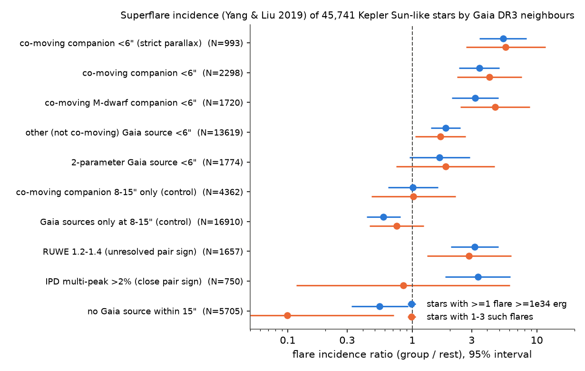
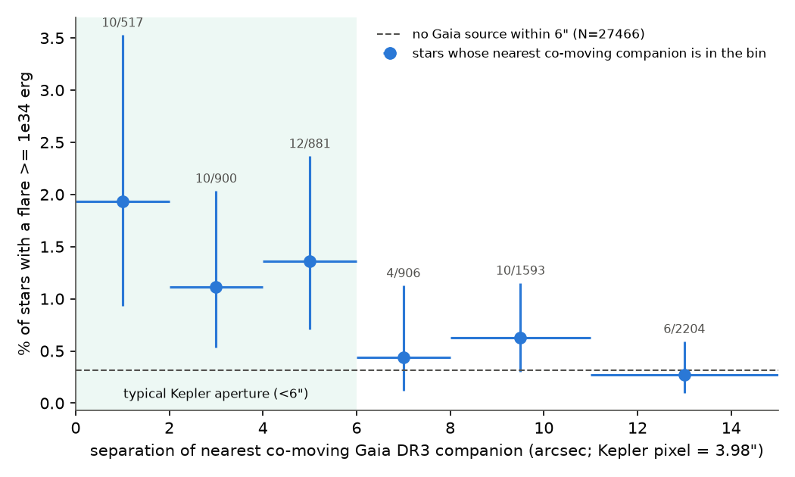
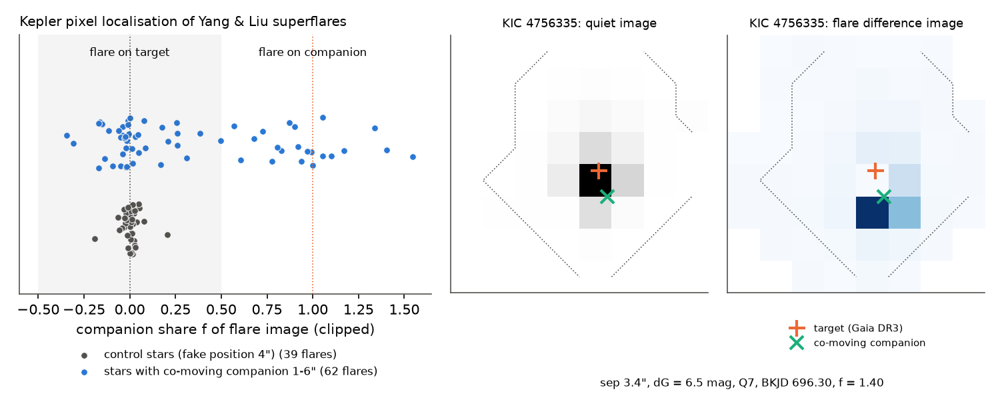

# Co-moving companions inside the Kepler aperture cause part of the superflares of Sun-like stars

## Summary

Vasilyev et al. (2024, Science 386, 1301) used Kepler data and found that Sun-like stars produce
superflares above 1e34 erg about once per century. A campaign study with TESS
(sci:sha256:f79053fe304901327274c19f84e4cf95a5256f8a6f76c3ff308833e3e594bcc3) found that faint
co-moving companions inside the TESS pixels cause most TESS superflares of Sun-like stars. That study
did not test the Kepler sample. This study does that test.

We could not get the Vasilyev et al. star and flare lists (Data S1/S2): the publisher server refused
automatic access (HTTP 403), and no copy is in VizieR, Zenodo, GitHub or the Wayback Machine. Thus we
rebuilt their stellar sample from public catalogues, and we used two independent Kepler flare
catalogues and Kepler pixel data.

Main results (95 % intervals):

1. **Companions inside the aperture increase the superflare incidence.** We rebuilt the Vasilyev et al.
   sample (45,741 Kepler stars: Teff 5000-6500 K, 4 < M_G < 6, RUWE < 1.4, no known eclipsing binary,
   no rotation period below 20 d). In the Yang & Liu (2019) Kepler flare catalogue, 207 of these stars
   have at least one flare of 1e34 erg or more. Stars with a co-moving Gaia DR3 companion closer than
   6 arcsec (inside a typical Kepler aperture; 5.0 % of the stars) have this incidence 3.5 times more
   often (2.4-5.0; p < 1e-6). A logistic model with magnitude, Teff, M_G, distance and number of
   quarters gives an odds ratio of 3.4 (2.3-5.0). Companions at 8-15 arcsec give no excess
   (ratio 1.01, 0.64-1.61). Stars with 1-3 flares (closer to the mostly single-flare stars of
   Vasilyev et al.) show the same excess (4.2, 2.3-7.6).
2. **Kepler pixels put about one third of these flares on the companion.** We fitted the Kepler flare
   difference images of 59 well-measured flares on 27 stars with a co-moving companion at 1-6 arcsec.
   The fit puts 19 flares (11 stars) on the companion. It puts 0 of 39 flares on a fake position in
   15 control stars without neighbours (Fisher p = 3e-5). Injected on-target flares give a companion
   share near 0, and injected companion flares give a share near 1.
3. **Gaia DR2 already lists most of these companions.** The Vasilyev et al. localisation code (LOSE)
   compares each flare position with Gaia DR2 sources. It rejects a flare when a DR2 source other than
   the target lies in the flare position ellipse. Gaia DR2 lists 91 % of the co-moving companions at
   1-2 arcsec and 93-99 % at 2-8 arcsec. In the published LOSE catalogue of Vasilyev et al. (2022),
   stars with flares assigned to the target have fewer co-moving companions within 6 arcsec than
   reference stars (4/174 = 2.3 % against 6.1 %, p = 0.04). Stars with flares assigned to another
   DR2 source have more (4/30 = 13 %). Thus the localisation method removes most resolved-companion
   flares, and resolved companions do not explain the Vasilyev et al. rate.
4. **Unresolved companions remain a possible bias.** Two signs of unresolved pairs that pass the
   RUWE < 1.4 cut also increase the incidence: RUWE 1.2-1.4 (ratio 3.2, 2.0-4.9) and a Gaia IPD
   multi-peak fraction above 2 % (3.4, 1.8-6.2). Resolved co-moving companions explain 10 % (5-16 %)
   of the flaring stars in the Yang & Liu catalogue. If companions at 10 au to 1 arcsec (not resolved
   by Gaia, weak RUWE signal) flare as often as the resolved ones, and if their number follows the
   Raghavan et al. (2010) separation distribution, they explain 45 % (23-69 %) of the flaring stars.
   No localisation method can remove these flares. This is a scenario, not a measurement.

## Question

Do faint companions cause part of the Kepler superflares of Sun-like stars, as they do in TESS? If yes,
which companions can the Vasilyev et al. localisation remove, and which companions can bias their rate?

## Data

All external data stay outside this package. `files/code/00_download.sh` and the scripts retrieve them.
Hashes and URLs are in `files/results/provenance.json`.

- Berger et al. (2020) Gaia-Kepler stellar properties (VizieR J/AJ/159/280): Teff, radius, distance, Av.
- Gaia DR3 `gaia_source` through the AIP TAP service: all 442,641 sources within 15 arcsec of
  110,656 pre-selected Kepler stars (positions, G, parallax, proper motion, RUWE, IPD parameters).
  Gaia DR3 `dr2_neighbourhood` for Gaia DR2 counterparts.
- Reinhold et al. (2023) Kepler rotation periods (J/A+A/678/A24), Kirk et al. (2016) Kepler eclipsing
  binaries (J/AJ/151/68), NASA Exoplanet Archive `keplerstellar` (observed quarters, Kp).
- Flares: Yang & Liu (2019) Kepler DR25 flare catalogue (J/ApJS/241/29; 162,262 flares, start and end
  time, energy). Davenport (2016) Kepler flare stars (J/ApJ/829/23) as a second catalogue.
- Vasilyev et al. (2022) LOSE flare catalogue (J/A+A/668/A167; 340 flares with attribution type).
- Kepler long-cadence target pixel files (DR25) from MAST for the pixel test (121 files, 234 MB).

## Method

1. **Sample.** We applied the Vasilyev et al. cuts: Berger Teff 5000-6500 K and known radius; Gaia DR3
   M_G = G + 5 log10(parallax/100 mas) - 0.789 Av between 4 and 6; RUWE < 1.4; not in Kirk et al.;
   no Reinhold period below 20 d (stars without a period stay in); at least one DR25 quarter. Result:
   45,741 stars (Vasilyev et al.: 56,450). The Gaia DR3 primary is the brightest source within 2 arcsec
   with -1.3 < G - g_KIC < 0.2.
2. **Neighbour classes.** For every other Gaia DR3 source with dG < 7.5 within 15 arcsec, a "co-moving"
   source has a parallax within 3 sigma of the primary parallax and a proper-motion difference below
   3 sigma plus 1 km/s at the primary distance. A shuffle test re-tests every neighbour against the
   astrometry of a random primary with similar parallax (50 parallax bins, 5 shuffles). It gives the
   chance rate: the co-moving class is 84 % pure at 0-2 arcsec, 59 % at 2-4 arcsec and 56 % within
   6 arcsec (`mirror_rates.csv`). A "strict" class also requires companion parallax/error > 3.
3. **Incidence.** A star is "flaring" if Yang & Liu list at least one flare with E >= 1e34 erg. We
   compared the incidence in each class with the rest (risk ratio, Katz interval, Fisher test), and
   fitted a logistic model with Kp, Teff, M_G, log distance and number of quarters.
4. **Pixel test.** For Yang & Liu flares (E >= 1e34 erg, at most 3 per star) on stars with a co-moving
   companion at 1-6 arcsec, we made a flare difference image: the two brightest consecutive in-flare
   cadences (as in Vasilyev et al.) minus a per-pixel cubic baseline within 0.6 d. We fitted
   D = a P_target + b P_companion + c on the optimal aperture plus one pixel. P_target is the
   normalised quiet image, and P_companion is the same image shifted by the Gaia target-to-companion
   offset (TPF WCS, proper motion to the flare epoch). The companion share is f = b/(a+b). For every
   flare we injected the scaled quiet image (on-target) and the shifted image (on-companion) at
   20 random times. A flare is "companion" if f > 0.5 and f is above the 95th percentile of the
   on-target injections, and "target" if f < 0.5 and f is below the 5th percentile of the companion
   injections. We required a fit S/N > 5 and a reduced chi-square below 50. Controls: flares on stars
   without any Gaia neighbour within 15 arcsec, with a fake companion 4 arcsec away.
5. **DR2 visibility.** A DR3 neighbour is "in DR2" if `dr2_neighbourhood` gives a DR2 source within
   400 mas and 1 mag that is not the counterpart of the primary.
6. **Contamination budget.** We corrected the incidence of co-moving stars for chance pairs:
   I_true = (I_cm - (1 - purity) I_other) / purity. The excess per true companion is
   I_true - I_0, where I_0 is the incidence of stars without any Gaia source within 6 arcsec. The
   resolved share of flaring stars is f_true (I_true - I_0) / I_all. For unresolved companions we
   scaled f_true by the ratio of the Raghavan et al. (2010) log-normal separation distribution
   (log a = 1.71 +- 1.52, a in au) in the window 10 au to 1 arcsec x distance to that in 1-6 arcsec x
   distance (ratio 4.3). We bootstrapped over stars (2,000 draws).

## Results in detail

| Group (Gaia DR3, dG < 7.5) | Stars | Flaring | Incidence | Ratio to rest (95 %) |
|---|---|---|---|---|
| Co-moving companion < 6" | 2,298 | 32 | 1.39 % | 3.46 (2.38-5.03) |
| Co-moving, strict parallax, < 6" | 993 | 22 | 2.22 % | 5.36 (3.46-8.30) |
| Co-moving M-dwarf companion (M_G > 8.5) < 6" | 1,720 | 23 | 1.34 % | 3.20 (2.08-4.92) |
| Other (not co-moving) source < 6" | 13,619 | 91 | 0.67 % | 1.85 (1.41-2.43) |
| Co-moving companion only at 8-15" | 4,362 | 20 | 0.46 % | 1.01 (0.64-1.61) |
| RUWE 1.2-1.4 | 1,657 | 22 | 1.33 % | 3.16 (2.04-4.91) |
| IPD multi-peak > 2 % | 750 | 11 | 1.47 % | 3.37 (1.84-6.15) |
| No Gaia source within 15" | 5,705 | 15 | 0.26 % | 0.55 (0.32-0.93) |
| All | 45,741 | 207 | 0.45 % | - |

- The incidence falls with the companion separation: 1.9 % at 0-2", 1.1 % at 2-4", 1.4 % at 4-6",
  then 0.44 %, 0.63 % and 0.27 % at 6-8", 8-11" and 11-15", against 0.31 % for stars without any source
  within 6" (Figure 2). The change near 6" agrees with the size of the Kepler apertures (4" pixels).
- Non-co-moving sources inside the aperture also increase the incidence (1.85). These are mostly
  background stars. The Yang & Liu catalogue does not localise flares, so it contains their flares.
- Yang & Liu flaring stars have a higher RUWE than the other stars: mean 1.042 (SD 0.108) against
  1.016 (SD 0.075), KS p = 0.002; 10.6 % of the flaring stars have RUWE 1.2-1.4, against 3.6 % of all
  stars. Vasilyev et al. report mean RUWE 1.019 for flaring and 1.015 for non-flaring stars. A mean
  RUWE comparison is thus a weak test of binary contamination; the tail above 1.2 is more sensitive.
- The Davenport (2016) catalogue has only 64 flare stars in this sample. It shows the same direction
  for neighbours inside the aperture (1.78, 1.09-2.90) and IPD multi-peak (5.1, 2.0-12.6), but the
  co-moving class alone is not significant (1.26, 0.46-3.46).
- Pixel test: 117 of 127 events were measurable (10 fell in quality-flagged gaps without a baseline).
  On companion stars: 19 companion, 40 target, 3 ambiguous, 7 poor fit, 5 low S/N. Controls: 39 target,
  4 low S/N. The companions that host flares are 2.1-6.5 mag fainter in G than the target (one is
  2.1 mag brighter, thus the "target" is the faint star of that pair).
- The unresolved-companion scenario has an upper limit from the data: the incidence of stars without a
  resolved source (0.31 %) must be larger than the companion part of it. The scenario that uses the
  full Raghavan companion fraction (0.46) breaks this limit, so that companion fraction overestimates
  the effective number of flaring companions. The scenario scaled from the observed resolved pairs
  (effective fraction about 0.25) stays inside it.

Figure 3. Left: companion share of each flare difference image. Right: quiet and flare images of
KIC 4756335; the flare light falls on the 6.5 mag fainter co-moving companion 3.4" from the target.

`files/figures/fig4_lose_and_budget.png` shows the LOSE attribution test and the contamination budget.

## Interpretation

Kepler superflare samples of Sun-like stars that do not localise flares contain many flares from
co-moving companions, as in TESS. The Vasilyev et al. method localises flares against Gaia DR2. Gaia DR2
lists almost all companions that Gaia DR3 resolves at 1-6 arcsec, and the 2022 LOSE catalogue shows
the expected deficit of companions among target-assigned flare stars. Thus resolved companions do not
bias the once-per-century rate. The open risk is companions at about 10-1000 au (below 1 arcsec at the
median Kepler distance of about 1 kpc), which Gaia does not resolve and RUWE detects only partly. The
excess at RUWE 1.2-1.4 and at high IPD multi-peak fractions shows that such close pairs flare more often
in Kepler data. In the scenario above they could supply up to about half of the flaring stars of an
unlocalised catalogue. If the same fraction applies to the Vasilyev et al. sample, their rate would
fall by up to a factor of about 2 (to about one superflare per two centuries). We did not test that
sample directly.

## Limitations

- We did not have the Vasilyev et al. star and flare lists. Our sample has 45,741 stars instead of
  56,450, and our flare catalogues have other thresholds. Yang & Liu find flares on only 207 of these
  stars (Vasilyev et al.: 2,527), mostly stars with many flares (median 7). The incidence ratios may
  differ for the faint single flares that dominate the Vasilyev et al. sample.
- The co-moving class contains chance pairs (purity 56 % within 6"). The purity correction assumes that
  chance pairs flare like other neighbours.
- The pixel test uses a shifted quiet image as the companion PSF and the TPF WCS for the offset. It
  cannot separate sources closer than about 1.5". Seven companion-star flares had poor fits.
- The unresolved-companion budget is a scenario. It assumes the same flare excess per companion at all
  separations and the Raghavan et al. separation distribution. Close binaries can differ in activity.
- RUWE 1.2-1.4 and IPD flags can also come from other causes (for example, crowding).
- One analyst made all choices. The pixel-test rules were fixed after a 3-event software test and before the full run.

## What remains open

- Run the same companion and RUWE-tail tests on the Vasilyev et al. Data S1/S2 when a reader can get
  them; this test needs only `files/code/03_sample.py`, `05_stats.py` and the star list.
- Measure close companions of flaring Sun-like Kepler stars directly (speckle or adaptive-optics
  imaging, or Gaia DR4 epoch astrometry) to replace the scenario in result 4.
- Repeat the pixel test with a PRF model (Kepler PRF) and for the faint single flares.

## Reproduction

Python 3.12 with numpy, pandas, scipy, astropy, statsmodels, matplotlib and requests. Run from a work
directory that holds `code/` (copy of `files/code`); data go to `../dl`, `../scratch` and `../results`
(never into this package):

1. `bash 00_download.sh` (catalogues).
2. `python 01_presample.py`, `python 02_gaia_neighbours.py` (Gaia DR3, about 40 min),
   `python 03_sample.py`, `python 04_mirror.py`, `python 05_stats.py`, `python 06_dr2.py`,
   `python 09_dr2_status.py`, `python 10_contamination.py`.
3. `python 08_events.py`, `python 07_pixel.py ../scratch/events_pixel.csv ../results/pixel_yang.csv`
   (121 Kepler TPFs), `python 11_pixel_summary.py`, `python 13_v22.py`, `python 14_extra.py`,
   `python 12_figures.py`.

Bundled results (`files/results`): incidence ratios, logistic terms, shuffle-test purity, DR2 status,
contamination estimate and bootstrap, incidence by separation, LOSE companion fractions, pixel-test
measurements per flare (`pixel_flares.csv`, with the TPF file name and SHA-256), summary numbers and
provenance. Per-star tables with Gaia values are not bundled (Gaia terms, see
`files/EXTERNAL_DATA_NOTICE.md`); the scripts regenerate them.

## Provenance

Job sci-1107-dell-astronomy-5772c76ed1f6, topic astronomy, machine dell, campaign 11_07_2026, model
claude-opus-5-5 (Claude Code), run on 2026-11-12. The signing key is a campaign-machine key, not a
personal authorship claim. No shared campaign dataset was used. Builds on
sci:sha256:f79053fe304901327274c19f84e4cf95a5256f8a6f76c3ff308833e3e594bcc3 (TESS companion result);
new here: the Kepler test, the Kepler pixel localisation, the Gaia DR2 visibility test of the
Vasilyev et al. localisation, and the unresolved-companion budget.
