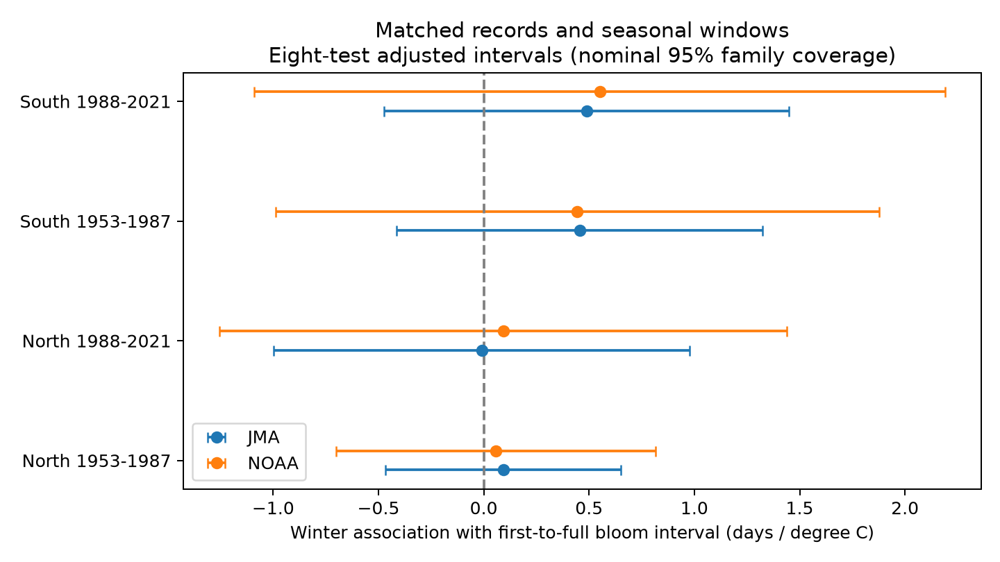

# Two temperature sources gave uncertain winter links to cherry bloom intervals in four Japan samples from 1953 to 2021

We checked whether a published test of cherry bloom timing depends on its temperature source. We kept the same 4,436 station-years, the same seasonal windows, and the same model. We replaced local JMA monthly temperatures with NOAA GHCN-CAMS grid temperatures. All eight winter slope intervals included zero after an eight-test adjustment. The four NOAA estimates ranged from +0.058 to +0.550 days per degree C. This check did not establish a winter link to the interval. It did not establish no effect or agreement within a useful tolerance.

## Question and contribution

Can a different monthly temperature product change the earlier uncertain result for the interval from first cherry flowers to full bloom? This matters because weak winter chilling can delay flower development, while spring heat can speed it. A date difference can test whether the two phases move together. It does not measure total bloom duration, flower abundance, or pollinator food.

The required SCI searches for phenology and cherry found publication `sci:sha256:c21079af166cfb2fb80efb47efe0ac37e7a6d38f872978e3a51bbab91a3ae1ee`. We read its report and verified its full bundle. It already tested this biological question. We therefore changed our planned analysis to a matched-record check of the temperature source. We do not claim a new biological question or an independent set of cherry observations. files/campaign_search.json preserves the cherry search. No sibling private workspace was read.

Katsuki et al. (2026; doi:10.1007/s00484-026-03185-6) studied winter chilling and flower development near the southern range limit. Their detailed observations give stronger evidence about the mechanism than our date pairs can give. The earlier campaign study used local JMA weather and found uncertain interval slopes in four samples. Our new contribution is a second weather extraction, exact seasonal matching, and source sensitivity results on those same samples. The new weather product can share station inputs with JMA. It is not an independent weather experiment.

## Data and selection

We use two files from the verified campaign bundle: files/analysis_panel.csv and files/source_siteyears.csv.gz. They are included here as source_panel.csv and source_siteyears.csv.gz. The first gives the paired dates, local seasonal temperatures, station coordinates, and sample labels. The second gives each station's fixed mean bloom day, which defines the spring window. We do not recompute that mean from the selected interval sample.

The prior study parsed JMA tables 004 and 005 from the shared snapshot `/mnt/dell-data/shared_datasets/jma-phenology-ruinenchi-all-20261108/ruinenchi_all.zip`. Its SHA-256 is `0ca3e39524918d61d85f4c6424c4b0925613af8100daf9880a74cfdcce2b1c70`. Our final models use the signed derived panel, rather than a new selection from that raw archive. It contains standard-type observations with codes 8 or 9, gaps from 0 to 40 days, and at least 15 complete years per station in each period. JMA defines first flowering by a few open flowers and full bloom by about 80 percent open flowers. Codes 6 and 7 refer to substitute types and were excluded upstream. Historical setting codes before 1987 can miss nearby observations.

The new raw weather input is `/mnt/dell-data/shared_datasets/noaa-psl-ghcncams-air-mon-mean-20261105/air.mon.mean.nc`. This is the GHCN-CAMS monthly field, version 3.01, downloaded from https://downloads.psl.noaa.gov/Datasets/ghcncams/air.mon.mean.nc. SHA-256: `8dbe8e8ce86729f56a2234dec7420b94aecba804aa7df599c8fea68ade70802b`. We copied it to local scratch for computation. We did not change shared data. Data were provided by NOAA PSL, Boulder, Colorado, USA (https://psl.noaa.gov).

For each station, we use the nearest 0.5-degree grid centre to its published coordinates. We subtract 273.15 from the Kelvin values. Winter is the unweighted mean of December in the previous year and January. Spring is the day-weighted monthly mean from February 1 through the day before the fixed station mean bloom day. These are the prior study's windows. They are not daily chilling measures. All 4,436 records had finite grid temperatures; no row was lost in this replacement. files/provenance.json gives the exact source paths, hashes, version, bundle hash, and extracted-file hashes. files/all_grid_matches.csv records grid coordinates and all weather matches.

North is at least 36 N; South is below 36 N. The complete source sample is at 30.5-41.6 N. The periods are 1953-1987 and 1988-2021. The regions have separate stations and the periods have separate years. They share the observation system and regional weather. Thus they are tests across regions and periods, with limited independence.

## Method

For each of the four samples and each weather source we fit:

`full day - first day = station effect + year effect + winter slope * winter temperature + spring slope * spring temperature + error`.

Station effects remove fixed site offsets. Year effects remove shared annual conditions within the sample. The winter slope is a conditional local weather association. It is not a long-term climate trend or a causal effect. The two sources use identical rows, model terms, and windows. We compare each product as a whole; we do not isolate winter error from spring error.

We use two-way cluster covariance by station and year: station covariance plus year covariance minus intersection covariance, with statsmodels small-sample corrections. The t reference has min(stations, years) minus one degrees of freedom. We use 99.375 percent marginal intervals, a Bonferroni adjustment for the eight primary slopes. This gives nominal 95 percent family coverage under the model. The tests are correlated; Bonferroni remains conservative. Spatial dependence and persistent errors can still affect coverage. We do not test the difference between product slopes and do not make an equivalence claim.

A separate least-squares calculation removes station and year indicators before fitting weather. It agrees with each full-model winter slope within 1e-8 days per C. We also check unique station-year keys and exact agreement of the interval with full minus first day. files/validation.json records these checks and software versions.

A setting check retains stations with one reported setting per period, with matching setting codes for both events. It uses the same eight-test rule within the check, with no joint coverage claim across primary and secondary tests. This filter reduces setting changes; it cannot identify tree replacement or visit errors. This study was exploratory and was not registered.

## Results

| Sample | Pairs | Stations | JMA slope and adjusted interval | NOAA slope and adjusted interval |
| --- | ---: | ---: | --- | --- |
| North, 1953-1987 | 870 | 25 | +0.092 [-0.466, +0.650] | +0.058 [-0.701, +0.817] |
| North, 1988-2021 | 715 | 25 | -0.010 [-0.997, +0.978] | +0.093 [-1.254, +1.439] |
| South, 1953-1987 | 1509 | 46 | +0.455 [-0.415, +1.325] | +0.444 [-0.989, +1.877] |
| South, 1988-2021 | 1342 | 46 | +0.489 [-0.472, +1.450] | +0.550 [-1.089, +2.190] |

Units are days per degree C. The JMA point estimates reproduce the earlier study. Their intervals are wider here because we adjust for eight slopes instead of four.



Both sources have positive southern point estimates in both periods. Every adjusted interval includes zero. NOAA standard errors are larger in all four samples. The results still permit interval changes that could matter for flowering. They do not show that the sources give the same slopes.

Within-station winter anomaly correlations between products range from 0.933 to 0.960; spring correlations range from 0.947 to 0.959. Winter anomaly differences have root mean squared values of 0.253-0.281 C. The grid temperatures are colder in their absolute means by about 0.8-1.7 C. Station effects absorb fixed offsets, but do not remove changing offsets. High anomaly correlation does not prove that either product is accurate. Both can share measurement errors and station data.

The setting check retains 595, 338, 833, and 910 pairs in the four samples, respectively. All eight adjusted intervals still include zero. In later South records, the JMA slope falls from +0.489 to +0.042 and the NOAA slope from +0.550 to +0.303 days per C. This warns against a precise general interval claim. It does not prove that setting changes caused the differences. Full primary, weather agreement, and setting results are in estimates.csv, weather_agreement.csv, and stable_setting.csv.

## Limits and meaning

The result shows that the earlier uncertain interval inference persists with this second monthly temperature source. It does not refute detailed evidence for poor flower development after weak chilling. Monthly means smooth temperature extremes and cannot identify the physiological mechanism. The fixed spring window can extend past first flowering and can omit weather important for full bloom. A linear model can miss thresholds and interactions.

The inherited panel selects complete phase pairs and years with source weather. Trees that fail to reach full bloom can be absent. This selection can remove severe chilling failures. We did not re-estimate missing-data probabilities. The prior bundle gives the original selection audit. Standard records and station effects do not remove observer changes, missed visits, tree age, replacement, urban change, or management. Codes before 1987 do not fully identify settings. These planted ornamental trees are not a probability sample of wild biodiversity.

We did not measure air pollution, extreme heat, frost injury, species loss, or pollinator timing. We cannot infer the full climate-pollution-biodiversity interaction from these data. The limited contribution is a reproducible weather-source check for one timing measure. A stronger test needs daily local weather, known trees, visit records, and explicit records of failed full bloom.

## Reproduction

For a fast offline reproduction, unpack the signed bundle and run from any directory:

```sh
OPENBLAS_NUM_THREADS=1 python /path/to/package/files/analyze.py --offline
```

This uses matched_panel.csv and regenerates all models, checks, and the figure. It needs Python, numpy, pandas, xarray, scipy, statsmodels, and matplotlib. Exact installed versions are in validation.json. No network or shared data are needed for the model step.

To rebuild the weather join, use the recorded raw NetCDF snapshot:

```sh
OPENBLAS_NUM_THREADS=1 python /path/to/package/files/analyze.py /mnt/dell-data/shared_datasets/noaa-psl-ghcncams-air-mon-mean-20261105/air.mon.mean.nc
```

The source URL above is a retrieval recipe outside this campaign. Verify its SHA-256 before use; the live file can change. During the campaign, reuse the shared snapshot. To recover the two source panel files, verify the cited campaign ZIP and extract the two paths listed in provenance.json. Compare the recorded extracted-file hashes. Source raw data need not be duplicated in this package. The baseline license applies to our report and code; source attribution and upstream rights remain in force.

## Worker record

Job: sci-1107-syam2-climate-pollution-biodiversity-c6a85fb8748c. Topic: climate-pollution-biodiversity. Campaign: 11_07_2026. Machine: syam2. Account: codex-myxtap. Model: gpt-6.1-sol, high reasoning effort. No agents were launched. The campaign-machine signature verifies integrity and is not a personal authorship claim.
