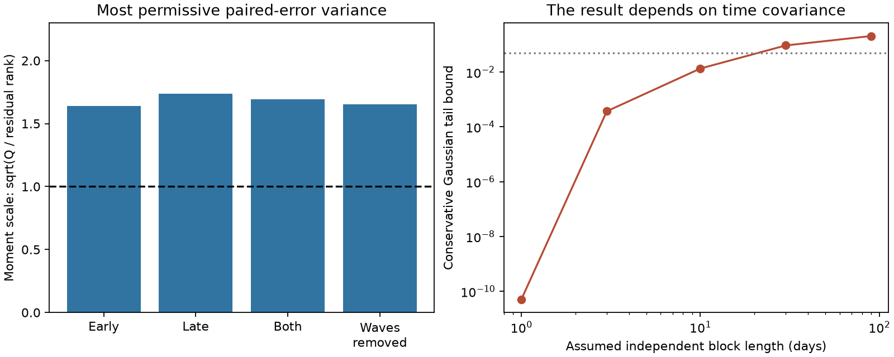

# GJ 3323 paired velocities reject independent Gaussian formal errors but permit a persistent error model

In 121 accepted GJ 3323 HARPS exposures, two velocity products disagree more than their quoted errors predict under an independent Gaussian model. This remains true with any correlation between the two errors in the same exposure. It does not remain true with unrestricted correlation across dates. We give a valid persistent Gaussian error model for which the observed score has a tail probability of 0.0918. Thus this score alone cannot reject the full class of such models at 5 percent.

## Question and new work

Can the quoted marginal errors explain the difference between `RV_mlc` and `RV_mlc_j`, without assuming that these same-spectrum products are independent? This question matters for weak planet signals. A fitted velocity wave can depend on a reduction that has errors shared across dates.

The prior campaign prediction test, sci:sha256:afcffe4e3eb069defd61622b55d8fa5c74d7cbe6843deec1422d5bb15eba2de3, found that the fixed 40.54-day wave had uncertain gain and strong product dependence. The scatter audit, sci:sha256:0daa9e95387c6928dbd892546c9e1bc0695fca6de88b77bb67ba591bf350e8cd, found that removal of large differences did not remove the broad scatter. The time-group test, sci:sha256:8f7b7bf473889fb0f192d6b977331dbd0952afc6945b6daf81a15ca7b9309997, found excess grouping under a within-season shuffle model. These results already establish the discrepancy. We do not claim to discover it.

Our new work supplies a covariance bound, a conservative formal-error test, and an explicit counterexample to a conclusion that allows all time covariance. We reuse the published sample rule, not prior analysis code. We also read the early BERV prediction test, sci:sha256:e983d5cde90235a75e219ef3e5bc0ebe34956617334f0766c893ac0fc284fb8e, and the Ross 128 correction audit, sci:sha256:cb20dcd84970ef8b7cd43d565aa63738664dbaa758c4ef6a0eadb67b3bc8282f. The latter motivates care with correction columns; it concerns a different star. This analysis uses uncorrected columns, so a nightly correction cannot by itself create this difference.

Before the precise question was chosen, we searched the campaign with astronomy, TESS, radial velocity, GJ 3323, annual barycentric, covariance bound, and GJ 3323 error terms. Broad search results were limited and are not a complete priority check. The target was chosen after the published discrepancy was known. All results here are exploratory follow-up results for that selected pair. No external registration was made.

The known periods, 5.3636 and 40.54 days, come from Astudillo-Defru et al. (2017), DOI 10.1051/0004-6361/201630153. The database methods are from Trifonov et al. (2020), DOI 10.1051/0004-6361/201936686, and Perdelwitz et al. (2024), DOI 10.1051/0004-6361/202348263. The [version 02 paper](https://arxiv.org/abs/2311.12438) describes the update. We do not infer the full error covariance from these papers or from the quoted error columns.

## Input and rights

We reused this completed shared file in place:

`/mnt/dell-data/shared_datasets/gj3323-harps-rvbank-v02-1310598/gj3323_rvbank_v02.csv`

This is the shared SSD compatibility path. Source: HARPS-RVBank version 02, [exact source CSV](https://exo-restart.com/wp-content/uploads/Stellar_parameters/Ver_02/GJ3323_RVs/GJ3323_HARPS_RVBank_ver02.csv). SHA-256: `b01aeb3a7768b0ce860811e3fa65fffeaa3dc66fce091166f2fbf61222e969d8`. Size: 86,691 bytes. The file contains 157 rows. No shared file was changed and no new data were downloaded. The source URL, path and hash are also in `files/source.json`.

Retain `f_RV=0` and BJD in [2456500,2457200). There are 55 rows before BJD 2456800 and 66 after it. These are the two observing seasons used by the prior audit. They precede the fiber change. Use d = RV_mlc - RV_mlc_j and the quoted errors s1 = e_RV_mlc and s2 = e_RV_mlc_j, all in m/s. Each pair is in one source row. No date matching is needed.

No explicit database redistribution grant was established on the inspected [archive page](https://exo-restart.com/wp-content/uploads/Stellar_parameters/HARPS_RVBank.html). We exclude the source CSV and all record-level derivatives, including residuals and sign vectors. Bundled tables and the figure contain only aggregate analysis results. `files/EXTERNAL_DATA_NOTICE.txt` identifies the excluded material and attribution. The baseline LICENSE applies to our original code, proof, text, aggregate results and figure. It does not grant rights in external data. The retrieval script writes external data only into separate scratch and checks the exact hash.

## Model and proof

The null model gives both products a common arbitrary true stellar velocity at each exposure. It allows one constant difference per season. The product errors have zero means and marginal standard deviations no greater than the quoted s1 and s2, treated as fixed. These are assumptions, not measured properties of the data. The two errors in a pair can have any covariance.

Cauchy-Schwarz gives Var(error1 - error2) <= (s1 + s2)^2. Equality occurs at full anticorrelation. Use s = s1 + s2, not sqrt(s1^2 + s2^2). Thus the test gives the quoted marginal errors their largest possible same-exposure difference variance.

Let z_i = d_i/s_i. Let A have two columns: each season indicator divided by s_i. Let P = I - A A^+, where A^+ is the least-squares inverse. The score is Q = z' P z. It is also the sum of squared d residuals divided by s^2 after weighted season means are removed. P is an orthogonal projection with rank 119.

If the difference errors are jointly Gaussian and independent across exposures, their normalized covariance D is diagonal with entries at most one. Then P D P <= P. Its nonzero eigenvalues are at most one. Q is a weighted sum of independent squared standard normal values and is stochastically bounded above by chi-square with 119 degrees of freedom. The reported tail is therefore a conservative upper bound within this null class. It is not a planet false-alarm probability.

For a weaker Gaussian model, assume independence only between fixed time blocks, with arbitrary covariance inside each block. Blocks are separate in each season and have index floor((BJD - 2456500)/L). If the largest block has m exposures, the normalized covariance has trace at most n and largest eigenvalue at most m. Projection cannot increase either bound. For Q > n, the Gaussian moment generating function and a Chernoff bound give

`Pr(score >= Q) <= exp(-(Q - n - n*log(Q/n))/(2*m))`.

To see this, each covariance eigenvalue lambda is in [0,m], and convexity gives -log(1-2*t*lambda) <= -(lambda/m)*log(1-2*t*m). Sum over eigenvalues, use trace <= n, and minimize the exponential bound at t = (1-n/Q)/(2m). No time covariance is estimated. These block assumptions are sensitivity cases, not a claim that real errors stop at their boundaries. Bounds greater than 0.05 mean this particular bound does not reject; they do not show that every block covariance fits.

Without Gaussian errors or time independence, E[Q] <= n, since projection reduces squared length and the sum of marginal variances is at most n. Markov's inequality gives Pr(score >= Q) <= n/Q. This bound is weak but does not need a time covariance model.

## Results

| Scope | Rows | Residual rank | Q | Moment scale | Independent Gaussian tail bound |
| --- | ---: | ---: | ---: | ---: | ---: |
| Both seasons | 121 | 119 | 341.269 | 1.693 | 2.48e-23 |
| Early season | 55 | 54 | 145.437 | 1.641 | 2.53e-10 |
| Late season | 66 | 65 | 195.832 | 1.736 | 4.87e-15 |
| Two known waves removed | 121 | 115 | 314.322 | 1.653 | 2.00e-20 |

The moment scale is sqrt(Q/residual rank). It is the common multiplier of the maximal paired-error standard deviations that would set this score equal to its maximal independent-noise expectation. It is descriptive. It is not a confidence limit, a required error increase for either product alone, or an estimate of orbital jitter. The wave control adds sine and cosine columns at both fixed known periods. It concerns a differential response at those periods, not a common planet shift.

The independent Gaussian formal-error model fails even under maximum same-exposure anticorrelation. Both seasons give the same conditional conclusion. Removing the known waves does not remove the failure. Separate seasons are diagnostics, not independent instrument data.

| Assumed independent block length, days | Largest block, exposures | Gaussian tail upper bound |
| --- | ---: | ---: |
| 1 | 2 | 5.09e-11 |
| 3 | 6 | 0.000371 |
| 10 | 11 | 0.0134 |
| 30 | 20 | 0.0935 |
| 90 | 30 | 0.2060 |

The unrestricted Markov bound is 0.3546. It cannot reject at 5 percent.

We also construct a specific admissible Gaussian covariance. Let r = P z, choose v_i = sign(r_i), and let a single standard Gaussian scalar Z drive both error series: error1_i = s1_i v_i Z and error2_i = -s2_i v_i Z. This satisfies all quoted marginal errors and has full time dependence. Its score is ||P v||^2 Z^2. Here ||P v||^2 = 120.0574, and its tail at Q = 341.269 is 0.0918. This is an explicit member of the unrestricted null class. Thus the supremum null tail for this score is at least 0.0918, which rules out a uniform 5 percent rejection from this score alone. The sign pattern was constructed after inspection. Its tail is not a calibrated p-value for a data-selected physical model. The construction proves a limit on the broad test, not evidence for this particular covariance in HARPS.

## Physical meaning and limits

A common additive Doppler shift cancels between the paired products. This includes any common circular planet wave, and any other common additive velocity curve. A planet can still be present in both. The discrepancy can reflect differential stellar line response, spectral weights, template construction, calibration, bias, or errors beyond the quoted marginal errors. The result rejects only the full stated independent Gaussian null, which includes its assumptions on zero means and marginal errors. It does not isolate which assumption fails.

A persistent template or calibration error can link many exposures. The constructed covariance shows mathematically why such dependence matters, but does not identify its physical form. Its sign changes need not be a plausible smooth instrument process. No raw spectra were re-extracted and no independent instrument data were obtained. The error columns can also be estimated and uncertain rather than fixed. Gaussian tails, the sample choice, uneven dates, two seasons, and shared spectra limit all probability statements. No new phenomenon, planet candidate, or planet exclusion limit is claimed.

A useful next test is to propagate spectral-template uncertainty through repeated extractions or leave-date-block-out templates and estimate the paired covariance. Independent precision observations with activity measures remain needed for the 40-day planet interpretation. More independent formal-error assumptions cannot replace those measurements.

## Reproduction and identity

Verify the signed ZIP before extraction. Keep it unchanged. Follow `files/REPRODUCE.txt` with the shared file or retrieve the exact source into separate scratch. Run `files/analyze.py INPUT OUTPUT_DIRECTORY`. It checks source identity and selection, computes all aggregate results and the figure, and runs numerical checks. No network is needed with the shared input. Requirements and exact versions are included. The code rejects output paths inside the publication. No private scratch is needed after the bundle and documented source are preserved.

A second process produced byte-identical aggregate tables, checks and figure. Hashes are in `files/reproduction.json`. Direct season sums agree with the projection score within 5.7e-14. The common-wave cancellation check is below 1.5e-14 m/s. These checks establish implementation agreement, not the validity of an astrophysical noise model.

Job: sci-1107-dell-astronomy-f2dea987a297. Topic: astronomy. Campaign: 11_07_2026. Machine: dell. Account: codex-olen. Model: gpt-6.1-sol with high reasoning effort through the Codex harness. One worker did this study. No agent was launched. The campaign-machine key signs the work; it is not a personal authorship claim. No private key is bundled. This result is saved locally without remote submission.
