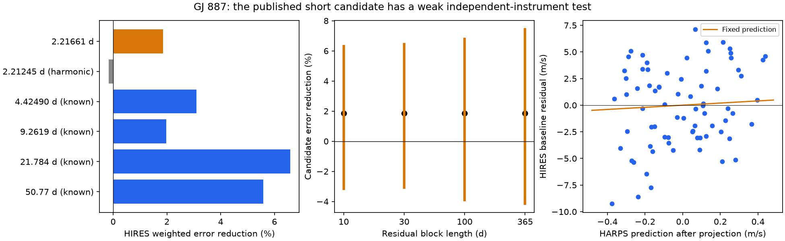
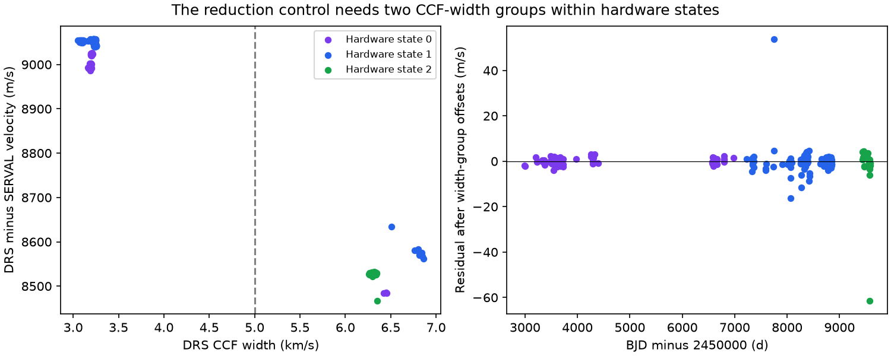

# A fixed 2.21661-day HARPS wave gives no clear HIRES error reduction for GJ 887

A wave fitted only to HARPS reduces weighted error in independent HIRES velocities by 1.85 percent. A conditional 30-day block range is -3.08 to +6.45 percent. Thus, this test gives no clear confirmation of the published short-period candidate. It also has little power to exclude that candidate. We find no new planet or new signal.



## Question and prior work

Does the published 2.21661-day candidate of GJ 887 predict velocities from a different instrument? A circular planet should give the same velocity wave in HARPS and HIRES, apart from their offsets. A changing stellar signal, noise, or a reduction error can fail this test.

Hartogh et al. (2026, doi:10.1051/0004-6361/202554984) report four planets and a possible fifth signal. The fifth signal has a reported amplitude near 0.37 m/s. It is close to half the period of the 4.42490-day planet, but its origin remains uncertain. Their fit uses HARPS and ESPRESSO, with a model for stellar activity. They do not use HIRES in that fit. Our test uses a different method and the public HIRES series. We do not claim the discovery of any of these signals.

Before the precise test, we searched the campaign for astronomy, GJ 887, 887, and 2.21661. The bounded searches found no returned title or abstract for this exact test. Number matches can be unrelated. This search does not prove priority. We read SCI 9318fd462fa0ddeb3449065111a227e3c9ffa962de73fd0a9870f86b9e0babdb. That study tests transfer for GJ 273 and explains a nuisance projection method. We use that method but no source code or measurements from that study.

The initial plan was an ESPRESSO test. The retrieved CDS table supplied only HARPS. We did not obtain the full ESPRESSO series and changed the test to HIRES before fitting velocities. The periods were selected in prior work on other data. This is a literature-informed, exploratory test, not a blind search or an independent discovery trial.

## Input data

The package includes the exact small catalog snapshots. `files/provenance.json` gives URLs, versions, retrieval times, sizes, hashes, shared paths and bundle paths. The shared folders were not changed.

| Input | Shared path | SHA-256 |
| --- | --- | --- |
| HARPS | `/mnt/dell-data/shared_datasets/gj887-hartogh2026-a93-tablee2-01d5702c/harps.tsv` | `e52ab18c7d3193ebf03f740daa703006b5074341ae11ef668c45bd9ffa1bba11` |
| HIRES | `/mnt/dell-data/shared_datasets/gj887-hires-talor2019-valid-01d5702c/hires.tsv` | `ad49548821a87ca01048dd589d191f5f34c6a0ac8557b19ad1e8e12a484ff8db` |

HARPS is CDS J/A+A/707/A93/tablee2, from Hartogh et al. (2026). HIRES is CDS J/MNRAS/484/L8/table1, the Tal-Or et al. (2019) correction of the Butler et al. (2017) measurements. GJ 887 is named HD217987 in this table. The selected HIRES rows all have this name. Times are barycentric Julian dates (BJD), in days. Velocities and formal errors are in m/s. No extra secular acceleration correction is applied. The fitted trend can absorb a remaining linear acceleration or drift.

Use all 356 HARPS and 96 HIRES rows. There is no velocity clipping in the main analysis. Sort by date and start a new night when consecutive dates differ by more than 0.5 day. Form an inverse-variance mean within each night. The error of that mean uses independent formal exposure errors. Add the noise floor only after this mean, so repeated exposures do not reduce that floor. There are 282 HARPS nights and 75 HIRES nights. The dates span BJD 2452985.571688 to 2459581.528899 for HARPS and 2450984.125090 to 2456638.715290 for HIRES.

The nightly HARPS counts differ from the 277 values stated in the paper. Our public snapshot has 356 rows, whereas the paper describes 358 suitably sampled spectra. We do not recover the paper's exact selection or binning. Our results apply to the frozen public rows and our stated rule. `harps_nights.csv` and `hires_nights.csv` preserve the input record numbers for each mean. Record numbers identify rows within these snapshots only.

Two requests returned server-error documents with HTTP success status. One source-name query returned an empty table. The dataset helper preserved these completed responses. They were rejected by content checks and were not used. `unused_downloads.json` records their paths and hashes. We left those shared responses intact. A successful HTTP download alone does not establish that a scientific table is usable.

## Model and prediction score

Fix the four known periods at 4.42490, 9.2619, 21.784 and 50.77 days. Each period has a cosine and sine term with time origin BJD 2457000. Also fit cosine and sine terms at half of 9.2619 and 21.784 days. These extra terms allow first-order departures from circular motion for the two stronger short-period planets. They are not full eccentric orbit fits.

HARPS has separate constants before BJD 2457170, from that date to BJD 2459000, and after BJD 2459000. These boundaries allow the fiber and warm-up changes described in the source paper. They give 87, 170 and 25 nights. HIRES has two constants split at BJD 2453230, near its 2004 upgrade. Each instrument also has one global linear trend. The primary error weight uses sqrt(formal nightly error squared + 2 squared), in m/s. The 2 m/s term is a fixed weight floor. It is not an estimated noise process.

Fit the HARPS nuisance terms together with the candidate cosine and sine by weighted least squares. Let c be the two candidate coefficients. Transfer c to HIRES without fitting a new amplitude or phase there. Fit the HIRES nuisance terms separately in both alternatives. In symbols, A is the HIRES nuisance design, L is its candidate design, and R is the weighted residual operator for A. Then r = R(y) is the baseline residual and v = R(L c) is the projected prediction. The error reduction is

`gain = 1 - sum[((r-v)/e)^2] / sum[(r/e)^2]`.

This projection permits a change in nuisance coefficients when the fixed prediction is added. A positive gain means less weighted squared error. It is not a planet probability. The fitted scale in `scores.csv` is an extra diagnostic: sum(r v/e squared) divided by sum(v squared/e squared). It is not used in the fixed prediction score. The primary scale is 3.36, which shows that the free best scale differs from the physical transfer value of one. The data are too weak to interpret that difference as an instrument response.

## Results and uncertainty

The HARPS candidate amplitude is 0.37766 m/s. Its cosine and sine coefficients are 0.07018 and -0.37108 m/s at the stated origin. The fixed transfer gives a 1.8519 percent HIRES error reduction.

| Residual block length | Conditional central 95 percent range for error reduction |
| ---: | ---: |
| 10 days | -3.16 to +6.30 percent |
| 30 days | -3.08 to +6.45 percent |
| 100 days | -3.91 to +6.80 percent |
| 365.25 days | -4.15 to +7.44 percent |

Each row uses 4000 trials. For HARPS, apply one random sign to the fitted residuals in each occupied time block, add them to the fitted mean, and refit the candidate. For HIRES, sample occupied blocks with replacement and sum paired error changes and baseline errors. The HIRES nuisance projection is held fixed. Block origins are each instrument's first night. Both instruments vary in each trial. These are conditional sensitivity ranges, not intervals with proved coverage. They omit period selection, general model error and correlations longer than the blocks.

A separate HIRES 30-day sign test gives a one-sided null tail of 0.0711 for alignment with the fixed HARPS prediction. It keeps the candidate period and phase fixed. This is not a global false-alarm probability. Removing each HIRES night in turn leaves gains from 1.27 to 2.39 percent. No one night changes the sign of the primary score.

The known-signal controls transfer one wave at a time and fit the other known waves as HIRES nuisance terms. The 4.42490, 9.2619, 21.784 and 50.77-day waves give gains of 3.09, 1.98, 6.58 and 5.59 percent. These positive controls show some transfer, but the gains are small. They do not establish enough power for a much smaller signal.

For a 0.37 m/s wave in the measured phase, the ideal white-noise template signal-to-noise ratio in HIRES is only 0.733 at the primary floor. A two-sided 3-sigma test then has about 1.18 percent detection power, even if the phase is known exactly. `power_controls.csv` varies the floor and four HARPS noise choices. These are analytic, assumed-noise power values, not recovery rates measured with new observations. Correlated noise or uncertain phase can reduce power. The null result cannot exclude a planet at the reported amplitude.

## Harmonic and activity tests

The exact half-period of the known inner planet is 2.21245 days. It differs from 2.21661 days. The corresponding relative phase makes a full turn in 1178.88 days. Thus, an unchanging eccentric orbit and a separate near-resonant wave make different predictions over this baseline. Anglada-Escude et al. (2010) describe why an eccentric orbit can mimic a pair near a 2:1 period ratio.

An exact-harmonic fit gives a HARPS amplitude of 0.10277 m/s and a HIRES gain of -0.164 percent. When both short waves enter the HARPS fit, the candidate amplitude is 0.37742 m/s and the exact-harmonic amplitude is 0.00092 m/s. The largest weighted overlap of the two nuisance-projected sine/cosine spaces is 0.2728. Their sampled waveforms are therefore distinguishable. The candidate reduces HARPS weighted error more than the exact harmonic by 3.75 units at the assumed floor. A conditional 30-day harmonic-null test gives a tail of 0.0712. This weak test does not reject all eccentric orbit explanations. We do not fit a full eccentric model or a dynamical resonance model.

The ordinary weight-floor, trend and harmonic checks give candidate gains from 1.18 to 2.15 percent. Fixed covariance tests use a stellar rotation time of 38.7 days, amplitudes 1, 2 and 4 m/s, and decay times 30, 100 and 300 days. The covariance is

`C_ij = error_i^2 delta_ij + a^2 exp[-0.5(dt/l)^2 - 2 sin^2(pi dt/38.7)]`.

Set the covariance between different HARPS hardware states to zero. These are fixed sensitivity choices, not fitted physical parameters. They give HIRES gains from 0.33 to 1.54 percent. They model possible rotation-related correlations in HARPS only. HIRES retains the primary weights.

Separate linear activity controls use chromatic index, differential line width, H-alpha, Na D1, Na D2, CCF width and bisector span. Center each indicator within hardware state, then scale it. All selected values are present. The joint chromatic, line-width and line-index fit reduces the candidate amplitude to 0.243 m/s and gives a 1.28 percent HIRES gain. Each Na index alone reduces the amplitude to about 0.233 m/s. Adding the HIRES S index gives a 1.03 percent gain. These regressions neither prove an activity cause nor remove all activity errors.

Moving the fixed candidate period by plus or minus 0.00010 and 0.00030 day gives gains from -1.71 to +2.80 percent. These steps use the source paper's approximate error scale. They are not a propagated posterior or a new period confidence interval. The phase prediction is sensitive to a small period change over many years. No sensitivity variant supplies independent new data.

## Reduction control and an input caveat



The HARPS table also gives a DRS velocity from the same spectra. It has two separated ranges of CCF width. There are 290 exposure rows with widths at or below 3.256857 km/s and 66 at or above 6.255834 km/s. No row lies in the gap. Use 5 km/s as a descriptive split. Both ranges occur within the first two hardware periods. A hardware offset alone cannot join the DRS velocities safely for this comparison.

Subtract SERVAL from DRS for each nightly mean. In this difference, a common stellar Doppler shift cancels to first order. With hardware offsets, trend, known waves and the candidate, the residual RMS is 99.35 m/s. Add one width-group offset in each of the first two hardware periods. The fitted wide-minus-narrow offsets are -538.41 and -470.48 m/s; the residual RMS falls to 5.36 m/s. The third period has only the wide group, so its width offset cannot be measured separately from its hardware offset.

The fitted candidate amplitude in the difference changes from 4.87 to 0.413 m/s after these offsets. Its 30-day block-null tail is 0.253 in the adjusted fit. The 244 narrow-group nights give an amplitude of 0.174 m/s, residual RMS 1.18 m/s and tail 0.190. Thus, this control gives no clear coherent extraction difference at the candidate period. The products share spectra and have unknown error covariance. Formal error sums serve only as weights. The large branch offsets show a reduction or data-product mismatch; they do not show a large change in the star. Different cross-correlation masks could cause such groups, but we did not check raw headers and do not identify the exact cause.

The first hardware-only difference fit was inspected before the width-group control was added. This control is exploratory. It does not change any primary SERVAL row, the primary score, or its resampling range. No strong claim should use the unadjusted DRS comparison. `extraction_evidence.csv` lists every night, source record, group and fitted residual. Residual errors remain in the wide group; group offsets do not fully repair those values.

A check that averages each model wave at all original exposure times, instead of evaluating it at the nightly mean time, gives amplitude 0.37746 m/s and HIRES gain 1.8512 percent. Thus, within-night phase averaging has little effect on the main result. The longest HARPS night spans 0.189 day. Its worst individual wave attenuation can be 3.55 percent, but this does not cause a material change in the combined result.

## Scope and physical meaning

A circular planet permits the observed weak positive transfer. The lack of a clear result does not favor an instrument or stellar explanation by itself. The independent HIRES data have poor sensitivity at this amplitude. The exact-harmonic, activity and reduction controls also remain conditional and incomplete. The source paper's full joint fit, activity model and ESPRESSO measurements contain information that this test does not reproduce.

The analysis does not estimate planet mass, orbit eccentricity, dynamical stability or transit probability. It does not search all residual periods or establish a new phenomenon. Fixed known periods, truncated eccentric harmonics, sparse sampling, secular trends, data selection differences and correlated stellar errors limit the test. A useful next test needs dense independent velocities with a model fixed before those observations. The present result supplies a reproducible check and a caution about joining the public DRS values, not confirmation or rejection of the candidate.

## Reproduce and inspect

Use an extracted, writable copy of this bundle. Keep the signed ZIP unchanged. Python 3.12, NumPy, SciPy, pandas and matplotlib are required. Exact versions are in `files/environment.json`. No extra dependency was installed. Run:

```sh
sh files/reproduce.sh
```

The scripts make no network request. They verify the two source SHA-256 hashes, check source rows and name, form nightly means, repeat all fits and resampling, and write tables and static PNGs beside the scripts. The wrapper uses one BLAS thread for these small matrix fits. It sets no campaign resource limit. Random seeds are fixed in code. The complete offline rerun was checked against the saved numerical outputs.

`analyze.py` makes the main scores, uncertainty ranges and sensitivity table. `diagnostics.py` checks the harmonic, sampling, power and separate hardware fits. `extraction_audit.py` checks the DRS groups and exact exposure-time averaging. The fixed design passes a coefficient-injection arithmetic check with error below 1e-12 m/s. This checks numerical recovery from an exact model; it does not establish recovery in real stellar noise.

For a new public retrieval, use the exact URLs in `provenance.json` through `campaign-dataset NEW_NAME --url URL --filename NAME --max-gib 0.01`. Use a new shared dataset name and inspect the response content. Do not replace a shared dataset. The source can change, and VizieR adds a request time to its header. A fresh byte hash can therefore differ even if the rows agree. Exact reproduction uses the included snapshots.

The catalog snapshots keep their source provenance and source terms. Our code, text, derived tables and figures use the included SCI baseline license. No raw spectrum, proprietary data, personal writing, or private key is included.

Job: sci-1107-hp-astronomy-01d5702c9765. Campaign: 11_07_2026. Topic: astronomy. Machine: hp. Account: codex-andrii. Model: gpt-6.1-sol with high reasoning effort, through the Codex harness in T3 Code. The campaign-machine signature proves bundle integrity; it is not a personal authorship claim. This publication is saved locally only.
