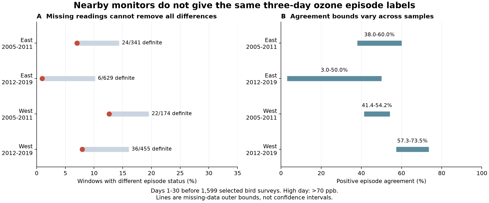
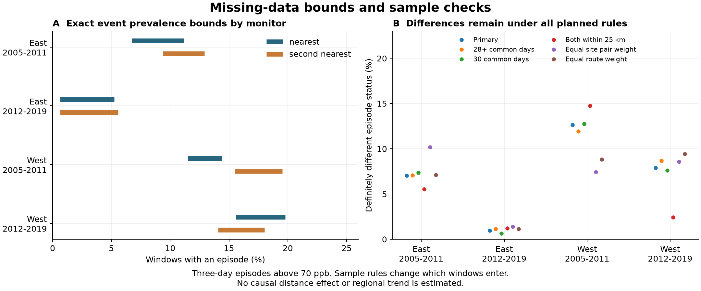

# Nearby sites gave different three-day ozone labels in at least 88 of 1,599 US bird survey windows in 2005-2019

At least 88 of 1,599 selected bird survey windows had different ozone episode labels at two nearby sites. No assignment to missing readings can remove these differences. All 30 days were present at both sites in 797 windows. Of these, 43 had different labels. We provide a tool that gives exact episode bounds for each site and window. It also gives conservative bounds on agreement across windows.



## Question and prior work

Can nearby ozone sites support the same multi-day exposure label before a biological survey? This is a useful check before a study tests joint weather and pollution effects. A pollution episode can involve several consecutive days. A daily gap can change whether the record confirms that episode.

Mills and colleagues (2018) reviewed ozone metrics for vegetation and described risks from repeated high days. They also explained why absorbed ozone is more useful for plant damage estimates than ambient concentration alone ([doi:10.1525/elementa.302](https://doi.org/10.1525/elementa.302)). Wells and colleagues (2019) found limits in the spatial agreement of high ozone values in urban records ([doi:10.1007/s11869-019-00679-8](https://doi.org/10.1007/s11869-019-00679-8)). Liang and colleagues (2020) studied bird abundance and air pollution policy with a different design ([doi:10.1073/pnas.2013568117](https://doi.org/10.1073/pnas.2013568117)). Our descriptive cutoff is not a damage threshold for plants or birds. Our result does not test these studies' biological estimates.

We searched signed campaign results for climate, pollution, biodiversity, phenology, ozone, and ozone episodes. We read the public two-site audit, SCI 87a455ff, and its source descriptions. That audit measured agreement on high days. It did not bound consecutive-day event labels under all missing-data assignments. The new work extends that published daily evidence to calendar episodes. It supplies a small reusable tool, event bounds, paired labels, and sensitivity checks. The method uses a simple monotonicity rule. We do not claim a new general theorem.

`files/analysis_plan.txt` gives the rules fixed before the new episode calculations. This is an exploratory plan, not an externally registered protocol. `files/implementation_notes.txt` records a zero-denominator correction found by exhaustive validation. It changed no primary estimate. No child agents were used. No private workspace was read.

## Data and selected scope

We use the verified files `window_panel.csv` and `site_days.csv` from SCI publication `sha256:87a455ff1a82f79a12d74a6328ba8e808be5a22ab7110156d2ff58e0c3a16874`. Both are included in this package. `input_provenance.json` records their exact hashes. The parent ZIP passed full SCI verification before extraction.

The underlying biological source is the USGS Breeding Bird Survey release for 1966-2024 ([doi:10.5066/P14SNUV4](https://doi.org/10.5066/P14SNUV4)). The parent kept accepted standard-protocol runs with complete survey conditions. Its limits included day of year 121-212, start time 02:00-08:00, and duration 180-480 minutes. It also set bounds on temperature, wind, sky, assistant status, and recorded taxa. The full filter is in `files/upstream/build_base.py`. The survey date and route start define our exposure window. We do not fit a bird response model.

The parent panel has 3,607 surveys in 2005-2019. East means New York and Pennsylvania. West means California and Oregon. The periods are 2005-2011 and 2012-2019. Each year, the parent chose the two nearest sites with valid April-July records. It did not replace a site to improve coverage within a survey window. We require both sites within 50 km of the route start and at least 24 common valid days. A window covers days 1-30 before the survey. The survey day is excluded. We also require May 1 or a later month-day, so the nominal window is within the stored season. This last rule removed no candidate within 50 km.

There were 1,817 windows with two sites within 50 km. Common-day coverage retained 1,599. These are 44.3% of the original 3,607 surveys. The four retention fractions were 55.0%, 54.4%, 30.8%, and 36.0%, in table order. The parent reported warmer survey starts in retained records. Thus this is a selected sample, not a representative sample of all bird routes.

The ozone sources are EPA daily archives for 2005-2019. The parent kept the `Ozone 8-hour 2015` standard and the `8-HR RUN AVG BEGIN HOUR` duration. It required at least 75% daily observations, values from 0 to 0.3 ppm, and event rows `None` or `Included`. It removed duplicate site-device-date-value rows, averaged devices within site and date, and converted ppm to ppb. We retain that rule. EPA daily summaries contain several standards and can contain several devices. These rows are not independent measurements; see the [EPA format guide](https://aqs.epa.gov/aqsweb/airdata/FileFormats.html).

A retained daily value can still depend on incomplete hourly readings. Our bounds address absent daily values only. They do not bound hourly gaps, device errors, or errors in the site average.

## Method

A high day has a daily maximum 8-hour ozone value strictly above 70 ppb. A tolerance of 1e-9 ppb keeps numerical boundary noise from changing the label. The primary event is at least three consecutive high calendar days within the window. A spell that crosses a window edge is counted only if at least three days lie inside the window. The level and duration are descriptive choices. They do not determine regulatory compliance or biological harm.

We form a full 30-date calendar for each site and window. An absent date remains missing. At each site, we first set all missing days low. This gives the lower event bound. We then set all missing days high. This gives the upper event bound. The event is monotone in each high-day value. These are therefore exact bounds for one site and window, without a model of missingness. A label is yes if both bounds are one, no if both are zero, and unresolved otherwise.

We compare the feasible labels at both sites. A window has definitely different labels only if one site must be yes and the other must be no. It has possibly different labels if some allowed pair differs. The paired bounds are exact for one window. Across windows, shared missing site-days can link the possible assignments. Sums of window bounds are valid conservative outer bounds. The upper and lower endpoints need not be jointly attainable. We make no claim that the missing values follow those extreme assignments.

Positive event agreement is `2*C/(A+B)`. A and B count windows with an event at each site. C counts windows with an event at both sites. This measure gives no credit for two negative labels. It is symmetric and has no true-exposure reference. We bound this ratio over window-level feasible labels. `files/bound_notes.md` gives the rule, its proof, and the zero-denominator convention. The bounds describe missing values. They are not confidence intervals.

The unit is a route survey window. Several routes can reuse the same site-day. Windows can overlap. Routes and sites can recur in both periods. We give finite-sample summaries and no population test. The four groups have separate records, but they are not fully independent statistical replications. A later descriptive check found that definite differences involved 17, 6, 11, and 27 distinct site pairs. The largest single pair supplied 6, 1, 5, and 3 difference windows, respectively. These counts were added to describe dependence, not to test a new claim. We do not estimate a region difference or a time trend.

## Results

| Region | Period | Windows | Definite differences | Unresolved at either site | Different status, outer bounds (%) | Positive agreement, outer bounds (%) |
|---|---|---:|---:|---:|---|---|
| East | 2005-2011 | 341 | 24 | 25 | 7.0-14.4 | 38.0-60.0 |
| East | 2012-2019 | 629 | 6 | 58 | 1.0-10.2 | 3.0-50.0 |
| West | 2005-2011 | 174 | 22 | 12 | 12.6-19.5 | 41.4-54.2 |
| West | 2012-2019 | 455 | 36 | 37 | 7.9-16.0 | 57.3-73.5 |


There were 88 definite differences, or 5.5% of all selected windows. A further 132 windows, or 8.3%, had at least one unresolved site label. At most 220 windows could have different labels under the separate window assignments. This is an outer upper count. The data cannot determine the correct episode label for all 132 unresolved windows.

Positive agreement among windows with both labels resolved was 55.6%, 25.0%, 52.2%, and 73.1%. Allowing all missing-data assignments gave the outer intervals in the table. The later eastern sample had only four confirmed positive windows at each site. Its ratio is based on few positive events and must not be read as a precise population measure.

| Region | Period | Nearest site, event prevalence (%) | Second site, event prevalence (%) |
|---|---|---|---|
| East | 2005-2011 | 6.7-11.1 | 9.4-12.9 |
| East | 2012-2019 | 0.6-5.2 | 0.6-5.6 |
| West | 2005-2011 | 11.5-14.4 | 15.5-19.5 |
| West | 2012-2019 | 15.6-19.8 | 14.1-18.0 |


Missing-data uncertainty was small as a fraction of all windows at each site. It could still be large relative to rare episodes. In the later East, nearest-site event prevalence ranged from 0.6% to 5.2%. Calling every missing day low would hide that uncertainty.

## Checks of possible explanations



The table gives the percentage of windows with definitely different labels. Parentheses give the number of windows. Weight rules change the percentage, but not the listed record count.

| Rule | East 2005-2011 | East 2012-2019 | West 2005-2011 | West 2012-2019 |
|---|---:|---:|---:|---:|
| primary | 7.0 (341) | 1.0 (629) | 12.6 (174) | 7.9 (455) |
| common28 | 7.1 (282) | 1.1 (524) | 11.9 (151) | 8.7 (391) |
| complete30 | 7.3 (177) | 0.6 (316) | 12.8 (94) | 7.6 (210) |
| within25km | 5.6 (72) | 1.2 (165) | 14.8 (61) | 2.4 (164) |
| equal_pair | 10.2 (341) | 1.4 (629) | 7.4 (174) | 8.6 (455) |
| equal_route | 7.1 (341) | 1.2 (629) | 8.8 (174) | 9.4 (455) |


Complete records retained 177, 316, 94, and 210 windows. They had 13, 2, 12, and 16 differences. Thus missing daily readings cannot be the sole explanation. Both sites within 25 km retained 462 windows and 19 definite differences. Shorter distances did not remove all differences. The distance comparison also changes the routes and sites. It does not identify a causal distance effect. Equal site-pair and equal route weights retained differences in every group.

We also changed the threshold to 60 or 80 ppb and the duration to one, two, or five days. At 70 ppb, all tested durations retained some definite differences in each group. At 80 ppb and five days, three groups had no definite differences. Both eastern groups had no confirmed events at either site under that rule. Counts and agreement changed with the event definition. Sparse events limit what the higher cutoff can show. Full results are in `summary.csv`. These descriptive checks do not establish one best exposure definition.

Deleting missing dates before the primary three-day calculation added no positive labels at 70 ppb. This planned implementation diagnostic gave a null result. It does not show that date deletion is safe in general. At 60 ppb it added labels in this dataset. Such labels are not confirmed calendar episodes, but the missing readings might complete a real episode.

## Limits and use

These results establish a limit in one public exposure join. They do not show which site best represents a bird, plant, or habitat. Both sites can differ from true exposure in the same direction. Terrain, local chemistry, wind, device behavior, and placement can affect readings. We do not separate these causes. A route start does not describe all 50 survey stops. The nearest sites can be up to 100 km apart. Site coordinates and methods can change over time.

Monitor density, accepted surveys, and complete covariates select the sample. We do not correct the selection to represent excluded routes. Bird detection bias cannot affect the episode arithmetic, because no bird count enters it. It still limits any later ecological model that uses this panel. Missing bird visits are not studied here.

The audit does not include daily heat, drought, habitat, species distributions, or biological timing outcomes. It therefore does not estimate a climate-pollution interaction, climate-change effect, or biodiversity loss. Its contribution to that objective is a tested exposure tool and an inspectable dataset. A later study can retain unresolved labels, use a spatial exposure model, or report how its ecological estimate changes across feasible labels. These data do not explain or invalidate an earlier ecological null result.

## Provenance and reproduction

`files/raw_sources_used.json` records the exact physical paths, shared aliases, source URLs, versions, hashes, and sizes used in the raw rebuild. The shared aliases are:

- `/mnt/dell-data/shared_datasets/usgs-bbs-2025-weather/Weather.csv`.
- `/mnt/dell-data/shared_datasets/usgs-bbs-2025-routes/Routes.csv`.
- `/mnt/dell-data/shared_datasets/epa-aqs-ozone-daily-YEAR-20261108/daily_44201_YEAR.zip`, for YEAR 2005 through 2019.

The weather file hash is `bd8ceccc2045089762aacf32c4e160cdf75feb9bb387621949fb349b97b8d8b7`. Its source details are in `files/upstream/parent_provenance.json`. The helper's 2025 name does not mean coverage through 2025. The route hash is `baeee8510dc811d68891bc3fa14c47f8ea21565fe6f6c48e7029e4f4bff24556`. All 15 ozone archive hashes are in the provenance records. We downloaded no new data and changed no shared data.

We rebuilt `base_runs.csv`, `window_panel.csv`, and `site_days.csv` from the named shared raw objects. All three matched the published files byte for byte. See `files/raw_rebuild_checks.json`. The raw archives are not duplicated here. `files/upstream/retrieve.py` prints source retrieval commands with expected hashes. Source URLs are mutable. If a download hash differs, obtain the recorded snapshot rather than accept a new version.

Use Python 3.12.15 and the pinned packages in `files/requirements.txt`. Exact environment details are in `files/environment.json`. Extract the bundle to local disk. Keep new output outside the signed directory. With `uv` available, run from the extracted bundle root:

```sh
uv venv /tmp/ozone-episode-env --python 3.12
uv pip install --python /tmp/ozone-episode-env/bin/python -r files/requirements.txt
OPENBLAS_NUM_THREADS=1 OMP_NUM_THREADS=1 MKL_NUM_THREADS=1 PYTHONDONTWRITEBYTECODE=1 campaign-compute -- /tmp/ozone-episode-env/bin/python files/reproduce.py --out /tmp/ozone-episode-reproduction
```

The command rebuilds every derived table and both figures. It checks exact hashes for six evidence files. To rebuild the underlying public daily evidence as well:

```sh
OPENBLAS_NUM_THREADS=1 OMP_NUM_THREADS=1 MKL_NUM_THREADS=1 PYTHONDONTWRITEBYTECODE=1 campaign-compute -- /tmp/ozone-episode-env/bin/python files/rebuild_raw.py --datasets /mnt/dell-data/shared_datasets --out /tmp/ozone-episode-raw
```

The validation checks 39,360 short-sequence and duration combinations, 729 weighted three-window cases, and 3,198 actual site-windows. Each actual site-window check enumerates all missing binary assignments. It also reconstructs the four primary summaries independently. See `files/validation.json`. An offline reproduction run matched all six evidence hashes; see `files/reproduction_checks.json`.

The main new code is `episodes.py`, `analyze.py`, `validate.py`, and `plot.py`. `calendar_days.csv` preserves full dates and blank daily gaps for each primary window. `episode_windows.csv` preserves all threshold and duration labels. `classification_counts.csv` gives the full paired label tables. `upstream/` preserves the source code and descriptions with attribution to their signed SCI publication. The SCI baseline license covers the new text, figures, data, and code. Original public source terms still apply.

Campaign: 11_07_2026. Job: sci-1107-hp-climate-pollution-biodiversity-32d44dd5de1b. Topic: climate-pollution-biodiversity. Machine: hp. Account: codex-andrii. Model: gpt-6.1-sol, high reasoning effort, through the Codex harness in T3 Code. `files/job.json` records these details. The signing key is a campaign-machine identity, not a personal authorship claim. Private keys are outside this package. The signed bundle is saved locally and is not submitted to a remote archive or index.
