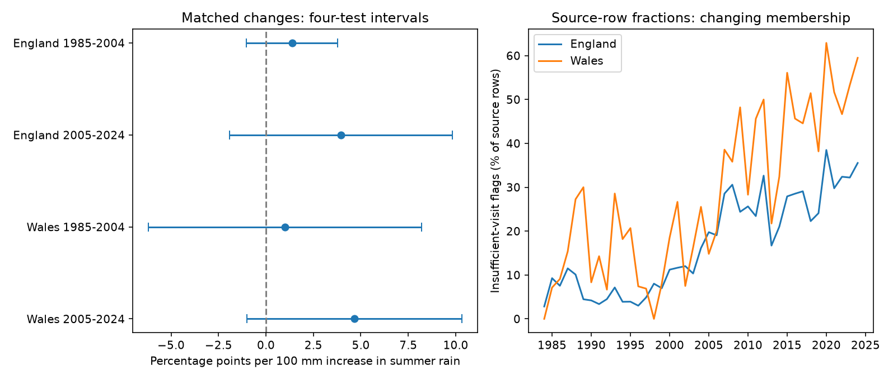

# Summer rain changes had no clear repeated link to insufficient butterfly visits in England and Wales in 1985-2024

Wetter summers had positive estimated links to insufficient survey visits in all four country and period tests. All four intervals adjusted for the four tests included zero. These data do not establish a repeated rain effect. They also do not exclude a useful effect size. The result concerns the observation process, not butterfly mortality.



## Question and prior work

Does a rise in summer rainfall predict a rise in insufficient-visit flags for the same butterfly species at the same site? We study Ringlet (*Aphantopus hyperantus*) and Meadow Brown (*Maniola jurtina*). The question matters because studies of climate and biodiversity can select records with usable abundance indices. If weather changes that selection, it can also change the sample used to study population responses.

Oliver et al. (2015), [doi:10.1038/nclimate2746](https://doi.org/10.1038/nclimate2746), studied drought-sensitive butterflies and habitat fragmentation. That work motivates careful tests of drought responses. It does not predict the sign of our visit-flag slope. Dennis et al. (2013), [doi:10.1111/2041-210X.12053](https://doi.org/10.1111/2041-210X.12053), developed abundance indices with missing counts. Schmucki et al. (2016), [doi:10.1111/1365-2664.12561](https://doi.org/10.1111/1365-2664.12561), distinguished missed visits due to survey design from those due to weather or recorder availability. Our test uses a published record flag. It does not estimate a new abundance index or recover missed counts.

We searched the signed campaign catalog for phenology, temperature, butterfly drought, and insufficient visits. We read SCI publications `21167ea1` and `7c1ab939` (full IDs in sci.json). The first found no clear repeated prior-rain relation in matched relative growth. The second found no later Welsh sites under an 80 percent paired-record rule. Both showed data-support limits. We test a different outcome: changes in the published insufficient-visit flag. The source data overlap the earlier studies; this is not an independent biological dataset. The local plan in files/PLAN.txt was saved before calculation of the outcomes. It was not registered outside this workspace.

## Data and observation rules

Botham, M.S.; Middlebrook, I.; Harrower, C.A.; Milborrow, J.; Roy, D.B. (2025). *United Kingdom Butterfly Monitoring Scheme: site indices 2024*. NERC EDS Environmental Information Data Centre. [doi:10.5285/53a1c705-4437-48bb-9bcd-b68977f8edd9](https://doi.org/10.5285/53a1c705-4437-48bb-9bcd-b68977f8edd9).

We reused the shared release through 2024. The source archive contains a CSV from 1976 onward. Its supporting guide defines -2 as a species recorded at a site in a year with too few visits during its flight period to give an accurate site index. We set a flag to one only for -2, and to zero for a nonnegative index, including an explicit zero. All selected indices have one of these states. An omitted source row is not a zero or proof of absence. The [dataset page](https://catalogue.ceh.ac.uk/documents/53a1c705-4437-48bb-9bcd-b68977f8edd9) states that WCBS sites are excluded from this site-index product. The broader scheme guide also describes WCBS, which must not be taken as evidence that these files include it.

The species and country slice contains 59,770 source rows over all available years. Of these, 23.78 percent have the flag. This fraction describes the retained source rows, not all planned visits or all populations. We match records by country, site code, species code, and consecutive calendar year. There are no duplicate keys in the slice. The 1985-2024 outcomes contain 48,817 matched site-species-year pairs at 2,886 sites. England contributes 47,248 pairs, and Wales contributes 1,569. Annual counts range from 172 to 3,131 in England and from 10 to 87 in Wales. Both species do not have to be present at a site; each site-species unit must have a source row in both years. We retain -2 in either or both years. Thus the test does not select for a usable abundance index, but it still selects for source-row presence.

Weather comes from the Met Office HadUK-Grid country series, updated 1 November 2026. We sum June, July and August rain and average monthly mean temperatures across these months. Rain is in units of 100 mm. Temperature is in C. Country weather cannot represent local storms, soil moisture or daily heat. Exact source paths, URLs, versions, byte counts and measured hashes are in files/provenance.json. No raw dataset was downloaded or changed in this investigation.

## Test

For each matched unit, we calculate 100 times the current flag minus the prior flag. We average these changes within each country and outcome year, with equal weight per unit. The outcome is a change in flag rate in percentage points for the same units, not the change between two unmatched annual fractions. A site can have one or two species units. Changing unit membership can still affect annual means.

Four models use England and Wales, each in 1985-2004 and 2005-2024:

```text
mean flag change(t) = a + b*(year - mean year)
                   + beta*[summer rain(t) - summer rain(t-1)]/100
                   + c*[summer temperature(t) - summer temperature(t-1)]
                   + error(t).
```

Each fit has 20 annual observations and four coefficients. Years have equal weight. The intercept permits mean drift. The time term permits changing drift. A constant site-species propensity cancels in each matched change. Time-varying effort, local weather, phenology and species-specific detection remain. There are only 20 annual weather changes per model, regardless of the number of site records.

We use least squares and Newey-West covariance with Bartlett weights through calendar lag 2, scaled by n/(n-4). We use a t reference with n-4 degrees of freedom. Primary intervals have nominal 98.75 percent coverage each, for a Bonferroni family coverage of 95 percent under the approximation. Small samples can impair that coverage. A repeated-positive claim requires all four adjusted lower bounds above zero. The country sites are disjoint, but their annual rain changes have correlation 0.889. These are not independent weather experiments. The periods have disjoint outcome years, but the 2005 difference uses 2004 weather and records.

## Results

Slopes are percentage points per 100 mm increase in summer rain from the prior year, conditional on temperature change and time.

| Country | Outcome years | Matched pairs | Slope | Four-test interval |
| --- | --- | ---: | ---: | --- |
| England | 1985-2004 | 10,735 | +1.38 | -1.03 to +3.78 |
| England | 2005-2024 | 36,513 | +3.95 | -1.92 to +9.83 |
| Wales | 1985-2004 | 390 | +1.01 | -6.18 to +8.20 |
| Wales | 2005-2024 | 1,179 | +4.66 | -1.01 to +10.33 |

All estimates are positive. No adjusted interval excludes zero. The later Welsh ordinary 95 percent interval is +0.39 to +8.94, but it does not pass the four-test rule. We do not select that result as evidence of replication. The intervals allow substantial increases and some decreases. They do not show that rain has no effect.

Separate-species slopes are positive in seven of eight samples. Early Welsh Meadow Brown has a slope of -1.33; early Welsh Ringlet has +4.35. These are secondary tests, not eight new primary claims. Removing one outcome year gives slope ranges of +0.81 to +1.84 and +2.84 to +4.71 in the two English periods, and -0.61 to +3.23 and +3.26 to +5.79 in the two Welsh periods. The early Welsh sign depends on individual years. The other three signs are stable in these omissions. Sign stability is not a test of a nonzero effect.

Using covariance lags 1 or 3 leaves all four adjusted intervals across zero. Removing 2020 leaves positive later-period point estimates but adjusted intervals across zero. Omission checks use calendar lags, so a missing year does not join adjacent retained rows as if they were adjacent years. The unmatched annual fraction model gives slopes +2.77, +4.12, -2.45 and +3.89 in table order. Its early Welsh sign differs from the matched model. This model describes a different outcome and has changing site membership. Complete secondary estimates and ordinary intervals are in files/estimates.csv. Its lo/hi columns use the same four-test critical value for comparison; these columns do not correct the full set of exploratory checks.

The figure's right panel shows a rise in the source-row flag fraction, especially after the early 2000s. It is a descriptive pattern. It can reflect survey rules, recording systems, effort, flight timing, site composition or other change. This investigation does not attribute that rise to rain or to a change in climate.

## Limits and next step

The flag has a survey interpretation, but no visit dates, missed-visit reasons or observer histories are available here. Rain can affect butterfly activity, detectability and flight timing as well as a recorder's ability to visit. A slope cannot separate these paths. Conditioning on rows in both years omits complete survey loss and species not reported in a year. The linear country model can miss local and nonlinear effects. A wide interval in early Wales reflects sparse records and few years, not proof of a regional difference.

The result is a data-support test for climate-biodiversity research. It does not estimate selection bias in an abundance slope, correct a population trend, test air pollution, measure an extreme event, or identify a causal climate-change effect. A stronger next test needs local daily weather and visit schedules, with separate states for no visit, no detection, insufficient coverage and a usable index. Such a test should estimate whether weather-linked exclusions change a target abundance relation.

## Reproduction and checks

Run `python files/analyze.py` from an unpacked bundle. It checks five input hashes and rebuilds matched records, annual weather and outcomes, all estimates, numerical checks and the PNG without network access. Python 3.12, numpy, pandas, scipy, statsmodels and matplotlib are needed. Exact installed versions are in files/validation.json. The package contains the exact two-species source slice and weather text, so the full archive is not needed for analysis.

The code checks source keys and flag values. A separate dictionary calculation reconstructs every matched transition and annual mean, with zero difference from the merge-based result. Direct matrix coefficients and calendar-lag covariance agree with statsmodels for complete annual series within the recorded tolerances. These checks test implementation, not the validity of the model assumptions. A first attempt to read the source DOCX lacked a library; standard-library XML reading replaced it before analysis. A review corrected omission-check covariance to use calendar gaps. Primary estimates were unchanged.

See files/REPRODUCE.txt for the raw-source rebuild and retrieval recipe. The preserved guide gives flag and licence definitions. Source hashes are signed with this package.

Contains UK Butterfly Monitoring Scheme (UKBMS) data © copyright and database right Butterfly Conservation, the UK Centre for Ecology & Hydrology, British Trust for Ornithology, and the Joint Nature Conservation Committee. Met Office weather contains Crown copyright material. Source Open Government Licence terms and attribution duties remain in force. The SCI baseline licence covers our original work to the extent that we hold rights.

Campaign: 11_07_2026. Job: sci-1107-dell-climate-pollution-biodiversity-04f961afff57. Topic: climate-pollution-biodiversity. Machine: dell. Account: codex-andrii. Model: gpt-6.1-sol, high reasoning effort, T3 Code through the Codex harness. Analysis date: 2026-11-09 UTC. No child agents were used. The signing key identifies a campaign machine, not a personal author. No private key is included. The signed bundle is stored locally, with no remote archive or index submission.
