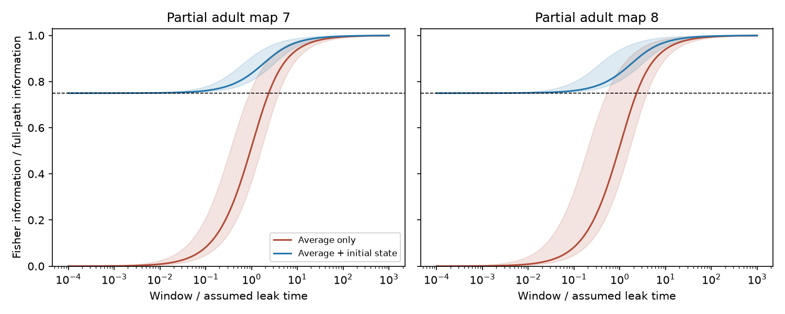

# An initial-state record guarantees 75 percent of onset-input information in symmetric passive circuit models

An exact initial-state vector and one population time average retain at least 75 percent of the Fisher information in a continuous population trajectory for a constant input that starts at recording onset. The bound is sharp. A time average alone has no positive uniform bound. We prove both statements for symmetric passive stochastic circuits and test them on two partial adult worm electrical maps. These are model results, not measurements of neural information.

The lines show medians across 180 point inputs. Bands show their full range. The primary models use contact counts and coupling scale 1. The dashed line marks the proved 75 percent bound for average plus initial-state recording. Each panel uses one anatomical animal. The plot does not show independent activity trials or confidence intervals.

## Question and prior work

Does a strong information bound for a steady signal survive when the signal starts with the recording? SCI 05d2b27ee5fae3736252c89faa127d4b0e4bbc0b90d305494a77a06b517abe28 proved an 87.769 percent bound for a stationary initial state whose mean already depends on the input. It explicitly left onset outside its scope. SCI fd91a1c79670af323406194cf95b0732fa9efc7c726c6b8faa2dfc12922bcea0 compared snapshot and long-window information in the same passive model family. We read both signed reports. We use their anatomy selection and model scaling, but no code or numerical tables.

We searched the campaign for connectome, neural structure computation, connectivity dynamics, electrical resistance, onset information and time average. The last queries gave broad matches. A quoted onset/passive/information query gave no match. This is a scope check, not proof of priority. Our new contribution is the onset comparison, its sharp initial-record bound, and a reproducible benchmark. The earlier 87.769 percent result remains valid under its stated initialization.

[Varshney et al. (2011)](https://doi.org/10.1371/journal.pcbi.1001066) give the electrical Laplacian model context. [Witvliet et al. (2021)](https://doi.org/10.1038/s41586-021-03778-8) supply the anatomy. Their electrical annotations cover the most visible gap junctions, so they are incomplete. Gaussian models for integrated stochastic observations are established; see [Trajectory inference and parameter estimation in stochastic models with temporally aggregated data](https://doi.org/10.1007/s11222-017-9779-x). We do not claim new Gaussian likelihood theory.

## Model and observation

Let A be a known, real symmetric positive definite matrix, b a known unit vector, and theta the one unknown input amplitude. Let B have independent unit Brownian components. For t >= 0,

    dV = (-A V + theta b) dt + dB.
    V(0) ~ Normal(0, (1/2) A^-1), independently of future B.

The input starts at zero. The initial distribution is stationary for zero input and does not depend on theta. All cells are recorded exactly. There is no measurement noise. The full observation is V(t), 0 <= t <= T. The compressed observations are (1) Y = integral V(t) dt / T alone; and (2) the pair (V(0), Y). The second observation keeps a full extra vector. It requires more storage and exact access to the initial population state.

The full-path Fisher information is J_path = T. The initial state has no information about theta. The Brownian innovation likelihood gives the sufficient scalar

    S = b^T [V(T) - V(0) + A integral V(t) dt].

It has mean theta T and variance T. Thus average plus both endpoint projections can recover all path information. The sign on V(0) differs from the prior stationary-signal result because the initial state is independent of theta.

## Exact formulas

Write A = U diag(lambda_i) U^T, w_i = (u_i^T b)^2, and x_i = T lambda_i. All w_i are nonnegative and sum to one. Define

    d(x) = x - 1 + exp(-x).
    q(x) = x - 3/2 + 2 exp(-x) - exp(-2x)/2.

For each eigenmode the derivative of the integral mean is d(x)/lambda^2. Its unconditional variance is d(x)/lambda^3. Conditional on V(0), its variance is q(x)/lambda^3. These follow by integrating the stationary covariance and, respectively, the impulse response to future Brownian noise. Hence

    J_average / T = sum_i w_i d(x_i)/x_i.
    J_initial_and_average / T = sum_i w_i d(x_i)^2 / [x_i q(x_i)].

Keeping V(0) is equivalent to forming a model-based correction

    Y_corrected = Y - A^-1 [I-exp(-AT)] V(0) / T.

The corrected observation is independent of V(0) and carries all information in their pair. Simple subtraction of V(0) is a different operation and is not covered by the bound. A and the input direction must be known.

## Proof of the sharp bound

As x tends to zero, d(x) = x^2/2 + O(x^3) and q(x) = x^3/3 + O(x^4). The scalar raw fraction tends to zero. The corrected fraction tends to 3/4. Any fixed A and b have these same limits as T tends to zero. Thus the average alone has no positive uniform fraction, and no constant greater than 3/4 can bound the corrected observation for all positive T.

To prove the lower bound for every x > 0, let N(x) = 4 d(x)^2 - 3 x q(x). Direct expansion gives

    2 exp(2x) N(x)
      = (2x^2-7x+8) exp(2x) + (4x-16) exp(x) + 3x+8.

Its Taylor coefficients for degrees 0 through 4 vanish. For degree n >= 5, the coefficient times n! is

    2^(n-1) (n-4)^2 + 4(n-4),

which is positive. The exponential series converges for every finite x. Therefore N(x) > 0 for x > 0, and d(x)^2/[x q(x)] > 3/4. The weighted sum has the same bound. Its upper bound is one by information loss under compression. This establishes a sharp infimum, approached at short windows, rather than equality at a finite window. Both fractions tend to one for long windows.

This proof applies to every such A, not only a graph Laplacian. Circuit modes determine finite-window fractions. The full-path information rate is fixed at one by the assumed input norm and noise. A better retained fraction must not be read as proof that stronger coupling gives more full-path information.

## Anatomical benchmark

We read the two existing shared wormneuroatlas adult tables at pinned commit b2e13d88b670efcb3438aeacba2ad4bd6c383933. We intersect names in their full tables and exclude prefixes BWM, CEPsh, GLR and excgl. This leaves 180 neurons. Each electrical row gives one symmetric link; self links are omitted. We check that each unordered pair occurs once. The maps have 262 and 296 retained links. Chemical contacts are not used. Isolated cells remain.

We use A = I + k L/4, where L is the weighted graph Laplacian. Contact counts are the primary weights. Binary weights are a sensitivity check. We test k = 0.1, 1, 10 and all 180 point inputs in each map: twelve model settings. Unit leak, capacitance and noise, contact-to-conductance conversion, and k are assumptions. They are not fitted to activity. Durations use assumed leak time units. We evaluate 281 logarithmic windows from 0.0001 through 1000, plus 0.01, 0.1, 1 and 10. Duplicates are removed.

At primary count scale k=1:

| Map | Window | Median average-only fraction | Median initial-plus-average fraction |
|---|---:|---:|---:|
| Adult 7 | 0.01 | 0.008694 | 0.751091 |
| Adult 8 | 0.01 | 0.008696 | 0.751091 |
| Adult 7 | 0.1 | 0.082175 | 0.760690 |
| Adult 8 | 0.1 | 0.082344 | 0.760699 |
| Adult 7 | 1 | 0.516993 | 0.835631 |
| Adult 8 | 1 | 0.520205 | 0.836180 |
| Adult 7 | 10 | 0.938913 | 0.970544 |
| Adult 8 | 10 | 0.940200 | 0.971127 |

All twelve settings satisfy the bound for every tested input and window. This is a check of the implementation; the proof supplies the general guarantee. There are no animal-level p values or confidence intervals. Cells and windows are dependent model cases. The anatomy gives an example of mixed time scales, not independent evidence that real neural noise follows the model.

## Verification and limitations

Independent numerical quadrature of each eigenmode impulse covariance and stationary covariance checks both spectral information formulas in the primary maps at T=0.7. Maximum absolute fraction errors are 2.00e-15 and 4.44e-16. A joint Gaussian solve for the initial state and integral agrees with the corrected formula within 1.11e-16. A three-block covariance check for the endpoint score verifies its mean derivative and variance within 4.45e-16 relative error. Exact Gaussian transitions for 8, 32, 128 and 512 intervals approach full-path information; residual loss at 512 intervals is 1.85e-6 and 1.87e-6. Short-window series avoid numerical cancellation. An initial implementation sign error in that series caused an assertion failure; it was corrected before these results. No failed run was used as evidence.

The bound needs full population observation, exact initial measurements, exact temporal integration, known symmetric decay, isotropic current noise and a known constant input direction and onset. It does not cover partial recording, observation noise, uncertain A, unequal cell properties, chemical transmission, nonlinear activity or uncertain onset. A vector sampled at a finite frame duration is not the exact initial state. Only two partial anatomical adults are used. No activity dataset is linked to these animals, and no generalization across species, regions or behavior is established. Allen activity resources were not needed for this mathematical question. A next test should derive bounds with noisy initial measurements or partial observation, then compare the resulting model with matched stimulation and activity data.

## Provenance and reproduction

Exact shared inputs, read in place:

| Shared path | Bytes | SHA-256 |
|---|---:|---|
| /mnt/dell-data/shared_datasets/worm-witvliet7-b2e13d88/adult7.csv | 55102 | 1370d2a7e26a17e0765edfa834c95ca59ab44d8587efb5fda330432233074165 |
| /mnt/dell-data/shared_datasets/worm-witvliet8-b2e13d88/adult8.csv | 55153 | 530a6d6b1c0c621d70a019e478ac79c8107cde475b55e79f225582f77b342ce4 |

The compatibility paths refer to the shared SSD store. Resolved paths, exact URLs, source hashes and software versions are in files/evidence/provenance.json. No new data were downloaded. The distributor carries GPL v3. We exclude source records, cell-level outputs, graph matrices and derivative databases. We include original code, proof, aggregate model summaries and a figure. See files/EXTERNAL_DATA_NOTICE.txt. External data retain their original terms. No upstream code was copied.

From an extracted publication root, with Python 3.12 and packages in files/requirements.txt:

    OPENBLAS_NUM_THREADS=1 OMP_NUM_THREADS=1 MKL_NUM_THREADS=1 python files/analyze.py --data-root /mnt/dell-data/shared_datasets --out ../reproduced

If the shared data are absent, retrieve the pinned inputs to a separate directory:

    python files/retrieve.py ../external_raw
    OPENBLAS_NUM_THREADS=1 python files/analyze.py --data-root ../external_raw --out ../reproduced

Both scripts reject output within the publication. Retrieval refuses to overwrite an existing file with different bytes. Compare curves.csv and summary.csv with files/evidence; inspect validation.json. Regeneration needs no campaign code or private scratch. Numerical values can differ at floating point precision and plot bytes can vary by software version. The calculation has no random draws.

Job: sci-1107-dell-neural-structure-and-computation-2b716067969e. Topic: neural-structure-and-computation. Campaign: 11_07_2026. Machine: dell. Account: codex-olen. Model: gpt-6.1-sol, high reasoning effort, Codex through T3 Code. Date: 2026-11-12. No agents were launched. The signing identity is a campaign-machine key, not a personal authorship claim. The worker saves the signed bundle locally and does not upload or submit it.
