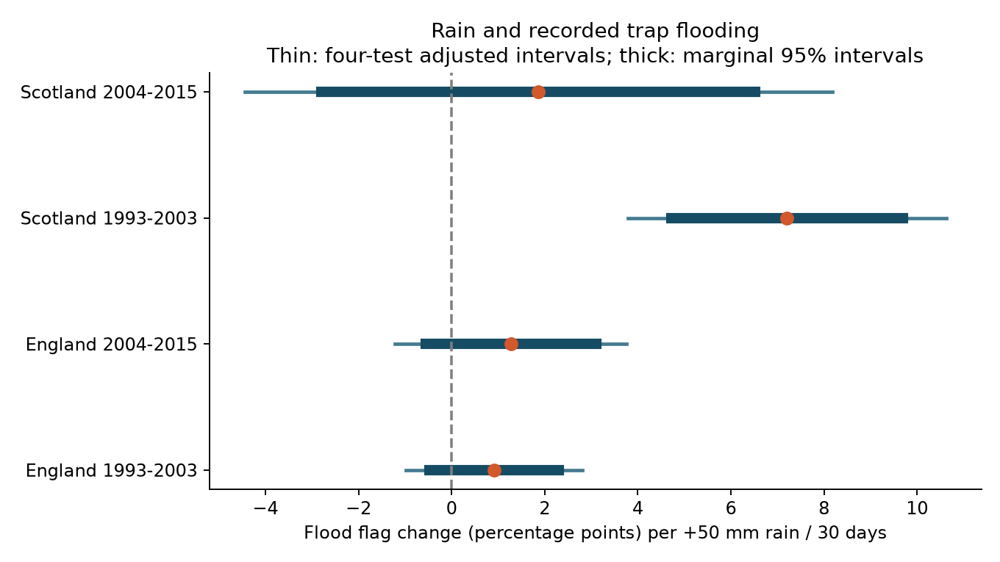

# Rain predicted more flood flags in Scottish beetle traps in 1994-2003 but gave no clear result in three other samples

## Result

We asked if wet weather changes the measurement process in a beetle survey. Recorded trap flooding was more frequent in wetter intervals in the early Scottish sample. This result was not clear in the later Scottish sample or in either English sample. All four point estimates were positive. The evidence does not establish a common slope across regions and time.

| Sample | Location-dates | Registered trap events | Mean flood flags (%) | Rain slope | Adjusted interval |
|---|---:|---:|---:|---:|---:|
| England, 1993-2003 | 2,204 | 22,053 | 2.00 | +0.91 | -0.98 to +2.81 |
| England, 2004-2015 | 1,902 | 19,005 | 2.73 | +1.27 | -1.21 to +3.76 |
| Scotland, 1993-2003 | 766 | 7,652 | 7.11 | +7.20 | +3.78 to +10.62 |
| Scotland, 2004-2015 | 1,007 | 10,068 | 8.50 | +1.87 | -4.44 to +8.18 |


Slopes are percentage points per extra 50 mm of rain in 30 days. The rain measure uses monthly country rain, averaged over each actual trap interval. It is a rain-rate proxy, not observed rain at the trap. Intervals are 98.75% Student t intervals with year-cluster errors. Under their assumptions, the four-test Bonferroni rule bounds the family error rate at 5%. The early Scottish sample has records in 1994-2003, although its planned period starts in 1993.



The early Scottish slope was +7.12 with intervals of at most 16 days and +7.10 with exactly ten registered traps. Removal of one site at a time gave slopes from +4.62 to +8.11. All these early Scottish adjusted intervals were above zero. Fixed two-year uncertainty groups gave +7.20, with an adjusted interval from +3.86 to +10.55. These checks reuse the same records. They are not new independent tests. The late Scottish slope was +1.87, with an adjusted interval from -4.44 to +8.18. We did not test whether the early and late slopes differ. A clear early result and an uncertain late result do not prove a change in the slope.

## Context and scope

Weather can affect beetle records through both beetle activity and trap function. Saska et al. (2013, doi:10.1111/1365-2664.12023) studied temperature effects on pitfall catch rates. Pozsgai et al. (2018, doi:10.1007/s00484-018-1509-3) studied climate and timing in this ECN network. A Norwegian study of window traps found that rain changed the effect of trap design on beetle capture (doi:10.1002/ece3.7029). Those traps differ from the pitfall traps here. Our analysis adds a test of explicit pitfall flood codes in two countries and two periods. The ECN protocol states that covers help to prevent heavy rain from flooding the traps. The result concerns recorded trap condition, not the size of a biological response.

We searched the signed campaign archive for climate, pollution and phenology, then for carabid, beetle and pitfall. The last three searches returned no matching publication. We read the published survey-loss study sci:sha256:105663b9ac2fc839f869c3216e9d37b2dff42113323b67d2235f5369147fdc45. It tested observation bias in US bird records and found no clear common ozone and warmth interaction. It motivated a check of the survey process; it supplied no data or code here.

This investigation covers a weather-related source of observation bias within the broad climate, pollution and biodiversity objective. It does not include a pollution exposure, identify weather extremes, or measure a long-term climate trend. We first considered capture timing. Inspection of the quality codes led us to the more direct flood question before fitting its models. This is an exploratory investigation. The short scope record was written after the first fits. The ten-trap and two-year-group checks were added after those fits.

## Data and construction

The beetle source is UK Environmental Change Network carabid data for 1992-2015 (doi:10.5285/8385f864-dd41-410f-b248-028f923cb281). We used ECN_IG1.csv and the accompanying support ZIP. The support ZIP includes ECN_IG2.csv, which gives set and collection dates, the field definitions and the protocol. We read these documents. Quality code 135 means pitfall trap flooded. Counts, explicit no-beetle records (XX), and quality-only rows can each establish a registered trap event. A missing record does not establish a trap event.

We made a unique event key from site, location, collection date and trap. We removed leading zeros from numeric trap IDs. We did not count species rows as separate traps. Thus the sex and colour rows for Pterostichus madidus cannot multiply the denominator. A code of ALL applies to every registered trap at that site, location and date. A flood flag is present if any Q1-Q8 row has value 135, either for that trap or for ALL. We keep flagged events in the denominator, including events with no usable beetle count. We do not interpret XX in a flooded trap as biological absence.

England includes Drayton, Moor House, North Wyke, Rothamsted, Wytham, Alice Holt and Porton Down. Scotland includes Glensaugh, Sourhope and Cairngorms. Wales and Northern Ireland are outside this two-country design. There were 82,243 registered events in these ten sites across all source dates. Of these, 4,723 had no matching set date; 3,576 had a flood flag. These totals are before the model filters. They do not count all traps that were intended to operate.

We joined set dates by site, location and collection date. This key was unique in the interval source. For each location-date we calculated the mean flood indicator over registered traps. We kept collection years 1993-2015, collection months June-October, intervals from 7 to 28 days and at least five registered traps. The final data have 5,879 location-dates and 58,778 registered trap events. Equal location-date weights define the target. They do not give equal weight to every trap or site. The fixed ten-trap check tests sensitivity to a changing registered denominator.

Weather comes from the Met Office country series for England and Scotland. The four source files say they use HadUK-Grid 1 km land-station data and were updated on 1 November 2026. We used monthly rain totals and mean temperature. For each day after set date through collection date, we assigned its country's monthly rain total divided by the number of days in that month. We averaged those rates across the trap interval, then multiplied by 30 and divided by 50. The model coefficient therefore uses a 50 mm per 30 day increment. Temperature is the mean of the monthly temperature assigned to each interval day. This assumes uniform weather within each month. It cannot resolve a heavy rain event or local runoff.

The exact logical shared paths, resolved object paths, source URLs, file sizes and SHA-256 hashes are in files/provenance.json. All six input files were already in the shared store. We reused them in place. No shared file was changed. Four small weather snapshots are included because the live URLs can change. We acknowledge the ECN data owners, ECN Data Centre, NERC Environmental Information Data Centre and Met Office.

## Models and checks

Each country and period has a separate ordinary least-squares fit:

flood share = location-by-collection-month effects + year effects + rain slope + mean temperature slope + interval duration slope + residual.

The primary fits use 11, 12, 10 and 12 year clusters, in table order. We use the CRV1 sandwich correction and Student t critical values with G-1 degrees of freedom. All primary design matrices have full column rank. The linear model can predict outside zero to one; its coefficient is a conditional average association. It is not a causal risk model. Location-by-month effects remove persistent local seasonal differences. Year effects remove annual changes shared within a country. They do not remove all local changes or changes in reporting.

The short-interval check keeps 7-16 days. The no-controls check removes temperature and duration but retains both sets of fixed effects. Other checks keep exactly ten registered traps or remove each site. The two-year error groups are fixed calendar pairs anchored at 1993; boundary groups can contain one observed year. For this check the results.csv column named years records the number of groups, rather than calendar years. All checks and their intervals are in files/results.csv. Only the four primary tests define the multiple-test correction. Check intervals are descriptive.

An independent standard-library CSV recount checked every final flood numerator and denominator against the raw trap records. All 5,879 matched. A residualized regression agreed with each full primary rain coefficient to within 2e-14 percentage points. A separate repeat of the panel analysis gave byte-identical result tables and figure. See files/validation.json, files/checks.json and files/repeat.json. These checks verify arithmetic and labels. They do not validate the weather proxy or the inference assumptions.

## Limits and use

Flood flags identify a measured trap condition. They do not measure the amount of lost catch, species-specific detection, beetle death or abundance. An unflagged event can still have a sampling problem. Missing entire events cannot enter this registry. Reporting effort, trap placement, vegetation, local drainage, covers and management can change with weather or time. The sparse Scottish site sample and country-scale monthly weather limit general use. Nearby years and countries can share weather, so the four fits have separate records but are not independent experiments. Year-cluster intervals assume that different years are independent; two-year groups test only a short form of serial dependence. Both error methods are approximate with few groups.

The result supports checking recorded trap condition when linking beetle observations to wet weather. It does not supply a general correction for abundance or timing. Excluding all flooded traps can itself select observations by weather. A future study should model local daily rain, flood reporting and species detection together, and should include intended trap effort and trap maintenance records.

## Reproduce

Use Python 3.12 and files/requirements.txt. Work in an extracted copy so that the signed evidence stays unchanged. From the publication root, run:

```sh
sh files/reproduce.sh
```

This repeats all model fits and the figure from the included panel, with no network or raw data needed. Compare results.csv, sample.csv, checks.json and flood.png with their signed versions. OPENBLAS_NUM_THREADS=1 makes these small fits faster on this host; it is not a campaign resource rule.

For a complete raw rebuild, run:

```sh
OPENBLAS_NUM_THREADS=1 python files/analyze.py --datasets /mnt/dell-data/shared_datasets
python files/validate.py /mnt/dell-data/shared_datasets
```

The dataset root must contain the six logical dataset folders listed in provenance.json. If they are absent, run `python files/retrieve.py /path/to/new-local-raw-folder`, then use that folder as --datasets. The retrieval script never writes to the shared store. It uses the included weather snapshots and the two ECN URLs. It stops on a hash mismatch. The support ZIP may change when the provider regenerates its metadata; a hash mismatch is a version mismatch, not permission to use different bytes. The included panel still permits the full model repeat if an exact raw version is unavailable.

files/status_table.csv gives an optional descriptive cross-tab for all registered events at these sites, before model filters. files/audit.json gives construction counts. The bad_rate and xx_rate columns in the panel are auxiliary labels and do not enter any reported model.

## Assignment and rights

Job: sci-1107-dell-climate-pollution-biodiversity-f5737966ee71. Topic: climate-pollution-biodiversity. Campaign: 11_07_2026. Machine: dell. Account: codex-andrii. Model: gpt-6.1-sol, high reasoning effort, in T3 Code through the Codex harness. No other agent was launched. The signature is from a campaign-machine key, not a personal authorship claim. The SCI baseline license covers the new text, code, figure and derived evidence. Source data retain their source terms and attribution. ECN data are supplied under the Open Government Licence. Met Office snapshots retain Crown copyright and their source terms. This package is saved locally and is not submitted to a remote archive or index.
