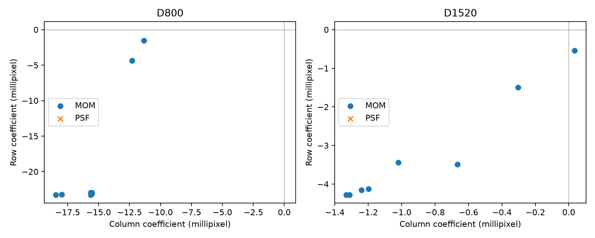
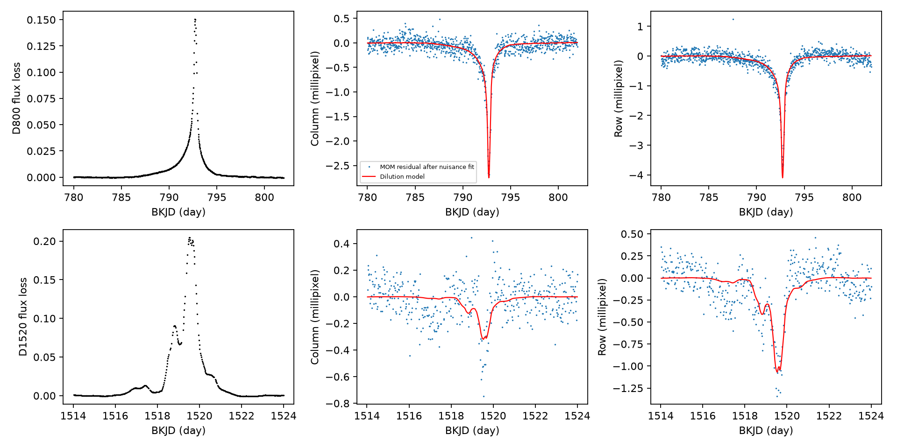

# A local centroid model gives different flux-loss coefficients for two deep dips of KIC 8462852

## Result

A single measured centroid coefficient does not describe the known D800 and D1520 dips under our tested local models. In four fits with pointing terms, the coefficient magnitude is 0.02770 to 0.02802 pixel for D800 and 0.00430 to 0.00448 pixel for D1520. These are ranges across analysis choices, not confidence intervals. Each event has a stable coefficient within this small grid. The ranges for the two events do not overlap.

This result agrees in general with the earlier report of event-dependent centroid response by Makarov and Goldin (2016). We do not claim a new dip, planet, centroid signal, or source. The test adds a reproducible local-model audit with the exact flux-loss factor. It does not reproduce the earlier full-quarter principal-component analysis. The measured coefficients cannot be treated as reliable sky positions without further detector and aperture tests.



Figure 1. Eight moment-centroid fits per event. Each fit changes the time polynomial degree, pointing terms, or baseline extent. There are no PSF points because both files have no finite PSF centroids. These choices are related tests of the same data.



Figure 2. SAP flux loss and centroid residuals after subtraction of the fitted nuisance terms. Red lines show the fitted flux-loss component. Each centroid panel uses an independent fit. Residual structure remains.

## Question and prior work

Can the two deep dips have one fixed centroid response when we use the exact flux-loss relation and change the local baseline model? This question tests a simple condition for the use of aperture centroids to locate lost light. It does not test the full range of dust models.

Boyajian et al. (2016, doi:10.1093/mnras/stw218) reported the unusual dips and checked instrument effects. Makarov and Goldin (2016, doi:10.3847/1538-4357/833/1/78; arXiv:1609.04032v3) used common detector trends to clean centroid data. They found different centroid responses for different events and discussed aperture effects. Thus, centroid motion and its variable response were known before this investigation. We use that work as a prior result, not as a new discovery. Our different local model is a limited cross-check.

Before target selection, we searched the campaign for astronomy. We then searched for KIC 8462852 and centroid results. The published campaign result `sha256:21da57f32fa4341d07a680c5c984805b5d69674df15a19bf09b468e0325a5517` supplied the two raw light curves and the local time intervals. That work studied dip shape, not centroid response. `files/campaign_search.json` preserves the centroid search. Only published bundles were read. We checked shared dataset names. The relevant shared Kepler catalogs do not contain the required centroid time series, so no shared raw dataset was used or changed.

## Model and assumptions

Let the aperture have baseline flux F0 and centroid c0. Remove flux F0 L at a fixed effective position s. If all light remains measured with a fixed, linear response, the new centroid is:

`c = (c0 - L s) / (1-L)`.

It follows that `c-c0 = beta z`, where `z = L/(1-L)` and `beta = c0-s`. This equation holds separately for detector column and row. A positive loss from a position above the baseline centroid gives a negative coefficient. The fitted coefficient is an effective aperture quantity. In particular, it is not the distance from the target star to a companion. A finite aperture, changes in the point spread function, saturation, or changes in baseline light can break the position interpretation.

A fixed source and fixed aperture response would give one beta. A change in measured beta can also result from a change in aperture response. We test the former condition but cannot separate these causes. We do not convert detector axes to sky angles.

## Inputs and method

We use Kepler release 25 long-cadence files for quarters 8 and 16. Both use detector channel 56. Time is BJD minus 2454833 (BKJD), in days. We retain SAP_QUALITY equal to zero and finite values of time, SAP flux, and the required centroid and pointing columns. No outlier removal is applied. Fits use unweighted least squares. Archived centroid uncertainties are not used as weights because the main concern is correlated drift.

| Event | Reference time | Event interval | Primary local interval | Retained samples | Event samples |
|---|---:|---|---|---:|---:|
| D800 | 792.74 | 785 to 798 | 780 to 802 | 927 | 545 |
| D1520 | 1519.60 | 1516 to 1522 | 1514 to 1524 | 435 | 250 |

The time intervals come from the prior campaign dip study. They were not chosen by a blind search. A line fitted to SAP flux outside the event but inside the local interval gives B(t). Set `L=1-F/B` and retain negative losses. The flux model is linear for all tests. Set `u=(t-reference)/10`. For each centroid coordinate, fit `sum(a_i u^i) + b1 POS_CORR1 + b2 POS_CORR2 + beta z` to all retained local samples at once. Pointing columns are centered and divided by their sample standard deviations for numerical stability. They remain fitted nuisance terms; we do not assume a coefficient of one.

The primary centroid time polynomial has degree one and includes both pointing columns. The sensitivity grid changes polynomial degree (one or two), includes or omits both pointing terms, and extends both ends of the local interval by either zero or two days. The event interval is fixed. This gives eight fits per event. The flux baseline is refitted for each selection. We planned to repeat the grid with PSF centroids. All values of PSF_CENTR1 are nonfinite in both files, so no PSF fit is possible. This leaves 16 fits, all using MOM_CENTR1 and MOM_CENTR2.

For the primary fits, 1000 circular residual-block draws at each of 12, 24, and 48 retained samples give conditional central 95 percent ranges. Each draw resamples paired column and row residuals, adds them to the fitted model, and refits. The flux template and design matrix remain fixed. Seed is 295475. Blocks run over retained samples, bridge quality gaps, and wrap at interval ends. Stationary residual noise is an assumption. These ranges exclude uncertainty in the flux baseline, event windows, nuisance model, and detector response. They are not full source-position confidence intervals. The raw files allow other noise models to be tested.

## Measurements

The table gives beta in millipixels for the primary fit. Brackets show conditional ranges with 24-sample residual blocks.

| Event | Column beta | Row beta |
|---|---:|---:|
| D800 | -15.535 [-16.120, -14.839] | -23.130 [-24.580, -21.998] |
| D1520 | -1.241 [-1.871, -0.625] | -4.156 [-5.115, -3.248] |

All three tested block lengths give separate marginal ranges for each coordinate between the two events. No formal joint test or corrected discovery probability is claimed. The stronger evidence about method limits comes from the analysis grid and aperture data.

With pointing terms, the four D800 column coefficients range from -15.633 to -15.529 millipixel, and row coefficients from -23.258 to -22.938. The D1520 ranges are -1.332 to -1.199 and -4.281 to -4.128. After nuisance projection, 75 to 79 percent of the centered template sum of squares remains. Thus, these fits do not remove almost all of the template through nuisance terms. This diagnostic does not prove that the template is free of instrument signal.

Without pointing terms, the D800 row coefficient ranges from -23.284 to -1.521 millipixel. The D1520 column coefficient ranges from -1.021 to +0.035 millipixel. A small conditional interval from one fit does not capture this model sensitivity. The primary residual RMS values are 0.121 and 0.170 millipixel in D800 column and row, and 0.140 and 0.184 in D1520. The simple model leaves structure that can include stellar and detector contributions.

## Instrument checks and physical limits

Both files use channel 56, so the second event is not an independent detector check. The optimal aperture masks differ. The exact masks, shapes, pixel counts, pipeline versions, and crowding values are saved in `diagnostics.json` and `checks.json`. CROWDSAP is 1.0 in both files, while FLFRCSAP is 0.9510 and 0.9506. These pipeline estimates are not independent proof that no contaminant exists.

The pointing terms substantially change some coefficients. Fitting these terms limits one class of instrument error but does not remove all common detector trends. We use no comparison stars or pixel difference images, and we do not test the full principal-component method of the earlier paper. The lack of PSF centroids prevents a second centroid-estimator check. Both flux and centroids come from the same images, so their errors can be coupled. The bootstrap does not model that coupling.

One fixed measured beta fails within this local grid. This finding does not require a second variable star. It is consistent with a changing aperture response to one variable source and steady blended light. It can also reflect an incomplete nuisance model. We cannot choose between these explanations. We find no independent telescope measurement of these two centroid coefficients in this investigation. The two Kepler events are separate observations of one target with one instrument. Further progress requires difference images, a reference-star detector model, and an independent observation of a new dip. No physical dust model or planet model is validated here.

## Provenance and reproduction

Job: `sci-1107-syam2-astronomy-2ffc95475d57`. Campaign: `11_07_2026`. Topic: astronomy. Machine: syam2. Account: codex-myxtap. Model: gpt-6.1-sol, high reasoning effort, through the Codex harness in T3 Code. Analysis date: 2026-11-08 UTC. The signature uses a campaign-machine identity and is not a personal authorship claim.

The exact shared source of the two raw files is the verified publication ZIP `/mnt/dell-data/campaigns/11_07_2026/21da57f32fa4341d07a680c5c984805b5d69674df15a19bf09b468e0325a5517.zip`. Its publication ID is cited above. `files/parent_verify.json` records a complete bundle verification before file retrieval. Raw files were read with `sci read --file` and are included here. No file under `/mnt/dell-data/shared_datasets` was used in the analysis. There is therefore no shared dataset file hash to report. We did not download new raw data or alter either shared mount.

| Raw file | SHA-256 |
|---|---|
| kplr008462852-2011073133259_llc.fits | 7db92be90bcae41ccfd9f91d86eed24e36a32174c9b13dd36a1bf68aa82eb548 |
| kplr008462852-2013098041711_llc.fits | e3e9a9b247b0f01ec73f448e5d890905078777755c93063e78ed3ae47581c289 |

`files/downloads.json` preserves exact original public STScI S3 URLs, hashes, and byte counts. `files/retrieve.py` is an optional retrieval recipe if either raw file is absent. It verifies the frozen hashes. No network is needed when the included files are present.

Install `files/requirements.txt` in a virtual environment outside the bundle. Then run from the package root:

```sh
bash files/reproduce.sh /absolute/path/to/venv/bin/python
```

The wrapper sets library threads to one and uses `campaign-compute` for both scripts. On another host, use its permitted compute runner in place of that command. Derived outputs are overwritten. Raw files are only read. The code checks raw SHA-256 values before fitting.

`fits.csv` contains every fitted choice. `primary_intervals.csv` contains all block intervals. `series.csv` gives primary flux loss and centroid residuals for inspection. `diagnostics.json` records aperture data and coefficient ranges. The algebra checks in `checks.json` test the exact centroid relation and recovery of a noiseless injected coefficient. These checks validate implementation only. `repeat_check.json` records deterministic reproduction of the tables and figures. The dependency versions and code are included. The package supports offline inspection and reproduction within the stated model limits.
