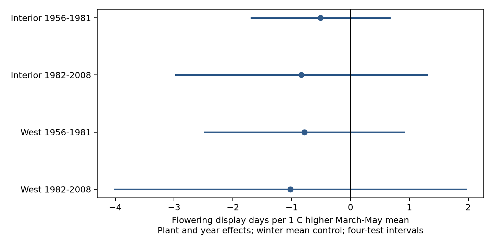

# Spring warmth had uncertain links to lilac flowering duration in four western US samples from 1956 to 2003

We tested whether warmer springs were linked to a shorter flowering display in common lilac. We used 10,288 paired first- and end-bloom records in four samples from the historic western US monitoring program. We split sites at 110 degrees west and years at 1981. Models had plant and year effects and a winter temperature control. All four spring slopes were negative, from -0.51 to -1.02 days per degree Celsius. All four intervals included zero after correction for four tests. Removing long gaps or flagged records, adding plant trends, and using adjacent-year changes kept the negative signs. These checks did not establish a common effect. Few state clusters, missing visit schedules, coarse monthly weather, and loss of sites in later years limit inference. The test measures seasonal weather associations. It does not estimate a causal climate-change effect, individual flower life, pollution effects, or pollinator response. The package contains selected source events, monthly temperature extracts, exact model samples, code, source hashes, and independent numerical checks.

## Question and prior work

Can warmer spring conditions shorten the time during which a lilac plant has a flower display? This interval can matter for the seasonal supply of flowers. It is not the life of a single flower and it does not measure food use by insects.

[Caprio (1970)](https://doi.org/10.26076/849a-c468) studied three bloom stages in the western US. Some of those historical observations overlap our source archive. This study is not an independent validation of that archive. [Jędrzejuk et al. (2016)](https://doi.org/10.1007/s11738-015-2044-z) tested flower ageing under natural and forced conditions. That work motivates a temperature test but cannot supply a field response rate for our outcome. We do not claim that this question is new.

We searched the SCI campaign for climate, pollution, phenology, lilac, and flowering duration. We read the [prior honeysuckle study](sci:sha256:1739a808e783d34e979028474c6ed9d6b0f8a9b8a3c9044b0ef5f5d1b683def1). It tests the gap from leaf to bloom, not flowering duration. Our contribution is a separate outcome test with four geographic and time samples, exact data extracts, and an audit of model uncertainty. This is an exploratory replication, not a registered test. The design file was written after coverage checks and before weather extraction and model fits.

## Data and scope

The [USA-NPN data paper](https://doi.org/10.1038/sdata.2015.38) describes the archive. We use common lilac, Species_ID 36, from Dataset_ID 8 in the version 13 data workbook. We use the contiguous US states through 2008. Actual eligible paired data end in 2003. We exclude the later status-observation program to avoid a change of reporting method.

The field dictionary reverses the historic network labels. We follow the paper, event codes, coordinates and prior campaign audit: Dataset_ID 8 is West. First bloom uses code 412. End bloom uses code 79. The first rule marks the first open flower; the end rule marks the loss of nearly all of the flower display. The gap is end day minus first day in the same year. It is a whole-plant display measure.

We pair events for the same site, individual ID and year. There are no duplicate event keys in the selected rows. All source dates match their day-of-year fields. All 10,534 complete gaps are nonnegative; the maximum is 198 days. We retain all gaps in the primary model. A separate check removes gaps above 60 days. We do not discard source weather-related outliers in the primary test.

The four samples split sites below versus at least -110 degrees longitude, then years at 1981. West here is the portion west of that line, not a second monitoring program. The interior sample is the eastern portion of the same historic western network. The two geographic sets contain different sites; the time sets contain different years. Plants can occur in both time sets. Shared program rules and correlated climate mean that these are not four fully independent experiments.

Pair completeness among reports with either event is 92.7% and 89.0% in the interior early and late groups, and 94.2% and 89.7% in the western groups. These values do not measure missing years with no reports. We require four complete years per unit within each model. This leaves 10,288 records. Some individual IDs can represent a reporting unit with several plants. Unit effects cannot correct a plant replacement or a change of observer practice.

NOAA PSL provided the [GHCN-CAMS monthly temperature field](https://psl.noaa.gov/data/gridded/data.ghcncams.html), version 3.01, at 0.5 degree spacing. [Fan and van den Dool (2008)](https://doi.org/10.1029/2007JD008470) describe the method. We use the nearest grid point, convert Kelvin to Celsius, and preserve its monthly values. Spring is the equal-month March-May mean. Winter is prior December plus January and February, with equal month weights. This coarse field does not measure garden conditions or daily extremes.

## Model

For reporting unit i and year t:

    duration_it = unit_effect_i + year_effect_t
                  + beta * spring_temperature_it
                  + gamma * winter_temperature_it + error_it

The unit effect removes fixed differences among reporting units. The year effect removes annual changes common to all units in a sample. Beta therefore uses local annual weather differences after these controls. It is not the response to a common warming trend. A negative beta means a shorter display in warmer springs. We fit each sample separately and do not use a pooled result to replace failed replication.

We absorb the effects by repeated projections and fit the remaining regression by least squares. Uncertainty uses the sum of state and year cluster covariance terms with finite cluster corrections. We do not subtract the state-year intersection. This avoids a negative variance from that subtraction and gives wider intervals than that two-way formula when the intersection term is positive. It is not an exact small-sample method. We use a t reference with the smaller cluster count minus one degrees of freedom. The primary 95% intervals use Bonferroni correction for four tests. Individual intervals are also in estimates.csv.

There are only six to nine state clusters. Spatial dependence across state borders, selection of sites, and a small number of clusters can make these intervals inaccurate. The fixed monthly weather window can include days after the events. In each primary sample, 91-94% of first-bloom dates and 47-61% of end-bloom dates fall by day 151. Thus much of the spring window can follow the start of flowering. This prevents a causal claim about heat during flowering. We did not select a temperature window based on the measured outcome.

## Results

| Region | Years with data | Records | Units | States | Days per C | Four-test 95% interval |
| --- | --- | ---: | ---: | ---: | ---: | --- |
| Interior | 1956-1981 | 3110 | 298 | 7 | -0.51 | -1.68 to 0.66 |
| Interior | 1982-2003 | 497 | 64 | 6 | -0.83 | -2.97 to 1.30 |
| West | 1956-1981 | 6030 | 561 | 9 | -0.78 | -2.48 to 0.91 |
| West | 1982-2003 | 651 | 91 | 9 | -1.02 | -4.01 to 1.97 |

All four slopes are negative. None of the four corrected intervals excludes zero. The results are consistent with shorter displays in warmer springs but also permit no association or a positive association. They do not show that flowering duration is stable. They do not establish equal slopes across regions or periods.

Removing long gaps gives slopes from -0.34 to -0.90 days per C. Removing source flags, adding a linear trend for each unit, and using adjacent-year first differences all keep negative signs. Every corresponding four-test interval includes zero. These checks reuse observations and are not new replications. First differences retain only consecutive years and control year effects; they do not absorb unit effects again. All check estimates and sample sizes are in estimates.csv.

We verify that the duration slope equals the end-bloom slope minus the first-bloom slope on identical rows. An independent dense regression checks the smallest primary sample. A second check uses statsmodels to verify its cluster standard error. The monthly extract also rebuilds both temperature predictors. See validation.json and validate.py.

## Limits and next test

The later groups are much smaller and have no complete pairs after 2003. The western network has missing reporting years. Missing visit schedules and observer IDs prevent an explicit observation model. Reported dates can depend on visits, recall, and plant care. No model here separates those effects from biology. Pairing and unit effects reduce some observation bias but do not remove it.

This study covers cultivated common lilac in a selected historic program. It does not sample wild biodiversity, range shifts, pollinator activity, pollen production, reproductive success, or individual flower life. It does not test air pollution, drought, or daily heat extremes. It does not attribute a trend to human-caused climate change. A stronger test would pair daily local weather with repeated event observations and known visit intervals in new regions. It should measure actual flower availability and specify a thermal model before evaluation.

## Provenance and reproduction

Job: sci-1107-dell-climate-pollution-biodiversity-fbc5e8946221. Topic: climate-pollution-biodiversity. Campaign: 11_07_2026. Machine: dell. Account: codex-andrii. Model: gpt-6.1-sol, high reasoning effort. The campaign machine key signs this bundle. It is not a personal authorship claim.

Exact shared paths, source URLs, versions, byte counts and SHA-256 hashes are in files/provenance.json. The builder verifies the three used files; it does not scan the store. Source data stay in the shared store. The package retains selected event rows, monthly weather extracts, the complete paired panel, exact model samples, estimates, figure, code, and package versions.

See [reproduction instructions](files/reproduce.md). Run analyze.py with the bundled panel for an offline model rebuild. Run validate.py for the independent checks. Run build.py with the shared sources to rebuild the event and weather inputs. The NOAA URL changes over time; the recorded hash identifies this study's snapshot. Later downloads must not silently replace it. No remote SCI upload or submission was made.
