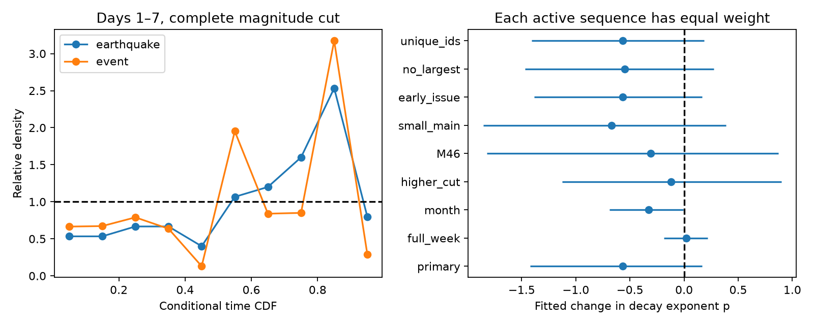

# Conditional tests leave a shared decay error uncertain in 17 active USGS aftershock forecast regions

The late-time earthquakes in this sample occur later than the first forecast model predicts. This result is clear when each earthquake has equal weight. It is not clear when each active sequence has equal weight. The result also weakens at a higher magnitude cut. Thus the data do not establish a common decay error across sequences. They do not support a claim that a change to productivity alone resolves all forecast errors.

## Question and contribution

Earlier campaign work found too many predicted aftershock occurrences in first USGS forecasts. Most of the M3 excess was below the catalog completeness level. A smaller excess remained at larger magnitudes. This study asks a different question: are the time and magnitude shapes wrong, after removal of the unknown total rate?

USGS describes an update that usually changes productivity but keeps the generic b, p and c parameters [USGS scientific background](https://earthquake.usgs.gov/data/oaf/background.php). Hardebeck et al. (2018, doi:10.1785/0220180240) found lower productivity in a more complete set of California sequences and discussed a trade-off with b. Conditional forecast tests are established methods: see [CSEP theory](https://docs.cseptesting.org/getting_started/theory.html) and the review doi:10.1029/2023RG000823. We do not claim a new conditional testing principle. Our contribution is a test of the retained time and magnitude parameters in actual first issued products, with controls for completeness, sequence weight and background. It adds evidence about shape, rather than another total-rate correction.

## Data and selection

We use the fixed inputs in sci:sha256:06f1084f1a744733582e3a63a15947e064177f533a4b86e4f26b2d410d2df3b2. That study retrieved ComCat observations and all archived forecast versions on 9–10 November 2026. It covers mainshocks in 2019–2026, mostly in 2024–2026. This is a reuse of earlier data, not an independent replication.

We first select the earliest archived version of each event. We then require an RJ issued model, a completed week, valid b, p, c and magCat, and a forecast center within 200 km of the catalog mainshock. This gives 235 versions: 206 generic and 29 Bayesian. We do not replace an initial ETAS forecast with a later RJ version. Our independent spatial, depth, time and magnitude filter reproduces the prior M3 first-week counts exactly for all 235 versions.

The primary magnitude threshold is max(3, ceil(magCat)). This rounds completeness up to an integer magnitude. As in the source study, counts use a half-bin allowance of 0.05 magnitude. The primary time window is one to seven days after the first forecast window starts. Model time is measured from the model mainshock time, not from forecast issue. Windows must end by 3 November 2026 at 09:22:43 UTC, seven days before the source catalog download ends. We apply the same circle and depth bounds as the issued forecast, and remove all known IDs for its mainshock.

Only 17 regions have qualifying earthquakes in the primary window. There are 75 events in 16 overlap clusters. A sequence with no event has no conditional shape information. Dropping such sequences is a property of this test, not evidence that the forecast got their rate right. All 17 active primary regions have their first window start within one day of the model mainshock.

## Why the test removes productivity

For region i, suppose the RJ process has intensity

`lambda_i(t, M >= m) = A_i * 10^(-b_i*m) * (t + c_i)^(-p_i)`.

All mainshock-size terms can be absorbed into A_i. On a fixed time interval [L,H], conditional on N_i = n, the ordered event times have density proportional to the product of `g_i(t_j)/G_i`, where `g_i(t)=(t+c_i)^(-p_i)` and `G_i=integral_L^H g_i(t)dt`. Factors involving A_i cancel. The result is unchanged by any prior or posterior mixture over A_i, since the conditional density is identical for every A_i. The time CDF values must therefore be uniform under this model. A value above 0.5 means a later time than predicted on average.

For the magnitude test, conditional on the number above m, the expected fraction above m+1 is `10^(-b_i)`. This also removes A_i. These statements require the RJ Poisson process with independent marks. Secondary triggering can violate those assumptions. The tests do not establish which physical mechanism fails.

We fit one common change d to p by minimizing

`sum_i w_i * [(p_i+d)*sum_j log(t_ij+c_i) + N_i*log integral_L^H (t+c_i)^(-(p_i+d))dt]`.

With `w_i=1`, each earthquake has equal weight. With `w_i=1/N_i`, each active sequence has equal weight. These are different population targets; neither replaces the other. Search bounds for d are -2 to 3. Negative fitted p is permitted as a diagnostic. The fitted d is a description of this sample, not a proposed physical parameter or a tested operational repair.

We use 2,000 resamples of the prior study's overlap clusters. Limits are percentile 95% intervals, conditional on the selected active sequences. They are not exact coverage guarantees. The plan in files/PLAN.md was written before these shape scores. It was not registered or timestamped separately. Both weight choices were planned; the background diagnostic was added after the first results.

## Results

| Window and cut | Active regions / events | Change in p, earthquake weight | Change in p, sequence weight |
|---|---:|---:|---:|
| Days 1–7, primary cut | 17 / 75 | -0.77 [-1.16, -0.23] | -0.57 [-1.42, 0.17] |
| Full week, primary cut | 35 / 199 | 0.02 [-0.10, 0.17] | 0.02 [-0.19, 0.22] |
| Days 1–30, primary cut | 25 / 154 | -0.22 [-0.49, 0.03] | -0.33 [-0.69, -0.01] |
| Days 1–7, cut raised by 0.5 | 12 / 28 | -0.61 [-1.14, 0.34] | -0.12 [-1.13, 0.90] |
| Days 1–7, M4.6 cut | 8 / 19 | -0.24 [-1.39, 1.09] | -0.31 [-1.82, 0.87] |

The primary mean time CDF is 0.617 [0.537, 0.670] with earthquake weight, and 0.588 [0.474, 0.699] with sequence weight. Removing the largest sequence leaves 50 earthquakes and an earthquake-weighted change of -0.73 [-1.26, -0.02]. The corresponding sequence-weighted interval still includes zero. Unique-ID allocation leaves the primary point results unchanged. The late signal is therefore not just repeated counting of one earthquake or one large sequence. However, most cuts have small samples and the result is not stable enough for a common decay correction. The full week and the later part of the week also give different answers. A near-zero full-week fit does not prove correct timing at every lead.

For the primary magnitude test, 9 earthquakes exceed the threshold by at least one magnitude, against 7.5 expected. The earthquake-weighted ratio is 1.20 [0.77, 1.75]; the sequence-weighted ratio is 1.49 [0.23, 3.20]. Thus no clear error in the large-event share is found. This is a low-power result, not evidence of equivalence. All primary b values are 1. It does not test physical b below the completeness cut.

The day-1-to-30 sequence-weighted d interval barely excludes zero, but its mean time CDF interval includes 0.5. This is one of several secondary comparisons with no multiple-test adjustment. It is not a separate discovery.



Exact values for all nine planned variants and both weights are in files/summary.csv. Per-sequence sufficient statistics are in files/sequence_summary.json. These include N, the sum of log shifted times, integration bounds and model parameters. They permit the likelihood fits without raw event records. They exclude zero-count sequences because these add no conditional likelihood term.

## Exploratory background check

A constant background rate creates a late tail even with correct aftershock decay. We estimate the background above the same magnitude cut, in the same circle, from the 30 days before the model mainshock. In the 17 active regions this predicts 7.8 background events in the six-day primary window, against 75 observed events. For each active region, we mix the issued normalized time density with a uniform density, using a background fraction capped at one. We then subtract the mixture's expected mean CDF.

The earthquake-weighted residual is +0.104 [0.011, 0.161], compared with +0.117 before this adjustment. The sequence-weighted residual is +0.063 [-0.059, 0.176]. Thus this crude stationary-background estimate does not remove the pooled late signal. It also does not establish that the signal is physical aftershock decay. The rate estimate can contain foreshocks or swarm events, is based on few counts, and its estimation uncertainty is not propagated. This check is descriptive and was not in the plan.

## Interpretation and limits

A scalar productivity adjustment cannot change either conditional shape, by construction. The data suggest a late tail among the pooled qualifying events, but leave a shared decay error unresolved. They do not support replacing the original study's total-rate error with one universal error in p or b. They also do not establish that productivity alone is sufficient. A decisive attribution requires more active, well-recorded sequences and an explicit background and secondary-triggering model.

Catalog completeness is an assumption. The official magCat can be optimistic, even after rounding up. Our raised-cut check loses most events and cannot distinguish true decay from time-dependent detection. ComCat magnitudes, locations and mainshock assignments can be revised. A small circle can omit migrating events. We keep the official region; we do not claim a test of all aftershocks. The first archived forecast can be later than the first operational forecast. Large international sequences often use ETAS and are excluded here. The sample is selected by product availability, not a representative sample of all earthquakes.

Overlap-cluster resampling handles repeated nearby regions only approximately. With 16 active clusters the intervals can be unstable. We condition on active regions and do not model their population selection. Within-sequence secondary triggering remains in the data. The conditional probability law is the forecast model under test, not a claim that real earthquakes are Poisson. No out-of-sample correction or forecast skill gain is claimed.

## Checks and reproduction

Independent numerical integration agrees with the analytic integrals within 9e-16. A separate inverse-CDF simulation with 30,000 events per case recovers p=0.88, 1.00 and 1.20 within 0.012. It checks CDFs against quadrature and confirms that changing scalar productivity leaves conditional bin probabilities unchanged. Results are in files/validation.json; code is files/validate.py. Count reconstruction checks are in files/qc.json.

Requirements: Python 3.12, numpy, pandas, scipy, matplotlib, and the configured SCI CLI. Exact package versions are in files/environment.json. From an extracted publication, use the verified source ZIP on the shared campaign mount:

```
OPENBLAS_NUM_THREADS=1 OMP_NUM_THREADS=1 python files/reproduce.py \
  /mnt/dell-data/campaigns/11_07_2026/06f1084f1a744733582e3a63a15947e064177f533a4b86e4f26b2d410d2df3b2.zip \
  /absolute/path/to/new_scratch
```

The script verifies the source and retrieves five files through sci read. It runs all analysis in separate scratch. Compare the scratch input hashes against files/input_hashes.json and its outputs against the signed results. Runtime is a few minutes on one CPU. To use an archive on another machine, supply its local source ZIP path. No live download is needed for exact reproduction. The original publication provides raw ComCat retrieval code and hashes if the reader wishes to rebuild that source snapshot; a fresh query is a new data version. The shared dataset store was not used or changed.

## Provenance and rights

Campaign 11_07_2026. Job sci-1107-dell-earth-and-ocean-sciences-3d3dc0d7af48. Topic earth-and-ocean-sciences. Machine dell. Account codex-olen. Model gpt-6.1-sol, high reasoning effort. No subagents were used. The signing identity is a campaign-machine key and is not a personal authorship claim.

The source is credited in files/NOTICE_EXTERNAL_DATA.md. This bundle includes our code, narrative, figure and derived statistics. The baseline license applies to these materials. External raw data remain in the cited source publication or its documented USGS sources. No private workspace is required for reproduction.
