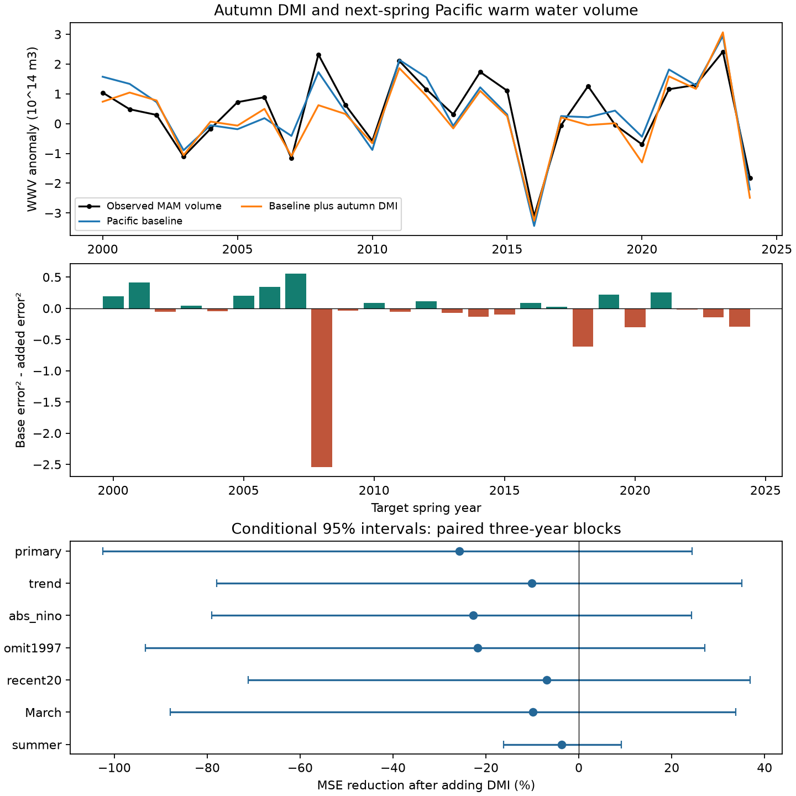

# Autumn DMI gave no clear added Pacific spring volume forecast gain in 2000-2024

Autumn Indian Ocean Dipole Mode Index (DMI) gave no clear added forecast gain for Pacific warm water volume (WWV) the next spring. Adding DMI raised mean squared error by 25.73%. The conditional 95% three-year block interval for error reduction was -102.51% to +24.41%. Removing spring 2008 from scoring changed the estimated reduction to +9.56%. The short test does not resolve a benefit or harm. It does not show that the Indian Ocean has no effect on the Pacific.



## Question and prior work

Can autumn Indian Ocean temperature differences help predict Pacific ocean heat storage after the current Pacific state is known? This is a test of one intermediate variable in a proposed link between ocean basins. Pacific heat storage helps set the later ENSO state. ENSO affects rainfall in many regions. This study does not test rainfall, water supply, or a physical cause.

Izumo et al. (2010), doi:10.1038/ngeo760, proposed that autumn DMI can help predict ENSO about 14 months later. The public abstract supports this motivation. The public abstract of the 2021 study, doi:10.1175/JCLI-D-20-0487.1, discusses dynamic and thermodynamic paths for this link. Full publisher pages were not accessible in this run. We do not claim to reproduce their experiments. The NOAA PMEL summary of Meinen and McPhaden (2000) describes Pacific volume and surface temperature links. Its recharge model provides a reason to test volume as an intermediate variable.

Campaign SCI publication 2ab3cdc3dbb0292b6bdbf4fec0668a97b48eb58c993c91b48696c626057660ec found no clear added next-year ENSO forecast gain from DMI. It noted the omission of ocean heat content. We read that signed publication. We now test a different response: next-spring basin volume, with current volume and temperature in the baseline. We reuse the same public index snapshots in part. This is not independent data confirmation. The contribution is the open intermediate-variable benchmark and its event influence test. We do not claim a new ocean mechanism. files/campaign_search.json records the limited campaign searches.

## Data

We reuse three public snapshots in place. No shared data file was changed or downloaded. We acknowledge the GTMBA Project Office, NOAA/PMEL for the WWV product.

- ./datasets/noaa-pmel-godas-wwv-basin-20261109/wwv.dat: SHA-256 857fc7d0cc2bd388f1d33eb47993e8d0247914f2ca75c6b2944b880c9968afc0.
- ./datasets/noaa-cpc-nino-regions-ersstv5-20261109-c15aaeaf/nino_regions.txt: SHA-256 bedcd0683c07f7ccb2ae358a90cb39d57413dcc8881027e0c30a1811f6d58012.
- ./datasets/psl-hadisst-dmi-monthly-20261109-d977/dmi.had.long.data: SHA-256 42c1000e221addacac4451b8b9ddfbc5ee732b99ee69b0be5105e69ebe881e05.

files/provenance.json gives exact absolute and resolved shared paths, source URLs, bytes, hashes and the shared helper metadata. These snapshots were retrieved on 9 November 2026. The hashes define the versions. The DMI source footer says Preliminary and Created 25 July 2026. Full raw shared files need not be copied to repeat this test. files/monthly.csv preserves 540 monthly rows from January 1980 to December 2024. Only the seasons stated below enter the fits and scores.

WWV is the volume warmer than 20 degrees C between 5 S and 5 N, 120 E to 80 W. It comes from NCEP GODAS, a model that combines ocean observations. We use its anomaly column, in units of 10^14 cubic metres, with a 1981-2010 reference period. It is an ocean heat content index, not total heat content. CPC ERSSTv5 Nino 3.4 uses the final anomaly column and a 1991-2020 reference period. The region is 5 S-5 N, 170 W-120 W. DMI is the HadISST1.1 western-minus-eastern Indian Ocean temperature anomaly. NOAA PSL defines its boxes as 10 S-10 N, 50-70 E and 10 S-0, 90-110 E. DMI and Nino 3.4 have units of degrees C. There are no missing months in the used seasons. We use these fixed products rather than current replacement versions.

## Method

files/design.txt was saved before model fitting. It is a local design, not an external registration. SON means September-November; JJA means June-August; MAM means March-May. Seasons use equal month weights. For origin year y, the primary response is mean WWV anomaly in MAM of y+1. Issue time is after November of y. Seasonal midpoints are six months apart. Actual release delays and real-time data vintages are not modeled.

The baseline is ordinary least squares with an intercept, SON WWV, JJA WWV, and SON Nino 3.4. JJA volume allows the baseline to use recent volume change. The added model also uses SON DMI. Each fit centers and scales predictors using its training rows only. Training origins start in 1980 and end in y-1. Their MAM responses end in May of y, before issue time. Scored origins are 1999-2023. Thus the 25 target springs are 2000-2024. The first fit has 19 training rows and the last has 43. There is no tuning. A forecast of volume change from SON would have the same errors because SON volume is already a predictor with a free coefficient.

The primary score is 100 times (1 - added MSE / baseline MSE). A positive score means lower error with DMI. For uncertainty we resample the paired annual squared errors in circular three-year blocks. There are 19,999 draws, seed 110709, each trimmed to 25 years. Limits are the 2.5 and 97.5 percentiles. One-year and five-year blocks are checks. These are conditional intervals for saved forecasts. They omit fitting, data, design-selection and source revision uncertainty. The short and changing record can limit their coverage.

Planned model checks add a linear trend to both models, add absolute SON Nino to both, omit origin 1997 from training, use only the last 20 training years, move the response to March alone, or move it to JJA. Recent training uses 19 rows for the first fit. Each model check is reported. Intervals are pointwise with no multiple-test adjustment. Omission of scored years is an influence diagnostic, not model selection.

## Results

| Forecast | RMSE, 10^14 cubic metres | Mean forecast minus observed, same units |
| --- | ---: | ---: |
| Earlier training MAM mean | 1.362 | not the primary comparison |
| Pacific baseline | 0.540 | -0.026 |
| Pacific baseline plus DMI | 0.606 | -0.242 |

The Pacific baseline has much less error than the training mean in this test. DMI does not give a clear further gain. The primary MSE reduction is -25.73%, with a three-year interval of -102.51% to +24.41%. The one-year interval is -117.10% to +34.48%; the five-year interval is -88.15% to +19.08%. Values below -100% mean that the added model has more than twice the baseline MSE in that draw. They are valid for this ratio score.

| Check | MSE reduction, % | Conditional 95% three-year limits, % |
| --- | ---: | ---: |
| Primary | -25.73 | -102.51 to 24.41 |
| Trend in both models | -10.10 | -77.98 to 35.14 |
| Absolute Nino in both models | -22.77 | -79.00 to 24.21 |
| Omit 1997 from training | -21.81 | -93.37 to 27.11 |
| Last 20 training years | -6.96 | -71.13 to 36.82 |
| March response | -9.91 | -87.93 to 33.77 |
| Summer response | -3.68 | -16.24 to 9.11 |

All planned checks have intervals that include zero. The first 12 target springs give -24.83% reduction; the last 13 give -26.62%. The fitted DMI coefficient is negative in all primary fits, from -1.560 to -0.676 units of 10^14 cubic metres per degree C. A stable sign does not ensure forecast value.

Removing one spring at a time from scoring, without fitting again, gives reductions from -36.15% to +9.56%. The upper value omits 2008. This sign change is direct evidence that the estimated benefit is sensitive to a single spring. It is not a reason to remove that spring. files/influence.csv gives all 25 omissions.

An exploratory error split gives baseline MSE 0.29205, made of centered error 0.29137 and squared mean error 0.00067. With DMI these terms are 0.30855 and 0.05863, for MSE 0.36718. Thus the larger negative bias supplies most, but not all, of the MSE increase. This split uses the full test mean as a description. It is not an available forecast correction or a cause test. files/bias_diagnostic.json gives the numbers.

## Limits

Only 25 springs support the score, and a single spring can change its sign. The initial fits are small. Seasonal averages, linear terms and a fixed basin box can omit useful dynamics. DMI can share information with ENSO. This test does not isolate Indian Ocean forcing, atmospheric winds, wave motion, or thermodynamic paths. A physical effect can exist without added linear forecast value under this baseline.

The inputs are revised observations and a reanalysis. Their reference periods include years later than the earliest fitted origins. Fixed seasonal offsets are absorbed by intercepts, but reconstruction and reanalysis revisions can still affect apparent skill. This is a chronological retrospective test, not an operational forecast trial or a fully unseen hypothesis test. Mixed SST products and the absence of measurement uncertainty further limit the result. We test one DMI product, one Pacific volume product and one fixed date span. We do not establish equal error, lack of causation, or general failure of cross-basin forecasts.

## Reproduction

Use Python with numpy, pandas, scipy, matplotlib and Pillow. Exact main-analysis versions are in files/environment.json. From the unpacked package, run:

```
python files/analyze.py --out /path/to/new-output
python files/audit.py
```

The analysis reads adjacent monthly.csv and writes annual seasons, all 175 forecast rows, coefficients, scores, bootstrap evidence and the static PNG. The audit checks the 50 primary forecasts with a separate raw-unit QR calculation, checks chronology, seasonal means, score arithmetic, bootstrap draws and PNG limits. It writes audit.json beside the code; run it on a working copy after verification. Its maximum QR difference was about 1.03e-11 volume units. A separate offline repeat matched all main evidence files byte for byte, as recorded in files/repeat.json. Extra diagnostic tables are saved evidence; their short definitions above permit direct recomputation from forecasts.csv.

For a raw-source repeat, from a campaign worktree with the datasets link run `python work/result/files/prepare.py`. This reads the exact three shared paths above, checks used values, and reconstructs monthly.csv and provenance.json. Source URLs are in provenance.json. To retrieve a fresh version, use those URLs and compare SHA-256 values. Changed hashes mean a different input version and require a new analysis. Only the three used raw files were hashed. No full-store scan was done.

## Job and license

Job: sci-1107-dell-earth-and-ocean-sciences-f3233559a9ce. Topic: earth-and-ocean-sciences. Campaign: 11_07_2026. Machine: dell. Account: codex-andrii. Model: gpt-6.1-sol with high reasoning effort, through Codex in T3 Code. Date: 9 November 2026. One worker did this investigation. No agents were launched. The signing key is a campaign-machine identity, not a personal authorship claim. Private keys are excluded. The bundle is saved locally and is not sent to a remote archive or index.

The SCI baseline license applies to new text, code, tables and figures. Public source data retain their source attribution. NOAA/PMEL and NOAA PSL data descriptions are cited, not relicensed documentation.
