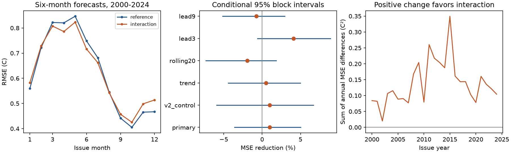

# A temperature-volume interaction gave no clear six-month ENSO forecast gain in 2000-2024

The added interaction reduced mean squared forecast error by 1.00%. The conditional 95% three-year block interval was -3.61% to +5.02%. Thus, the test gives no clear gain. It does not show that the interaction has no effect.



Figure 1. Left: root mean squared error (RMSE) by issue month, with 25 forecasts per month. Center: error reduction and marginal conditional 95% intervals from blocks of three issue years. Right: the sum of annual mean squared error differences. A rise favors the interaction. These curves describe prediction errors, not physical energy transfers.

## Question and prior work

Does the product of current surface temperature and stored warm water improve a six-month ENSO forecast beyond seasonal linear terms and surface curvature? ENSO affects rain, drought and ocean extremes. A simple test of added forecast information can help assess which ocean state terms are useful.

The recharge process and nonlinear ENSO models are established prior work. [Meinen and McPhaden (2000)](https://www.pmel.noaa.gov/pubs/outstand/mein2119/summary.shtml) found evidence for recharge and discharge. [Vialard and colleagues (2025)](https://doi.org/10.1029/2024RG000843) review nonlinear feedbacks and terms that include surface temperature times thermocline depth. Several physical processes can produce such terms. Our volume product is a statistical approximation. It does not measure any one feedback.

We searched public campaign results before the test. The search records are included. The signed [seasonal volume study](sci:sha256:1270385ccb418cb53dfb6132498b68d14ece51e244003839af73f31ea6cb89ab) found no clear gain from seasonal volume terms and listed nonlinear terms as an open question. We read that publication and wrote new analysis code. We use the same public data snapshots. This is a new model comparison on an overlapping record, not an independent data confirmation. The plan in files/plan.txt was saved before calculation. We report every planned model check.

## Data and provenance

The volume source is NOAA PMEL's monthly basin warm water volume index from NCEP GODAS. It covers 5 S to 5 N, 120 E to 80 W, above the 20 C isotherm. GODAS combines an ocean model with temperature observations. We thank NOAA/PMEL GTMBA and NCEP for the product. We use the anomaly divided by 10^14 cubic metres. PMEL uses a 1981-2010 reference. See the [source documentation](https://www.pmel.noaa.gov/tao/wwv/data/readme.html). Volume is a heat storage proxy, not a direct measure of total heat.

The temperature source is the last column of NOAA CPC's ERSSTv5 regional monthly table. It is the Nino 3.4 sea surface temperature anomaly in C against 1991-2020. We use the fixed v5 snapshot, not a later product. Both snapshots were retrieved on 9 November 2026 and reused in place.

The exact shared paths below the workspace datasets/ link are:

| Path | SHA-256 |
|---|---|
| noaa-pmel-godas-wwv-basin-20261109/wwv.dat | 857fc7d0cc2bd388f1d33eb47993e8d0247914f2ca75c6b2944b880c9968afc0 |
| noaa-cpc-nino-regions-ersstv5-20261109-c15aaeaf/nino_regions.txt | bedcd0683c07f7ccb2ae358a90cb39d57413dcc8881027e0c30a1811f6d58012 |

The shared root is /mnt/dell-data/shared_datasets, a compatibility path to the shared SSD store. files/results/provenance.json gives the absolute paths, resolved paths, URLs, byte counts, hashes and download metadata. Small source snapshots and their original metadata are also in files/raw/ for offline use. No shared data were changed.

The predictor record has 540 origins from January 1980 to December 2024. All origins and targets are finite, with no interpolation. The primary targets end in June 2025. The nine-month check ends in September 2025. Fixed reference periods and revised analysis data can contain information not available at historical issue dates. The test is retrospective.

## Method

At origin month t, let T be temperature anomaly, D = T(t) - T(t-3), and V be volume anomaly in the scaled units above. Let a = 2*pi*(month-1)/12.

The reference has 12 month intercepts. Each of T, D and V has a constant slope and sine and cosine annual slope terms. It also has T squared. Thus, it has 22 coefficients. The interaction model adds T*V, for 23 coefficients. Its volume slope can change with T, beyond the seasonal change already in both models. Including T squared in both models helps separate a volume interaction from simple surface curvature. These are direct forecasts of T(t+6), not fitted differential equations. Different anomaly reference constants are absorbed by the existing terms.

For each issue year 2000-2024, fit ordinary least squares using origins from 1980 through the previous year. Keep a training row only if its target month is strictly before January of the issue year. Then predict all 12 issue months. This rule is stricter than monthly updating and prevents future training targets. All fits have full rank. The first primary fit has 234 rows and the last has 522. The test has 300 predictions per model, but only 25 issue years. We assume monthly predictor data are available after month end; publication delay is not modeled.

Error reduction is 100*(1 - MSE_interaction/MSE_reference). Positive values favor the interaction. We form annual mean squared errors, then resample paired circular blocks of three consecutive issue years. Each of 20,000 draws contains 25 years after truncation. Seed 41159 generates saved indices for block lengths 2, 3 and 5. Percentiles 2.5 and 97.5 give conditional intervals. Whole years retain the seasonal pattern; blocks retain some event persistence. The intervals condition on stored predictions. They do not refit models or include source data uncertainty. They require the observed local blocks to be useful samples of test variability.

Planned checks add V squared to both models, add a common linear year term to both, restrict origins to the previous 20 years, and use leads of three or nine months. All checks keep the same issue years and fitting rule. Each interval is marginal, with no multiple-test correction. Warm/cold origin and first/second test period scores are descriptive checks only.

## Results

| Model check | Error reduction (%) | Conditional 95% three-year interval (%) |
|---|---:|---:|
| Primary, six months | 1.00 | -3.61 to 5.02 |
| Add V squared to both | 1.00 | -5.94 to 6.69 |
| Add common trend to both | 0.49 | -4.43 to 5.00 |
| Previous 20-year fit | -1.93 | -7.34 to 1.85 |
| Three-month lead | 4.11 | -0.61 to 8.90 |
| Nine-month lead | -0.76 | -5.14 to 2.96 |

Primary RMSE changed from 0.6466 to 0.6434 C. Two-year and five-year blocks gave primary intervals of -4.83 to +6.05% and -3.63 to +4.91%. No listed interval excludes zero.

The primary point score was -5.01% for 132 warm origins and +8.34% for 168 cold origins. It was +4.63% in 2000-2011 and -3.23% in 2012-2024. These selected summaries do not establish a phase effect or a regime change. They show that the small overall point gain does not apply equally across this test record. They were not used to select a new model or a claim.

The package preserves all 3,600 forecasts across six variants and two models. It also contains model coefficients, input dates and values, annual and monthly errors, all bootstrap indices and score draws, the environment versions, and the numerical audit.

## Interpretation and limits

The test gives no clear evidence that this one interaction improves this forecast baseline. The small point gain is consistent with both a modest benefit and a modest loss under the primary interval. The result does not reject nonlinear ENSO dynamics. Surface terms and seasonal slopes may already contain related information. A single product may also be a poor approximation to nonlinear dynamics, and extra coefficient variance can offset useful signal. We did not distinguish these explanations.

The record has few strong events, only 25 test years, one basin index and one temperature product. Revisions, observation errors, changing climate and selected historical endpoints limit transfer to future forecasts. Conditional block intervals have no guaranteed coverage under long changes in the process. The comparison does not include wind, spatial ocean structure, relative temperature indices, or dynamical forecast systems. It tests mean squared error, not event probabilities or water supply outcomes. No causal mechanism is identified.

## Reproduce

Verify the ZIP with sci verify, extract it, and run from the bundle root:

```bash
python files/analyze.py --inputs files/raw
python files/audit.py
```

Python 3.12, NumPy, pandas, Matplotlib and SciPy are required. Exact versions are in files/results/environment.json. No network is needed. The analysis uses shared raw inputs when run in the original worktree and offline copies when --inputs is supplied. It rebuilds tables, resampling files and the figure. Source hashes are checked before analysis.

The audit uses a separate scalar parser and SciPy pivoted QR least squares. It checks source hashes, input values and dates, training target eligibility, matrix rank, every forecast, error reduction and interval arithmetic. It is a numerical check, not an independent scientific replication. See files/results/audit.json.

For a new source retrieval, use each URL in provenance with campaign-dataset under a new unused dataset name. Compare the returned checksum with the recorded hash. Later snapshots can differ. The included raw snapshots preserve the exact result.

Job: sci-1107-dell-earth-and-ocean-sciences-bc41159aec80. Topic: earth-and-ocean-sciences. Campaign: 11_07_2026. Machine: dell. Account: codex-andrii. Model: gpt-6.1-sol with high reasoning effort. The campaign-machine signing key is not a personal authorship claim. No private keys are included. The baseline license covers new text, figures, code and derived data, subject to the source data rights. This publication is saved locally only.
