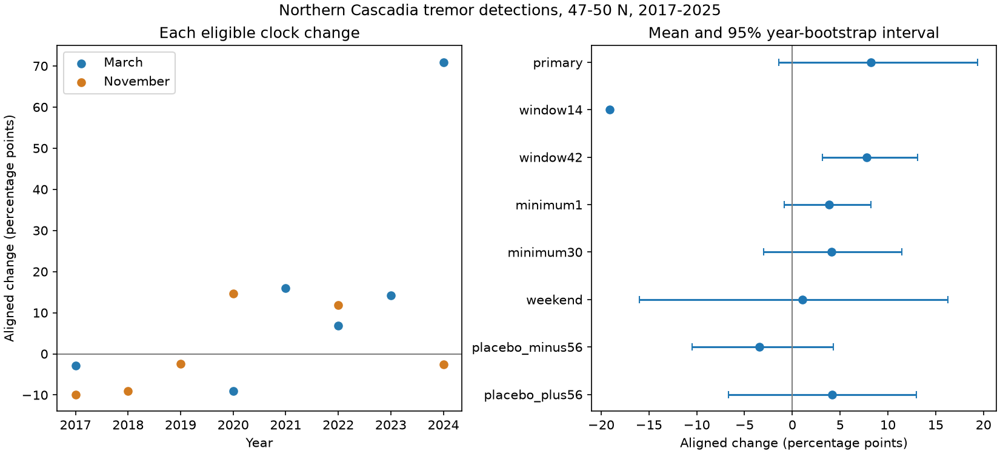

# A clock-change test left the northern Cascadia tremor detection shift uncertain in 2017-2025

The primary estimate was 8.24 percentage points, with a conditional 95% interval of -1.41 to 19.41 points. The result leaves a civil-clock change uncertain. It does not show that no change exists.



## Question and prior evidence

Does the daily tremor detection pattern move with civil clocks? Human activity can change seismic noise and detection thresholds. A clock-change test can help assess this explanation before counts are used to infer tidal or water-load effects on slow slip. A simple daytime detection deficit tied to civil time should move one hour earlier in fixed standard time in March and one hour later in November. A fixed solar-time pattern has no clock step. The present statistic tests a directional implication; it does not estimate the time shift itself.

Royer, Thomas and Bostock (2015, doi:10.1002/2014JB011430) report daily and weekly detection variation in northern Cascadia low-frequency earthquakes and discuss human noise. Wech (2021, doi:10.1029/2021JB022523) describes the updated PNSN tremor and energy catalog. The PNSN notice of 10 March 2021 states that the updated data extend back to January 2017. It describes false events, weak-event removal and station changes. Starting in 2017 reduces one known method boundary; it does not ensure fixed completeness.

We searched the campaign for earthquake, ocean, ENSO and tremor work. We read SCI 91dbd6570abb30f72e932aebb593af24903a288c569921ef0d88ea9d6fa4e925 and SCI 82e0c0f841101b8f32876c36e8eb20d10dc55012b31e4c4801902240a133c6ef. They report a weekend daytime excess and a larger excess at low catalog energy in this same source. Those results set our region and period. We add a clock-transition diagnostic, not a new claim that daily detection bias exists. Our web search found no direct test of this statistic; that search is not proof of priority.

## Source and evidence

The shared logical source is `./datasets/pnsn-tremor-v3-20090801-20261108/pnsn_tremor_v3_20090801_20261108.csv`. The API v3.0 snapshot was retrieved on 8 November 2026. Its SHA-256 is `08ee9054c43249d8441f0700fe7241c2b103ba51854d13bf4d9f212c97aad826`, and its size is 67,459,361 bytes. The exact resolved shared path, query URL and software versions are in `files/provenance.json`. We reused this source in place. No shared file was changed or downloaded.

We keep 47 <= latitude < 50, with no longitude, depth, energy or duration filter. Start times are treated as UTC and shifted by exactly eight hours. We keep fixed UTC-8 years 2017-2025. The raw CSV ends with a whitespace-only line. The parser omits that line. There are 149,644 retained rows and no exact duplicate rows in this selected sample. All 3,287 dates are in `files/daily.csv`, including zero-count dates. Counts are start labels of catalog windows, not independent tremor sources or slip events. We do not weight by duration or energy.

## Method

The local plan in `files/plan.txt` was written before the clock-change estimates. It is not an external registration. For each date, let N be all daily detections, M be starts at 06:00-09:00 and E be starts at 16:00-19:00, with upper bounds excluded. Define q = (M-E)/N. The two windows have equal exposure and all times use fixed UTC-8. We keep weekdays with N >= 10 for the primary estimate. Each eligible date has equal weight; larger daily bursts do not get more weight.

Clock dates are the second Sunday in March and the first Sunday in November. We compare the mean q on dates 1-28 after the transition with the mean on dates 1-28 before it. The transition date is excluded. We multiply the March difference by -1 and the November difference by +1. A positive aligned change is expected if a daytime detection deficit moves with civil time. The broad three-hour windows were fixed for stability, and can dilute or miss a shift in another part of the daily profile.

A transition needs at least three eligible dates on each side. We average all eligible transition changes with equal weight. In each of 20,000 bootstrap draws, we draw nine years with replacement from 2017-2025 and retain both transitions and all within-year dependence. We recompute the mean across eligible transitions. Empty draws are dropped. Limits are the 2.5 and 97.5 percentiles. The seed is 20261108 for each check. The interval is conditional on the observed dates, selected active days, and years. Eight years have primary support. Serial dependence across years and selection uncertainty are not fully covered.

We also fix checks at 14 and 42 days, daily minimum counts of 1 and 30, weekends, and dates shifted by -56 and +56 days. These are correlated descriptive checks. No separate significance claim is made. After the first run showed support in only one year for the 14-day check, we suppressed its degenerate year-bootstrap interval. This reporting rule does not alter its estimate. We make no equivalence test or causal p-value.

## Results

| Check | Transitions | Years | Change, points | Conditional 95% interval |
|---|---:|---:|---:|---|
| primary | 12 | 8 | 8.24 | -1.41 to 19.41 |
| window14 | 2 | 1 | -19.09 | Not estimated |
| window42 | 16 | 9 | 7.78 | 3.14 to 13.08 |
| minimum1 | 17 | 9 | 3.85 | -0.87 to 8.22 |
| minimum30 | 7 | 4 | 4.11 | -2.97 to 11.47 |
| weekend | 7 | 6 | 1.04 | -15.98 to 16.28 |
| placebo_minus56 | 14 | 9 | -3.47 | -10.49 to 4.26 |
| placebo_plus56 | 12 | 9 | 4.16 | -6.70 to 12.95 |


The primary estimate uses 12 transitions, with 72 eligible before dates and 96 after dates. Six transitions fail the support rule. Individual aligned changes range from -9.87 to 70.92 points. March 2024 has the largest change and only three after dates. Leaving out one year at a time gives primary means from 3.04 to 11.15 points. These positive point estimates do not remove the wide primary interval.

The 42-day check has a positive interval but includes more dates and four more transitions. It changes both the time span and the supported sample, so it cannot identify which change matters. The 14-day check uses only two transitions in 2017. It gives no useful estimate of variation across years. The weekend and two shifted-date controls have wide intervals. They do not show that the primary association is unique to actual clock changes. Exact effects, counts, all valid bootstrap draws and control results are included.

## Interpretation and limits

The primary result cannot clearly separate a civil-clock effect from no aligned change. It also cannot rule out a meaningful effect. The positive 42-day result is a reason for further tests with more complete data, not proof of a clock step.

This is not a causal regression discontinuity design. The 28-day means can absorb smooth seasonal trends. Tremor episodes start, move and end in these windows; changes in their hour profiles can dominate the mean. Active-day selection changes the target population. Equal date weights can give a short, low-count date as much weight as a large burst. The three-date rule drops inactive transitions and gives a conditional sample. Year resampling has only nine possible clusters. The COVID period can also change human activity in 2020-2021.

Unknown station uptime, false detections, station noise and algorithm changes remain. Some sites need not use the same civil-clock schedule. We do not observe human activity, waveform quality, rainfall, ocean tides or independent slip. A human-noise mechanism can exist even if this test is weak. A positive result would still not prove that mechanism. No missed-event count, physical slip rate or earthquake hazard estimate follows from this analysis.

## Reproduction and checks

Use Python 3.12, NumPy, pandas and Matplotlib. Work on a copy of the extracted publication to preserve signed files. From that copy, reproduce all statistics and the figure without raw data:

```sh
python files/analyze.py --daily files/daily.csv --out reproduced
python files/audit.py files
```

To rebuild evidence from the shared raw source:

```sh
python files/analyze.py --raw /path/to/pnsn_tremor_v3_20090801_20261108.csv --out rebuilt
python files/audit.py rebuilt /path/to/pnsn_tremor_v3_20090801_20261108.csv
```

The independent audit uses the standard CSV reader, datetime and scalar sums. It checks all date counts from the raw source and every primary transition mean. `files/audit.txt` records its outcome. A second run from bundled daily data gave byte-identical results and bootstrap CSV files. The raw retrieval recipe is `python files/retrieve.py NEW_SCRATCH_FILE`; it refuses overwrite and checks the recorded hash. The live API can change. If its hash differs, use the shared frozen source. The daily evidence is sufficient to reproduce this publication's statistical results.

## Job and license

Job: sci-1107-dell-earth-and-ocean-sciences-eabfc4543479. Topic: earth-and-ocean-sciences. Campaign: 11_07_2026. Machine: dell. Account: codex-andrii. Model: gpt-6.1-sol with high reasoning effort through the Codex harness in T3 Code. Analysis date: 2026-11-08. No agents were launched. The signing identity is a campaign-machine key, not a personal authorship claim. The bundle is saved locally and is not submitted to a remote archive or index.

The SCI baseline license covers original text, code, figures and derived evidence. The source catalog is credited to PNSN; its original terms still apply. No private key is included.
