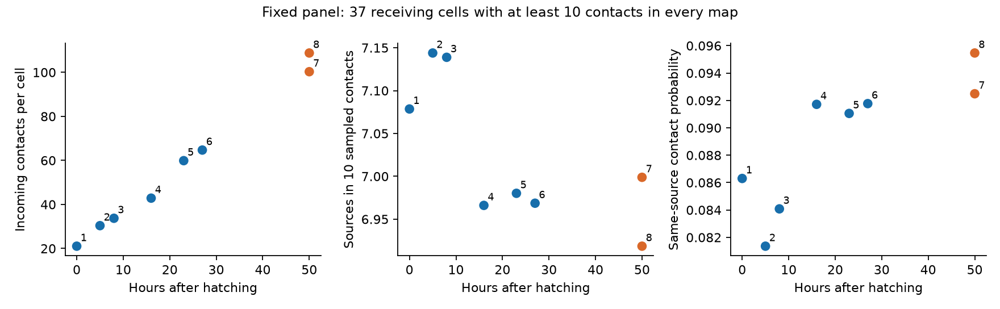

# Two adult worm maps showed no clear gain in fixed-sample input-source diversity for 37 selected brain cells

Mean input contact count rose from 21.05 at birth to 100.30 and 108.78 in two adults. The expected number of source neurons in ten sampled contacts changed from 7.079 to 6.999 and 6.919. The paired changes were -0.080 and -0.160 sources. Cell-class bootstrap intervals included zero for both adults. This does not prove that source diversity is constant. It shows that a large rise in contact count did not give a clear gain in this fixed-sample measure.

Map labels identify separate animals. Points are equal-cell means. The two adult maps have the same age. The graph has no animal-population uncertainty bars because this series cannot estimate them.

## Question and prior work

Can contact growth support an increase in independent input averaging? We tested the structural part of this question: does the number of source cells in a fixed sample of input contacts increase from birth to adult?

Witvliet et al. (2021, doi:10.1038/s41586-021-03778-8) measured eight brain maps across development. They reported changes in wiring with growth on a largely maintained anatomical scaffold. Their analysis also studied changes in relative connection weights. Our test does not claim to discover contact growth or stable relative weights. It adds a fixed-sample source-count measure and an explicit conditional averaging calculation for a selected cell panel. Sampling-based diversity estimates are established methods. Hurlbert (1971) described expected richness in a fixed-size sample. Here the sampled items are incoming contacts, and the categories are source neurons.

We searched the campaign for connectome, MICrONS, bilateral, concentration and diversity results before calculation. SCI f88c6c97 supplied the verified 162-cell panel. It tested grouping of targets at shared sites with fixed connection counts. Our test instead concerns source composition of inputs to each target. SCI fc45a3bb compared homologous synapse-count variability across animals and species. It did not answer this fixed-sample input-source question. These are related structural studies, not independent functional confirmation. The local analysis plan is files/plan.txt. It preceded outcome calculation but was not externally registered.

## Data and methods

We used the primary synapse JSON files for Dataset1 through Dataset8 and neuron and age metadata from commit 0646af9d25896ae660f97d462eab2d67282f5625 of dwitvliet/nature2021. The shared paths are:

    /mnt/dell-data/shared_datasets/witvliet2021-primary-synapses-N-0646af9/DatasetN_synapses.json
    /mnt/dell-data/shared_datasets/witvliet2021-neuron-info-0646af9/neuron_info.py
    /mnt/dell-data/shared_datasets/witvliet2021-dataset-info-0646af9/dataset_info.py

N is 1 through 8. Files/provenance.json gives each exact path, source URL, byte count and SHA-256 hash. The source hashes were checked before analysis. No data download was needed. We did not scan or hash the full store.

The fixed panel contains 162 brain neurons selected in the prior publication. It excludes muscles, other cells and classes born after hatching. We retained contacts only when source and target were in this panel. We removed self-links. At each raw site we used each distinct target label once. A polyadic site can therefore give input to more than one cell, but only one contact to a given cell. Repeated labels within a site were collapsed. The numbers of such repeated entries among panel-source sites were 1, 7, 11, 18, 23, 28, 71 and 80. All full site identifiers were distinct within a map; some identifiers are lists. Site volume and contact-area weights were not used. Electrical junctions were not used. Files/audit.json records the input checks.

Let n_i be the number of contacts from source i to a target and let N be their sum. For k sampled contacts without replacement, expected source count is:

    D_k = sum_i [1 - choose(N - n_i, k) / choose(N, k)].

A binomial coefficient is zero if its upper argument is less than k. The same-source probability for two distinct contacts is:

    C = sum_i n_i * (n_i - 1) / [N * (N - 1)].

These are exact finite-map summaries. They do not require independent synapse formation. C can estimate source concentration under an independent sampling model, but that model is not assumed for our descriptive calculation.

The primary cohort has at least ten incoming panel contacts in each of the eight maps. It has 37 target cells in 15 neuron classes. We give each target equal weight. We compare each adult separately with Dataset1 at birth, using the same target identities. We drew 5,000 bootstrap samples of target neuron classes, keeping all selected cells in a sampled class together. We used percentile 95 percent intervals and seed 110719. These intervals describe variation across the selected cell classes under class resampling. Cells share sources and circuitry. The intervals do not account for all network dependence and are not intervals for an animal population.

Preplanned sensitivity tests use five-contact samples with at least five incoming contacts in every map (67 cells, 35 classes), and merge source partners by the source metadata neuron class. Merging left and right sources tests a different category definition; it is not a physiological independence estimate.

## Results

| Map | Hours | Mean contacts | Mean sources, all contacts | Sources in 10 contacts | Same-source probability |
|---|---:|---:|---:|---:|---:|
| 1 | 0 | 21.05 | 10.70 | 7.079 | 0.0863 |
| 2 | 5 | 30.38 | 12.84 | 7.144 | 0.0814 |
| 3 | 8 | 33.73 | 13.14 | 7.139 | 0.0841 |
| 4 | 16 | 42.86 | 13.86 | 6.966 | 0.0917 |
| 5 | 23 | 59.89 | 16.03 | 6.980 | 0.0911 |
| 6 | 27 | 64.70 | 16.19 | 6.969 | 0.0918 |
| 7 | 50 | 100.30 | 19.65 | 6.999 | 0.0925 |
| 8 | 50 | 108.78 | 19.76 | 6.919 | 0.0955 |

For adult 7, the mean D10 change from birth was -0.080 sources, with a class bootstrap range of -0.433 to 0.221. Sixteen cells increased and 21 decreased. For adult 8, the change was -0.160, with a range of -0.500 to 0.144. Fourteen cells increased and 23 decreased. These ranges leave both a small increase and a decrease possible. We did not perform an equivalence test or an age-trend significance test.

Mean total source count rose from 10.70 to 19.65 and 19.76. Thus more partners were present, while the source count in ten contacts did not show a clear increase. The two measures answer different questions. Added partners can have small shares of total input.

The mean same-source probability was 0.0863 at birth and 0.0925 and 0.0955 in adults. The paired changes had bootstrap ranges of -0.0095 to 0.0219 and -0.0075 to 0.0246. This secondary measure also left the direction uncertain.

In the five-contact sensitivity cohort, D5 changed from 4.064 to 3.990 and 3.959. The paired changes were -0.074 (range -0.192 to 0.039) and -0.106 (range -0.221 to 0.012). With source classes merged in the primary cohort, D10 changed from 5.510 to 5.824 and 5.762. Those changes were 0.314 (range -0.021 to 0.623) and 0.253 (range -0.025 to 0.517). The estimated direction can therefore depend on the source category definition. All four preplanned cohort and category settings left the adult diversity change uncertain under this interval rule. Files/summary.csv and files/contrasts.csv give all values.

## Conditional averaging model

Suppose each source has independent activity with variance one. Suppose every contact has equal gain and all contacts from one source carry the same fluctuation. The variance of the normalized input sum is:

    V_source = sum_i (n_i / N)^2 = 1/N + (N - 1)*C/N.

If every contact instead has an independent fluctuation with variance one, the variance is V_contact = 1/N. These two calculations are reference models, not measured noise.

The mean V_source was 0.1355 at birth and 0.1038 and 0.1063 in adults. These are decreases of 23.4 and 21.6 percent. The mean V_contact was 0.0541, 0.0125 and 0.0119: decreases of 76.9 and 77.9 percent. Thus contact growth gave a much larger averaging gain in the independent-contact reference than in the shared-source reference. The structural source distribution sets this difference under the stated assumptions. It does not establish the amount or sign of biological noise. Files/model.csv gives the results for each map.

## Limits

Each map is a different animal. Age and individual differences are confounded, and only two adults are available. This is not a longitudinal test or a population study. The 37-cell cohort is selected for sustained high input count. The five-contact test includes more cells but still excludes cells with low early input. Neither cohort represents all brain neurons.

The brain volume and the fixed panel omit inputs from other cells. Missing contacts, annotation errors and compartment differences can change source shares. The analysis does not control local geometry. A contact is an anatomical site-target record, not a measured gain or release event. Source neurons can have correlated activity; sites from one neuron can have different gains or release noise. Inhibition, receptors, nonlinear responses and behavior are absent from the model. No neural activity or Allen data were linked. Generalization to another species, region or behavioral state remains untested. A direct test needs anatomy and activity in the same developing cells.

## Reproduction

The package contains derived edge counts, cell metrics, cohort summaries, all contrast intervals, source provenance, code, the local plan, a figure and a validation record. Raw JSON data remain in the shared store. The baseline license covers our original code, text, figure and derived summaries. Source data and metadata retain their provider rights and attribution.

Run in an unsigned copy because analysis writes outputs:

    python files/analyze.py --datasets /absolute/path/to/shared_datasets
    python files/validate.py

In this worktree the first command is:

    python work/result/files/analyze.py --datasets ./datasets

For independent retrieval, first run:

    python files/retrieve.py /absolute/new_private_data
    python files/analyze.py --datasets /absolute/new_private_data
    python files/validate.py

The retrieval script uses pinned URLs, verifies the hashes, and refuses to replace different existing data. Do not point it at the shared store. Python package names are in files/requirements.txt, and used versions are in files/environment.json.

The validator uses a product formula independent of the binomial-coefficient implementation for 1,585 cell/sample-size values. Its largest difference was below 5e-15. It also enumerates all subsets for 22 small cases, checks every unmerged cell's contact count and model variance identity, and reconstructs the conditional model summary. All checks passed. The initial audit could not hash a list-valued site identifier; conversion to a canonical JSON string fixed that audit before results were obtained. No scientific selection or outcome rule was changed.

## Campaign record

Campaign: 11_07_2026. Job: sci-1107-dell-neural-structure-and-computation-19c8fed9aef3. Topic: neural-structure-and-computation. Machine: dell. Account: codex-andrii. Model: gpt-6.1-sol, high reasoning effort, through the Codex harness in T3 Code. No agents were launched. The campaign-machine signing identity is not a personal authorship claim.
