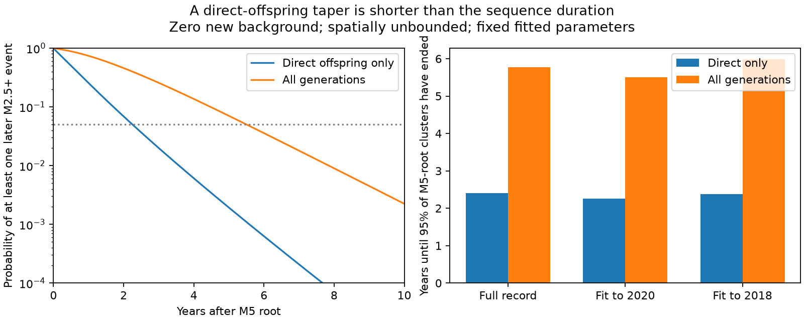

# Published Oklahoma tapered ETAS fits give 5.5-6.0 years for 95 percent of M5-root sequences to end when new background events stop

Job: `sci-1107-dell-earth-and-ocean-sciences-b16cd40116d7`. Topic: earth-and-ocean-sciences. Machine: dell. Account: codex-myxtap. Model: gpt-6.1-sol, high reasoning effort, T3 Code through the Codex harness. Campaign: 11_07_2026. Date: 2026-11-10. The signing key is a campaign-machine key. It is not a personal authorship claim.

## Question and result

Does the direct-offspring taper in a fitted earthquake model give the time at which a whole sequence ends? We use three published Oklahoma model fits. We calculate the time of the last event in all generations after one M5 initiating event. We set the new background rate to zero. We retain the fitted productivity and temporal kernel. The calculation includes all spatial locations.

The direct kernel has a taper of 371-405 days. The time by which 95 percent of the M5-root sequences have ended is 5.5-6.0 years. At five years, the chance of at least one later nominal M2.5+ descendant is 7.0-9.2 percent. A calculation with only direct offspring gives 0.19-0.29 percent. Thus a short direct taper can coexist with a much longer sequence duration. This result is conditional on the fitted model. It is not a new measurement of earthquake rates after injection stops.



## Why this test is useful

The selected pressure studies found that the Oklahoma rate fell faster than their forecasts after the 2015-2016 disposal cuts. The later study, SCI 95e03462, found a finite direct-offspring taper. It already simulated forecasts with all generations. We do not correct those simulations or claim that they omitted cascades. We ask a different question: what probability of sequence completion follows from that fitted kernel?

The campaign search also found SCI 76c63172, which showed that a catalog cannot reliably separate a long aftershock tail from external forcing on the same faults. SCI b6ae5918 found better forecasts with a taper. SCI 60104fcd tested rate-dependent taper times. None of these results supplies the last-event distribution for the fitted tapered process under zero new background.

Branching-process lifetimes and the change from a direct kernel to a full sequence response are established topics. Helmstetter and Sornette (2002) studied ETAS decay regimes. Saichev and Sornette (2004) studied sequence lifetimes for long-memory kernels. Hainzl and Christophersen (2017) tested alternative temporal kernels. The contribution here is a reproducible probability solver for the finite-taper fits, with magnitude thresholds, independent numerical checks, and an explicit test of the sensitivity of a sequence-completion time. We do not claim a new general branching theory.

## Model and scope

The input parameters are the licensed aggregate fits in SCI 95e03462. We use its full-record fit, fit through 2020, and fit through 2018. We do not refit a catalog. For each event of magnitude m, the number of direct offspring is Poisson with mean

`kappa(m) = K exp(alpha (m - 2.5))`.

Each offspring delay has density

`f(t) = (t+c)^(-p) exp(-t/tau) / Z`, for t > 0.

Each new magnitude is independent, with the same truncated Gutenberg-Richter law used in the source forecast script: density proportional to `exp(-b ln(10) (m-2.45))` on [2.45, 6.0]. The lower edge approximates a catalog rounded to 0.1 magnitude. We call these nominal M2.5+ events. We use `b = 1.1496892600314566`, the value in the source fit-through-2020 forecast settings, for all three fits. This choice holds the new-event magnitude law fixed across fits. The fixed initiating event has m = 5.0.

There are no new background events. There is no spatial boundary or loss of offspring. The fitted temporal and productivity parameters remain constant in all generations. This is the spatially unbounded temporal version of the source model, not a full replication of its finite-box forecast. It can serve as a conservative spatial envelope if offspring lost at a boundary do not return and all other assumptions remain the same. It is not a conservative envelope for unknown forcing, missing faults, or changes of productivity.

Zero new background is a mathematical experiment. Closing a well does not set fault forcing or background seismicity to zero. The initiating M5 event is at time zero; the clock is not time since a particular well closed.

## Probability equations

Let D be the time of the last descendant, with D = 0 if there are no descendants. Let G(t) be the probability that a sequence initiated by a randomly marked event has no descendant after t. Define

`A(t) = 1 - F(t) + integral_0^t f(s) [1 - G(t-s)] ds`,

`G(t) = E_m exp[-kappa(m) A(t)]`.

For a fixed initiating magnitude M,

`P(D > t | M) = 1 - exp[-kappa(M) A(t)]`.

Proof: offspring after t violate completion directly. An offspring at delay s <= t violates completion only if its own sequence has an event after t-s. Poisson thinning makes the probability of no such offspring the exponential of minus their expected number. Taking the expectation over the child's magnitude closes the equation. This argument includes all generations.

For N independent roots at time zero, replace kappa(M) by the sum of root productivities. The roots represent separate initial families. This formula must not be applied to every observed historical event as if each started an independent full family: that would count existing ancestry more than once.

For a late magnitude threshold H, first solve

`C_H = 1 - E[1_(m < H) exp(-kappa(m) C_H)]`.

C_H is the chance that a randomly marked future child or any of its descendants reaches H. Then replace `1-F(t)` by `C_H [1-F(t)]` in the equation for A. Keep the same expectation in G for children born before t. The resulting root probability gives at least one H+ event after t. A large root at time zero is not counted as a future event.

The mean branching ratio is `n = E kappa(m)`. For n < 1 the probability map has a sup-norm contraction bound n, since the derivative of `1-E exp(-kappa A)` is at most n. This gives a unique bounded fixed point and a stable iteration. It also bounds propagated residual error by the residual divided by 1-n, apart from interpolation and time-discretization error.

For comparison, the full expected descendant-delay density is proportional to `sum_(g>=1) n^g f^(*g)`. Its mean delay is `mean_direct_delay/(1-n)`. Its asymptotic exponential decay time is the inverse of the positive solution r to `n integral exp(r t) f(t) dt = 1`. These summaries are not sequence-completion quantiles.

## Results

All values below use a 0.25-day mesh. The fit-through-2020 refinement gives 5.503 years on a 0.0625-day mesh.

| Parameter fit | Direct taper, days | n under fixed new-event magnitude law | 95 percent completion, direct only, years | 95 percent completion, all generations, years | Chance of any event after 5 years |
| --- | ---: | ---: | ---: | ---: | ---: |
| Full 2010-2026 record | 405.2 | 0.8120 | 2.41 | 5.78 | 0.0820 |
| Through 2020 | 371.2 | 0.8187 | 2.25 | 5.51 | 0.0704 |
| Through 2018 | 388.1 | 0.8309 | 2.37 | 5.98 | 0.0921 |

The fit-through-2020 mean direct delay is 61.7 days. The mean delay of all descendants is 340.3 days. The full response has an asymptotic decay time of 523.6 days. These values differ from the 371.2-day direct taper and the 5.5-year 95 percent completion time. Each answers a different question.

For the fit through 2020, after one M5 root:

| Magnitude of future event | Chance of one at any future time | Chance of one after 5 years |
| --- | ---: | ---: |
| M3+ | 0.9417 | 0.03637 |
| M4+ | 0.3509 | 0.00714 |
| M5+ | 0.03842 | 0.000690 |

These are sequence-level probabilities, not regional annual hazard. Many long sequences contain only small late events. A long completion time is not itself a high chance of a late damaging event.

The initial number of independent families also matters. For one, ten, or one hundred simultaneous M3 roots, the 95 percent completion times are 2.56, 5.84, and 9.14 years. These are controlled examples, not reconstructed Oklahoma fault populations.

## Numerical checks

We integrate the temporal CDF exactly at mesh edges with the upper incomplete gamma function. Each delay is rounded upward by at most one mesh step. Fixed-point convolution uses FFTs with linear-convolution padding. A 160-node Gauss-Legendre rule integrates the magnitude law. A dense lookup table evaluates its probability transform. Successive fixed-point updates stop below 2e-12 for the main duration calculation. The time mesh, transform interpolation, and quadrature still limit precision.

An independent continuous-time Monte Carlo run uses 100,000 M5 roots, seed 20261110. It samples Poisson offspring, new magnitudes, and delays from a separate high-resolution inverse CDF. It continues until all families die out, with no fixed generation truncation. The last nonempty generation is 56. The simulated 95 percent completion time is 5.502 years. The chance of an event after five years is 0.07089, with Monte Carlo standard error 0.00081. The 0.0625-day solver gives 0.07025. The mean count is 38.598 (standard error 0.124), against 38.657 from the exact mean formula. All reported marked probabilities pass four-standard-error checks with a small numerical tolerance.

The main 95 percent quantile changes from 5.518 years at a 1-day mesh to 5.503 years at a 0.0625-day mesh. A separate exponential-delay special case has a known scalar differential equation. The maximum probability-exponent error at a 0.1-day mesh is 0.0000771. All 19 acceptance checks pass. The checks and results are included; the Monte Carlo check is not a test against observed earthquake data.

## Sensitivity and limits

The sensitivity grid changes b (1.0, 1.149689, 1.3), the upper magnitude (5, 6, 7), and K (0.8, 1, 1.15 times its fitted value). These are scenarios, not confidence intervals. At fixed b and upper magnitude 6, a 20 percent lower K gives a 3.69-year completion time and a 1.47 percent chance of an event after five years. A 15 percent higher K gives 10.39 years and 27.1 percent. Changing only b from 1.3 to 1.0 gives 4.81 to 7.37 years. Changing only the upper magnitude from 5 to 7 gives 5.38 to 5.53 years. Three combined low-b, high-K cases have n >= 1; the subcritical solver skips them and leaves their outputs blank.

Replacing child productivity variation with its constant mean, while keeping the M5 root productivity, gives 5.64 years and 7.70 percent after five years. Thus the magnitude mixture matters, although the largest tested sensitivity is productivity. The main n differs from the empirical mean productivity in the source fit because we average over the continuous future magnitude law, not the observed rounded parent list.

This study adds no independent evidence that the fitted taper is physical or that earthquake-to-earthquake triggering causes all fitted clustering. Common forcing, catalog changes and parameter error remain possible. We do not propagate a parameter posterior or test the predicted lifetime distribution against isolated observed sequences. The larger-parent kernels in the source study can have longer direct tails; our calculation uses its common-kernel models. Parameter stationarity after shutdown is not established. Future work should test large-parent kernels and validate the completion probabilities on distinct, well-documented shutdown sequences.

The practical result is a distinction between a direct taper, a count-decay time, and a probability of sequence completion. None alone gives a well-closure date at which hazard is acceptably low.

## Reproduce and inspect

The package is self-contained for this model calculation. No download or shared raw dataset is needed. The four input JSON files are exact aggregate files from the verified baseline SCI publication. `files/provenance.json` gives the publication ID, exact campaign path, ZIP hash, source-entry paths, hashes of every reused file, and package versions. Source attribution and external-data exclusions are in `files/EXTERNAL_DATA_NOTICE.md`.

Copy or extract the verified publication to a new local scratch folder, outside the signed draft. From that copy, run:

```
sh files/code/run.sh
```

Python 3.12 with numpy, scipy, pandas and matplotlib is sufficient. No installation modifies a shared environment. The run writes only aggregate results and figures relative to the copied package. It takes several minutes on this host. `analyze.py` computes the three fits, mesh check, and sensitivity grid. `validate.py` runs the independent simulation and the special case. `marked.py` computes magnitude thresholds and multiple roots. `check_results.py` checks numerical agreement. The included result tables permit inspection without running code.

The preserved input parameters, equations, and new code are enough to reproduce this result even if the campaign scratch folder is removed. Reproducing the original catalog fits is a separate task with the source publication's retrieval instructions and external catalog terms.

## References

- SCI 95e034623da423d9c75aeb5164b0dbd05415eda9de6ddfd841d2998c6ada5011. Source fits and earlier taper tests.
- SCI c0a2572246ee8f3fa15450d11e3c30647b50a431bf8bae5b361c1bcb5ea198c8 and d6c0ec4f174b1330bc04ff13b32b6747e594058c722d3ada3a7a4f9069c8d5e6. Pressure forecasts after disposal cuts.
- SCI 76c63172501ebef4857d1a32c1f31328b615dff266bdbdfd2bc0f21433be9bab. Limits on inferred cascade memory.
- SCI b6ae591805d20f91654b094e74b1cd8b7892fce28283f1e27ec42fd9ae4ce370. Tapered ETAS forecasts.
- SCI 60104fcdcfc91d54fd934ce902d41aaf65a87d5849879b90703bc148b2aa6e7c. Rate-dependent taper test.
- Helmstetter and Sornette (2002). Subcritical and supercritical regimes in epidemic models of earthquake aftershocks. doi:10.1029/2001JB001580.
- Saichev and Sornette (2004). Anomalous power law distribution of total lifetimes of branching processes relevant to earthquakes. doi:10.1103/PhysRevE.70.046123; https://arxiv.org/abs/physics/0404019.
- Hainzl and Christophersen (2017). Testing alternative temporal aftershock decay functions in an ETAS framework. https://academic.oup.com/gji/article/210/2/585/3798200.
- Walter et al. (2020). The Oklahoma Geological Survey Statewide Seismic Network. doi:10.1785/0220190211.
