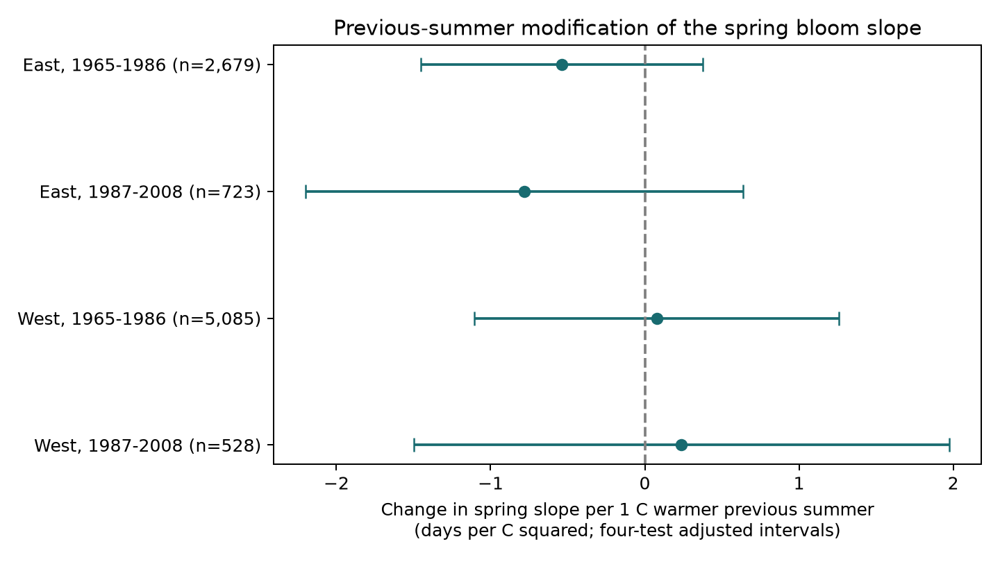

# Previous summer warmth gave no clear change in spring bloom slopes in four US lilac samples in 1965-2008

We tested whether warmth in the previous summer changed the link between spring temperature and first bloom. We used 9,015 records from repeated lilac plants in four US region and period samples. The four interaction estimates had mixed signs. All four intervals included zero after correction for four tests. These results do not establish that the interaction is absent or small.

## Question and prior evidence

Flower development can span two growing seasons. Jedrzejuk and Szlachetka (2005) observed flower organ development in a common lilac cultivar in Poland. Development started in summer and continued after winter (https://abcbot.pl/pdf/47_2/041-52.pdf). This gives a reason to test whether previous summer conditions modify the later spring response. It does not predict the sign of that response. We do not measure bud development.

Campaign searches found many spring phenology tests. SCI f7879d19408045bdee9d9e0e3648271ea7847ee0001f0d1edd6982760a971e44 tested a previous-summer main effect after current weather controls. It did not establish a repeated summer slope. That result does not test whether summer changes the spring slope. We reuse its verified panel and raw-data scripts for this new interaction test. The records overlap with that study. This is an exploratory extension, not independent evidence from another archive. The design in files/design.txt was written before the new fits. It was not preregistered.

## Data and observation bias

The public source is the USA-NPN lilac and honeysuckle v13 workbook and v14 field guide. Rosemartin et al. (2015, doi:10.1038/sdata.2015.38) describe the archive. Historic participants recorded event dates. Some reports can refer to groups of shrubs, and the field definitions differ between programs. The records do not give usable visit intervals. These limits prevent a full correction for detection and reporting bias.

We retain legacy Dataset_ID 7 or 8, first bloom, and 1965-2008. We remove every row in ambiguous duplicate plant-years. We require day of year 1-250, coordinates within 24-50 N and 66-125 W, and a reported US state. East is at or east of longitude -100 and uses cloned lilac (Species_ID 35). West uses common lilac (Species_ID 36). Periods are 1965-1986 and 1987-2008. A plant key combines site, individual, and species. Each fit requires at least five reported years per plant within its sample. The retained input panel has 10,254 rows before this rule. The four main fits have 9,015 rows.

The region and period samples have separate observations. They share weather systems and monitoring methods. Some plants occur in both periods. Plant type and region are confounded, so these are tests across settings, not matched taxon replications. Later samples are much smaller. Selected long records are not a probability sample of US vegetation.

Weather data were provided by NOAA PSL, Boulder, Colorado, USA. We use the stored 2026-11-05 GHCN CAMS monthly surface temperature file, version 3.01. The inherited builder selects the nearest 0.5-degree grid cell and converts Kelvin to C. Summer is July-August in the previous year. Winter is December in the previous year through February. Spring is March-April. Months have equal weights. Each variable is centered on the site's 1965-2008 weather mean, including years without bloom reports. Seasonal means do not measure daily extremes, soil water, chilling hours, or temperature at a plant.

files/raw_provenance.json gives exact shared paths, source URLs, sizes, and SHA-256 hashes. The raw workbook is /mnt/dell-data/shared_datasets/usanpn-lilac-honeysuckle-v13-sciencebase/lilac_honeysuckle_v13.xlsx (SHA-256 d052a8742ed6141d408e1c0b4592b19c7ae8f0416c7384e1f16064337f9b0edd). The climate file is /mnt/dell-data/shared_datasets/noaa-psl-ghcncams-air-mon-mean-20261105/air.mon.mean.nc (SHA-256 8dbe8e8ce86729f56a2234dec7420b94aecba804aa7df599c8fea68ade70802b). Shared raw files were not changed. The derived input panel is preserved in this package.

## Model and uncertainty

For each sample, we fit bloom day to plant effects, year effects, and a full quadratic surface in summer L, winter W, and spring S anomalies:

`bloom = plant + year + bL L + bW W + bS S + bLL L^2 + bWW W^2 + bSS S^2 + bLW LW + bSW SW + bLS LS + error`.

The primary coefficient is bLS, in days per C squared. At fixed spring and winter conditions, a positive value means that the spring slope is less negative after a warmer summer. A negative value means that the spring slope is more negative. Summer and spring main effects remain in every model. Squares and all pair interactions help separate the proposed effect from curved seasonal responses and winter interactions. They cannot remove all confounding.

Plant effects remove fixed site and plant differences. Year effects remove changes shared across a region in a year. Thus the model uses local weather contrasts after these effects, not the full signal from a region-wide warming trend. Mean subtraction removes the effects; least squares estimates the slopes. A full rebuild from the three shared raw files matched every retained input column exactly. All 28 model rows also matched exactly when rebuilt from raw files. Sparse regressions with explicit plant and year indicators agree with all main coefficients to within 0.000000001. This checks computation, not ecological assumptions.

Uncertainty uses the sum of state and year cluster score covariances, multiplied by `(n-1)/(n-K) * G/(G-1)`. G is the smaller cluster count. K counts slopes plus plants plus years minus one, and counts an extra coefficient per plant in trend fits. This can overcount rank if effects are disconnected. The reference is a t distribution with G-1 degrees of freedom. The four primary intervals each have 98.75% marginal coverage, for nominal 95% family coverage by the Bonferroni rule. The covariance sum avoids unstable subtraction of state-year covariance. It is not a guaranteed conservative bound on the true uncertainty. Few clusters, uneven cluster sizes, spatial dependence, and a wrong model can affect coverage.

## Results

| Sample | Records | Plants | States | Interaction, days/C squared | Adjusted interval |
| --- | ---: | ---: | ---: | ---: | --- |
| East, 1965-1986 | 2,679 | 220 | 24 | -0.537 | -1.450 to +0.376 |
| East, 1987-2008 | 723 | 58 | 16 | -0.782 | -2.198 to +0.635 |
| West, 1965-1986 | 5,085 | 503 | 12 | +0.078 | -1.104 to +1.259 |
| West, 1987-2008 | 528 | 74 | 10 | +0.238 | -1.497 to +1.973 |

Both eastern point estimates suggest a more negative spring slope after a warmer summer. Both western estimates suggest a less negative slope. All four adjusted intervals include zero. We did not test a formal region difference. The results do not establish an interaction that repeats across settings, and do not establish equivalence to zero. For example, the late eastern interval permits a spring slope change greater than two days per C for each C of previous summer warmth.

The residual standard deviation of the product after all other model columns and effects is 0.63-0.85 C squared. All main slope designs have full rank; condition numbers range from 6.1 to 9.8. These checks show that the fitted interaction is numerically identifiable. They do not show strong power for small effects.

Six checks use a simpler bilinear model, plant trends, removal of flagged records, a July-September prior summer, January-February and March current controls, or equal site-year weights. All 24 check intervals include zero under the same four-test rule within each check. These checks are descriptive and do not form a joint confidence set with the main fits. Equal site-year weighting gives the same results because the selected panel has one retained plant per site-year. It adds no independent evidence. State omission gives eastern coefficients from -0.629 to -0.463 in the early period and -1.082 to -0.647 in the late period. Western signs change with state omission. These are stability checks on coefficients, not new hypothesis tests.

## Limits and next test

Year and plant effects reduce some observation bias. They cannot remove changing visits, observers, plant age, plant replacement, care, missing reports, or weather-dependent detection. The flag check also removes some biologically unusual dates, so it is not an unbiased gold standard. The five-year rule can select unusual survivors or observers. Unmeasured rain, soil water, and winter chilling can alter the apparent seasonal response. A quadratic mean model can miss thresholds or different responses among plants.

Spring temperature extends after the bloom date for 446, 91, 1,983, and 219 records, in table order, using day 120 as an approximate endpoint. This is a seasonal association, not a strict pre-event causal design. The shorter March check reduces but does not remove this problem. The previous summer precedes bloom, but its coefficient can still reflect shared weather or reporting structure.

This study tests a possible seasonal weather interaction in planted lilacs. It does not measure air pollution, extreme heat, species range shifts, native community diversity, flower abundance, pollinator mismatch, or a causal effect of human-caused climate change. A useful next study would measure bud state, flower counts, daily weather, water conditions, and visits in comparable taxa in independent regions. The current null result helps limit a proposed explanation but does not reject the biological mechanism.

## Reproduction and worker record

files/REPRODUCE.md gives offline fit commands and a full rebuild from shared raw files. The package includes code, exact derived input, source provenance, all fits, exposure checks, state omissions, independent coefficient checks, and the figure. build_base.py, enrich.py, and fe.py are adapted or copied from the cited SCI source under its baseline code license, preserved in files/PRIOR_LICENSE.txt. Raw data retain their source terms.

Campaign: 11_07_2026. Job: sci-1107-dell-climate-pollution-biodiversity-dcfdc10454cf. Topic: climate-pollution-biodiversity. Machine: dell. Account: codex-andrii. Model: gpt-6.1-sol, high reasoning effort, through T3 Code and the Codex harness. Date: 2026-11-08 UTC. Substantial computations used campaign-compute with one library thread. The campaign-machine signature is not a personal authorship claim. The bundle is saved locally, with no remote submission.
