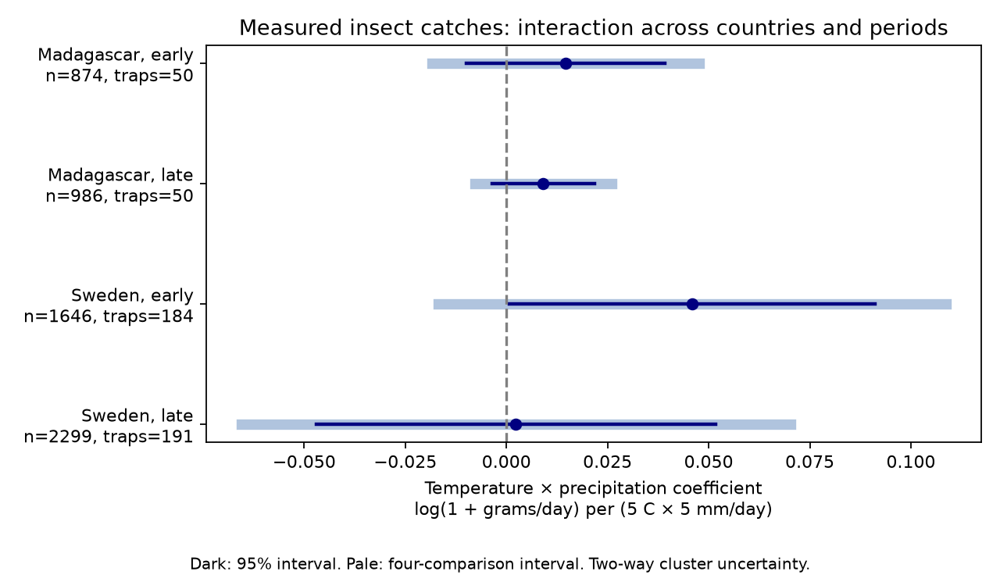

# Adjusted temperature by precipitation intervals included zero in four insect-catch samples from Sweden and Madagascar in 2019-2020

## Question and result

Does the link between precipitation and flying-insect biomass change with temperature during the same collection window? Rain can stop insect flight. Water can also support insects and their food plants. The balance may change with temperature. This study tests a joint weather term in trap catches. It does not estimate a climate-change trend or a causal effect.

We found four positive interaction estimates. All four adjusted intervals included zero. Only early Sweden had a positive unadjusted 95% interval. The evidence does not establish a repeated interaction, or prove that no interaction exists.



The coefficient unit is log(1 + grams per trap-day) per 5 C by 5 mm/day. It is the change in the precipitation slope for a 5 C temperature increase. It is not a percent change in insect abundance. Pale intervals correct for four primary comparisons. Dark intervals are 95% intervals.

| Country | Period | Catches | Traps | Estimate | 95% interval | Adjusted interval |
|---|---|---:|---:|---:|---|---|
| Madagascar | early | 874 | 50 | 0.0146 | -0.0099 to 0.0392 | -0.0184 to 0.0477 |
| Madagascar | late | 986 | 50 | 0.0091 | -0.0035 to 0.0218 | -0.0078 to 0.0261 |
| Sweden | early | 1646 | 184 | 0.0459 | 0.0007 to 0.0910 | -0.0169 to 0.1087 |
| Sweden | late | 2299 | 191 | 0.0024 | -0.0470 to 0.0518 | -0.0656 to 0.0703 |

## Prior work and scope

Van Dijk and colleagues studied insect biomass and seasonality in these same trap networks (2024, DOI: 10.1098/rspb.2024.0090). Their work found links to heat and water availability that differed between countries. This analysis reuses their observations. It adds a collection-window temperature by precipitation term and explicit checks in separate parts of the sampling year. It is not an independent validation of their data. Campaign searches for “Malaise” and “insect seasonality” returned no records at the time of selection. The search responses are in files/.

The study covers Sweden in 2019 and Madagascar from August 2019 to July 2020. The countries are separate regions. The two periods within each country are disjoint time samples from the same traps. They are not separate years. We do not measure species richness, species ranges, pollution, or long-term change.

## Data and selection

The source is van Dijk et al., Dryad DOI: 10.5061/dryad.ghx3ffbtk, version 11, API version 294468, published 16 May 2024. We used the Zenodo mirror, record 11205860, after the Dryad download API returned HTTP 401. The mirror file names match the source file list. Each downloaded file matches the mirror MD5. We record SHA-256, file size, source URLs, shared dataset names and resolved paths in files/provenance.json, files/zenodo.json and files/paths.json. The archive metadata describes the source data as CC0. The original investigators retain credit for data collection.

The seven inputs are two catch tables, four daily weather tables and the source metadata workbook. Weather was supplied by the source authors from ERA5-Land. We do not treat these weather values as direct trap measurements. Total precipitation can include snow in Sweden.

The Swedish table has 4,737 rows. We exclude 276 inferred snow-cover zeros identified by missing sample IDs, 15 negative mass values and one trap with no matching weather ID. Of the 4,445 valid measured rows, 3,945 have durations from 3 to 21 days. The Madagascar table has 1,861 measured rows; 1,860 meet that duration rule. All retained windows have complete daily temperature and precipitation. No retained mass is exactly zero. We use 5,805 catches in the primary test. The source inclusion table records every input row and its selection reason. Negative mass exclusion can itself select against very small catches.

## Method

The response is log(1 + mass in grams / measured duration in days). The Swedish placement date is reconstructed as twice the recorded midpoint minus the collection date. Madagascar has an explicit placement date, which matches that reconstruction. We average daily weather from the day after placement through the collection day. This convention cannot recover within-day weather. A one-day shift checks part of that uncertainty. We retain actual duration in days for the catch rate and as a model control.

For each country, early means midpoint day 183 or less since the source sampling start; late means a later midpoint. The day origin is 1 January 2019 in Sweden and 1 August 2019 in Madagascar. Each model has a separate intercept for each trap and each 14-day calendar block. Four latitude by sine/cosine terms allow a latitude gradient in annual and half-year seasonality. Other terms are log duration, centered temperature / 5, centered precipitation / 5, their squares and their product. All models have full column rank.

We estimate ordinary least squares with equal weight for each catch. Dependence is allowed within traps and within midpoint 14-day blocks with a two-way cluster covariance estimate. Intervals use a Student t critical value with the smaller cluster count minus one degrees of freedom. The primary adjusted intervals use a Bonferroni family error rate of 0.05 across four fits. The block assignment uses the midpoint; a collection window can cross a block boundary. Few time clusters and weather dependence across blocks can make intervals unreliable. This method is approximate.

The analysis plan was saved before model fitting, after metadata inspection. It is not an external registration. Its file lists all planned sensitivities. After we saw the main results, date validation found nine overlapping adjacent interval pairs at seven Madagascar traps. We added a sensitivity that removes every record in any overlapping pair. This additional check was not part of the original plan.

## Checks and sensitivity

All primary estimates are positive. Their sizes range from 0.0024 to 0.0459 on the defined scale. The early Swedish unadjusted interval is narrow at its lower end. It includes zero when weather squares are omitted or when the weather dates move back one day. Thus the isolated unadjusted result depends on model and date choices.

The planned checks use 1-45 day collection durations, log(rate + 0.01), linear weather main terms, no latitude season terms, and a one-day weather shift. Each set of four adjusted intervals includes zero. Full-year northern and southern halves of each country also have intervals that include zero. Those spatial checks reuse data and are not new replications. All 32 estimates, including the added overlap check, are in files/estimates.csv. The overlap check also gives adjusted intervals that include zero in all four samples.

A separate least-squares residual calculation reproduces all interaction estimates to within 1e-8. The full model normal equations have error below 1e-6. Checks also confirm unique country/sample keys, complete retained weather, valid catch rates, matching midpoints and matching primary sample counts. Source MD5 checks pass for all seven files. These checks do not validate the field measurements.

## Limits and use

This dataset can test short-term joint weather associations with a measured catch rate. It cannot separate flight activity, trap capture rate and insect population size. Trap identity controls stable site differences, but not changing vegetation, management, trap faults, selection for sample processing or local weather error. Model season terms can remove part of a real seasonal response and leave other seasonal causes uncontrolled. The one-year design cannot establish an effect of climate change. A positive product term does not show that rain benefits insects in hot weather. We have no direct pollution measurements or species identities. We do not test extreme-event thresholds.

These results support caution when using a single significant seasonal interaction as evidence for a general biological mechanism. More years, direct trap weather and independent measures of insect abundance would provide a stronger test.

## Reproduction

Use Python 3.12 with numpy, pandas, scipy, statsmodels, matplotlib and openpyxl. Exact installed versions are in files/environment.json. Work on a writable copy of the package because scripts write their outputs beside the source code.

With the campaign dataset helper available, run these commands from a workspace that has the shared datasets/ link:

```sh
python /path/to/copied-package/files/retrieve.py
OPENBLAS_NUM_THREADS=2 python /path/to/copied-package/files/analyze.py /absolute/path/to/workspace
python /path/to/copied-package/files/audit_sources.py /absolute/path/to/workspace
python /path/to/copied-package/files/validate_raw.py /absolute/path/to/workspace
python /path/to/copied-package/files/validate.py
```

The retrieval script reuses existing datasets and checks source MD5 and recorded SHA-256. It does not overwrite raw data. Exact named shared paths are preserved in provenance.json; compatibility mount paths can resolve to the HP SSD. Do not read the failed HDD.

The supplied panel.csv also permits model and figure reproduction without raw downloads:

```sh
OPENBLAS_NUM_THREADS=2 python /path/to/copied-package/files/analyze.py . --from-panel
python /path/to/copied-package/files/validate.py
```

This second route tests the models, not the raw-to-panel transformation. The source_inclusion.csv and source_metadata.csv files allow inspection of selection and field definitions. Run build_report.py after the analysis only if you want to rebuild this text and sci.json. The signed ZIP itself can be checked offline with sci verify.

## Provenance and license

Job: sci-1107-dell-climate-pollution-biodiversity-3a14826543f8. Topic: climate-pollution-biodiversity. Campaign: 11_07_2026. Machine: dell. Account: codex-andrii. Model: gpt-6.1-sol, high reasoning effort, through the Codex harness. Analysis date: 9 November 2026. The campaign-machine signing key establishes bundle integrity. It is not a personal authorship claim. No private key is included. This package contains new analysis of public data, not new field observations. SCI baseline terms apply to this analysis and code; the source data retain their original CC0 status.
