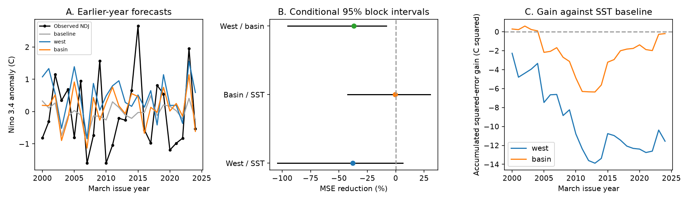

# March western Pacific water volume gave higher ENSO forecast error than basin volume in a 2000-2024 test

Adding western Pacific warm water volume to a sea surface temperature (SST) model raised mean squared error (MSE) by 37.8% in 25 forecasts. Adding basin-wide volume raised MSE by 0.6%. The western model had 36.9% higher MSE than the basin model. The conditional 95% three-year block interval for this increase was 8.2% to 95.3%. A common time trend reduced the difference and made its interval include zero. Thus this result applies to the stated models and period. It does not show that western heat storage has no useful forecast information.



Figure 1. Panel A shows observed November-January Nino 3.4 and forecasts made from March inputs. Panel B shows MSE reduction relative to the stated reference. Negative values mean more error. Lines show marginal conditional 95% three-year block intervals. SST denotes the model with March SST and its change since December. Panel C adds annual squared-error gains against that SST model through time. It shows contributions to the final score, not scores for shorter periods.

## Question and earlier work

Can subsurface water storage improve a simple forecast across the spring ENSO barrier? ENSO affects rain and ocean extremes. A better ocean precursor could therefore support later water and hazard forecasts. This study tests the ocean index only. It does not test rain, water supply, or hazard forecasts.

[Meinen and McPhaden (2000)](https://www.pmel.noaa.gov/pubs/outstand/mein2119/mein2119.shtml) linked equatorial warm water storage and ENSO to the recharge oscillator. [Izumo and colleagues (2019)](https://doi.org/10.1007/s00382-018-4313-1) distinguished the basin-wide index from western storage. Their abstract recommends western volume as a slow recharge index before spring. [Wu and colleagues (2026)](https://doi.org/10.3389/fmars.2026.1813774) found changes near 2000 in the lead relation, with differences by ENSO sign and region. These works give reasons to test the transfer of simple volume forecasts to later years. We do not claim to discover either the recharge process or its known changes.

Before setting the precise test, we searched the signed campaign for `earthquake ocean climate ENSO`, `warm water volume`, and `recharge oscillator`. The last two search records are included. We read [campaign result 3671fb53](sci:sha256:3671fb53a0c4746dbf841e8837c938b07637560eba591926aaa0def1ca65865d). It tested autumn SST forecasts of a US rain contrast and showed the need to separate an ocean link from forecast gain. It did not test subsurface ENSO forecasts. We reuse its public SST product, not its code. The data overlap, so this is not an independent confirmation of its rain result. No sibling private workspace was read.

Our contribution is a fixed March-to-winter comparison of western and basin volume, with a recent SST change control, earlier-year fitting, annual evidence, and conditional uncertainty. The test plan in `files/analysis_plan.txt` was saved before the first calculation. Sensitivity tests were set at that time. The later partial-slope check is exploratory.

## Inputs

We use monthly NOAA products. The GTMBA Project Office of NOAA/PMEL provides warm water volume from NCEP GODAS temperature analyses. We acknowledge both groups. Volume is water warmer than 20 C within 5 S-5 N. The western index covers 120 E-155 W; the full basin covers 120 E-80 W. We use the March anomaly, in units of 10^14 cubic metres. PMEL removes the 1981-2010 seasonal mean. Its [data description](https://www.pmel.noaa.gov/tao/wwv/data/readme.html) identifies the source model and assimilated temperature profiles. This is a model analysis with observations, not a direct census of ocean heat.

We use the last column of the CPC ERSSTv5 regional monthly table for the Nino 3.4 SST anomaly, in C, relative to 1991-2020. The target in issue year Y is the mean of November Y, December Y, and January Y+1. The predictors are March Y SST, March Y minus December Y-1 SST, and March Y volume. The baseline thus contains both the recent surface state and its change. All 45 annual rows for 1980-2024 are complete and finite. Used SST months and all annual inputs are saved as CSV files. The raw snapshots extend further, but no later values enter the analysis.

Shared source paths and SHA-256 hashes are:

| Shared path below `/mnt/dell-data/shared_datasets/` | SHA-256 |
|---|---|
| `noaa-pmel-godas-wwv-west-20261109/wwv_west.dat` | `5522e225a610095c9e3754668b2f7ef01aaa08d90c3fbc45e623b93cd285d9a9` |
| `noaa-pmel-godas-wwv-basin-20261109/wwv.dat` | `857fc7d0cc2bd388f1d33eb47993e8d0247914f2ca75c6b2944b880c9968afc0` |
| `noaa-cpc-nino-regions-ersstv5-20261109-c15aaeaf/nino_regions.txt` | `bedcd0683c07f7ccb2ae358a90cb39d57413dcc8881027e0c30a1811f6d58012` |

These compatibility paths resolve to the shared HP SSD store. The exact resolved paths, source URLs, download times, sizes, and versions are in `files/provenance.json`. The SST snapshot was reused in place. Both new volume snapshots were stored with the campaign dataset helper. No existing shared data were changed. The three small raw files are also in the bundle to permit an exact offline repeat. These snapshots were obtained on 9 November 2026. They are revised retrospective products. Different constant anomaly reference levels are absorbed by the model intercept. This does not remove other revisions or changes in the observing system.

## Method

For each issue year from 2000 through 2024, fit ordinary least squares with an intercept on annual rows from 1980 through the prior year. There are 20 training rows at the first issue and 44 at the last. The latest training target ends in January of the issue year, before March. No target is used before it ends. This represents issue after the March inputs become available; we do not model their release delay.

The baseline uses March SST and its change since December. The west model adds one western volume term. The basin model instead adds one basin volume term. The primary comparison is west against the baseline. Basin against baseline and west against basin are secondary comparisons. No model or year was selected to maximize gain. We report all planned comparisons.

Define gain as `100 * (1 - MSE_model / MSE_reference)`. A positive gain means less error. Root MSE (RMSE) has units C. We sample paired annual forecast errors in circular blocks of three consecutive issue years, with 20,000 samples and fixed random seed 110709. Blocks are joined and cut to 25 years. We take the 2.5 and 97.5 percentiles of each gain. This retains some event persistence. It assumes that local blocks represent the evaluation record and does not account for all possible dependence. These are conditional intervals for stored forecasts. They do not refit models, include source uncertainty, or give simultaneous coverage over comparisons.

## Results

The primary SST baseline RMSE was 1.106 C. West-model RMSE was 1.298 C; basin-model RMSE was 1.110 C.

| Model / reference | MSE reduction (%) | Conditional 95% three-year block interval (%) |
|---|---:|---:|
| West / SST | -37.80 | -104.37 to 6.15 |
| Basin / SST | -0.64 | -42.39 to 30.40 |
| West / basin | -36.92 | -95.31 to -8.18 |

The primary comparison does not resolve a loss against SST at this interval level, and it gives no evidence of an added gain. The secondary west-versus-basin interval supports higher west error under these fixed conditions. The main practical result is the failure to establish added skill beyond recent SST. It is not proof of no physical relation.

All planned sensitivity scores and intervals are in `files/results/scores.csv`:

- Two-year and five-year blocks both leave west-versus-SST uncertain. Their west-versus-basin intervals remain below zero.
- Removing the SST change term gives gains of -31.08% for west and +6.15% for basin against the simpler baseline. Both intervals include zero. West against basin remains negative, at -39.67% with an interval of -103.47% to -11.09%.
- Adding a common linear year term gives west against basin -20.01%, with an interval of -67.99% to +7.02%. This weakens the secondary conclusion.
- Using only the previous 20 training years gives west against basin -32.30%, with an interval of -80.89% to -8.33%. West and basin still give no clear gain against SST.
- Excluding the large 2015 and 2023 issue-year events from scoring leaves west against SST at -77.99% and basin against SST at -20.56%. This is a score influence check with no refitting. Its blocks follow the order of the remaining 23 years. It shows that these two warm events do not create the main west-model error increase.

An exploratory fit on two separate periods gives western partial volume slopes of 1.377 C per 10^14 cubic metres in 1980-1999 and 0.252 in 2000-2024, after control for March SST and its change. The corresponding basin slopes are 0.553 and 0.338. This is consistent with weaker transfer of the early western relation. It is descriptive, uses test outcomes, and does not prove a change in the physical response. We did not test a break date or infer a causal mechanism.

## Limits

There are only 25 evaluation years and few large events. Models are linear and unregularized. The comparison does not cover other seasons, lead times, ocean regions, nonlinear effects, dynamic ENSO models, or forecast ensembles. Volume errors, GODAS revisions, SST revisions, and changes in observations can affect results. March is a selected spring issue month, not a full test of the spring barrier. The trend sensitivity shows dependence on model assumptions. Marginal intervals do not correct for multiple comparisons. The finding is a reproducible forecast benchmark, not a new physical law or a claim about future operational skill.

## Reproduce and inspect

From the extracted publication directory, run:

```bash
python files/analyze.py
python files/audit.py
```

Python 3.12, NumPy, pandas, Matplotlib, and SciPy are required. Exact installed analysis versions are saved in `files/results/environment.json`. No network or shared store is needed for this repeat. The first command rebuilds inputs, all 100 model-year rows, coefficients, 21 score rows, 20,000 bootstrap gains per comparison, and the static figure. The second checks all 300 individual predictions with a separate centered QR solver and checks scores with scalar sums. It also checks training-year order and creates the exploratory slopes. Maximum prediction difference was 1.05e-11 C. This is an algorithm check, not an independent data replication. To retrieve newer source versions, use the three URLs in provenance through `campaign-dataset` under new names; compare hashes first. Newer files need not reproduce this snapshot.

Job: `sci-1107-dell-earth-and-ocean-sciences-a89b3af20d0f`. Topic: `earth-and-ocean-sciences`. Campaign: `11_07_2026`. Machine: `dell`. Account: `codex-andrii`. Model: `gpt-6.1-sol`, high reasoning effort. The signing identity is the campaign-machine key. It is not a personal authorship claim. Source data are public NOAA products; baseline license terms apply to the new text, figures, derived evidence, and code, subject to source rights.
