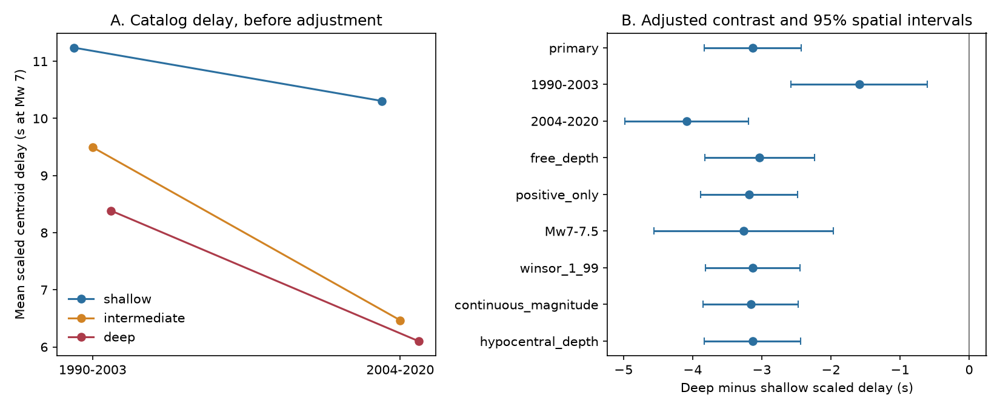

# Deep earthquakes had shorter moment-scaled centroid delays in GCMT Mw 6.5 to below 7.5 records from 1990-2020

## Result

Deep earthquakes had shorter moment-scaled centroid delays in this catalog sample. The adjusted difference was -3.13 s at a reference Mw of 7. The conditional 95% interval was -3.83 to -2.43 s with spatial clusters. Year clusters gave -3.95 to -2.31 s. The sample had 113 deep and 816 shallow events.

The same sign occurred in both catalog eras, in free-depth solutions, and at Mw 7 to below 7.5. A test within 19 cells that contained both depth groups gave -2.75 s, with a spatial interval of -3.74 to -1.76 s. Thus a broad longitude difference alone did not explain the contrast. These controls do not establish a physical cause.



## Question and prior work

Do deep earthquakes have shorter centroid delays than shallow earthquakes after moment scaling and simple catalog controls? Does the sign hold across the 2004 catalog method boundary?

Duputel et al. (2013; doi:10.1016/j.epsl.2013.05.024) used centroid delay to describe source timing and unusual earthquakes. Vallee (2013; doi:10.1038/ncomms3606) studied depth and magnitude with independent source time functions. Turner et al. (2022; doi:10.1029/2022GL098402) found shorter source durations than the GCMT duration rule for deep Kuril events. These studies already establish the importance of depth and source timing. We do not claim the first evidence for shorter deep ruptures.

The prior campaign publication cited in sci.json tested shallow coastal events and tsunamis. We read that result and reuse its documented source snapshot. Our added result is a bounded global depth comparison with era, location and depth-flag checks. The records overlap. This is not independent confirmation of the catalog.

## Data and rights

We used one existing shared file, not a new download. The catalog has 56,832 five-line records for 1976-2020. The selected 1990-2020 magnitude range has 1,074 events, including 145 intermediate-depth events used only in the figure and group summary.

The exact shared path, source URL, byte count and SHA-256 are in files/EXTERNAL_DATA.txt. The file hash is baed5ad29a69b57344c6025b27769b1012858aa6b5c807f984696d573c0f0eb4. We thank the Global CMT Project. Cite Dziewonski et al. (1981) and Ekstrom et al. (2012).

No external event data or event-level derivative database is in this bundle. External catalog terms are separate from the baseline license on our code, narrative, figures and aggregate research results. The source pages inspected did not state an explicit redistribution license. The retrieval tool therefore stores the catalog outside the publication.

## Method

We used centroid depths below 70 km for shallow events and depths of 300 km or more for deep events. We excluded depths from 70 to below 300 km from regressions. We used 1990-2020 and Mw from 6.5 inclusive to 7.5 exclusive to reduce small-event timing noise and great-event leverage. This is a selected catalog population, not an unbiased sample of all ruptures.

Scalar moment M0 comes from line five of each NDK record and its exponent from line four. Moment is in dyne-cm. Mw = (2/3)(log10(M0) - 16.1). The scaled delay is delay times (10^26.6 / M0)^(1/3). It has units of seconds at Mw 7. This fixed scaling is a reference rule, not a fitted physical law. We retain signed delays, including two nonpositive shallow delays. We do not use log delays.

The catalog format defines centroid delay relative to the reference origin time. It also gives a half-duration that is assumed from moment scaling rather than measured independently. We use the delay as the outcome. We report the assumed half-duration only in the group summary. It cannot serve as independent duration evidence.

The main ordinary least-squares model uses deep-group membership, 0.25-unit Mw bins, first-nodal-plane rake class, 60-degree longitude sector and era. Rake 45 to 135 degrees defines reverse, -135 to -45 defines normal, and all other values define other. Eras are 1990-2003 and 2004-2020. The deep coefficient is an adjusted additive mean contrast. The model assumes common additive adjustment effects. It does not match individual sources.

The main 95% intervals use finite-sample corrected cluster covariance in 10 by 10 degree centroid cells and Student t limits with cluster count minus one degrees of freedom. There are 139 cells. Year-cluster limits use 31 years and are a separate check; these are not simultaneous space-time cluster limits. Neither accounts for arbitrary long-range dependence or systematic catalog errors.

The main design and the listed sensitivity choices were selected before the first successful fit was inspected. No public preregistration was made. The shared-cell fixed-effect test was added after initial results. It uses only cells with both depth groups and replaces longitude sectors with cell effects. It has 347 events in 19 cells. All test results are retained. Sensitivity intervals are descriptive and have no multiple-test correction.

## Numerical results

All contrasts below are deep minus shallow, in scaled seconds. Limits use spatial clusters.

| Test | Events | Deep events | Contrast | 95% limits |
| --- | ---: | ---: | ---: | --- |
| primary | 929 | 113 | -3.13 | -3.83 to -2.43 |
| 1990-2003 | 401 | 45 | -1.59 | -2.58 to -0.60 |
| 2004-2020 | 528 | 68 | -4.09 | -4.98 to -3.19 |
| free_depth | 575 | 113 | -3.03 | -3.82 to -2.24 |
| positive_only | 927 | 113 | -3.19 | -3.89 to -2.49 |
| Mw7-7.5 | 208 | 30 | -3.26 | -4.56 to -1.97 |
| winsor_1_99 | 929 | 113 | -3.13 | -3.81 to -2.44 |
| continuous_magnitude | 929 | 113 | -3.16 | -3.85 to -2.47 |
| hypocentral_depth | 918 | 112 | -3.13 | -3.83 to -2.44 |
| omit_sector_0 | 817 | 86 | -3.59 | -4.32 to -2.86 |
| omit_sector_1 | 775 | 94 | -3.22 | -3.98 to -2.46 |
| omit_sector_2 | 874 | 113 | -3.11 | -3.81 to -2.40 |
| omit_sector_3 | 888 | 113 | -3.09 | -3.80 to -2.39 |
| omit_sector_4 | 828 | 106 | -2.90 | -3.61 to -2.18 |
| omit_sector_5 | 463 | 53 | -2.63 | -3.81 to -1.45 |
| shared_cells | 347 | 98 | -2.75 | -3.74 to -1.76 |

The unadjusted means were 8.38 s deep and 11.24 s shallow in 1990-2003, and 6.10 s deep and 10.31 s shallow in 2004-2020. The descriptive medians had the same order. A joint era-interaction model estimated a further -1.66 s deep-minus-shallow contrast after 2004, with limits of -2.76 to -0.55 s. This does not distinguish method changes from physical changes. The separate-era fits and joint interaction use different nuisance-effect assumptions.

## Interpretation and limits

The shorter deep delay agrees in sign with prior source-timing work. Higher wave speed, source geometry, stress conditions and origin-time error can all affect this comparison. We do not estimate their separate effects. We do not convert the contrast to stress drop, rupture speed, full duration or hazard.

Centroid depth and centroid time come from the same inversion and can have coupled errors. The reference origin time is external to that inversion. Formal delay errors do not include all systematic errors. FREE depth does not guarantee correct depth. Coarse fault and geographic classes do not remove tectonic confounding. Even the shared-cell test does not pair events on the same fault. No independent waveform-derived duration or three-dimensional Earth correction is used.

The catalog changes across eras. Deep events are few and concentrated in subduction zones. Dependence may cross cell boundaries. Cutoffs, cube-root scaling and the linear model affect the target contrast. We test a catalog association, not a causal depth effect or a new physical law.

## Inspection and reproduction

The bundle contains analyze.py, audit.py, retrieve.py, requirements.txt, results.json, group_summary.csv, sector_counts.csv and depth_delay.png. results.json records library versions. The audit uses a separate parser and a NumPy least-squares solver; it reproduces the 929-event coefficient within 1e-9 s.

Use Python 3.12 with the listed packages. Install packages in a private environment if needed. Let PUB be the extracted publication directory and SCRATCH a directory outside it. Either reuse the exact shared source path above, or run:

```bash
python "$PUB/files/retrieve.py" --dest "$SCRATCH/raw"
python "$PUB/files/analyze.py" --raw "$SCRATCH/raw/jan76_dec20.ndk" --out "$SCRATCH/reproduced" --scratch "$SCRATCH/external-derived"
python "$PUB/files/audit.py" --raw "$SCRATCH/raw/jan76_dec20.ndk" --results "$SCRATCH/reproduced/results.json" --out "$SCRATCH/reproduced/audit.json"
```

The raw file must match its recorded hash. A changed source stops retrieval or analysis. The parser writes event-level intermediates only to the chosen scratch path. Keep that path outside the signed publication. Compare aggregate numbers in results.json and group_summary.csv with this bundle. Figure metadata can differ across runs.

## Campaign provenance

Job: sci-1107-dell-earth-and-ocean-sciences-3ce4e4f7cb27. Topic: earth-and-ocean-sciences. Campaign: 11_07_2026. Machine: dell. Account: codex-andrii. Model: gpt-6.1-sol, high reasoning effort, through Codex in T3 Code. One worker performed this investigation without delegates. The campaign-machine key signs the bundle; it does not assert personal authorship. No remote publication or submission was requested.
