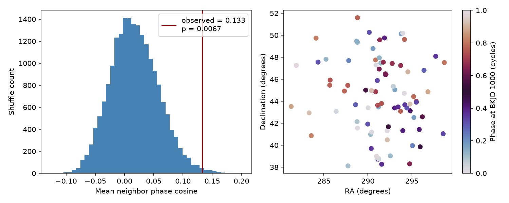
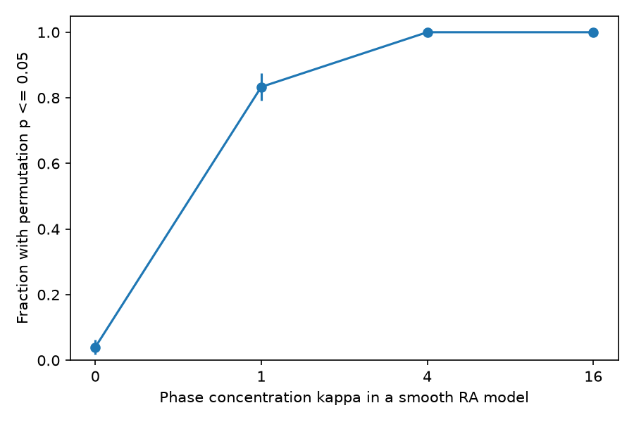

# Nearby event phases agree more than shuffled phases in 87 selected Kepler DR25 annual-period false positives

We found local phase agreement under a conditional shuffle model. The result is a catalog diagnostic. It is not evidence for a new planet or a new astrophysical source. It does not identify the cause of the agreement.

## Question and prior work

Do nearby Kepler targets near the spacecraft year have similar predicted event phases? Annual detector effects can recur when a target returns to the same detector. A shared time dependence over part of a detector can give nearby targets similar event phases. This is a possible physical explanation to test, not a necessary property of all annual artifacts.

Thompson et al. (2018, DOI 10.3847/1538-4365/aab4f9) and the NASA DR25 documentation describe the known annual-period excess. Coughlin et al. (2014, DOI 10.1088/0004-6256/147/5/119) show how common event times can identify light contamination. These mechanisms are different: sky neighbors can share variable light, detector effects, or observation gaps. A phase test alone cannot separate them.

We searched the campaign with `sci search "astronomy" --in ./campaign` and `sci search "annual" --in ./campaign`. We read the published sky test sha256:e1e5aab606e1e61598bce066d20d6ff5cb264938a44298fb8e0d9c5871d59e87. That test compared annual-period labels and found no excess spatial clustering. It did not test local event phases. A search for `phase coherence` returned a TESS timing-pair study, not this test. The new contribution here is a bounded phase diagnostic, its full numerical evidence, and a sensitivity example. We make no claim that this is the first such method in all prior work.

## Data and selection

We used the shared data in place and made an unchanged copy for offline checks. No shared data were changed. The exact input path is:

`/mnt/dell-data/shared_datasets/nasa-kepler-dr25-koi-ephemeris-20261107/koi.csv`

The source is the NASA Exoplanet Archive table `q1_q17_dr25_koi`, the closed Q1-Q17 DR25 delivery. The snapshot has 1,172,424 bytes and SHA-256 `b5303a99894149d2cc61cf02052a7e440fbbc6a45d43aff9af5e2c052fc40588`. `files/source_provenance.json` preserves the exact TAP query URL and retrieval time. The dataset name ends in 20261107; its recorded retrieval time is 2026-11-08 UTC. `files/provenance.json` records the job, environment, and input hashes.

Of 8054 rows, 7994 have a finite positive period and finite epoch, RA, declination, model signal-to-noise ratio (SNR), and Kepler magnitude. Before period or disposition selection, we keep one row per Kepler target: nearest period to 372.57 days, then KOI name. This leaves 6869 targets. This rule favors annual events on targets with several signals; results apply only to this selection.

The primary sample has `koi_pdisposition = FALSE POSITIVE` and 350 <= period < 390 days. There are 87 targets. Pipeline false positives include both astrophysical false positives and instrument false alarms. Model SNR is not the pipeline multiple-event statistic. Candidate tests use the pipeline label, not a current planet status. No individual candidate status is changed.

## Method and assumptions

`files/design.txt` records the design before the phase statistics ran. It is an internal design record, not an externally registered protocol. The primary choices were five neighbors, the 40-day period interval, and reference date BKJD 1000. Other tests are exploratory sensitivity checks.

For period P and catalog epoch t0, define phase x = ((t0 - 1000) / P) modulo 1. Define angle theta = 2*pi*x. This is the phase of the fitted event sequence relative to a fixed date. It is unchanged by replacing t0 with t0 plus an integer times P. Two annual sequences with similar phases have nearby predicted events at that date. Different periods cause phase differences to change over time. Tests at BKJD 400 and 1400 check this dependence. These tests use the same fitted catalog, not independent observations.

We find five nearest other targets by great-circle sky distance. The directed graph has 435 edges. An edge can appear in both directions. S is the mean of cos(theta_i - theta_j) over these edges. Identical phases give S = 1. Opposite phases give S = -1. We do not assume that edges are independent.

We hold the graph fixed and shuffle phases within the eight groups formed by pooled median splits in period, SNR, and magnitude. Group sizes are 14, 15, 7, 7, 7, 7, 15, and 15 in the saved group order. Exact boundaries are in `summary.json`. This preserves each group's full phase distribution, including any global phase concentration. It does not enforce uniform phases. The null assumes phases are exchangeable between sky locations within each group. Coarse groups can fail to control continuous trends and sky-dependent observation coverage.

We use 19,999 shuffles with NumPy seed 110711. The one-sided p value is (1 + number of shuffle values >= S) / 20,000. It is conditional on this model, sample, and statistic. It is not a probability that a signal is a planet or an artifact. Phase errors and correlated period/epoch errors are not propagated. The central 95% shuffle range is a null reference range, not a confidence interval for an astrophysical effect.

## Results



The primary S is **0.13273966**. The null mean is **0.01754150**, with standard deviation **0.04144209**. The central 95% null range is **-0.05716 to 0.10418**. The upper-tail p value is **0.0067**. Its Monte Carlo standard error is about 0.00058. The observed excess over the null mean is about 0.1152 in mean cosine units.

| Test | Targets | S | Null mean | Upper-tail p |
| --- | ---: | ---: | ---: | ---: |
| primary | 87 | 0.13274 | 0.01754 | 0.00670 |
| k3 | 87 | 0.13960 | 0.02073 | 0.01860 |
| k10 | 87 | 0.06019 | 0.01003 | 0.05260 |
| width20 | 48 | 0.03077 | 0.02416 | 0.42620 |
| width60 | 105 | 0.08124 | 0.00787 | 0.03435 |
| ref400 | 87 | 0.14240 | 0.04115 | 0.01160 |
| ref1400 | 87 | 0.13166 | 0.00655 | 0.00375 |
| no_ec | 77 | 0.08963 | 0.02400 | 0.07245 |
| minsep1 | 87 | 0.13274 | 0.01754 | 0.00670 |
| unstratified | 87 | 0.13274 | 0.00814 | 0.00435 |
| candidate | 27 | 0.21849 | -0.00705 | 0.00610 |

The result persists at three neighbors and at changed reference dates. Ten neighbors give p = 0.0526. The narrower 360-380 day sample gives p = 0.4262. These samples and tests are related; they are not independent confirmations. We do not use secondary p values to select a discovery claim, and we do not give them family-wide error control.

The candidate sample also shows agreement (27 targets, p = 0.0061). Thus, this test does not show that phase agreement is specific to false positives. Removing the ten targets with `koi_fpflag_ec = 1` gives p = 0.07245. This changes both the sample and the graph, so it cannot show that these ten targets caused the full effect. The flag records an existing ephemeris match; no new source link is inferred.

The smallest primary graph separation is 0.02011 degrees (1.206 arcmin); the median is 1.08617 degrees and the maximum is 4.09913 degrees. A one-arcminute edge exclusion therefore changes nothing. This check excludes only very close edges in this selected graph. It does not exclude distant contamination. Removing one target and all its graph edges, without rebuilding neighbors, gives S from 0.11872 to 0.15655. This is a descriptive influence check, not a new significance test. No single target removal erases the positive sign. `edges.csv` lists all unique graph pairs and their phases for inspection.

## Numerical checks and sensitivity

An independent scalar calculation used the haversine formula and Python math functions. It reproduced all 435 neighbor edges and S to less than 1e-12. A separate random-number generator with 9,999 shuffles gave p = 0.0057, consistent with simulation error. The check and leave-one-target results are in `validation.json`. These checks verify calculations, not the exchangeability assumption. A second full run from the bundled input gave identical bytes for all 24 numeric and sample CSV, JSON, and NPY outputs. `files/repeat_check.json` records each comparison.

After the primary result, we tested an illustrative smooth sky phase field. Its mean angle is 2*pi*(RA - minimum RA)/(maximum RA - minimum RA). Add independent von Mises angle noise with concentration kappa. Kappa = 0 gives uniform phases. Larger kappa gives less scatter. This pattern is an example for sensitivity only. It is not a Kepler channel map or a fit to the observed phases.

Each row uses 300 synthetic samples on the real sky graph, 499 conditional shuffles per sample, and a p <= 0.05 rule. Seed is 110712. Each sample uses its own shuffle null. The reported errors describe simulation noise only.



| Kappa | Rejections | Fraction | Standard error |
| ---: | ---: | ---: | ---: |
| 0 | 12 / 300 | 0.0400 | 0.0113 |
| 1 | 250 / 300 | 0.8333 | 0.0215 |
| 4 | 300 / 300 | 1.0000 | 0.0000 |
| 16 | 300 / 300 | 1.0000 | 0.0000 |

The uniform-phase calibration gives 12 rejections in 300 samples. This diagnostic can detect this example of a broad smooth phase field. It can miss a sparse, discontinuous, channel-specific, or time-varying artifact. We do not infer an artifact amplitude or population fraction from this simulation.

## Physical interpretation and limits

The evidence shows local phase structure under a stated conditional null. Recurring detector noise is one possible cause. Shared stellar light is another. Sky-dependent observing gaps and selection by the detection and vetting pipeline can also produce the result. The candidate result makes a false-positive-specific explanation less secure. The test does not establish any of these mechanisms.

This is a selected KOI sample, not all target stars or all detected threshold crossings. The catalog fit gives linear ephemerides, not measured per-event times. The neighbor graph is on the sky, not on the detector. No detector channel, rolling-band severity, light curve, pixel location, event shape, or injection/recovery coverage model was tested. All data come from one mission. No independent telescope observation was used. No individual target has sufficient evidence here for a new phenomenon claim or a planet confirmation. An independent test would need channel and cadence coverage plus actual events, and then another mission where available. The present p value is not corrected for the wider campaign's research selection.

## Inspection and reproduction

The package includes the frozen CSV, provenance, source code, exact target rows and phases for all tests, primary graph, all shuffle values, all synthetic p values, figures, numerical summaries, and pinned packages. The only shared data files used are the CSV and its provenance record. Hashes of both are in `provenance.json`. Source code does not require network access to analyze the bundled input.

With Python 3.12.16 and uv, from the publication root:

```sh
uv venv /tmp/phase-check-venv
uv pip install --python /tmp/phase-check-venv/bin/python -r files/requirements.txt
OPENBLAS_NUM_THREADS=1 OMP_NUM_THREADS=1 MKL_NUM_THREADS=1 campaign-compute -- /tmp/phase-check-venv/bin/python files/analyze.py --out /tmp/phase-check-results
OPENBLAS_NUM_THREADS=1 OMP_NUM_THREADS=1 MKL_NUM_THREADS=1 campaign-compute -- /tmp/phase-check-venv/bin/python files/validate.py
```

The validation script reads saved evidence in `files/results` and writes its check there; use a working copy after signature verification. Compare `summary.json`, `power.json`, the sample CSV files and null arrays with the saved results. PNG bytes can depend on the plotting environment. To use the shared input directly, give `analyze.py --input` with the exact shared path. The script checks the input SHA-256 before analysis. To retrieve the public data again, download the URL in `source_provenance.json` to local scratch and require the recorded SHA-256. If the server returns different bytes, use the bundled snapshot. An ordinary host can run the same commands without `campaign-compute`; this campaign requires the limiter.

## Job record

Campaign: 11_07_2026. Job: sci-1107-dell-astronomy-ac3cf3adf484. Topic: astronomy. Machine: dell. Account: codex-andrii. Model: gpt-6.1-sol with high reasoning effort, through Codex in T3 Code. No child agents were used. The campaign-machine key signs this package. It is not a personal authorship claim. The private key is outside the package. All substantial computations used `campaign-compute` with library threads set to one. No remote SCI submission was made.

This research used the NASA Exoplanet Archive, DOI 10.26133/NEA4. NASA provides this service through Caltech under the Exoplanet Exploration Program.
