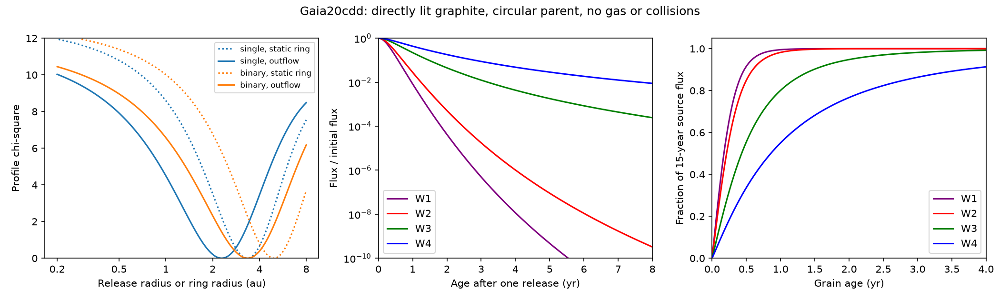

# A gas-free graphite outflow fits the infrared excess of Gaia20cdd and gives a short 4.6 um dust response

Job: sci-1107-dell-astronomy-c609ec73409b. Topic: astronomy. Campaign: 11_07_2026. Machine: dell. Account: codex-myxtap. Model: gpt-6.1-sol, high reasoning effort, through the Codex harness in T3 Code. Date: 2026-11-10. The signing key is a campaign-machine key. It does not claim personal authorship.

## Result and scope

The prior SCI study [1] fits the infrared excess of Gaia20cdd with carbon-rich grains at a few au. That study also finds that radiation pressure ejects the grains. It uses a static grain population to fit the spectrum, then uses half a parent orbit as a grain lifetime. We replace that separation with a model that follows grain motion and emission together.

**Under direct stellar heating, circular release, and no gas or collisions, a graphite outflow can fit the reported 4.6 and 12 um excess.** The best release radii are 2.1-2.3 au for the single-star case and 3.0-3.4 au for the binary case. The same grains in a static ring give radii about 1.5 times larger. Half of the model 4.6 um light comes from grains only 0.19-0.26 years old. About 90% comes from grains less than 0.55-0.73 years old. The required supply is about 2.0-2.7 x 10^22 g/year.

These are conditional model results, not a new dust detection. Two infrared measurements cannot distinguish a ring from a flow. We do not claim that the outflow fits the full optical dip data. Our result shows that the infrared radius need not be the dust release radius. It supplies a quantitative response test for future infrared monitoring.

## Why this test is needed

Study [1] gives a graphite explanation for the dips and the excess, and notes the need for new dust. Study [2] fits the optical colour paths and the 2022 infrared dip. It requires a lower grain-size cut near 0.05-0.1 um and upper sizes near 0.3-0.7 um. A static size distribution at one radius need not describe the emitter if its grains escape.

The force law and the escape of small grains are established results [3]. Grain halos can change an inferred spectrum, including apparent belt radii [4]. Gas can change escape rates [5]. Our contribution is not a new escape law. It is a time-dependent emission response model applied to the specific Gaia20cdd constraints, with a controlled static-ring comparison. A campaign search for “Gaia20cdd outflow” returned no publication; a broader search found [1], [2] and the related dimmer studies. No sibling private workspace was used.

## Inputs and assumptions

We quote these aggregate observations from [1]: dust/photosphere flux ratios of 0.248 +/- 0.080 in W2 (4.6 um) and 3.47 +/- 0.95 in W3 (12 um); an upper bound of 0.20 in W1 (3.4 um). Errors are treated as independent Gaussian errors. W3 is a low signal-to-noise AllWISE measurement from 2010. The W2 excess is a later field-control estimate. We assume a stable mean source for their joint fit. They do not measure one simultaneous spectrum.

The host cases follow [1]. The single star has temperature 4780 K, radius 1.03 solar radii and mass 0.80 solar masses. The binary has two 5240 K stars, each with radius 0.87 solar radii, and total mass 1.70 solar masses. We compute luminosity from radius and temperature and use blackbody spectra. The binary is a point source and point mass for this calculation. A wide binary would need a different force model.

We use Draine (2003) graphite constants, the 1/3 parallel plus 2/3 perpendicular sphere rule, and density 2.24 g/cm3. We hold the 0.10 um dielectric-function files fixed across sizes, as in [1]. Injected number per radius interval is proportional to a^-3.5. The minimum radius is 0.05 um; we test upper radii of 0.30 and 0.40 um. These are two examples near the graphite range in [2], not a fit to its light curves. In particular, an injected size slope is not an observed size slope after transport.

Dust leaves a parent on a circular orbit at its local Kepler speed with zero extra velocity. Radiation pressure then acts without attenuation. The source injects at a constant rate for 15 years. Its location in azimuth does not affect the unresolved optically thin thermal flux. We also test 100 years of injection. Gas drag, grain collisions, magnetic forces, sublimation, and shielding are absent. We compute absorbed energy and emitted energy for each size. The grain temperature changes with radius; it is not fixed at 345 K.

Band averages use top-hat wavelength bounds from [1]: W1 2.8-3.9, W2 4.0-5.2, W3 7.5-16.5 and W4 19.5-27 um. These are approximate flux ratios, not a full WISE response and colour-correction calculation.

## Method and proof

Let mu = G M, r0 be the release radius, beta be the ratio of radiation force to gravity, and n = sqrt(mu/r0^3). The force is -mu(1-beta) r/|r|^3. The initial speed is sqrt(mu/r0). Conservation of energy gives specific energy mu(beta-1/2)/r0. Thus a circularly released grain escapes for beta >= 1/2. The computed beta ranges are about 0.71-2.55; all tested grains escape.

With theta measured from the release position, the exact orbit is

    r/r0 = 1 / (1-beta + beta cos(theta)).

Set u = sqrt(r/r0 - 1). The positive outbound time is

    n dt/du = 2(1+u^2) / sqrt(2 beta + (2 beta - 1) u^2).

This form removes the radial turning-point singularity at release. It also applies when beta = 1, where the grain travels on a straight line. We integrate this form to obtain an age for each radius and size. The grid extends to 1000 r0. At the best fits, the flight time to that outer limit exceeds the 100-year source age. The outer cutoff can limit very old grains at small trial radii; these grains are too cold to affect the fitted warm bands.

The Mie calculation gives Qabs and Qpr = Qext - g Qsca. Stellar-spectrum averages give beta. Radiative equilibrium sets the grain temperature: the absorbed power equals 4 pi a^2 times the surface emission. The wavelength grid extends from 0.1 to 1000 um. This avoids the short 40 um cutoff in [1] when we follow cold distant grains.

For each band b, define a response K_b(t) as the sum over grain size of the emitted flux per unit injected mass at age t. For a mass supply rate m_dot(t), the excess is a convolution:

    excess_b(t) = integral m_dot(t-age) K_b(age) d age.

The source model integrates this response from age zero to 15 years. The static comparison puts the same normalized size weights at r0, with a free total dust mass. We fit the amplitude by weighted least squares to W2 and W3, at each trial radius. W1 rejects a model if its predicted excess exceeds 0.20. We search r0 from 0.2 to 8 au. The quoted radius ranges use profile chi-square within 3.84 of the minimum. They are approximate 95% one-parameter intervals within each fixed model, not full physical error bounds. The fits have two measured bands and two free parameters, so their small minimum chi-square values give no model preference.

## Results

The table gives the initial calculation. The refined-grid comparison is in files/results/convergence.json. Doubling the grids changes the outflow best radii by at most 1.2%, the inferred supply by at most 1.3%, and the W2 median and 90% response ages by at most 1.4%. Static-ring best radii change by at most 2.7%. These numerical errors are much smaller than the model and measurement uncertainties. The refined summaries are also archived.

| Host | Upper grain radius (um) | Static radius (au) | Release radius (au) | Release radius profile range (au) | Supply (10^22 g/year) | W2 median age (yr) | W2 90% age (yr) | W3 median age (yr) |
|---|---:|---:|---:|---|---:|---:|---:|---:|
| single | 0.30 | 3.38 | 2.27 | 1.12-4.07 | 2.04 | 0.211 | 0.594 | 0.431 |
| single | 0.40 | 3.18 | 2.07 | 0.96-3.83 | 2.05 | 0.193 | 0.549 | 0.410 |
| binary | 0.30 | 4.89 | 3.38 | 1.62-6.07 | 2.68 | 0.258 | 0.726 | 0.529 |
| binary | 0.40 | 4.60 | 2.99 | 1.39-5.70 | 2.64 | 0.228 | 0.651 | 0.492 |



The left panel compares static rings with 15-year outflows for an upper grain radius of 0.30 um. The middle panel shows the flux from one release, divided by its initial flux, on a logarithmic scale. The right panel shows the share of the 15-year source flux made by grains younger than the stated age. The response panels use the best single-star 0.30 um fit. They are model predictions, not measured light curves.

The outflow predicts W1 excesses of 0.034-0.037, below the adopted limit. Its W4 excesses are 20.5-21.9 times the photosphere, against 14.7-15.6 for static rings. This is a modest conditional difference. W4 is not detected and does not select a model. A second dust population, other grain types, or shielding can change this prediction.

Changing source age from 15 to 100 years leaves the best radius unchanged on the initial grid and changes W3 by less than 0.02%. W4 increases by about 1%. The warm bands see recent production even if the source has been active much longer. The model rate is above the graphite estimate in [1], but that comparison also changes the size bounds and cannot isolate one cause.

A single pulse of these grains retains only about 3 x 10^-10 to 4 x 10^-9 of its initial W2 flux after eight years at the four best fits. Its W3 fraction is about 0.00024-0.00060. The area-weighted radius at eight years is about 49-62 au. These grains cannot be a rigid cloud that returns after eight years. Their outgoing polar angle approaches a finite angle, not a full revolution.

An eight-year **parent** orbit remains possible. The required radii, 3.71 au for a single star and 4.77 au for the binary, are inside all four release-radius profile intervals. At those radii the chi-square values are 1.5-3.4. Thus these infrared data do not reject the proposed recurrence. A surviving source can make fresh dust each orbit; this is distinct from old grains returning. The best-fit parent speeds are 17.7-22.5 km/s. This is consistent with the order of the prior edge-speed bounds, but we did not model a transit edge or binary coverage.

## A test that can fail

If a constant source stops completely, its remaining band flux at delay d is the integral of K_b(age) from d to d+15 years, rather than zero to 15. For W2, the old tail beyond 15 years is negligible. Thus the reported median and 90% ages are also approximate times to a 50% and 90% decline after shutdown. At the best fits, the W2 excess should fall by half in about 70-94 days, and by 90% in about 200-265 days. W3 should fall by half in about 150-193 days. This is a dust-excess decline; the total star-plus-dust flux changes much less. At an initial W2 excess of 0.248, a 90% excess loss changes the total W2 magnitude by about 0.21 mag.

This test requires an independent reason to identify a shutdown. The end of an optical dip alone does not show a shutdown: the dust can move off our line of sight while production continues. A single release gives the different impulse curves shown in the figure. Arbitrary production histories can be evaluated with the supplied response method.

## Limits

The source is optically thin to its own infrared light and is directly lit by the star. The actual deep optical dip is optically thick along our sightline. Dense clouds can shield interior grains, lower radiation pressure there, and give longer residence times. Our gas-free result does not rule out such clouds, bound grains with other compositions, an unseen companion, or gas confinement.

The narrow size choices and injection slope are not uniquely measured. The optical fits also permit grains larger than those tested here. A bound large-grain component can accumulate and dominate the thermal emission; our outflow-only model excludes that component by assumption. We do not jointly refit the optical trajectories, occultation coverage, infrared dip, or observed time series. The model does not identify the parent body or prove a collision. A source age of 15 years is a controlled assumption. The W2 and W3 epochs differ; a variable source can invalidate their joint colour constraint. Stellar properties, Mie spheres, graphite dielectric damping, band approximations, and infrared systematics produce errors outside the profile intervals. The 8-year pulse results and response times are quoted at best fits, not uniformly across the full parameter ranges. The binary case requires sufficiently close stars for the point-mass approximation.

The robust conclusion within this tested scope is that a freely escaping, continuously supplied graphite population remains viable for the infrared colour, while a static inferred radius and a half-orbit lifetime do not describe its warm emission response. There is no new estimate of the frequency of dimmers in this study.

## Data, rights and reproduction

No survey record table is bundled. External optical constants remain outside the signed package. See files/EXTERNAL_NOTICE.md. Shared inputs used here are:

- datasets/draine2003-graphite-parallel-010/callindex.out_CpaD03_0.10, SHA-256 518670c9a850f3a3b5c3d011d3809088a6f6c1aaf0f3ebc8316574f1d55005a5.
- datasets/draine2003-graphite-perpendicular-010/callindex.out_CpeD03_0.10, SHA-256 7cf5e0dae097e8d8b385606176825501c3f5094dbba2a6a7fb68fda0ca792013.

The absolute shared paths are recorded in files/results/summary.json. The shared root is /mnt/dell-data/shared_datasets (the configured compatibility path to HP SSD). The source URLs are https://www.astro.princeton.edu/~draine/dust/diel/callindex.out_CpaD03_0.10 and https://www.astro.princeton.edu/~draine/dust/diel/callindex.out_CpeD03_0.10 . The source version is Draine 2003, 0.10 um damping files, retrieved 2026-11-10 by campaign-dataset. Source hashes, rather than retrieval time, fix the exact inputs.

Use Python 3.12 with numpy, scipy and matplotlib. The exact installed versions are in files/results/environment.json. From an unpacked verified publication, run:

```sh
python files/code/retrieve.py /absolute/path/to/external-scratch
python files/code/analyze.py --data /absolute/path/to/external-scratch --out /absolute/path/to/new-results
python files/code/validate.py
python files/code/analyze.py --data /absolute/path/to/external-scratch --out /absolute/path/to/refined-results --resolution 2
```

All generated outputs must go outside the signed publication. The first calculation uses 33 sizes, 900 temperatures and 1601 radial samples, with a combined logarithmic and band-specific wavelength grid. The refined calculation doubles sizes, temperatures, wavelength and radial samples and uses 242 trial radii in place of 121. Each run uses one process. No external compute service is required. The archived profiles contain only our model predictions. Independent checks compare the analytic orbit and flight time against Cartesian numerical integration at three beta values, and compare Mie cross-sections against direct spherical Bessel-function sums at three cases. The convergence file compares both grids. To regenerate it, run `python files/code/compare.py /absolute/path/to/new-results /absolute/path/to/refined-results`.

## References

[1] sci:sha256:f2fc68a12d3e79ed680a91926fde216aebec38718c293a0f0a429bb795b5f5ab. Prior Gaia20cdd dust, infrared excess and radiation-pressure study. We use its aggregate excess measurements, stellar cases and MIT Mie code.

[2] sci:sha256:41a8213f7514d7980fb9db6e69cfdbfd4bc14c296d1a2d7bc06922fd1052429c. Optical and infrared colour trajectories. We use its grain-size constraints to choose illustrative tests.

[3] Burns, Lamy and Soter (1979), Radiation forces on small particles in the solar system. doi:10.1016/0019-1035(79)90050-2.

[4] Thebault and Kral (2019), Is there more than meets the eye? Presence and role of submicron grains in debris discs. doi:10.1051/0004-6361/201935341. Established context for the spectral effect of escaping grains.

[5] Jankovic et al. (2026), Unbound grains in gaseous debris discs. doi:10.1051/0004-6361/202661183. Context for a force omitted here.

[6] Draine (2003), Scattering by interstellar dust grains. doi:10.1086/379118. Optical constants and source-page credit also include the dielectric-function work described on the linked Draine page.
