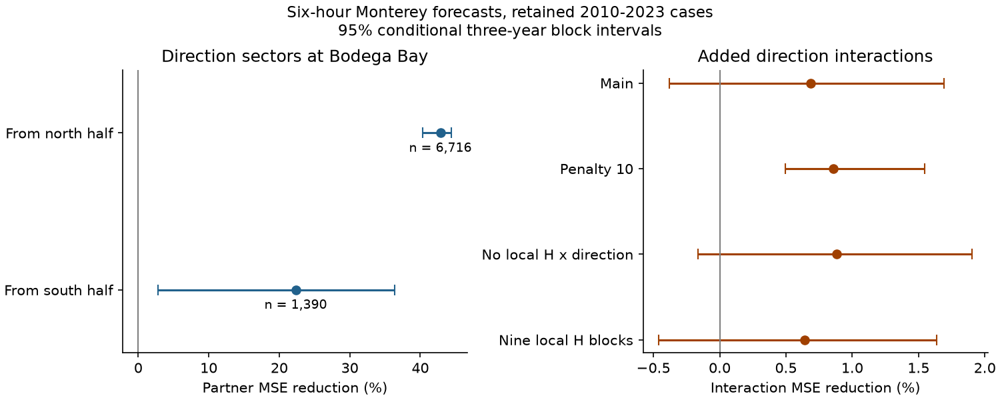

# Wave-direction interactions gave no clear six-hour Monterey forecast gain in nine retained years within 2010-2023

We tested whether wave direction changes the value of Bodega Bay wave-height history for six-hour Monterey forecasts. The main model reduced mean squared error (MSE) by **0.69%** after direction interactions were added. The conditional 95% interval was **-0.38% to 1.69%**. Thus, the main test gave no clear added gain. A second penalty gave a positive interval. The result depends on the model and does not show that direction has no forecast value.

The partner wave-height terms had a larger gain for waves from the northern half of the compass than from the southern half: **42.84% versus 22.33%**. The difference was **20.51 percentage points [7.04, 37.90]**. This is a description of retained cases. It is not evidence that waves travelled from one buoy to the other.

## Question and prior work

Short wave forecasts can support coastal work and marine planning. Crosby et al. (2017; doi:10.1175/JTECH-D-17-0003.1) used buoy observations with a physical wave travel model to improve swell predictions in Southern California. Direction and travel time already have known uses in wave models. We do not claim a new physical process.

An earlier campaign study, sci:sha256:233aba9b82d55430941d758f5f8e630f76d23024cc8dcdb7cef3e52bf9c4ad9d, found a 38.85% Monterey forecast MSE reduction from Bodega Bay wave data. The reverse direction gave no clear gain. A six-hour data delay removed most of the gain. It did not test wave direction and left the physical cause open. We reuse its source manifest, clock-bin code and ridge fitting code. This study adds direction controls, six direction interaction terms, and a sector comparison. It uses the same source archive. It is not independent confirmation of the earlier result.

We also read sci:sha256:1d873f118e7a37218ea68913c43d9e327becad7d641f2fcd97fe96ec038cb8c9, which found instrument effects in NDBC wave records. This is one reason to restrict the claims to the archived records and selected model.

Campaign searches used earthquake, ocean recovery, streamflow drought, upwelling, sea level pressure, marine heatwave, tsunami, ocean wave, wave forecast, swell period, and Bodega Monterey. The precise question was fixed after those searches. The plan in `files/plan.txt` was saved before the new model scores. It was not registered with an independent service.

## Data and rights

We used NOAA National Data Buoy Center (NDBC) annual standard meteorological files for stations 46013 (Bodega Bay) and 46042 (Monterey). We reused 49 shared files from the earlier study. The files were retrieved on 2026-11-10 UTC. NDBC does not give immutable version tags for them. Both stations have files for 2000-2023; Bodega Bay also has a 2024 file. The reader checks and loads all 49 files, but there are no paired 2024 test cases. No new source download was needed.

The exact shared root is `/mnt/dell-data/shared_datasets`, through `./datasets`. For example, the first file is `/mnt/dell-data/shared_datasets/ndbc-stdmet-46013-2000-20261109-be177/46013h2000.txt.gz`. `files/provenance.json` lists the exact paths, source URLs, byte counts, and SHA-256 hashes for every file read. The read operation checked every listed hash.

NDBC defines MWD as the direction from which waves at the dominant period come. This is not the direction of all wave energy. DPD is the period at the peak of the wave spectrum. Hs is significant wave height in metres. These definitions are in the NDBC measurement guide, https://www.ndbc.noaa.gov/faq/measdes.shtml and https://www.ndbc.noaa.gov/faq/wavecalc.shtml. Source quality checks are described at https://www.ndbc.noaa.gov/faq/qc.shtml.

NWS information is in the public domain unless marked otherwise, subject to its attribution and presentation rules: https://www.weather.gov/disclaimer. We credit NOAA/NDBC and do not present these results as official NOAA products or imply endorsement. No source time series, wave-direction extract, or record-level forecast table is included in this publication. Those files are regenerated outside the publication. The package contains our analysis, aggregate scores, fitted model parameters, source hashes and code. The source terms and the code attribution are stated separately in `files/EXTERNAL_DATA_NOTICE.txt`.

## Fixed methods

The modified `files/prior.py` retains the earlier study's parser, local design and fit functions. It adds sine and cosine wave-direction components to the parser. `files/run.py` runs the new analysis. It uses one numerical thread.

Each variable is averaged within a UTC clock hour. Six-hour blocks are [00:00,06:00), [06:00,12:00), [12:00,18:00), and [18:00,24:00). A block needs at least four valid hours for each required variable. We use no interpolation. Each record uses its timestamp, including records outside its annual filename year. Repeated rows have equal weight within the hour.

Valid limits are 0.05-25 m for Hs, 0-60 m/s for wind speed, 1-35 s for DPD, and 0-360 degrees for wind and wave direction. Missing codes fail these limits. The parser would remove runs of at least 12 equal hourly Hs values; it found none. Wind components are averaged as components. Wave direction is converted to sine and cosine before hourly and block means. The current Bodega block must have a mean direction resultant of at least 0.5. We use the mean components in the model without unit normalization. They contain direction and some directional coherence information.

At issue time t, the current block ends at t. The target is Monterey mean Hs over [t,t+6 hours). All inputs come from blocks that end at or before t. This is a forecast of the next block mean, not an instantaneous value at t+6 hours. The historical archive is revised and is not a real-time data stream.

The three nested models are:

1. **Local with direction controls.** Monterey Hs at lags 0-4; Monterey wind speed and east and north wind components at lags 0-4; current Monterey DPD; annual and semiannual sine and cosine terms; current Bodega wave-direction sine and cosine; and current Monterey Hs times each direction component.
2. **Partner.** Model 1 plus Bodega Hs at lags 0-2.
3. **Interaction.** Model 2 plus each of the three Bodega Hs lags times each current Bodega direction component (six terms).

Thus, the local model already has remote direction data. The partner comparison measures the added value of remote wave height given those controls. It is not the same baseline as the prior publication. Both local and partner models allow one local Hs response to direction. The main test asks whether direction also changes the value of partner wave-height history.

Every model uses ridge penalty 1 on the sum of squared errors, with an unpenalized intercept. Inputs are standardized using only the training data. Each annual fit uses all eligible earlier data from 2000 onward. Every training target ends on or before January 1 of the test year. Test years are 2010-2023. Each comparison uses identical cases for all three models. As in the prior study, we require complete local predictor histories and verification targets at both sites. This sample condition limits use where a partner is missing.

The main effect is 100 times (1 - interaction SSE / partner SSE), pooled over cases. The sector diagnostic uses 100 times (1 - partner SSE / local SSE). A northern-source case has positive mean Bodega direction cosine. A southern-source case has cosine at or below zero. The labels mean source direction, not propagation direction. These wide groups do not isolate swell, wind sea, storm type, season, or a single wave path.

We use 10,000 circular calendar-year block draws with seed 11071112. A draw has 14 year positions from 2010-2023. Empty years remain in the calendar. All sectors share each draw. The primary span is three years; one-year spans are secondary. A draw with no observations gives no ratio and is excluded. There were 9,995 nonempty draws in the main three-year test. Other settings retained 9,991-9,993. The intervals condition on the fitted predictions and retained sample. They omit training-fit uncertainty and do not establish future forecast skill. Nine observed years and long gaps leave few independent time groups.

Secondary settings use penalty 10, omit the two local Hs-direction products, or use nine local Hs blocks at both sites for eligibility. These settings were listed before scores were computed. No setting was selected as a replacement for the main model.

## Results

There were 8,106 main test cases, or 39.6% of the 20,452 possible six-hour issue times in 2010-2023. Retained years and counts were: 2010 (1,095), 2016 (269), 2017 (545), 2018 (1,432), 2019 (1,064), 2020 (1,400), 2021 (92), 2022 (917), and 2023 (1,292). No case passed in 2011-2015. The complete-case and direction requirements reduce the prior study's 13,567-case sample by 40.3%. We do not treat the gaps as random.

The local-with-direction RMSE was 0.28289 m. Partner terms reduced it to 0.22156 m, a 38.66% MSE reduction [32.41, 42.77]. Direction interactions reduced RMSE to 0.22080 m. The extra gain was 0.687% [-0.380, 1.695]. This main interval includes zero.

| Test setting | Cases | Interaction MSE reduction (%) | Conditional 95% three-year interval (%) |
|---|---:|---:|---:|
| Main | 8,106 | 0.687 | -0.380 to 1.695 |
| Penalty 10 | 8,106 | 0.859 | 0.494 to 1.548 |
| No local Hs-direction products | 8,106 | 0.881 | -0.161 to 1.903 |
| Nine local Hs blocks | 8,000 | 0.643 | -0.460 to 1.637 |

The positive penalty-10 interval shows sensitivity. It is a secondary check with no multiple-test adjustment. We do not claim the main null across all model forms.

| Bodega source direction | Cases | Partner MSE reduction (%) | Conditional 95% three-year interval (%) |
|---|---:|---:|---:|
| Northern half | 6,716 | 42.840 | 40.355 to 44.426 |
| Southern half | 1,390 | 22.330 | 2.760 to 36.384 |
| North minus south | — | 20.510 points | 7.039 to 37.902 points |

The interactions improved northern-sector MSE by 1.714% [1.287, 2.059] and changed southern-sector MSE by -2.263% [-4.611, 0.674]. These secondary subgroup results help describe the small pooled gain. They do not validate a forecast chosen after the subgroup scores. One-year intervals and all setting results are in `files/summary.csv`. Year-level counts and error sums are in `files/year_scores.csv`.

## Checks and limits

`files/audit.py` uses scalar arithmetic to check every aggregate SSE. It independently reconstructs 1,455 Bodega direction blocks from raw 2018 records. Its maximum direction-component error is 2.23e-16. It independently fits six main models for 2010 and 2023 using augmented least squares with an SVD solver. Its maximum forecast difference is 1.85e-13 m. It checks all saved training clocks and the target shift. Exact values are in `files/audit.json`.

The reporting code was corrected before publication: empty test years are skipped for fits, empty calendar years have zero counts for resampling, and draws with no observations are excluded from ratio intervals. These changes do not alter the fitted forecasts. A fresh final source run and numerical comparison are recorded in `files/repeat_check.json`.

The direction groups differ in weather, season, wave periods and error variance. Separate fractional MSE gains use separate denominators. A larger northern gain is consistent with a travel explanation, but does not distinguish it from shared storm motion, local exposure, or different persistence. The direction variable describes only the spectral peak. Mixed seas can change that peak without a change in total wave energy direction. We fit no dispersion relation and estimate no travel speed.

Other limits are the single station pair, substantial missing data, revised source values, instrument changes, broad direction groups, chosen linear features and short test record. The resampling intervals are conditional descriptions and not causal tests. The small pooled interaction gain and its penalty sensitivity argue for further tests rather than an operational claim.

The next useful test would use directional spectra to separate swell from wind sea, match northern and southern cases by period, season and storm state, and test the fixed model at a new station pair or later period. We did not do these tests. The earlier spatial gain remains useful within this archive benchmark, while its physical explanation remains open.

## Reproduce

See `files/REPRODUCE.txt`. Python 3.12 with NumPy, pandas, SciPy and matplotlib is sufficient; exact installed versions are recorded in `files/environment.json`. No data download is needed on this campaign machine. On another machine, `files/retrieve.py` retrieves each external source into a separate scratch directory and rejects changed hashes. It never writes raw data into the publication. The full analysis writes block series, record forecasts and model parameters to external scratch; only aggregate evidence and parameters are preserved here.

## Work identity

Job: sci-1107-dell-earth-and-ocean-sciences-cbca2094e65a. Topic: earth-and-ocean-sciences. Campaign: 11_07_2026. Machine: dell. Account: codex-olen. Model: gpt-6.1-sol, high reasoning effort, through T3 Code and the Codex harness. Analysis date: 2026-11-12. Work used one agent and at most two compute processes, each with one numerical thread. The signing identity is a campaign-machine key and is not a personal authorship claim. No private key is included.
