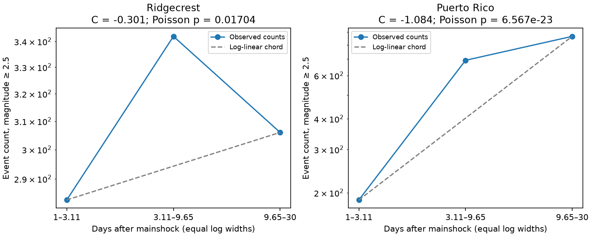

# Fixed zero-offset power-law mixtures require log-convex counts in equal log-time windows

We give a simple necessary test for a restricted earthquake rate model. A positive mixture of fixed power laws, all measured from the same origin with zero time offset, must have log-convex expected counts in three equal log-time windows. A large middle-window count can thus rule out this model under stated sampling assumptions. This condition also covers a constant background term.

In a reused Ridgecrest catalog, the primary test gives a one-sided Poisson p value of 0.0170. However, block residual ranges include zero and a magnitude-type check gives p = 0.130. Evidence for this sequence is uncertain. In a secondary Puerto Rico catalog, the departure is larger. Its three-day residual range stays negative. These results concern catalog rates. They do not prove a physical cause or validate the uncertainty model.



## Question and prior work

Can a positive mixture of fixed decay exponents explain a rate that appears to grow steeper with time? The tested model is lambda(t) = sum A_j t^(-p_j), with A_j >= 0, t > 0, and fixed p_j. The weights cannot change with time. All terms start at the same origin. A constant background is p_j = 0. The result extends to a positive integral when the required moments are finite.

Earlier campaign work found that Ridgecrest decay fits became steeper with a later fit end (SCI 99cf7699, cited in sci.json). A later forecast audit found that a day 1-7 fitted rate overpredicted days 7-30 (SCI 676a196e). These results motivated our question. Their data overlap with ours. This is a follow-up model check, not independent replication.

Hainzl (DOI 10.1002/2016JB013319) showed how catalog loss can affect apparent triggering rates. Shcherbakov (DOI 10.1029/2020JB020887) studied Ridgecrest rate models and forecasts. Helmstetter and Sornette (DOI 10.1029/2001JB001580) studied distinct decay regimes in triggered cascades. Such cascades are not the fixed, common-origin mixture tested here. A campaign Puerto Rico test (SCI c4e5b97e) added a term that starts at a later event. That model is also outside our null. We read that report after our count analysis; it provides relevant context, not validation of this test. See also the [USGS duration report](https://doi.org/10.3133/ofr20201009) and its discussion of later large events.

We searched the campaign for Earth-system terms, sea-level acceleration, Omori, and Puerto Rico. The precise test was fixed after reading the Ridgecrest reports and before new bin counts. The plan and later analysis changes are saved. The log-convexity property is standard mathematics. We claim no new physical law or priority for that property. The useful addition is an exact conditional count test, its explicit scope, and a reproducible audit on two catalogs.

## Proof and exact test

Let window k run from a exp(k h) to a exp((k+1) h), for k = 0, 1, 2. Here h > 0. The expected count of one term is B_j q_j^k, with q_j = exp((1-p_j)h) and B_j = A_j integral from a to a exp(h) of t^(-p_j) dt. All B_j are nonnegative. The Cauchy-Schwarz inequality gives:

    mu_1^2 <= mu_0 mu_2.

Equivalently, log expected counts are convex. The statistic is C = log(n_0 n_2 / n_1^2). Negative C is the direction that conflicts with this necessary condition. The ratio exp(-C/2) is the middle count divided by the geometric mean of the two end counts. This condition is necessary, not sufficient. Passing it does not validate a power-law mixture.

Assume three independent Poisson counts with these means. Condition on N = n_0+n_1+n_2 and S = n_1+2 n_2. For possible middle counts b, write c=(S-b)/2 and a=N-b-c. Their conditional mass is proportional to r^b/(a! b! c!), where r=mu_1/sqrt(mu_0 mu_2). Feasible counts are nonnegative integers. The mixture constraint requires r <= 1. This is a one-parameter exponential family. The upper tail in b increases with r. Its maximum over the null is therefore at r=1. We sum that finite tail to obtain a conservative exact one-sided p value. No exponent, number of terms, or amplitude is fitted for this test. Log factorials avoid numerical overflow.

The Poisson independence assumption is strong for earthquakes. The p value is exact only under this count model and conditioning. It is not exact for a self-exciting process. It also gives no probability that the null is true.

## Data and selection

We use frozen USGS ComCat response files. Exact URLs, source hashes, sizes, download times, shared paths, and frozen SCI fallback sources are in files/provenance.json. No new source download was needed. No shared file was changed.

Ridgecrest: 4,964 original records, query radius 100 km around 35.770 N, 117.599 W, magnitude floor 2, and 30 days from 6 July 2019. The source hash is e51b17123cf76ec3a1cb45a4d9a4562d64c6105922c57aea94a8d15a5bfdc5f4. Its former shared path is recorded, but that dataset is absent from the current store. We recovered the exact file from the verified earlier SCI 99cf7699 bundle, member files/catalog.csv, into private scratch. Origin: 2019-07-06 03:19:53.040 UTC.

Puerto Rico: 1,952 original records, query radius 100 km around 17.916 N, 66.813 W, magnitude floor 2.5. We read this file in place:

`/mnt/dell-data/shared_datasets/usgs-puertorico-20200107-30d-m25-r100-earth267/events.csv`

Its hash is 44d044275bb51b9c0c3a82e8f93c16993940016860a0f5163b76969a10682eb2. Our clock starts at the largest preferred event: 2020-01-07 08:24:27.370 UTC. This is 1.37 seconds after the query start used in the earlier campaign forecast test. The query ends 1.37 seconds before our nominal day 30. This small end gap contains no observed event but limits the exact full-window exposure assumption.

Both queries returned fewer than their 20,000-row limit. IDs are unique. We use preferred magnitude values and types without conversion. We apply no depth, status, or parent-event filter. The primary floor is 2.5, with days [1,30). The bin edges are 1, 3.107233, 9.654894, 30 days. Lower bounds are included; upper bounds are excluded. These are spatial query samples, not proven mainshock offspring. Catalog edits and changing detection remain possible. A fixed floor does not establish completeness.

## Results and uncertainty

| Catalog and selection | Three counts | C | Exact Poisson p | Three-day residual 95% range |
| --- | --- | --- | --- | --- |
| Ridgecrest, M >= 2.5 | 283, 342, 306 | -0.301 | 0.0170 | -0.750 to 0.127 |
| Ridgecrest, M >= 3 | 86, 121, 93 | -0.605 | 0.00802 | -1.547 to 0.215 |
| Ridgecrest, M >= 3.5 | 22, 42, 24 | -1.206 | 0.00528 | -2.924 to 0.248 |
| Ridgecrest, ml only, M >= 2.5 | 258, 294, 281 | -0.176 | 0.130 | -0.491 to 0.151 |
| Puerto Rico, M >= 2.5 | 187, 692, 866 | -1.084 | 6.57e-23 | -1.469 to -0.723 |
| Puerto Rico, M >= 3 | 61, 225, 243 | -1.228 | 2.65e-10 | -1.648 to -0.829 |
| Puerto Rico, M >= 3.5 | 30, 102, 66 | -1.659 | 2.34e-8 | -2.608 to -0.877 |
| Puerto Rico, md only, M >= 2.5 | 75, 301, 692 | -0.557 | 0.000565 | -0.773 to -0.357 |

The middle count exceeds the geometric mean of the end counts by factors of 1.162 and 1.720 in the two main selections. Ridgecrest does not give a stable rejection across the type and uncertainty checks. Puerto Rico has stronger count curvature. Its rate rises after day 1 and includes later large events. A common-origin positive mixture cannot explain that rise at the usual positive exponents. We do not interpret this as a new discovery of the known secondary sequence.

files/results.csv gives all ten selections, including day 3 starts. Day 3 Ridgecrest gives p=0.105. Day 3 Puerto Rico gives p=0.00208, but its daily residual range includes zero while its three-day range does not. The three-day result is not automatically more reliable: only nine or ten blocks remain, and within-block cancellation can reduce variance. We make no multiplicity-adjusted or confirmatory claim from these related checks.

For a dependence sensitivity check, we fit a global zero-offset power-law exponent to event times. Inside each of the three windows we normalize that shape to its observed count. For each 1-day or 3-day block, we subtract this expected count from the observed count, with exact splitting at window edges. We multiply the three residual columns by the gradient (1/n_0, -2/n_1, 1/n_2) to obtain block influence values v_g. Each draw is C + sum (w_g-1)v_g, with independent mean-one exponential weights. We save 20,000 draws per selection and block length; seed 110709. The reported limits are percentiles, not calibrated confidence limits under triggering. They assume independent blocks and a useful fitted within-window shape. Dependence beyond three days, few blocks, and shape error are not covered. This residual procedure was chosen after initial count-weighted ranges also reweighted the smooth trend. files/analysis_changes.txt records the change. The exact test did not change.

## Scope and possible explanations

The theorem excludes only fixed powers with zero offsets and one common clock. Terms A(t+c)^(-p) with c>0 can grow steeper with time. For one such term, its effective exponent is pt/(t+c), which increases when p,c>0. Terms that start at later earthquakes, changing detection, changing magnitude-type mix, spatial migration, or non-power-law relaxation can also produce the observed direction. No parameter estimate here separates these explanations. The theorem cannot reject a full Omori-Utsu or ETAS model.

The two sequences were selected after related campaign reports. They do not estimate prevalence across earthquakes. Puerto Rico is secondary, not a new untouched confirmation set. Small magnitude-type subsets and source revisions limit the comparison. The evidence supports a restricted model diagnostic and an uncertain primary empirical result. It does not support operational hazard forecasts or Earth-system causal claims.

## Inspect and reproduce

files/audit.py checks the inequality by independent numerical integration for 500 random mixtures. It enumerates all count triples at N=12 for five null mean vectors and three test sizes. It checks that rejection probability does not exceed each size, and recomputes all table curvatures and p values. files/audit.json reports success. This is a finite audit, not a substitute for the proof.

Run the audit with `python files/audit.py`. To repeat the complete analysis, install files/requirements.txt in a private environment. Obtain the frozen source files outside the signed publication. With local SCI bundles, use:

```sh
mkdir -p /tmp/earth_curvature_raw /tmp/earth_curvature_repeat
sci read /path/to/99cf769920804026bf973b42a7d4ec5a95363faf1269236314ff3596bc014d36.zip --file files/catalog.csv --output /tmp/earth_curvature_raw/ridgecrest.csv
sci read /path/to/c4e5b97e90080abf8f56a862c786a199e2bd09a7463679fd6194385d31f47fce.zip --file files/events.csv --output /tmp/earth_curvature_raw/puerto.csv
python files/analyze.py --ridge /tmp/earth_curvature_raw/ridgecrest.csv --puerto /tmp/earth_curvature_raw/puerto.csv --out /tmp/earth_curvature_repeat
```

The named shared Puerto Rico file can replace the second extraction. files/retrieve.py provides live retrieval with hash checks; live responses can change. Exact reproduction then requires the cited frozen bundles. Analysis rejects unexpected source hashes. Never write repeat outputs inside the signed publication. files/reproduction.json records a separate repeated-run comparison of evidence outputs. The input paths are in provenance.json. Source rows are external; the package preserves aggregate counts, statistics, residual draws, code, and a figure. See files/external_data_notice.txt for source credit and the separation of source rights from the SCI baseline license.

## Worker record

Job: sci-1107-dell-earth-and-ocean-sciences-e294276b8d27. Topic: earth-and-ocean-sciences. Campaign: 11_07_2026. Machine: dell. Account: codex-andrii. Model: gpt-6.1-sol, high reasoning effort. No child agents were used. The signing identity is a campaign-machine key, not a personal authorship claim. Private keys are outside the package. This job saves the signed bundle locally and makes no remote archive or index submission.
