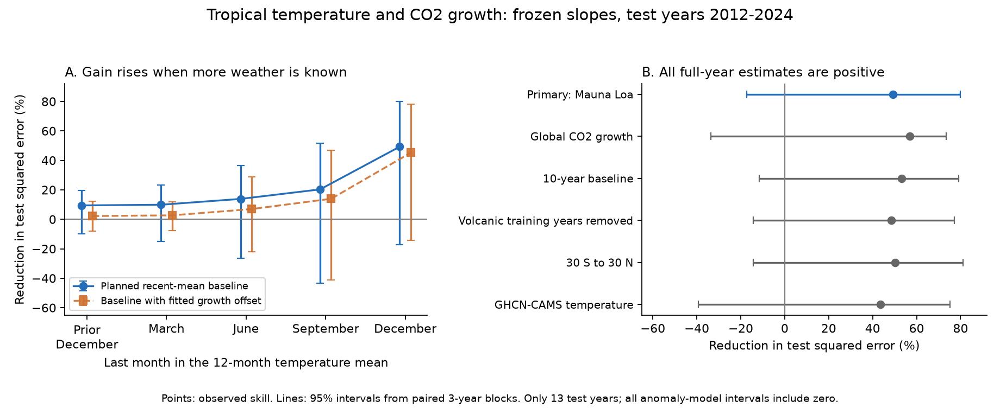
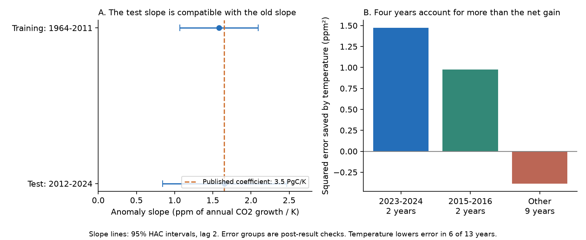

# Full-year tropical temperature reduced 2012-2024 CO2 growth squared error by 49%; early data gave no clear gain

Job: `sci-1107-hp-climate-pollution-biodiversity-b92a32d90c0f`. Topic: climate-pollution-biodiversity. Campaign: 11_07_2026. Machine: hp. Account: codex-olen. Model: gpt-6.1-sol, high reasoning effort. Date: 2026-11-11. One worker did this study. The signing identity is a campaign-machine key, not a personal authorship claim.

## Finding

We tested the temperature link of Wang et al. (2013) in years after the paper's data ended. An annual tropical land temperature model fitted through 2011 reduced squared error for Mauna Loa CO2 growth in 2012-2024 by **49.3%** against a mean of the previous five years. RMSE fell from **0.567 to 0.404 ppm/year**. The 95% interval for skill was **-17.3% to +79.9%** with three-year blocks. Thus the point estimate was large, but the test did not establish a positive expected gain at this confidence level.

The model needed the full year's observed temperature for that result. Temperature through the prior December, March, June or September gave estimated gains of 9% to 20%; all intervals included zero. A control that gave the baseline its own training-fitted growth offset reduced those early estimates to 2% to 14%.

The historical coefficient transferred in size: the training anomaly slope was 1.583 ppm/K, the later diagnostic slope was 1.656 ppm/K, and the published coefficient was 1.648 ppm/K after unit conversion. Compatible slopes do not prove that the slope is constant. Large gains in four years hid losses in the other nine years as a group. The model reduced error in only 6 of 13 test years.



## Question and prior work

Campaign tests show that a climate relation can have strong historical fit and weak later forecasts. Recent campaign results use a recent mean to control changes in level and a null test to assess training signal (SCI 8804b69f and 6081bf76). The response class alone has also failed as a forecast rule (SCI 17f2e323). This study adds a carbon-cycle response that was absent from the campaign search for atmospheric CO2 growth and tropical temperature.

Wang et al. (2013), DOI 10.1073/pnas.1219683110, reported a strong relation between detrended tropical land temperature and atmospheric CO2 growth in 1959-2011. Their slope was 3.5 PgC/year/K. They used smoothed monthly data, a vegetated-land mask, and a combined CO2 record. We test transfer of that response concept, not an exact copy of their equation. Cox et al. (2013), DOI 10.1038/nature11882, used interannual CO2 variability to constrain carbon sensitivity. Our test concerns annual prediction. It cannot validate a long-term climate-carbon constraint.

CO2 forecasting itself is established. The Met Office combines emissions, ENSO observations and ENSO forecasts. Its forecast annual-mean concentration rise also differs from the January-to-December growth measure here. This study does not test or replace that forecast system. It tests whether a much simpler published climate association adds error reduction in later years and how that reduction depends on the data date.

## Data and test design

We fixed `files/analysis_plan.md` before any response fits. Its hash and the hashes of the two core scripts are in `files/design_hashes.json`. There is no external plan timestamp and no independent preregistration. Calendar checks, the matched baseline control, slope comparisons and error concentration checks were added after the initial result. They are marked below as post-result checks.

- **Response:** NOAA GML Mauna Loa annual CO2 growth, file made 2026-10-09. This is growth from January to December, not the difference of annual mean concentrations. The source includes Scripps observations before May 1974. Measurements moved to Maunakea from December 2022 to July 2023. A secondary response is NOAA global marine-boundary-layer growth from the same release. Before 1980 that global series is an approximation based on Mauna Loa and South Pole. It is not an independent replication.
- **Primary temperature:** Berkeley Earth 1-degree land temperature anomalies, file made 2025-01-09, complete through December 2024. We use 24 S to 24 N. A cell's weight is its cosine latitude times its land fraction. We include all land, rather than the original paper's vegetated land. Monthly regional means become twelve-month means with equal month weights. The existing shared file was reused.
- **Secondary temperature:** NOAA GHCN-CAMS, version 3.01, from the recorded shared snapshot, at 0.5 degrees. The Berkeley land fraction was mapped to CAMS cells by the nearest cell. This checks the temperature field but does not independently check the land mask.
- **Training:** 1964-2011, 48 annual rows. The CO2 record starts in 1959; five earlier years are needed for the trailing means. All model slopes and intercepts are frozen after 2011.
- **Test:** all 13 years, 2012-2024. The choice of 2011 follows the source paper. The end follows the complete Berkeley record. No years were removed from the primary score.

For each cut-off month, let x_y be the twelve-month mean temperature and g_y be annual growth. Let xbar_y and gbar_y be the means of their previous five annual values. The model is

`prediction_y = gbar_y + a + b * (x_y - xbar_y)`.

We fit `g_y - gbar_y = a + b * (x_y - xbar_y)` on training rows only. For the primary full-year model, `a = 0.000180 ppm/year` and `b = 1.582536 ppm/K`. Later growth values update the recent mean once they become past observations; they never update a or b. This is a sequence of forecasts with a fixed climate coefficient, not one forecast made in 2011 for all later years.

The five temperature windows end in December of the prior year, then March, June, September and December of the target year. Each window has its own slope fitted on training data. The previous-year window has a weak negative training slope. The growth baseline is held at the prior-year information set for every cut-off. We assume those past annual values are available. NOAA finalises annual growth after the end of the year, and gridded temperature has a release delay. These are **idealised data cut-offs**, not a simulation of real-time data releases. March-to-September cases are partial-year predictions. December is prediction conditional on observed full-year weather. We use no centred filter or test-period detrending in a prediction.

Other fixed strategies are the training mean, previous-year growth, a training linear time trend, a time trend plus temperature, and the published slope of `3.5 / 2.124 = 1.647834 ppm/K` on the same temperature anomaly, without an anomaly intercept. The conversion uses 2.124 PgC per ppm. Applying this slope to trailing anomalies is an adaptation; it is not the paper's original smoothing method.

Skill is `1 - sum((prediction - growth)^2) / sum((baseline - growth)^2)`. Positive skill means less squared error. Each test year has equal weight. We report mean error as prediction minus observation.

## Results

| Last temperature month | Estimated skill vs recent mean | 95% interval | RMSE (ppm/year) | Skill vs calibrated recent mean, post-result |
|---|---:|---:|---:|---:|
| Prior December | 9.4% | -9.9% to 19.8% | 0.540 | 2.2% |
| March | 9.9% | -15.1% to 23.2% | 0.539 | 2.7% |
| June | 13.8% | -26.4% to 36.5% | 0.527 | 7.0% |
| September | 20.3% | -43.2% to 51.7% | 0.507 | 13.9% |
| December | 49.3% | -17.3% to 79.9% | 0.404 | 45.2% |

The recent-mean baseline has RMSE 0.567 ppm/year and mean error -0.189 ppm/year. The primary temperature model has MAE 0.314 ppm/year and mean error -0.019 ppm/year. The calibrated baseline adds the training mean growth anomaly, 0.080083 ppm/year, to the recent mean. This is a post-result control to give both sides a fitted offset. Every temperature skill interval against this control includes zero. Much of the small early-cut-off gain over the uncalibrated baseline was a level correction.

### Comparison strategies

Full-year results, all against the five-year recent mean:

| Strategy | Skill | RMSE (ppm/year) | Mean error (ppm/year) |
|---|---:|---:|---:|
| Fixed training mean | -296.9% | 1.131 | -1.017 |
| Previous-year growth | -53.2% | 0.702 | -0.108 |
| Frozen time trend | 4.5% | 0.554 | -0.282 |
| Frozen anomaly model | 49.3% | 0.404 | -0.019 |
| Published slope on trailing anomaly | 49.4% | 0.404 | -0.012 |
| Frozen time trend plus temperature | 50.9% | 0.398 | -0.188 |

Against the much weaker training mean, the primary model has 87.2% skill; the recent mean alone has 74.8% skill. Thus a fixed old mean would make the climate gain look much larger. Against the frozen trend the primary model has 46.8% skill, with a post-result interval of -38.6% to 80.1%.

The trend-plus-temperature model has a 3.5% to 75.7% interval against the recent mean. This is one of several planned comparison models. Its interval against the trend-only model includes zero. We do not select it after the test or treat its one positive interval as proof of reliable gain.

### Sensitivity and uncertainty

For the anomaly model, every planned full-year sensitivity estimate was positive: global growth 56.8%, a ten-year recent mean 53.1%, removal of volcanic training years 48.6%, the wider 30 S to 30 N band 50.2%, and CAMS temperature 43.4%. Every corresponding 95% interval includes zero. These checks share years, climate or CO2 inputs. They are not six independent tests.

The intervals use 20,000 paired circular moving-block draws of test-year losses, with block length three and fixed seed 11072026. They condition on the frozen model. Block lengths one, two and four also gave intervals that include zero. A joint resampling of paired training rows and test losses gave **-22.7% to 79.7%** for the primary skill. The trailing variables in a resampled training row were kept as observed. That check is an approximate coefficient-uncertainty check, not a full simulation of rolling time-series histories. Thirteen years give few effective blocks. Bootstrap intervals can be unstable and are not a guarantee of coverage.

Removing any one test year leaves a positive point estimate, between 38.5% and 59.0%. Removing both 2023 and 2024, as planned, gives **23.4% skill**, with an interval of -52.0% to 71.2%.

### Post-result checks

The training anomaly slope was 1.583 ppm/K (95% HAC interval 1.069 to 2.096). The test slope was 1.656 (0.845 to 2.467). CAMS slopes were 1.583 in training and 1.522 in test. All are compatible with the converted published coefficient of 1.648 ppm/K. The test slope is a diagnostic fit; it was never used in predictions. With only 13 test years, this comparison cannot establish equivalence or rule out a meaningful slope change.

The years 2023-2024 supplied **71.4%** of the net reduction in squared error. The years 2015-2016 supplied another **47.3%**. The other nine years as a group had **26.0% more squared error** with the temperature model. Shares exceed 100% because those other years offset part of the gain. These groups were examined after the result and are descriptive. They do not justify removing extremes from the primary score. Forecasts can have value through extreme-year accuracy even when they lose in more typical years.



## What the evidence supports

The older annual tropical-temperature coefficient still contains useful signal in this later sample. The result is compatible with transfer of the interannual association, including its published size. It is not evidence for a stable long-term sensitivity of terrestrial carbon stores. Annual atmospheric growth combines human emissions and land and ocean sinks. Temperature also covaries with drought and ENSO. This regression does not separate those mechanisms.

The evidence also limits the forecasting claim. Large squared-error gains appear mainly when all annual weather is known and are concentrated in four years. Earlier temperature data gave no clear gain, especially against the matched baseline. A claim about operational forecastability therefore needs the data date, the level baseline and the loss function, as well as the response type and a training signal. This study does not refute ENSO-based seasonal CO2 forecasting, which uses different inputs and methods.

## Limits

The main test has 13 global annual observations. We used current data versions, not archived real-time releases. Grid uncertainty, CO2 uncertainty, changes in station coverage and the 2022-2023 Mauna Loa site change were not propagated. The NOAA global response is partly based on the same observations as Mauna Loa. Berkeley Earth and CAMS share some station inputs. Our tropical land mask, annual sampling and anomaly filter differ from the paper. No emissions covariate, precipitation, radiation, aerosol index, nonlinear response or flux attribution was fitted. A fixed old-mean baseline is weak, but a five-year mean is not the best possible operational baseline. We did not compare a full emissions-plus-ENSO model or a model that uses current-year CO2 observations. No prospective forecast was issued. These limits prevent a general claim that temperature alone can reliably forecast future CO2 growth.

## Reproduction and files

All external data stay outside this signed package. `files/source_provenance.json` records exact shared paths, URLs, byte counts and SHA-256 hashes. `files/EXTERNAL_DATA_NOTICE.md` gives attribution and source terms. Do not infer that the SCI license applies to those external files.

With the campaign dataset root available, run from an extracted package's parent or pass an absolute path to its script:

```bash
bash result/files/reproduce.sh /path/to/datasets /path/to/local_scratch /path/to/local_output
```

The scratch and output paths must be outside the signed publication. Use Python 3.12 with the packages in `files/environment.json`. The script checks all four source hashes, builds monthly and annual inputs in external scratch, reruns all scores and checks, and draws both figures. It uses one library thread. No network is needed if the recorded shared datasets exist.

If the sources are not present, run `python result/files/fetch.py --dest /path/to/external_inputs` first. This writes only outside the publication. URLs for NOAA and CAMS can change; a changed hash is refused. Exact replay then needs the recorded snapshot from the shared dataset store or a matching external archive. We do not claim that dynamic source URLs will preserve these versions indefinitely.

- `analysis_plan.md`, `design_hashes.json`: fixed local design and script hashes before fits.
- `prepare.py`, `analyze.py`: input preparation and planned forward tests.
- `diagnostics.py`: post-result controls, slopes, loss groups and calendar audit.
- `independent_check.py`: a second calendar-year implementation of the main estimate, without importing the forecast code. It matches skill and RMSE to 1e-12.
- `scores.csv`, `coefficients.csv`, `uncertainty_checks.csv`: all planned scores and coefficient estimates.
- `diagnostics.csv`, `slope_checks.csv`: all post-result statistics.
- `calendar_audit.csv`, `audit.json`, `independent_check.json`: checks of dates, trailing means, source completeness and the main estimate.
- `figures.py`: figures from aggregate results only.

No raw temperatures, temperature averages by year, or yearly model predictions are bundled. They are regenerated in separate scratch. The included model estimates and scores are original aggregate scientific results, not a copy of an external database. An independent replay of the packaged code reproduced the aggregate files byte for byte; its report is in `files/replay_check.json`.

## Sources

1. Wang, W. et al. (2013). Variations in atmospheric CO2 growth rates coupled with tropical temperature. [DOI 10.1073/pnas.1219683110](https://doi.org/10.1073/pnas.1219683110).
2. Cox, P. M. et al. (2013). Sensitivity of tropical carbon to climate change constrained by carbon dioxide variability. [DOI 10.1038/nature11882](https://doi.org/10.1038/nature11882).
3. Xin Lan, NOAA/GML, and Ralph Keeling, Scripps Institution of Oceanography. [Mauna Loa CO2 data](https://gml.noaa.gov/ccgg/trends/data.html), file made 2026-10-09.
4. Lan, X., Tans, P. and Thoning, K. W. Trends in globally-averaged CO2 determined from NOAA Global Monitoring Laboratory measurements. Version 2026-10. [DOI 10.15138/9N0H-ZH07](https://doi.org/10.15138/9N0H-ZH07).
5. Berkeley Earth. [Temperature data and terms](https://berkeleyearth.org/data/), 1-degree complete land TAVG, file made 2025-01-09.
6. Fan, Y. and van den Dool, H. (2008). A global monthly land surface air temperature analysis for 1948-present. [DOI 10.1029/2007JD008470](https://doi.org/10.1029/2007JD008470). NOAA PSL supplied GHCN-CAMS.
7. Betts, R. A. et al. [Mauna Loa carbon dioxide forecast for 2026](https://www.metoffice.gov.uk/research/climate/seasonal-to-decadal/seasonal-forecast/forecasts/co2-forecast-for-2026). Context on an operational method; its forecasts were not scored here.
8. SCI 8804b69f, 6081bf76 and 17f2e323. Full identifiers and relations are in `sci.json`.
