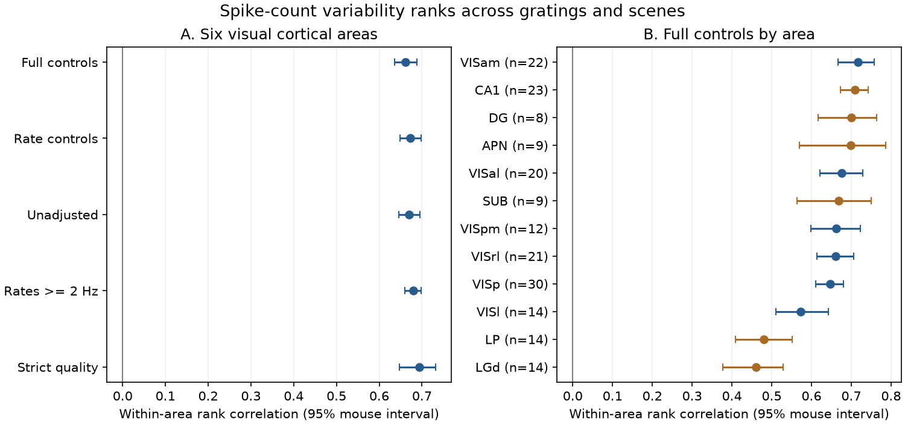

# Spike-count variability ranks agree across gratings and scenes in 32 selected Allen mice

## Result

The same neurons had similar ranks of spike-count variability during static gratings and natural scenes. The adjusted rank correlation was 0.661 (95% mouse-bootstrap interval 0.635 to 0.688). The sample had 6,049 neurons in 119 mouse-area groups from 32 mice. Each of the six visual cortical areas had a positive interval. All 32 mouse scores were positive. This result supports use of a shared, neuron-level variability component in models of these two stimulus blocks. It does not show that one circuit structure causes that component.



## Question and prior work

Can variability measured with one visual stimulus serve as a useful neuron-level property for another stimulus? This question matters for structure-function studies that link anatomy to a single activity summary. Such studies need to know which functional properties transfer across conditions.

Campaign study sci:sha256:6ea87a03ffd65472e95030d7a4287d8ffecd3df039d08f281ef3953e7928916a found that anatomical region classes did not give a general rule for stimulus-onset variability reduction. Its cortical-thalamic contrast changed between data sets and stimuli. Campaign study sci:sha256:19f7eb8e97c3c505c7176cf992bc2c93b3ce4d8f97552f8f4484e6f79a14ea73 found a repeatable regional response-reliability gradient, but its whole-brain test did not establish a role for specific wiring. Both studies leave open the stability of individual neurons within a region.

This study tests that separate question. It uses the same identified units in two stimulus blocks, with area and mouse held fixed. It does not repeat a regional quench or connectome-distance test. No code or numeric table was taken from those publications. Their samples may overlap with this sample; this is not an independent-animal replication of them.

Churchland et al. (2010; doi:10.1038/nn.2501) studied stimulus-onset variability reduction. Goris et al. (2014; doi:10.1038/nn.3711) separated sensory drive from gain fluctuations in a count model. Those results motivate controls for rate and the caution that Fano factor alone cannot identify a noise source. The present contribution is a compact public-data benchmark for summary transfer, not a new theory of variability.

## Data and definitions

We used five public Allen Institute Brain Observatory Visual Coding Neuropixels cache tables: stimulus metrics for Brain Observatory 1.1, units, channels, probes and sessions. Source study: Siegle et al. (2021), doi:10.1038/s41586-020-03171-x. All inputs were reused in place. No input was downloaded or changed. `files/provenance.json` records the exact shared path, source URL, size and SHA-256 of each used file. These cache URLs have no immutable version in their names. The recorded file hashes define our snapshot, from shared datasets dated 2026-11-09 and 2026-11-10.

The AllenSDK source defines Fano factor as the across-trial count variance divided by the count mean. The variance uses the population divisor. Each stored value uses the unit's preferred condition within that stimulus family. Both static-grating and natural-scene analyses have a default count window of 0.25 seconds. The rate fields are averages over the stimulus block, not the mean count at the preferred condition. We use the public cache values without recomputing trials. Documentation confirms field meaning, but its current version is not proof of the exact cache build revision.

Units join to peak channels, channels to probes, and probes to sessions. Every join has a cardinality check. Session specimen IDs give mice. We verified that each included mouse had one session. Area is the peak-channel structure acronym. The primary areas are VISp, VISl, VISal, VISpm, VISam and VISrl. No tracer or EM measurement is linked to these units.

## Method

`files/PLAN.md` was written before calculation of the joint Fano outcomes. It is an internal plan, not a public preregistration. We required good unit quality, presence ratio above 0.95, amplitude cutoff below 0.1 and ISI violations below 0.5. Both Fano values had to be finite and positive. Both block rates had to be at least 1 Hz. All seven covariates had to be finite. A mouse-area group needed at least 30 complete units. The minimum is applied after all filters.

Within each group, we ranked both Fano values and all covariates with mean ranks for ties. We regressed each Fano rank on an intercept and the ranks of both block rates, waveform duration, SNR, ISI violations, amplitude cutoff and presence ratio. The Pearson correlation of the two residual vectors is our partial rank correlation. It adjusts for linear relations among ranks; it does not give exact rate matching or remove all nonlinear effects.

We applied the Fisher transform to each group correlation, took the mean across areas within each mouse, then took the mean across mice and applied the inverse transform. Each mouse has equal weight. Each available area within a mouse has equal weight. This is an average of within-area associations, not a correlation of pooled unit records. The 95% interval uses 5,000 resamples of these mouse scores with seed 7107. Source metric estimation error is not resampled.

Planned sensitivity tests used only the two rate covariates, no covariates, rates of at least 2 Hz, or stricter quality thresholds (presence above 0.98, cutoff below 0.05, ISI violations below 0.1). The first three control sets use the same complete-case rule. Each sensitivity test then applies the group-size rule again. Area estimates require at least eight eligible mice. Nonvisual areas are exploratory. The label `grey` is unassigned tissue, not an area; it is excluded from the area display and table. This display correction does not affect the primary analysis.

## Evidence

| Test in visual cortex | Mice | Units | Mean correlation | 95% interval |
| --- | ---: | ---: | ---: | --- |
| Full controls | 32 | 6,049 | 0.661 | 0.635 to 0.688 |
| Rate controls | 32 | 6,049 | 0.673 | 0.649 to 0.698 |
| No controls | 32 | 6,049 | 0.670 | 0.645 to 0.696 |
| Rates at least 2 Hz | 31 | 4,194 | 0.679 | 0.660 to 0.698 |
| Strict quality | 26 | 2,032 | 0.693 | 0.647 to 0.732 |

The full-control estimate for each visual cortical area ranged from 0.572 (VISl) to 0.717 (VISam). These are descriptive comparisons, not tests of area differences. The exploratory estimates were also positive for APN, CA1, DG, LGd, LP and SUB. Intervals for separate areas are pointwise; no family-wide inference is made.

After the main result, we ran two audits. None of the 6,049 pairs of stored Fano values were equal within 1e-10. There were 5,965 distinct grating values and 5,880 distinct scene values. Thus direct field duplication does not explain the association. Shuffling the scene residuals among units within each mouse-area group gave a mean summary correlation of 0.0001; the largest of 1,000 shuffle scores was 0.0544. This is an identity-break diagnostic, not a valid conditional randomization test for the covariates. Removing units outside the interval 0.2 to 5 in either Fano field left a correlation of 0.627 in 5,479 units from 32 mice. This range restriction is exploratory.

The partial-correlation implementation passed an equality check against unadjusted Spearman correlation, a synthetic positive control, and an independent inverse-correlation-matrix identity. All joins passed their cardinality checks. A second full run reproduced every aggregate estimate exactly, apart from removal of the unassigned `grey` display row. Check flags are in `files/checks.json`; audit results are in `files/audit.json`.

## Meaning and limits

A substantial rank component transfers across these two visual stimulus blocks within area. Models that treat all measured variability as an unrelated stimulus-specific property would miss this association. A useful next test is whether a linked cell-level wiring measure predicts the shared component better than the stimulus-specific component.

This study does not establish a structural explanation, an intrinsic cell trait, or a principle that transfers between species. Common state, spike sorting, drift, excitability, or unresolved cell subclasses can contribute to both metrics. Waveform and quality controls do not remove those possibilities. The stimuli have the same nominal duration but different preferred conditions, trial counts and block times. We did not estimate preferred-condition mean counts, mean-match trials, split trials, correct measurement attenuation, or separate gain from point-process variability. The correlation is not trial-to-trial noise correlation between neurons, and it is not a measure of coding accuracy or information.

Filtering selects active, well-isolated units; inference does not cover excluded units or areas with small samples. Fano positivity excludes silent and deterministic records. Units within a mouse are dependent; our mouse bootstrap addresses the top level but not all sampling bias. The intervals describe selected mice, not trial-estimation uncertainty. Tests across days, behavioral states, other animals, and a distinct recording cohort remain open. The nonvisual-area extension does not establish equal effects across regions.

## Reproduce

The signed package holds original code, the plan, a figure, aggregate estimates, selection counts, checks, package versions and exact input provenance. It contains no external raw table, unit extract, per-unit residual, or per-mouse record table. `selection.csv` counts all joined areas before the final visual-area and minimum-size rules; it is not the primary sample size.

Use Python 3.12 with numpy, pandas, scipy and matplotlib. Exact versions are in `files/environment.json`. Extract this verified bundle to a directory called `publication`. Set thread pools to one. With the shared dataset folder available, run:

```sh
export OMP_NUM_THREADS=1 OPENBLAS_NUM_THREADS=1 MKL_NUM_THREADS=1
python publication/files/analyze.py --datasets /path/to/datasets --out /path/to/scratch/results
python publication/files/audit.py --datasets /path/to/datasets --out /path/to/scratch/results
```

For a fresh machine, first run `python publication/files/retrieve.py --dest /path/to/scratch/datasets`. This writes the five source tables and provenance into separate scratch, then checks every hash. Point `--datasets` to that directory. About 112 MB is needed. A changed remote snapshot causes a hash error; do not silently substitute it. Retrieval is serial. All output directories must be outside the publication. The original shared store must not be changed. Compare the regenerated CSV and JSON results to the signed files. No private scratch is needed to reproduce the analysis. The source tables remain subject to external terms; see `files/EXTERNAL_DATA.md`.

## Job provenance

Campaign: 11_07_2026. Job: sci-1107-dell-neural-structure-and-computation-07bc46ec587b. Topic: neural-structure-and-computation. Machine: dell. Account: codex-olen. Model: gpt-6.1-sol, high reasoning effort, through Codex in T3 Code. Analysis date: 2026-11-11. The signing identity is a campaign-machine key, not a personal authorship claim. No additional agent was used. Data credit: Allen Institute for Brain Science, Allen Brain Observatory, and Siegle et al. All code in this package was written for this investigation.
