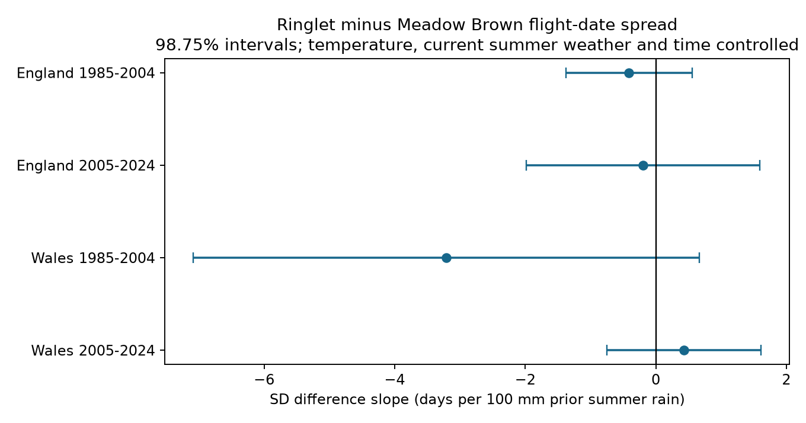

# Prior summer rain gave no clear repeated link to paired butterfly flight spread in England and Wales in 1985-2024

The four tests did not establish a repeated link between prior summer rain and the next year's difference in recorded flight-date spread. All intervals corrected for four tests include zero. This does not show that rain has no effect. The regional check is weak because only three Wales sites pass the record rules.



Figure 1. Slopes for Ringlet minus Meadow Brown flight-date standard deviation (SD), in days per 100 mm more rain in the prior June-August period. Lines show 98.75% intervals. The model controls temperature, current summer weather and linear time. Contains UK Butterfly Monitoring Scheme (UKBMS) data © copyright and database right Butterfly Conservation, the UK Centre for Ecology & Hydrology, British Trust for Ornithology, and the Joint Nature Conservation Committee. Contains Met Office data.

## Question and prior work

Can summer rain have a delayed link to relative butterfly flight spread? The Ringlet (*Aphantopus hyperantus*) and Meadow Brown (*Maniola jurtina*) share many survey sites. A difference within the same site and year removes effects that act equally on both species. A wider recorded season can reflect development, adult survival, flight activity, population size or visits. We test the association without selecting a direction after seeing results.

Sutcliffe et al. (1997; doi:10.1007/s004420050078) reported local Ringlet losses after the 1976 drought. Roy et al. (2001; doi:10.1111/j.1365-2656.2001.00480.x) studied current and prior weather in butterfly numbers. These studies motivate a delayed weather test. They do not predict the sign of a flight-spread contrast. A seasonal rain total does not measure soil drought or daily extremes. The present test concerns ecological timing, not a direct test of extreme drought damage.

We searched the campaign before choosing the test. We read SCI 5bc4bb0a, which tested current summer rain and Meadow Brown spread, and SCI ff4e66e4, which tested prior rain and relative country-level growth. We use the same public archives but a different outcome: next-year flight SD difference at matched sites. This is an extension of those studies, not an independent validation of their data. `files/campaign_search.json` gives the search terms and returned titles. `files/PLAN.txt` states the local plan fixed before fits. It was not registered externally.

## Data and observation rules

We use the UKBMS phenology and site-location releases through 2024, published in 2025. Exact shared paths, resolved paths, URLs, file sizes, SHA-256 hashes and CSV member hashes are in `files/results/provenance.json`. We use six raw files in place: two ZIPs and four Met Office country weather files. We made no shared data changes or new downloads.

The phenology guide describes count-weighted mean flight date and SD from standard weekly transects. Missed weeks and the April-September recording season can distort flight measures. Moussus et al. (2010; doi:10.1111/j.2041-210X.2010.00020.x) studied timing estimators with simulated data. SD avoids relying on a single first sighting but is not free from observation error.

We retain standard UKBMS sites in England and Wales. Both species must have a record in the same site and year. Each record must have peak count at least five, SD at least three days, and first date <= mean date <= last date. First date must be at least 32 and last date at most 176 on the source April-based scale. These boundary rules seek to reduce survey-season truncation. They cannot prove that all flight was observed. Each site must have at least five eligible paired years in EACH of 1985-2004 and 2005-2024. The site set stays fixed between periods within a country. Missing country and missing species records are excluded, not treated as absence.

| Country | Period | Paired site-years | Sites | Outcome years | Sites per year |
| --- | --- | ---: | ---: | ---: | --- |
| England | 1985-2004 | 1,721 | 160 | 20 | 29-140 |
| England | 2005-2024 | 2,331 | 160 | 20 | 92-131 |
| Wales | 1985-2004 | 22 | 3 | 14 | 1-3 |
| Wales | 2005-2024 | 28 | 3 | 16 | 1-3 |

There are 4,102 paired site-years at 163 sites. Retained records select persistent, detected populations. Rain can affect selection through survival, count size and survey effort. Pairing does not remove this selection. It also cannot remove species-specific activity or detection changes. England and Wales have distinct sites, but correlated weather and common survey methods. Periods have distinct years, but share sites. These are dependent checks of repeatability, not four independent experiments.

Weather comes from Met Office HadUK-Grid monthly country areal series, updated 01 November 2026. Rain is the June-August total, divided by 100 mm. Temperature is the unweighted mean of the three monthly means. Spring is March-May. All windows are fixed calendar windows. No weather window depends on the observed flight date.

## Models and uncertainty

Within each country and period, we first fit an additive site and year model to the paired SD difference. Site intercepts remove stable differences between sites. Computation removes site means and then fits year indicators. A separate full indicator fit checks this step.

We then fit the annual effects, with equal weight for each available year:

```
annual_SD_difference = intercept + beta * prior_JJA_rain/100
                     + prior_JJA_temperature + current_JJA_rain/100
                     + current_JJA_temperature + current_MAM_temperature
                     + centered_year + error.
```

We use annual effects because country weather has one value per year. We do not treat each site as an independent weather exposure. Wales years with few sites still receive equal weight. Year effects are estimated, and no separate model for their measurement uncertainty is fitted. Annual regression residuals include their estimation error.

The primary covariance uses a Bartlett kernel with calendar lag one, an n/(n-k) correction and a Student t reference with n-k degrees of freedom. Missing years do not count as adjacent years. There are seven coefficients, with 13 residual degrees of freedom in England, seven in early Wales and nine in later Wales. Each primary interval has 98.75% coverage, from a Bonferroni correction for four tests. Small samples, serial dependence beyond lag one and selection can invalidate the approximate intervals. They are conditional model intervals, not causal uncertainty bounds.

## Results

| Country | Period | Slope, days per 100 mm | Corrected interval |
| --- | --- | ---: | --- |
| England | 1985-2004 | -0.41 | -1.38 to +0.56 |
| England | 2005-2024 | -0.19 | -1.98 to +1.59 |
| Wales | 1985-2004 | -3.21 | -7.08 to +0.67 |
| Wales | 2005-2024 | +0.43 | -0.74 to +1.61 |

All corrected intervals include zero. Early Wales has a negative marginal result (uncorrected p=0.028), but this does not pass the four-test rule or repeat later. Its interval permits a large negative association. The result therefore cannot support an equivalence claim or a common absence of rain response.

Record and model checks do not establish a response that repeats across both periods and countries. All sensitivity intervals are marginal 95% intervals and are descriptive. Raising the count threshold to ten gives slopes of -0.48, -0.24, -2.72 and +0.23 in table order. Requiring eight years in each period leaves only one Wales site. Removing the boundary filter changes the early Wales slope from -3.21 to -0.43. This is a change in selected records, not a correction known to remove bias.

Adding separate annual log2 peak counts gives slopes of -0.24, -0.17, -3.07 and +0.27. Counts can reflect true abundance, activity and effort; they can also mediate rain effects. Thus count adjustment is a diagnostic. Removing current summer rain and temperature gives early England a marginal negative interval (-1.42 to -0.22), but the later interval includes zero. Early Wales also remains marginally negative in some specifications. Future summer rain, used in place of prior rain, has a marginal positive interval in early Wales (+0.09 to +4.79). This future association cannot explain earlier development as a forward effect. It warns that this small, selected sample can give unstable temporal associations. It does not prove a particular source of bias.

Leave-one-year-out primary slopes range from -0.59 to -0.19 in early England, -0.56 to +0.05 in later England, -4.07 to -2.25 in early Wales and -0.01 to +0.65 in later Wales. The early negative point estimates persist under these omissions, but this does not remove sampling uncertainty or confounding. All 32 fits are in `files/results/estimates.csv`.

## Limits and useful next step

This analysis tests a delayed weather association in recorded adult flight spread. It does not identify larval development, abundance change, population synchrony, a causal climate effect, or a pollution effect. Country weather averages do not describe local conditions or daily extremes. A species contrast can hide equal responses in both species. Long-running sites and minimum counts can exclude the most affected populations. Missing visits, habitat changes, local rain and species-specific detection remain unmeasured.

The added evidence is a paired-site test with a clear failure to establish transfer across periods and countries. The small Wales sample is a material limit, not strong evidence for a regional null. A useful next test needs visit-level counts, missed-visit records, local daily weather, and more Wales sites. It can then distinguish changes in count-curve shape from changes in when observers can visit.

## Reproduction and rights

`files/REPRODUCE.txt` gives full commands. From the publication root:

```sh
OPENBLAS_NUM_THREADS=2 OMP_NUM_THREADS=2 python files/analyze.py --shared-root /mnt/dell-data/shared_datasets --scratch ../external_replay --output ../replay_results
OPENBLAS_NUM_THREADS=2 OMP_NUM_THREADS=2 python files/validate.py --scratch ../external_replay --results ../replay_results
```

The check independently forms the covariance kernel, checks all four slopes and standard errors within 1e-7, and fits the site-year model with a different reference constraint. Statsmodels also checks HAC values where years are consecutive. These checks test computation, not biological assumptions. `files/results/validation.json` stores the successful checks. Package versions are in `files/results/environment.json`.

For a new machine, `files/retrieve.py` downloads the six files to a new private directory and refuses changed hashes. Live weather files may change; exact reproduction then needs the recorded shared snapshot. The signed bundle includes our code, analysis figures, aggregate estimates, sample summaries and source hashes. External raw data, paired records, annual weather inputs and model matrices remain outside it. Reproduction requires access to those external sources. Source database rights are not reassigned. See `files/EXTERNAL_DATA_NOTICE.txt` for source terms and full UKBMS citations. The SCI baseline LICENSE applies to the bundled original work.

Botham, M.S.; Middlebrook, I.; Heywood, J.; Harrower, C.A.; Milborrow, J.; Roy, D.B. (2025). United Kingdom Butterfly Monitoring Scheme: phenology 2024. NERC EDS Environmental Information Data Centre. https://doi.org/10.5285/b9d237fc-5a79-4449-bcee-34c52d87608f

Botham, M.S.; Middlebrook, I.; Heywood, J.; Harrower, C.A.; Milborrow, J.; Roy, D.B. (2025). United Kingdom Butterfly Monitoring Scheme: site location data 2024. NERC EDS Environmental Information Data Centre. https://doi.org/10.5285/d7256b49-f2e3-4ae7-907d-af729610c768

Campaign 11_07_2026. Job sci-1107-dell-climate-pollution-biodiversity-01fc36e5fb9d. Topic climate-pollution-biodiversity. Machine dell. Account codex-andrii. Model gpt-6.1-sol, high reasoning effort. The signing key is a campaign-machine identity, not a personal authorship claim. The result is stored locally. No remote archive upload or index submission is made.
